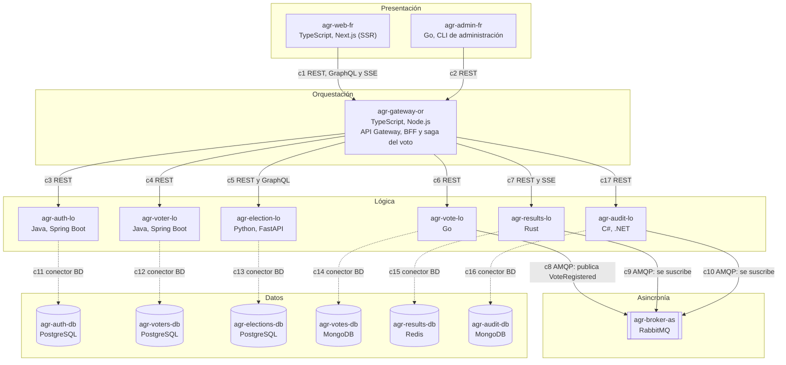
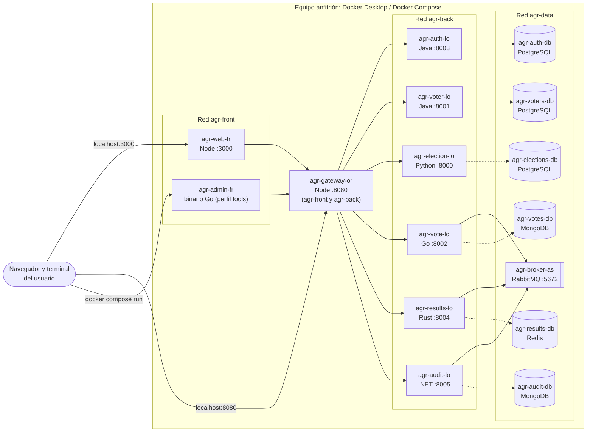
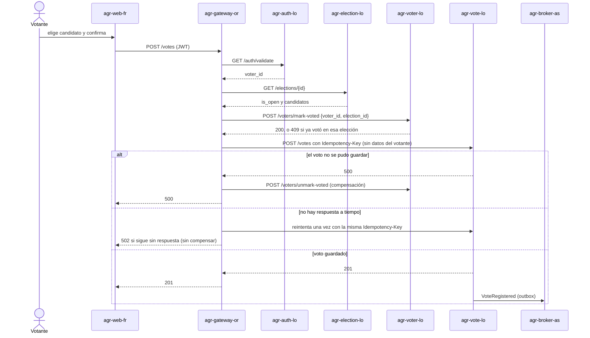
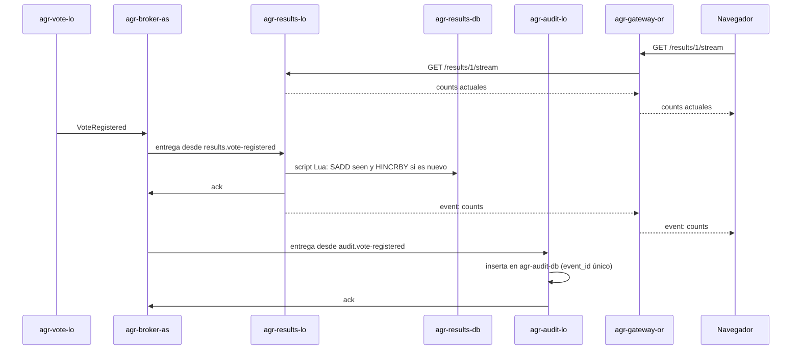

<p align="center">
  
</p>

# AGORA: sistema de votación electrónica (Prototipo 2)

Guía del equipo 1b para el segundo prototipo de Arquitectura de Software (UNAL, 2026-II, prof. Jeisson Andrés
Vergara Vargas).
- Entrega del artefacto: lunes 2 de noviembre de 2026, archivo `p2_1b.pdf` en MiCampus (lo sube un solo integrante).
  Se genera desde `artifacts/p2_1b.md`.
- Presentación en clase: martes 3 de noviembre de 2026.

## Contenido

1. [Componentes del Prototipo 2](#1-componentes-del-prototipo-2)
2. [Arquitectura](#2-arquitectura)
3. [Cómo ejecutarlo](#3-cómo-ejecutarlo)
4. [Cómo funciona cada componente](#4-cómo-funciona-cada-componente)
5. [Contratos entre componentes](#5-contratos-entre-componentes)
6. [Flujos completos](#6-flujos-completos)
7. [Cómo se cumplen los requisitos del enunciado](#7-cómo-se-cumplen-los-requisitos-del-enunciado)
8. [Variables de entorno](#8-variables-de-entorno)
9. [Límites conocidos](#9-límites-conocidos)
10. [Estructura del repositorio](#10-estructura-del-repositorio)

---

## 1. Componentes del Prototipo 2

AGORA permite listar elecciones con sus candidatos, autenticar votantes, registrar un voto anónimo (**una vez por
votante en cada elección**), ver los resultados en vivo y administrar elecciones desde una consola de comandos.

| Componente | Nivel | Lenguaje y herramientas | Origen | Responsable |
|---|---|---|---|---|
| `agr-web-fr` | Presentación | TypeScript, Next.js (SSR) | Del P1, se migra de React SPA a Next.js | Cristian |
| `agr-admin-fr` | Presentación | Go, Cobra (CLI) | Nuevo | Maicol |
| `agr-gateway-or` | Orquestación | TypeScript, Node.js | Nuevo | David |
| `agr-auth-lo` | Lógica | Java 21, Spring Boot, Spring Security, JWT | Nuevo (sale del login del Voter Service del P1) | Esteban |
| `agr-voter-lo` | Lógica | Java 21, Spring Boot | Del P1, cambia: ahora solo registra participación | Camilo |
| `agr-election-lo` | Lógica | Python, FastAPI, SQLAlchemy, Strawberry | Del P1, casi sin cambios | David |
| `agr-vote-lo` | Lógica | Go, `net/http`, MongoDB, AMQP | Del P1, cambia: ya no orquesta, publica eventos | Maicol |
| `agr-results-lo` | Lógica | Rust | Nuevo (los resultados salen del Vote Service) | Miguel |
| `agr-audit-lo` | Lógica | C#, .NET | Nuevo | Camilo |
| `agr-broker-as` | Asincronía | RabbitMQ | Nuevo | Maicol |
| `agr-auth-db` | Datos | PostgreSQL 16 | Nuevo | Esteban |
| `agr-voters-db` | Datos | PostgreSQL 16 | Del P1, cambia de tabla | Camilo |
| `agr-elections-db` | Datos | PostgreSQL 16 | Del P1, sin cambios | David |
| `agr-votes-db` | Datos | MongoDB 7 | Del P1, agrega campos | Maicol |
| `agr-results-db` | Datos | Redis 7 | Nuevo | Miguel |
| `agr-audit-db` | Datos | MongoDB 7 | Nuevo | Camilo |

**Qué cambia respecto al Prototipo 1:**

| Aspecto | Prototipo 1 | Prototipo 2 |
|---|---|---|
| Front-end web | SPA en React (SOFEA) | SSR con Next.js |
| Presentación | 1 componente | 2 (web y CLI de administración) |
| Lógica | 3 servicios | 6 servicios (uno por integrante) |
| Orquestación | Dentro de `agr-vote-lo` | Componente propio: `agr-gateway-or` |
| Asincronía | Ninguna | RabbitMQ y consumidores de eventos |
| Datos | 3 bases | 6 bases (PostgreSQL, MongoDB y Redis) |
| Conectores HTTP | REST y GraphQL | REST, GraphQL y SSE |
| Marca de "ya votó" | Una sola por votante (vota una vez en total) | Una por votante y elección |
| Resultados | Se calculan en cada consulta; botón "Actualizar" | Conteo incremental en Redis; se actualizan solos (SSE) |
| Administración | Swagger con una llave | CLI `agora` con la misma llave |
| Lo que ve el navegador | Tres servicios en tres puertos | Solo el web (3000) y el gateway (8080) |
| Lenguajes | Python, Java, Go, TypeScript | Python, Java, Go, TypeScript, Rust, C# |

## 2. Arquitectura

### 2.1 Vista de componentes y conectores



Los conectores c1 a c16 son los del entregable [`artifacts/p2_1b.md`](artifacts/p2_1b.md). El c17 (gateway a
auditoría) permite que la CLI consulte el registro de auditoría. Las líneas continuas son HTTP o AMQP; las
punteadas son conectores a bases de datos.

### 2.2 Estilos y patrones

| Estilo o patrón | Dónde | Qué significa aquí |
|---|---|---|
| Microservicios | Los 6 componentes de lógica | Cada servicio tiene un dueño, su propia base y se despliega por separado |
| Base de datos por servicio | Cada `-lo` con su `-db` | Ningún servicio lee la base de otro |
| API Gateway y Backend-for-Frontend | `agr-gateway-or` | Único punto de entrada para la web y la CLI |
| Saga orquestada | Voto, en `agr-gateway-or` | El gateway ejecuta los pasos del voto y compensa si falla el guardado |
| Composición de API | Resultados, en `agr-gateway-or` | El gateway une los conteos de resultados con los nombres de candidatos |
| Publish/Subscribe, dirigido por eventos | `agr-vote-lo` → `agr-broker-as` → resultados y auditoría | El voto se registra una vez y quien lo necesita se entera por un evento |
| CQRS ligero | Escritura en MongoDB, lectura en Redis | Los resultados se leen sin recalcular nada |
| Outbox | `agr-vote-lo` | Ningún voto guardado se queda sin publicar |
| Consumidor idempotente | `agr-results-lo`, `agr-audit-lo` | Un evento repetido no se cuenta dos veces |
| Cliente-servidor y SSR | `agr-web-fr` | El HTML se genera en el servidor de Next.js |
| Capas | Sistema completo y dentro de cada servicio | Presentación → orquestación → lógica → datos y mensajería |

### 2.3 Reglas de diseño

- **Los servicios de lógica nunca se llaman entre sí.** Cuando un flujo necesita a varios, lo coordina
  `agr-gateway-or` (llamadas síncronas) o se comunican por eventos a través de `agr-broker-as`.
- **Una base de datos por servicio, ninguna compartida.** Los demás solo ven esos datos a través de la API del
  dueño.
- **Identidad, participación y voto separados.** Quién es el votante vive en `agr-auth-db`; en qué elecciones ya
  votó vive en `agr-voters-db`; qué se votó vive en `agr-votes-db`. Ningún dato une un voto con un votante.
- **Solo dos puertas hacia afuera:** el web (3000) y el gateway (8080). Los servicios y las bases no publican
  puertos.
- **Ningún servicio comparte código con otro.** Se hablan solo por los contratos de la sección 5.

**Convención de nombres.** `agr-<nombre>-<nivel>`: `-fr` presentación, `-or` orquestación, `-lo` lógica, `-as`
asincronía y `-db` datos. En el Prototipo 2 **el componente, la carpeta del repositorio, el servicio de Docker
Compose y el contenedor se llaman igual**. Así, `docker compose logs agr-vote-lo`, `docker ps` y las URLs internas
(`http://agr-vote-lo:8002`) usan el mismo nombre que la vista C&C.

## 3. Cómo ejecutarlo

Requisitos: Git y Docker Desktop abierto con el motor corriendo. Los puertos `3000`, `8080` y `15672` de tu equipo
deben estar libres.

```bash
git clone https://github.com/Cam152/ArquiSoft.git
cd ArquiSoft
docker compose up --build -d --wait
docker compose ps
```

La primera vez descarga imágenes y compila ocho componentes (Java, Rust y .NET son los más lentos), así que puede
tardar varios minutos. El sistema está listo cuando todos los contenedores con *healthcheck* dicen `healthy`.

| Qué | URL |
|---|---|
| Web (SSR) | http://localhost:3000 |
| Gateway, health check | http://localhost:8080/health |
| Gateway, resultados de la elección 1 | http://localhost:8080/results/1 |
| Gateway, GraphQL | http://localhost:8080/graphql |
| Consola de RabbitMQ (colas y mensajes) | http://localhost:15672 (usuario y clave de `BROKER_USER` y `BROKER_PASSWORD`) |

**Datos de ejemplo** (se cargan solos la primera vez):

| Qué | Valor |
|---|---|
| Votantes | Documentos `1000000001` a `1000000005`, clave `voter123` |
| Elección `1` | "Elección de representante estudiantil 2026", abierta, 3 candidatos |
| Elección `2` | "Consulta sobre el horario de laboratorios", en borrador, 2 candidatos |
| Elección `3` | "Elección de monitores 2025-II", cerrada, 2 candidatos |
| Llave de administración | `dev-admin-key` (`ADMIN_API_KEY`) |

Cada votante puede votar **una vez en cada elección**. Para repetir la demostración con los mismos votantes,
reinicien los datos con `docker compose down -v`.

**Consola de administración.** La CLI no arranca con `up`; se ejecuta bajo demanda:

```bash
docker compose run --rm agr-admin-fr elections list
docker compose run --rm agr-admin-fr elections create --name "Elección 2026" --description "Prueba"
docker compose run --rm agr-admin-fr candidates add --election 4 --name "Ana Torres"
docker compose run --rm agr-admin-fr candidates add --election 4 --name "Luis Herrera"
docker compose run --rm agr-admin-fr elections open 4
docker compose run --rm agr-admin-fr results show 4
docker compose run --rm agr-admin-fr audit list --election 4
```

Todos los comandos están en la sección 4.2.

**Comandos útiles:**

```bash
docker compose ps                        # estado de los contenedores
docker compose logs -f agr-gateway-or    # logs de un componente
docker compose down                      # detiene el sistema y conserva los datos
docker compose down -v                   # detiene y borra los datos (vuelve a cargar los de ejemplo)
```

**Puertos para depurar.** `docker-compose.yml` solo publica 3000, 8080 y 15672. Para entrar directo a un servicio
(por ejemplo Swagger del Election Service en http://localhost:8000/docs) o a una base, cada integrante puede crear
un `docker-compose.override.yml` local con los puertos que necesite. Docker Compose lo lee solo si existe, y no se
sube al repositorio:

```yaml
services:
  agr-election-lo:
    ports: ["8000:8000"]
  agr-voters-db:
    ports: ["5433:5432"]
```

**Problemas frecuentes:**

- `error during connect ... dockerDesktopLinuxEngine`: Docker Desktop está cerrado. Ábranlo y esperen a que diga
  "Engine running".
- `port is already allocated`: otro programa usa el 3000, el 8080 o el 15672. Ciérrenlo o cambien el puerto
  publicado en un `docker-compose.override.yml`.
- En Windows PowerShell, `curl` es un alias de otra cosa: usen `curl.exe`.
- Si la compilación se corta por la red, vuelvan a ejecutar `docker compose up --build`: lo ya descargado queda en
  caché.

## 4. Cómo funciona cada componente

Todos los servicios de lógica siguen las mismas convenciones:

- `GET /health` responde `200 {"status": "ok"}` y es lo que usa el *healthcheck* del compose.
- Errores siempre en JSON `{"detail": "mensaje"}`.
- Configuración solo por variables de entorno y logs a la salida estándar.
- Mismas capas internas: `handler` o `controller` (HTTP) → `service` (reglas de negocio) → `repository` (base de
  datos), más `client`, `publisher` o `consumer` cuando hablan con el broker.

### 4.1 Web: `agr-web-fr` (TypeScript, Next.js con SSR)

**Qué hace.** Es la interfaz del votante. Muestra las elecciones, permite iniciar sesión, votar y ver los
resultados actualizándose solos.

**Cómo lo hace.** Next.js genera cada página **en el servidor** (SSR): cuando el navegador pide `/`, el servidor de
Next.js consulta al gateway por la red interna, arma el HTML con los datos y lo envía listo. El navegador recibe la
página completa, sin pantallas de "cargando". Solo hay dos momentos en que el navegador habla directo con el
gateway: al enviar el voto y al abrir el stream de resultados en vivo.

| Ruta | Se genera en | Qué hace |
|---|---|---|
| `/` | Servidor | Lista las elecciones con su estado y candidatos (GraphQL al gateway) |
| `/ingresar` | Cliente | Formulario de documento y clave; llama a `POST /auth/login` del gateway |
| `/elecciones/[id]/votar` | Servidor + cliente | El servidor trae la elección y sus candidatos; el navegador envía `POST /votes` con el JWT |
| `/elecciones/[id]/resultados` | Servidor + cliente | El servidor trae los resultados actuales; el navegador abre `GET /results/{id}/stream` (SSE) y actualiza las barras con cada evento |
| `/api/health` | Servidor | *Healthcheck* del contenedor |

**Detalles:**

- **Dos URLs del gateway.** El servidor de Next.js usa `GATEWAY_INTERNAL_URL` (`http://agr-gateway-or:8080`, por la
  red de Docker). El navegador usa `NEXT_PUBLIC_GATEWAY_URL` (`http://localhost:8080`).
- **Sesión.** El JWT se guarda en `sessionStorage` y la sesión se cierra sola al vencer (1 hora). Las páginas que se
  generan en el servidor no necesitan el token, porque elecciones y resultados son públicos.
- **Resultados en vivo.** El SSE entrega solo los conteos por candidato; la página los combina con la lista de
  candidatos que ya trajo al generarse.
- **Mensajes al votante.** Igual que en el P1, un solo archivo (`lib/api.ts`) traduce cada código de respuesta a un
  mensaje ("Ya votaste en esta elección", "La elección no está abierta", etc.).
- **Imagen.** Se compila en `node:20-alpine` con `output: "standalone"` y corre `node server.js` en el puerto 3000.
  Se reutilizan los componentes visuales del P1.

### 4.2 CLI de administración: `agr-admin-fr` (Go, Cobra)

**Qué hace.** Reemplaza el uso de Swagger: es la herramienta con la que quien administra crea, edita, abre y cierra
elecciones, gestiona candidatos y consulta resultados y auditoría.

**Cómo lo hace.** Es un programa de línea de comandos (`agora`). Cada comando arma una petición HTTP al gateway,
agrega el header `X-API-Key` y muestra la respuesta como tabla en la terminal (`text/tabwriter`). Si el gateway
responde un error, imprime el `detail` y termina con código de salida distinto de 0.

| Comando | Petición al gateway |
|---|---|
| `elections list [--status active]` | `GET /elections` |
| `elections show <id>` | `GET /elections/{id}` |
| `elections create --name ... [--description ...] [--starts ... --ends ...]` | `POST /admin/elections` |
| `elections update <id> [--name ...] [--description ...]` | `PATCH /admin/elections/{id}` |
| `elections delete <id>` | `DELETE /admin/elections/{id}` |
| `elections open <id>` | `POST /admin/elections/{id}/activate` |
| `elections close <id>` | `POST /admin/elections/{id}/close` |
| `candidates add --election <id> --name ... [--description ...]` | `POST /admin/elections/{id}/candidates` |
| `candidates remove --election <id> --candidate <cid>` | `DELETE /admin/elections/{id}/candidates/{cid}` |
| `results show <id>` | `GET /results/{id}` |
| `audit list [--election <id>] [--limit 50]` | `GET /admin/audit` |

**Configuración:** `AGORA_GATEWAY_URL` (en el compose, `http://agr-gateway-or:8080`; fuera de Docker,
`http://localhost:8080`) y `AGORA_ADMIN_KEY` (toma el valor de `ADMIN_API_KEY`).

**Imagen y uso.** Se compila en `golang:1.23-alpine` y queda un binario en `alpine`. En el compose está en el perfil
`tools`, así que `docker compose up` no lo arranca y se usa con `docker compose run --rm agr-admin-fr <comando>`.

### 4.3 Gateway: `agr-gateway-or` (TypeScript, Node.js)

**Qué hace.** Es el único punto de entrada de la API y el orquestador del sistema. Enruta cada petición al servicio
que corresponde, valida quién es el votante, protege la administración, ejecuta la saga del voto, une datos de
varios servicios y reenvía el stream de resultados en vivo.

**Cómo lo hace:**

- **Enrutamiento.** Cada ruta pública (sección 5.1) apunta a un servicio interno por la red `agr-back`
  (`http://agr-election-lo:8000`, `http://agr-vote-lo:8002`, etc.). Está hecho sin framework, solo con `node:http` y `fetch` (ver `agr-gateway-or/README.md`).
- **Autenticación del votante.** En las rutas que la exigen (`POST /votes`), el gateway llama a
  `GET /auth/validate` de `agr-auth-lo` con el header `Authorization` recibido. Si la respuesta es 200, obtiene el
  `voter_id`; si es 401, responde 401. El gateway no conoce el secreto del JWT.
- **Administración.** En las rutas `/admin/*` compara `X-API-Key` con `ADMIN_API_KEY` (comparación de tiempo
  constante) y reenvía la llave al Election Service, que también la verifica.
- **Saga del voto.** `POST /votes` ejecuta los pasos de la sección 6.1: validar la elección, marcar la
  participación, guardar el voto y compensar si el guardado falla.
- **Composición de resultados.** `GET /results/{id}` pide los conteos a `agr-results-lo` y la elección a
  `agr-election-lo`, y devuelve un solo JSON con nombres, ceros, porcentajes y orden (sección 5.1).
- **SSE.** `GET /results/{id}/stream` abre el stream de `agr-results-lo` y lo reenvía al navegador evento por
  evento, sin compresión ni *buffering* en esa ruta.
- **Llamadas internas.** Todas tienen un tiempo máximo de 5 segundos; las que modifican datos llevan `X-Service-Key`.
- **CORS.** Es el único componente que lo necesita: acepta el origen del web (`http://localhost:3000`, variable
  `CORS_ORIGINS`).
- **Logs sin datos sensibles.** Es el único componente que ve juntos el JWT y el candidato elegido, así que **nunca
  registra el cuerpo de `POST /votes`** ni el header `Authorization`.

**Estructura:** `routes/` (rutas públicas), `middleware/auth.ts` y `middleware/admin.ts`, `saga/vote.ts`,
`compose/results.ts`, `sse/proxy.ts` y `clients/` (un cliente HTTP por servicio).

### 4.4 Auth Service y Auth DB: `agr-auth-lo` (Java, Spring Boot) y `agr-auth-db` (PostgreSQL)

**Qué hace.** Es la única fuente de la identidad del votante: comprueba documento y clave, emite el JWT y lo valida
cuando el gateway pregunta.

**Cómo lo hace.** Toma el login del Voter Service del P1 y lo convierte en un servicio propio:

- **Login.** Busca al votante por `document` y compara la clave con `BCryptPasswordEncoder.matches`. Si coincide,
  firma un JWT HS256 (biblioteca `jjwt`) con `sub` igual al `id` del votante y vencimiento de 1 hora. Si no,
  responde `401 {"detail": "Documento o clave incorrectos"}` sin decir cuál de los dos falló.
- **Validación.** `GET /auth/validate` lee el header `Authorization: Bearer <jwt>`, verifica firma y vencimiento y
  responde `200 {"voter_id": 1}`. Si el token es inválido o venció, responde
  `401 {"detail": "Token inválido o expirado"}`. Spring Security tiene un `AuthenticationEntryPoint` propio para que
  ese caso sea 401 con JSON y no 403.
- **Seguridad.** Sin sesión (*stateless*). `/health` y `/auth/login` son públicos; `/auth/validate` exige el token.
  Solo este servicio conoce `JWT_SECRET`.
- **Votantes de ejemplo.** Un `DataSeeder` crea los 5 votantes si la tabla está vacía, con la clave guardada con
  BCrypt.

**Datos (`agr-auth-db`):** tabla `voters(id, document UNIQUE, name, password_hash)`. Volumen `auth-db-data`.

**Puerto interno:** 8003. **Imagen:** compila con `maven:3.9-eclipse-temurin-21` y corre en
`eclipse-temurin:21-jre-alpine`.

### 4.5 Voter Service y Voters DB: `agr-voter-lo` (Java, Spring Boot) y `agr-voters-db` (PostgreSQL)

**Qué hace.** Registra **en qué elecciones ya votó cada votante**. Es la pieza que impide el doble voto.

**Cómo lo hace.** Ya no tiene lista de votantes ni claves (eso pasó a `agr-auth-lo`). Usa como `voter_id` el que el
gateway obtuvo del JWT, así que no hay que sincronizar votantes entre dos bases:

```sql
CREATE TABLE ballots_cast (
  voter_id    BIGINT NOT NULL,   -- "sub" del JWT que emite agr-auth-lo
  election_id BIGINT NOT NULL,
  PRIMARY KEY (voter_id, election_id)
);
```

- **`mark-voted`** hace `INSERT ... ON CONFLICT DO NOTHING` y mira cuántas filas insertó: 1 significa que quedó
  marcado (200); 0 significa que ya había votado en esa elección (409). Es atómico aunque lleguen dos peticiones al
  mismo tiempo, porque la llave primaria no deja insertar dos veces.
- **`unmark-voted`** hace `DELETE` de esa fila. Es la compensación de la saga y es idempotente: borrar algo que no
  existe también responde 200.
- **Llave de servicio.** Ambos endpoints exigen `X-Service-Key` igual a `SERVICE_API_KEY`; solo el gateway la tiene.
- La tabla **no guarda fecha ni hora**: ese dato permitiría cruzar la participación con el voto.

**Datos (`agr-voters-db`):** tabla `ballots_cast`. Volumen `voters-db-data`. **Puerto interno:** 8001.

### 4.6 Election Service y Elections DB: `agr-election-lo` (Python, FastAPI) y `agr-elections-db` (PostgreSQL)

**Qué hace.** Gestiona elecciones y candidatos: sus estados, sus reglas y su consulta por REST y GraphQL.

**Cómo lo hace.** Es el mismo servicio del P1; solo cambia que ahora lo llama únicamente el gateway.

- **Capas** (`app/`): `routers/` (REST), `graphql_api.py` (GraphQL de solo lectura con Strawberry), `services.py`
  (reglas de negocio, compartidas por REST y GraphQL), `models.py` (SQLAlchemy), `schemas.py` (validación con
  Pydantic) y `security.py` (`X-API-Key`).
- **Reglas:** una elección está en `draft`, `active` o `closed`. Solo en borrador se edita, se elimina o se cambian
  candidatos; para abrirla hacen falta al menos 2 candidatos; solo una elección activa se puede cerrar. `is_open` es
  verdadero si está activa y la fecha actual cae dentro de `starts_at` y `ends_at`. Cada candidato recibe un número
  de tarjetón automático.
- **Arranque:** espera a PostgreSQL, crea las tablas y, si la base está vacía y `SEED_DATA=true`, carga las 3
  elecciones de ejemplo.

**Datos (`agr-elections-db`):** tablas `elections` y `candidates` (llave foránea con borrado en cascada y número
único por elección). Volumen `elections-db-data`. **Puerto interno:** 8000. Swagger en `/docs` (solo con el
puerto publicado en un *override*).

### 4.7 Vote Service y Votes DB: `agr-vote-lo` (Go) y `agr-votes-db` (MongoDB)

**Qué hace.** Guarda el voto anónimo y avisa al resto del sistema publicando el evento `VoteRegistered`.

**Cómo lo hace.** Ya no valida elecciones ni marca votantes (eso lo hace la saga del gateway) ni calcula resultados
(eso pasó a `agr-results-lo`):

- **Guardado idempotente.** `POST /votes` recibe `{election_id, candidate_id, candidate_name}` y el header
  `Idempotency-Key`. Inserta el voto con esa llave, que tiene un índice único. Si la llave ya existía (el gateway
  reintentó), responde 201 sin duplicar el voto.
- **Outbox.** El voto se guarda con `published: false`. Después de responder, una *goroutine* publica el evento en
  `agr-broker-as` con confirmación del broker y marca `published: true`. Otra *goroutine* revisa cada 5 segundos los
  votos que sigan en `false` y los vuelve a publicar, así que si RabbitMQ falla un momento, el evento sale cuando se
  recupere.
- **Anonimato.** El voto no lleva nada del votante. `cast_at` se redondea a la hora. La `Idempotency-Key` es un
  identificador aleatorio que genera el gateway y no se deriva del votante.
- **Capas** (`internal/`): `handler`, `service`, `repository`, `publisher` y `outbox`. Biblioteca AMQP sugerida:
  `amqp091-go`.

**Datos (`agr-votes-db`):** colección `votes`
`{_id, election_id, candidate_id, candidate_name, cast_at, published, idempotency_key}`, con índice único en
`idempotency_key` e índice en `published`. Volumen `votes-db-data`. **Puerto interno:** 8002.

### 4.8 Broker: `agr-broker-as` (RabbitMQ)

**Qué hace.** Es el componente de procesos asíncronos: recibe cada `VoteRegistered` y lo entrega a todos los que lo
necesitan, aunque en ese momento estén caídos.

**Cómo lo hace.** La topología se declara en `agr-broker-as/definitions.json` y RabbitMQ la carga al arrancar, así
nadie crea colas a mano:

| Elemento | Configuración | Para qué |
|---|---|---|
| Exchange `agora.votes` | Tipo `fanout`, durable | Copia cada evento a todas sus colas |
| Cola `results.vote-registered` | `quorum`, `x-delivery-limit: 5`, *dead-letter* a `agora.dlx` | Eventos para `agr-results-lo` |
| Cola `audit.vote-registered` | `quorum`, `x-delivery-limit: 5`, *dead-letter* a `agora.dlx` | Eventos para `agr-audit-lo` |
| Exchange `agora.dlx` y colas `results.dead`, `audit.dead` | Durables | Guardan los mensajes que fallaron 5 veces, para revisarlos |

- Los mensajes se publican como **persistentes** y con **confirmación del broker**: sobreviven a un reinicio.
- Los consumidores usan ***ack* manual**: un mensaje solo se borra cuando el consumidor terminó de procesarlo. Si el
  consumidor cae a mitad, RabbitMQ lo reentrega.
- RabbitMQ garantiza entrega **al menos una vez**; por eso los consumidores descartan eventos repetidos.
- Para agregar otro consumidor basta con crear una cola nueva enlazada a `agora.votes`, sin tocar `agr-vote-lo`.

**Imagen:** `rabbitmq:3-management-alpine`, volumen `broker-data`, puerto AMQP 5672 interno y consola web en 15672.

### 4.9 Results Service y Results DB: `agr-results-lo` (Rust) y `agr-results-db` (Redis)

**Qué hace.** Mantiene el conteo de votos de cada elección, lo sirve al instante y avisa en vivo cada vez que cambia.

**Cómo lo hace:**

- **Consumo sin contar dos veces.** Se suscribe a `results.vote-registered`. Por cada evento ejecuta en Redis un
  script Lua atómico: `SADD results:{election_id}:seen {event_id}` y, solo si el evento es nuevo,
  `HINCRBY results:{election_id} {candidate_id} 1`. Después confirma el mensaje (*ack*).
- **Consulta.** `GET /results/{election_id}` lee el hash con `HGETALL` y responde los conteos. No conoce nombres de
  candidatos; el gateway los agrega (sección 5.1).
- **Resultados en vivo.** `GET /results/{election_id}/stream` abre un canal SSE. Al conectarse envía los conteos
  actuales, y luego un evento `counts` cada vez que el consumidor suma un voto en esa elección, más un comentario
  cada 15 segundos para mantener viva la conexión. Internamente usa un canal de difusión por elección.
- **Bibliotecas sugeridas:** `axum` (HTTP y SSE), `lapin` (AMQP), `redis` y `tokio`.

**Datos (`agr-results-db`):** `results:{election_id}` (hash candidato → votos) y `results:{election_id}:seen`
(conjunto de eventos ya contados). Redis guarda en disco (`appendonly yes`) sobre el volumen `results-db-data`, así
que los conteos sobreviven a un reinicio. **Puerto interno:** 8004.

### 4.10 Audit Service y Audit DB: `agr-audit-lo` (C#, .NET) y `agr-audit-db` (MongoDB)

**Qué hace.** Guarda un registro inmutable de todo lo que pasó en las votaciones, sin datos del votante, y lo deja
consultar a quien administra.

**Cómo lo hace:**

- **Consumo.** Un `BackgroundService` de .NET se suscribe a `audit.vote-registered` (biblioteca `RabbitMQ.Client`) e
  inserta cada evento en MongoDB (`MongoDB.Driver`). `event_id` tiene índice único: si el evento llega repetido, la
  inserción falla por duplicado, se toma como éxito y se confirma el mensaje.
- **Inmutable.** El servicio solo inserta y consulta; no tiene endpoints para editar ni borrar.
- **Consulta.** `GET /audit/events?election_id=1&limit=50` devuelve los eventos más recientes, y
  `GET /audit/summary/{election_id}` el total de eventos de una elección. El gateway los expone en
  `GET /admin/audit` con la llave de administración.
- **Capas:** `Consumers/`, `Services/`, `Repositories/` y `Controllers/` (ASP.NET Core).

**Datos (`agr-audit-db`):** colección `events {event_id, type, election_id, occurred_at, recorded_at}`. Ambas horas
se redondean a la hora. Volumen `audit-db-data`. **Puerto interno:** 8005.

### 4.11 Docker Compose y despliegue



| Red | Quién está | Para qué |
|---|---|---|
| `agr-front` | `agr-web-fr`, `agr-admin-fr`, `agr-gateway-or` | La presentación solo alcanza al gateway |
| `agr-back` | `agr-gateway-or` y los 6 servicios de lógica | El gateway llega a los servicios |
| `agr-data` | Los 6 servicios de lógica, las 6 bases y el broker | Cada servicio llega a su base y al broker |

Ni la presentación ni el gateway alcanzan las bases. Dentro de `agr-data` la separación entre bases la dan las
credenciales: cada servicio solo conoce las de la suya.

| Contenedor | Imagen | Puerto publicado | Volumen | Healthcheck | Espera a |
|---|---|---|---|---|---|
| `agr-web-fr` | `./agr-web-fr` | `3000:3000` | ninguno | `GET /api/health` | `agr-gateway-or` |
| `agr-admin-fr` | `./agr-admin-fr` | no corre como servicio (perfil `tools`) | ninguno | no aplica | no aplica |
| `agr-gateway-or` | `./agr-gateway-or` | `8080:8080` | ninguno | `GET /health` | los 6 servicios de lógica |
| `agr-auth-lo` | `./agr-auth-lo` | no | ninguno | `GET /health` | `agr-auth-db` |
| `agr-voter-lo` | `./agr-voter-lo` | no | ninguno | `GET /health` | `agr-voters-db` |
| `agr-election-lo` | `./agr-election-lo` | no | ninguno | `GET /health` | `agr-elections-db` |
| `agr-vote-lo` | `./agr-vote-lo` | no | ninguno | `GET /health` | `agr-votes-db`, `agr-broker-as` |
| `agr-results-lo` | `./agr-results-lo` | no | ninguno | `GET /health` | `agr-results-db`, `agr-broker-as` |
| `agr-audit-lo` | `./agr-audit-lo` | no | ninguno | `GET /health` | `agr-audit-db`, `agr-broker-as` |
| `agr-broker-as` | `rabbitmq:3-management-alpine` | `15672:15672` | `broker-data` | `rabbitmq-diagnostics ping` | nada |
| `agr-auth-db`, `agr-voters-db`, `agr-elections-db` | `postgres:16-alpine` | no | uno por base | `pg_isready` | nada |
| `agr-votes-db`, `agr-audit-db` | `mongo:7` | no | uno por base | `mongosh` (ping) | nada |
| `agr-results-db` | `redis:7-alpine` (`appendonly yes`) | no | `results-db-data` | `redis-cli ping` | nada |

- `depends_on` con `condition: service_healthy`: cada componente espera a que lo que necesita esté sano.
- Construcción en dos etapas en todos los servicios propios: la imagen final no lleva compiladores.
- Los datos viven en volúmenes con nombre: `docker compose down` los conserva y `down -v` los borra.

## 5. Contratos entre componentes

Convenciones comunes: JSON en `snake_case` en REST (GraphQL usa `camelCase`), errores como `{"detail": "mensaje"}`,
token del votante en `Authorization: Bearer <jwt>`, llave de administración en `X-API-Key` y llave entre el gateway y
los servicios en `X-Service-Key`.

### 5.1 API pública del gateway (puerto 8080)

Es la única API que usan el web y la CLI.

| Método y ruta | Quién la usa | Requiere | Va a |
|---|---|---|---|
| `GET /health` | Compose | nada | el gateway |
| `POST /auth/login` | Web | nada | `agr-auth-lo` |
| `POST /graphql` | Web (servidor) | nada | `agr-election-lo` (solo lectura) |
| `GET /elections`, `GET /elections/{id}` | Web, CLI | nada | `agr-election-lo` |
| `POST /votes` | Web (navegador) | JWT | Saga (sección 6.1) |
| `GET /results/{id}` | Web, CLI | nada | `agr-results-lo` + `agr-election-lo` (composición) |
| `GET /results/{id}/stream` | Web (navegador) | nada | `agr-results-lo` (SSE) |
| `POST /admin/elections` | CLI | `X-API-Key` | `agr-election-lo` |
| `PATCH`, `DELETE /admin/elections/{id}` | CLI | `X-API-Key` | `agr-election-lo` |
| `POST /admin/elections/{id}/candidates` | CLI | `X-API-Key` | `agr-election-lo` |
| `DELETE /admin/elections/{id}/candidates/{cid}` | CLI | `X-API-Key` | `agr-election-lo` |
| `POST /admin/elections/{id}/activate`, `/close` | CLI | `X-API-Key` | `agr-election-lo` |
| `GET /admin/audit?election_id=&limit=` | CLI | `X-API-Key` | `agr-audit-lo` |

`POST /auth/login`:

```json
// Petición
{"document": "1000000001", "password": "voter123"}
// 200
{"access_token": "<jwt>", "token_type": "Bearer", "expires_in": 3600}
```

`POST /votes` (header `Authorization`):

```json
// Petición
{"election_id": 1, "candidate_id": 2}
// 201
{"status": "recorded"}
```

`GET /results/{id}` (composición del gateway):

```json
{
  "election_id": 1,
  "election_name": "Elección de representante estudiantil 2026",
  "total_votes": 10,
  "results": [
    {"candidate_id": 2, "candidate_name": "Luis Herrera", "votes": 6, "percentage": 60.0},
    {"candidate_id": 1, "candidate_name": "Ana Torres", "votes": 4, "percentage": 40.0},
    {"candidate_id": 3, "candidate_name": "Camila Duarte", "votes": 0, "percentage": 0.0}
  ]
}
```

`GET /results/{id}/stream` (`Content-Type: text/event-stream`):

```
event: counts
data: {"election_id": 1, "total_votes": 11, "counts": {"1": 4, "2": 7}}
```

### 5.2 APIs internas (solo las llama el gateway)

| Servicio | Endpoint | Respuestas |
|---|---|---|
| `agr-auth-lo` | `POST /auth/login` | 200 con el token, 401 credenciales incorrectas |
| `agr-auth-lo` | `GET /auth/validate` | 200 `{"voter_id": 1}`, 401 token inválido o vencido |
| `agr-voter-lo` | `POST /voters/mark-voted` `{voter_id, election_id}` | 200 `{"status": "marked"}`, 409 ya votó en esa elección, 401 llave de servicio incorrecta |
| `agr-voter-lo` | `POST /voters/unmark-voted` `{voter_id, election_id}` | 200 `{"status": "unmarked"}` (idempotente) |
| `agr-election-lo` | REST y GraphQL del P1 | Ver sección 4.6; errores 401, 404, 409, 422 |
| `agr-vote-lo` | `POST /votes` `{election_id, candidate_id, candidate_name}` + `Idempotency-Key` | 201 `{"status": "recorded"}` (también si la llave se repite), 500 no se pudo guardar |
| `agr-results-lo` | `GET /results/{id}` | 200 `{"election_id", "total_votes", "counts": {"<candidate_id>": votos}}` |
| `agr-results-lo` | `GET /results/{id}/stream` | SSE con eventos `counts` |
| `agr-audit-lo` | `GET /audit/events?election_id=&limit=` | 200 lista de eventos |
| `agr-audit-lo` | `GET /audit/summary/{election_id}` | 200 `{"election_id", "events"}` |

`mark-voted`, `unmark-voted` y el `POST /votes` de `agr-vote-lo` exigen `X-Service-Key`; sin ella responden 401.
Las escrituras del Election Service exigen `X-API-Key`, que el gateway reenvía.

### 5.3 Evento `VoteRegistered`

Lo publica `agr-vote-lo` en el exchange `agora.votes`; lo consumen `agr-results-lo` y `agr-audit-lo`.

```json
{
  "event_id": "6720f3a1c2b9e8a4d1f00a17",
  "type": "VoteRegistered",
  "version": 1,
  "election_id": 1,
  "candidate_id": 2,
  "occurred_at": "2026-11-03T14:00:00Z"
}
```

| Campo | Detalle |
|---|---|
| `event_id` | El `_id` del voto en `agr-votes-db`. Único: sirve para descartar repetidos |
| `type`, `version` | Permiten cambiar el formato sin romper a los consumidores |
| `election_id`, `candidate_id` | Lo único necesario para contar. **Ningún dato del votante** |
| `occurred_at` | Hora del voto redondeada a la hora |

## 6. Flujos completos

### 6.1 Votar (saga orquestada por `agr-gateway-or`)



**Paso a paso:**

1. El gateway valida el JWT con `agr-auth-lo` y obtiene el `voter_id`. Si falta o es inválido: 401.
2. Pide la elección a `agr-election-lo`: si no existe, 404; si no está abierta, 409; si el candidato no le
   pertenece, 422. Se valida **antes** de marcar para no gastar el voto en una elección cerrada.
3. Marca la participación en `agr-voter-lo`. Si ya votó en esa elección: 409.
4. Genera una `Idempotency-Key` aleatoria y pide a `agr-vote-lo` guardar el voto, sin ningún dato del votante.
5. Si `agr-vote-lo` responde 500, **compensa**: desmarca la participación y responde 500 (el votante puede intentar
   de nuevo).
6. Si `agr-vote-lo` no responde a tiempo, **no compensa**, porque el voto pudo haberse guardado y desmarcar
   permitiría votar dos veces. Reintenta una vez con la misma llave; si tampoco responde, devuelve 502.
7. Si todo sale bien, responde 201. El evento `VoteRegistered` sale después, por el *outbox*.

**Códigos de `POST /votes` y lo que ve el votante:**

| Código | Cuándo | Mensaje en el web |
|---|---|---|
| 201 | Voto registrado | "Tu voto quedó guardado de forma anónima." |
| 401 | Falta el JWT, o es inválido o venció | Vuelve al login con "Tu sesión expiró" |
| 404 | La elección no existe | "La elección no existe." |
| 409 | La elección no está abierta, o ya votó en ella (lo dice `detail`) | "La elección no está abierta" o "Ya votaste en esta elección" |
| 422 | El candidato no pertenece a la elección | "El candidato no pertenece a esta elección" |
| 500 | Falló el guardado y ya se compensó | "No se pudo guardar tu voto. Puedes intentarlo de nuevo." |
| 502 | Un servicio no responde | "El sistema no puede validar tu voto en este momento." |

### 6.2 Conteo y resultados en vivo



Resultados y auditoría trabajan en paralelo y no dependen uno del otro. Si `agr-results-lo` está caído, la votación
sigue funcionando: los eventos esperan en su cola y se cuentan cuando vuelve.

### 6.3 Anonimato

| Base | Responde a | Qué guarda | Qué no guarda |
|---|---|---|---|
| `agr-auth-db` | ¿Quién es? | documento, nombre, hash de la clave | nada sobre votos |
| `agr-voters-db` | ¿Ya votó en esta elección? | `voter_id`, `election_id` | candidato, fecha y hora |
| `agr-votes-db` | ¿Qué se votó? | elección, candidato, hora redondeada | ningún dato del votante |
| `agr-results-db`, `agr-audit-db` | ¿Cuántos votos? ¿Qué pasó? | conteos y eventos | ningún dato del votante |

El único componente que ve en la misma petición quién vota y por quién es el gateway, y no lo guarda ni lo registra
en sus logs.

## 7. Cómo se cumplen los requisitos del enunciado

| Requisito del Prototipo 2 | Cómo se cumple |
|---|---|
| Arquitectura distribuida | 16 componentes en contenedores que se comunican por red (15 corren siempre; la CLI se ejecuta bajo demanda) |
| Al menos 2 componentes de presentación, uno web | `agr-web-fr` (web) y `agr-admin-fr` (CLI) |
| Web con subarquitectura SSR | `agr-web-fr` genera las páginas en el servidor con Next.js |
| Componentes de lógica ≥ integrantes (6) | `agr-auth-lo`, `agr-voter-lo`, `agr-election-lo`, `agr-vote-lo`, `agr-results-lo`, `agr-audit-lo` |
| Al menos 1 componente de comunicación u orquestación | `agr-gateway-or` |
| Al menos 4 componentes de datos, relacionales y NoSQL | 3 PostgreSQL, 2 MongoDB y 1 Redis |
| Al menos 1 componente de procesos asíncronos | `agr-broker-as` (RabbitMQ) con sus consumidores |
| Conectores HTTP | REST, GraphQL y SSE |
| Al menos 5 lenguajes de propósito general | Python, Java, Go, TypeScript, Rust y C# |
| Despliegue orientado a contenedores | Docker y Docker Compose |

## 8. Variables de entorno

Se cambian copiando `.env.example` a `.env`. Todas tienen un valor por defecto en el compose.

| Variable | Componente | Por defecto | Uso |
|---|---|---|---|
| `AUTH_DB_USER`, `AUTH_DB_PASSWORD`, `AUTH_DB_NAME` | Auth DB y Auth Service | `auth` | Credenciales de la base |
| `VOTERS_DB_USER`, `VOTERS_DB_PASSWORD`, `VOTERS_DB_NAME` | Voters DB y Voter Service | `voters` | Credenciales de la base |
| `ELECTIONS_DB_USER`, `ELECTIONS_DB_PASSWORD`, `ELECTIONS_DB_NAME` | Elections DB y Election Service | `elections` | Credenciales de la base |
| `VOTES_MONGO_DB` | Vote Service | `votes` | Base de MongoDB de los votos |
| `AUDIT_MONGO_DB` | Audit Service | `audit` | Base de MongoDB de la auditoría |
| `BROKER_USER`, `BROKER_PASSWORD` | Broker y sus clientes | `agora` | Credenciales de RabbitMQ y de la consola |
| `JWT_SECRET` | Auth Service | `dev-jwt-secret-change-me-0123456789abcdef` | Firma de los JWT (mínimo 32 caracteres) |
| `ADMIN_API_KEY` | Gateway, Election Service y CLI | `dev-admin-key` | Llave de administración (`X-API-Key`) |
| `SERVICE_API_KEY` | Gateway, Voter Service y Vote Service | `dev-service-key` | Llave entre el gateway y los servicios |
| `SEED_DATA` | Election Service y Auth Service | `true` | Cargar los datos de ejemplo |
| `CORS_ORIGINS` | Gateway | `http://localhost:3000` | Orígenes permitidos para el navegador |
| `GATEWAY_INTERNAL_URL` | Web (servidor) | `http://agr-gateway-or:8080` | Gateway visto desde el servidor de Next.js |
| `NEXT_PUBLIC_GATEWAY_URL` | Web (navegador) | `http://localhost:8080` | Gateway visto desde el navegador |
| `AGORA_GATEWAY_URL` | CLI | `http://agr-gateway-or:8080` | Gateway visto desde la CLI |

Variables que el compose arma y no se cambian por `.env`: las URLs de cada base (`DATABASE_URL`, `DB_URL`,
`MONGO_URI`, `REDIS_URL`), `AMQP_URL` y las URLs de los servicios que usa el gateway. Todas usan los nombres
`agr-*` de la red de Compose.

## 9. Límites conocidos

- Si `agr-vote-lo` no responde a tiempo dos veces, el votante puede quedar marcado sin voto (sección 6.1). Es el
  costo de no compensar a ciegas.
- Los resultados en vivo tienen consistencia eventual: después de votar, el conteo puede tardar un instante en
  reflejar el voto.
- El JWT vive en `sessionStorage` y no se puede revocar antes de que venza (1 hora). La mejora sería una cookie
  `HttpOnly` gestionada por el servidor de Next.js.
- Sin HTTPS, sin límite de intentos de login y con claves de ejemplo por defecto.
- La administración usa una llave compartida, no usuarios con roles.
- Cada servicio corre en una sola instancia; el diseño permitiría replicar los servicios sin estado detrás del
  gateway.

## 10. Estructura del repositorio

```
.
├── docker-compose.yml          (los 16 componentes, redes y volúmenes)
├── .env.example
├── .github/workflows/ci.yml    (CI)
├── artifacts/                  (entregables: p1_1b.md, p2_1b.md, logo y vistas)
├── agr-web-fr/                 (TypeScript, Next.js SSR)
│   └── app/, components/, lib/
├── agr-admin-fr/               (Go, CLI "agora")
│   └── cmd/, internal/client, internal/commands
├── agr-gateway-or/             (TypeScript, Node.js)
│   └── src/routes, middleware, saga, compose, sse, clients
├── agr-auth-lo/                (Java, Spring Boot)
│   └── controller, service, repository, security, config
├── agr-voter-lo/               (Java, Spring Boot)
│   └── controller, service, repository
├── agr-election-lo/            (Python, FastAPI)
│   └── app/ (routers, graphql_api, services, models, schemas)
├── agr-vote-lo/                (Go)
│   └── internal/ (handler, service, repository, publisher, outbox)
├── agr-results-lo/             (Rust)
│   └── src/ (consumer, service, repository, sse)
├── agr-audit-lo/               (C#, .NET)
│   └── Consumers/, Services/, Repositories/, Controllers/
└── agr-broker-as/              (RabbitMQ)
    └── definitions.json, rabbitmq.conf
```

Las bases de datos no tienen carpeta: usan imágenes oficiales (`postgres:16-alpine`, `mongo:7`, `redis:7-alpine`)
configuradas desde el compose.
