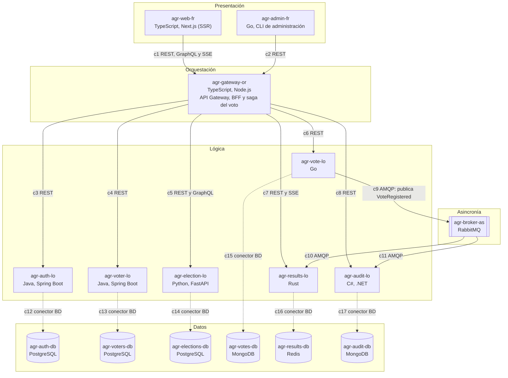
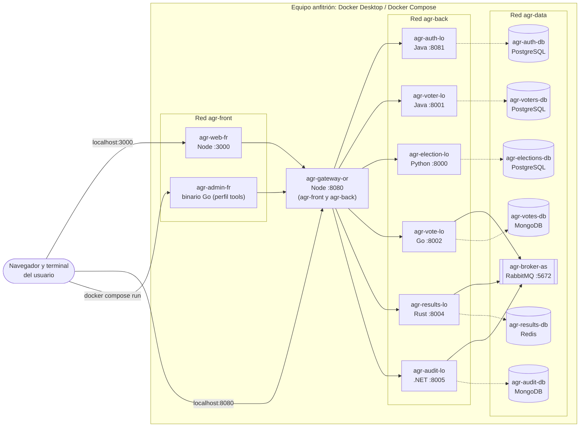
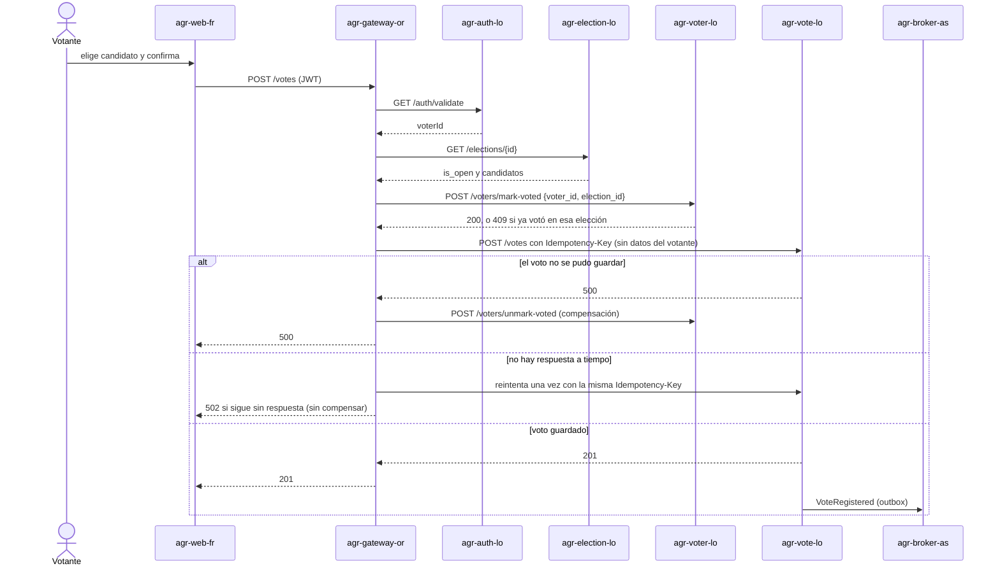
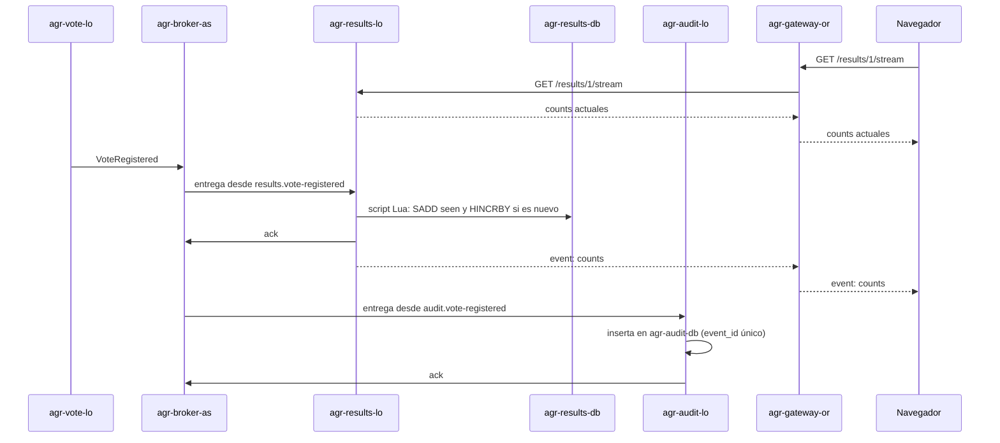

<p align="center">
  
</p>

# AGORA: sistema de votación electrónica (Prototipo 2)

**AGORA** es un sistema de votación electrónica para elecciones estudiantiles. Un votante inicia sesión con su
documento y su clave, ve las elecciones abiertas, vota **una vez en cada elección** y sigue los resultados, que se
actualizan solos mientras la votación está abierta. Quien administra crea, abre y cierra elecciones desde una consola
de comandos. El voto es **anónimo**: el sistema sabe quién votó y qué se votó, pero ningún dato permite unir las dos
cosas.

Está construido como un sistema distribuido de 16 componentes en contenedores: una web con renderizado en el servidor,
una consola de administración, un API Gateway que orquesta el voto, seis servicios en seis lenguajes distintos, un
broker de mensajes y seis bases de datos.

Proyecto del equipo 1b para el curso Arquitectura de Software (UNAL, 2026-II, prof. Jeisson Andrés Vergara Vargas).

- Entrega del artefacto: lunes 2 de noviembre de 2026, archivo `p2_1b.pdf` en MiCampus. Su versión en Markdown está
  en [`artifacts/p2_1b.md`](artifacts/p2_1b.md).
- Presentación en clase: martes 3 de noviembre de 2026.

## Contenido

1. [Componentes del Prototipo 2](#1-componentes-del-prototipo-2)
2. [Arquitectura](#2-arquitectura)
3. [Cómo ejecutarlo](#3-cómo-ejecutarlo)
4. [Cómo funciona cada componente](#4-cómo-funciona-cada-componente)
5. [Contratos entre componentes](#5-contratos-entre-componentes)
6. [Flujos completos](#6-flujos-completos)
7. [Cómo se cumplen los requisitos del enunciado](#7-cómo-se-cumplen-los-requisitos-del-enunciado)
8. [Variables de entorno](#8-variables-de-entorno)
9. [Límites conocidos](#9-límites-conocidos)
10. [Estructura del repositorio](#10-estructura-del-repositorio)

---

## 1. Componentes del Prototipo 2

| Componente | Nivel | Lenguaje y herramientas | Origen | Responsable |
|---|---|---|---|---|
| `agr-web-fr` | Presentación | TypeScript, Next.js 16 (SSR), React 19 | Del P1, migrado de React SPA a Next.js | Cristian |
| `agr-admin-fr` | Presentación | Go, Cobra (CLI `agora`) | Nuevo | Maicol |
| `agr-gateway-or` | Orquestación | TypeScript, Node.js 22 (sin framework) | Nuevo | David |
| `agr-auth-lo` | Lógica | Java 21, Spring Boot 3.2, Spring Security, jjwt | Nuevo (sale del login del Voter Service del P1) | Esteban |
| `agr-voter-lo` | Lógica | Java 21, Spring Boot 3.4, JDBC | Del P1; ahora solo registra participación | Camilo |
| `agr-election-lo` | Lógica | Python, FastAPI, SQLAlchemy, Strawberry | Del P1, sin cambios | David |
| `agr-vote-lo` | Lógica | Go, `net/http`, driver de MongoDB, `amqp091-go` | Del P1; ya no orquesta, publica eventos | Maicol |
| `agr-results-lo` | Lógica | Rust, axum, lapin, redis | Nuevo (los resultados salen del Vote Service) | Miguel |
| `agr-audit-lo` | Lógica | C#, .NET 10, ASP.NET Core | Nuevo | Camilo |
| `agr-broker-as` | Asincronía | RabbitMQ 3.13 | Nuevo | Maicol |
| `agr-auth-db` | Datos | PostgreSQL 16 | Nuevo | Esteban |
| `agr-voters-db` | Datos | PostgreSQL 16 | Del P1, cambia de tabla | Camilo |
| `agr-elections-db` | Datos | PostgreSQL 16 | Del P1, sin cambios | David |
| `agr-votes-db` | Datos | MongoDB 7 | Del P1, agrega campos y usuario propio | Maicol |
| `agr-results-db` | Datos | Redis 7 | Nuevo | Miguel |
| `agr-audit-db` | Datos | MongoDB 7 | Nuevo | Camilo |

**Qué cambia respecto al Prototipo 1:**

| Aspecto | Prototipo 1 | Prototipo 2 |
|---|---|---|
| Front-end web | SPA en React (SOFEA) | SSR con Next.js |
| Presentación | 1 componente | 2 (web y CLI de administración) |
| Lógica | 3 servicios | 6 servicios (uno por integrante) |
| Orquestación | Dentro de `agr-vote-lo` | Componente propio: `agr-gateway-or` |
| Asincronía | Ninguna | RabbitMQ y consumidores de eventos |
| Datos | 3 bases | 6 bases (PostgreSQL, MongoDB y Redis) |
| Conectores HTTP | REST y GraphQL | REST, GraphQL y SSE |
| Marca de "ya votó" | Una sola por votante (vota una vez en total) | Una por votante y elección |
| Resultados | Se calculan en cada consulta; botón "Actualizar" | Conteo incremental en Redis; se actualizan solos (SSE) |
| Administración | Swagger con una llave | CLI `agora` con la misma llave |
| Lo que ve el navegador | Tres servicios en tres puertos | Solo el web (3000) y el gateway (8080) |
| Lenguajes | Python, Java, Go, TypeScript | Python, Java, Go, TypeScript, Rust, C# |

## 2. Arquitectura

### 2.1 Vista de componentes y conectores



Los conectores c1 a c17 son los de la vista C&C del entregable ([`artifacts/p2_1b.md`](artifacts/p2_1b.md)). Por el
c8 (gateway a auditoría) la CLI consulta el registro de auditoría. Las líneas continuas son HTTP o AMQP; las punteadas
son conectores a bases de datos.

### 2.2 Estilos y patrones

| Estilo o patrón | Dónde | Qué significa aquí |
|---|---|---|
| Microservicios | Los 6 componentes de lógica | Cada servicio tiene un dueño, su propia base y se despliega por separado |
| Base de datos por servicio | Cada `-lo` con su `-db` | Ningún servicio lee la base de otro |
| API Gateway y Backend-for-Frontend | `agr-gateway-or` | Único punto de entrada para la web y la CLI |
| Saga orquestada | Voto, en `agr-gateway-or` | El gateway ejecuta los pasos del voto y compensa si falla el guardado |
| Composición de API | Resultados, en `agr-gateway-or` | El gateway une los conteos de resultados con los nombres de candidatos |
| Publish/Subscribe, dirigido por eventos | `agr-vote-lo` → `agr-broker-as` → resultados y auditoría | El voto se registra una vez y quien lo necesita se entera por un evento |
| CQRS ligero | Escritura en MongoDB, lectura en Redis | Los resultados se leen sin recalcular nada |
| Outbox | `agr-vote-lo` | Ningún voto guardado se queda sin publicar |
| Consumidor idempotente | `agr-results-lo`, `agr-audit-lo` | Un evento repetido no se cuenta dos veces |
| Cliente-servidor y SSR | `agr-web-fr` | El HTML se genera en el servidor de Next.js |
| Capas | Sistema completo y dentro de cada servicio | Presentación → orquestación → lógica → datos y mensajería |

### 2.3 Reglas de diseño

- **Los servicios de lógica nunca se llaman entre sí.** Cuando un flujo necesita a varios, lo coordina
  `agr-gateway-or` (llamadas síncronas) o se comunican por eventos a través de `agr-broker-as`.
- **Una base de datos por servicio, ninguna compartida.** Los demás solo ven esos datos a través de la API del
  dueño.
- **Identidad, participación y voto separados.** Quién es el votante vive en `agr-auth-db`; en qué elecciones ya
  votó vive en `agr-voters-db`; qué se votó vive en `agr-votes-db`. Ningún dato une un voto con un votante.
- **Solo dos puertas hacia afuera:** el web (3000) y el gateway (8080), más la consola de RabbitMQ (15672). Los
  servicios y las bases no publican puertos.
- **Ningún servicio comparte código con otro.** Se hablan solo por los contratos de la sección 5.

**Convención de nombres.** `agr-<nombre>-<nivel>`: `-fr` presentación, `-or` orquestación, `-lo` lógica, `-as`
asincronía y `-db` datos. **El componente, la carpeta del repositorio, el servicio de Docker Compose y el contenedor
se llaman igual**. Así, `docker compose logs agr-vote-lo`, `docker ps` y las URLs internas (`http://agr-vote-lo:8002`)
usan el mismo nombre que la vista C&C.

## 3. Cómo ejecutarlo

Requisitos: Git y Docker Desktop abierto con el motor corriendo. Los puertos `3000`, `8080` y `15672` de tu equipo
deben estar libres.

```bash
git clone https://github.com/Cam152/ArquiSoft.git
cd ArquiSoft
docker compose up --build -d --wait
docker compose ps
```

La primera vez descarga imágenes y construye nueve imágenes propias (Java, Rust y .NET son las más lentas), así que
puede tardar varios minutos. El sistema está listo cuando los contenedores con *healthcheck* dicen `healthy`.
`agr-auth-lo` no tiene *healthcheck*: aparece como `Up` y tarda unos segundos más que los demás en aceptar logins.

| Qué | URL |
|---|---|
| Web (SSR) | http://localhost:3000 |
| Gateway, health check | http://localhost:8080/health |
| Gateway, resultados de la elección 1 | http://localhost:8080/results/1 |
| Gateway, GraphQL (GraphiQL en el navegador) | http://localhost:8080/graphql |
| Consola de RabbitMQ (colas y mensajes) | http://localhost:15672 (usuario y clave: `agora` / `agora`, o los de `BROKER_USER` y `BROKER_PASSWORD`) |

**Datos de ejemplo** (se cargan solos la primera vez):

| Qué | Valor |
|---|---|
| Votantes | Documentos `1001` a `1005`, todos con la clave `123456` |
| Elección `1` | "Elección de representante estudiantil 2026", abierta, 3 candidatos |
| Elección `2` | "Consulta sobre el horario de laboratorios", en borrador, 2 candidatos |
| Elección `3` | "Elección de monitores 2025-II", cerrada, 2 candidatos |
| Llave de administración | `dev-admin-key` (`ADMIN_API_KEY`) |

Cada votante puede votar **una vez en cada elección**. Para repetir la demostración con los mismos votantes,
reinicien los datos con `docker compose down -v`.

**Consola de administración.** La CLI no arranca con `up`; se ejecuta bajo demanda (la primera vez construye su
imagen):

```bash
docker compose run --rm agr-admin-fr elections list
docker compose run --rm agr-admin-fr elections create --name "Elección 2026" --description "Prueba"
docker compose run --rm agr-admin-fr candidates add --election 4 --name "Ana Torres"
docker compose run --rm agr-admin-fr candidates add --election 4 --name "Luis Herrera"
docker compose run --rm agr-admin-fr elections open 4
docker compose run --rm agr-admin-fr results show 4
docker compose run --rm agr-admin-fr audit list --election 4
```

Todos los comandos están en la sección 4.2.

**Comandos útiles:**

```bash
docker compose ps                        # estado de los contenedores
docker compose logs -f agr-gateway-or    # logs de un componente
docker compose down                      # detiene el sistema y conserva los datos
docker compose down -v                   # detiene y borra los datos (vuelve a cargar los de ejemplo)
```

**Puertos para depurar.** `docker-compose.yml` solo publica 3000, 8080 y 15672. Para entrar directo a un servicio
(por ejemplo Swagger del Election Service en http://localhost:8000/docs) o a una base, cada integrante puede crear
un `docker-compose.override.yml` local con los puertos que necesite. Docker Compose lo lee solo si existe; no se
sube al repositorio:

```yaml
services:
  agr-election-lo:
    ports: ["8000:8000"]
  agr-voters-db:
    ports: ["5433:5432"]
```

**Problemas frecuentes:**

- `error during connect ... dockerDesktopLinuxEngine`: Docker Desktop está cerrado. Ábranlo y esperen a que diga
  "Engine running".
- `port is already allocated`: otro programa usa el 3000, el 8080 o el 15672. Ciérrenlo o cambien el puerto
  publicado en un `docker-compose.override.yml`.
- "Un servicio de AGORA no responde" al iniciar sesión justo después de levantar el sistema: `agr-auth-lo` todavía
  está arrancando. Esperen unos segundos y vuelvan a intentar.
- En Windows PowerShell, `curl` es un alias de otra cosa: usen `curl.exe`. Si `npm` no corre por la política de
  scripts, usen `npm.cmd`.
- Si la compilación se corta por la red, vuelvan a ejecutar `docker compose up --build`: lo ya descargado queda en
  caché.

## 4. Cómo funciona cada componente

Todos los servicios de lógica siguen las mismas convenciones:

- `GET /health` responde `200 {"status": "ok"}` y es lo que usa el *healthcheck* del compose. La excepción es
  `agr-auth-lo`, que expone `GET /auth/health` y no tiene *healthcheck*.
- Errores en JSON `{"detail": "mensaje"}` (salvo `agr-auth-lo`, ver sección 4.4).
- Configuración por variables de entorno y logs a la salida estándar.
- Capas internas parecidas: `handler` o `controller` (HTTP) → `service` (reglas de negocio) → `repository` (base de
  datos), más `publisher` o `consumer` cuando hablan con el broker.

### 4.1 Web: `agr-web-fr` (TypeScript, Next.js con SSR)

**Qué hace.** Es la interfaz del votante. Muestra las elecciones, permite iniciar sesión, votar y ver los
resultados actualizándose solos.

**Cómo lo hace.** Next.js genera cada página **en el servidor** en cada petición (SSR): cuando el navegador pide
`/`, el servidor de Next.js consulta al gateway por la red interna, arma el HTML con los datos y lo envía listo. El
navegador recibe la página completa, sin pantallas de "cargando". El navegador habla directo con el gateway solo dos
veces: al enviar el voto y al abrir el stream de resultados en vivo.

| Ruta | Se genera en | Qué hace |
|---|---|---|
| `/` | Servidor | Lista las elecciones con su estado y candidatos (GraphQL al gateway). Abiertas primero, luego en borrador y al final cerradas |
| `/ingresar` | Servidor | Formulario de documento y clave. Lo envía una *Server Action* de Next.js, que llama a `POST /auth/login` del gateway desde el servidor y devuelve el token al navegador |
| `/elecciones/[id]/votar` | Servidor + navegador | El servidor trae la elección y sus candidatos; el navegador envía `POST /votes` al gateway con el JWT |
| `/elecciones/[id]/resultados` | Servidor + navegador | El servidor trae los resultados actuales; si la elección está activa, el navegador abre `GET /results/{id}/stream` (SSE) y actualiza las barras con cada evento |
| `/api/health` | Servidor | *Healthcheck* del contenedor (no consulta al gateway) |

**Detalles:**

- **Dos URLs del gateway.** El servidor de Next.js usa `GATEWAY_INTERNAL_URL` (`http://agr-gateway-or:8080`, por la
  red de Docker). El navegador usa `NEXT_PUBLIC_GATEWAY_URL` (`http://localhost:8080`). Ambas se leen al ejecutar,
  así que cambiarlas no exige reconstruir la imagen.
- **Sesión.** El JWT se guarda en `sessionStorage` (`lib/session.ts`): sobrevive a recargar la página, se borra al
  cerrar la pestaña y la sesión se cierra sola al vencer (1 hora). El encabezado muestra el documento y un botón
  "Salir". Las páginas que se generan en el servidor no necesitan el token, porque elecciones y resultados son
  públicos.
- **Resultados en vivo.** El SSE entrega solo los conteos por candidato; la página los combina con la lista de
  candidatos que ya trajo al generarse (`lib/results.ts`). Si el stream se corta, se reconecta con espera creciente
  (2, 4, 8... hasta 30 segundos).
- **Mensajes al votante.** Un solo archivo (`lib/api/errors.ts`) traduce cada código de respuesta a un mensaje
  ("Ya votaste en esta elección", "La elección no está abierta", etc.).
- **Organización:** `app/` (páginas y la *Server Action* del login), `components/` (formularios, tarjetas, barras de
  resultados), `lib/api/server.ts` (llamadas del servidor al gateway), `lib/api/browser.ts` (voto y SSE desde el
  navegador), `lib/session.ts`, `lib/useResultsStream.ts` y `lib/navigation.ts`.
- **Imagen.** Se compila en `node:22-alpine` con `output: "standalone"` y corre `node server.js` en el puerto 3000.

### 4.2 CLI de administración: `agr-admin-fr` (Go, Cobra)

**Qué hace.** Reemplaza el uso de Swagger: es la herramienta con la que quien administra crea, edita, abre y cierra
elecciones, gestiona candidatos y consulta resultados y auditoría.

**Cómo lo hace.** Es un programa de línea de comandos (`agora`). Cada comando arma una petición HTTP al gateway,
agrega el header `X-API-Key` en las rutas de administración y muestra la respuesta como tabla en la terminal
(`text/tabwriter`). Si el gateway responde un error, imprime el `detail` y termina con código de salida distinto de 0.

| Comando | Petición al gateway |
|---|---|
| `elections list [--status active]` | `GET /elections` |
| `elections show <id>` | `GET /elections/{id}` |
| `elections create --name ... [--description ...] [--starts ... --ends ...]` | `POST /admin/elections` |
| `elections update <id> [--name ...] [--description ...] [--starts ...] [--ends ...]` | `PATCH /admin/elections/{id}` |
| `elections delete <id> [--yes]` | `DELETE /admin/elections/{id}` (pide confirmación salvo con `--yes`) |
| `elections open <id>` | `POST /admin/elections/{id}/activate` |
| `elections close <id>` | `POST /admin/elections/{id}/close` |
| `candidates add --election <id> --name ... [--description ...]` | `POST /admin/elections/{id}/candidates` |
| `candidates remove --election <id> --candidate <cid>` | `DELETE /admin/elections/{id}/candidates/{cid}` |
| `results show <id>` | `GET /results/{id}` |
| `audit list [--election <id>] [--limit 50]` | `GET /admin/audit` |

**Configuración.** Opciones globales `--gateway`, `--api-key` y `--timeout` (10 s por defecto). Si no se pasan, usa
`AGORA_GATEWAY_URL` (por defecto `http://localhost:8080`; en el compose, `http://agr-gateway-or:8080`) y
`AGORA_ADMIN_KEY` (en el compose toma el valor de `ADMIN_API_KEY`).

**Imagen y uso.** Se compila en `golang:1.23-alpine` y queda un binario en `alpine`. En el compose está en el perfil
`tools`, así que `docker compose up` no lo arranca y se usa con `docker compose run --rm agr-admin-fr <comando>`.

### 4.3 Gateway: `agr-gateway-or` (TypeScript, Node.js)

**Qué hace.** Es el único punto de entrada de la API y el orquestador del sistema. Enruta cada petición al servicio
que corresponde, valida quién es el votante, protege la administración, ejecuta la saga del voto, une datos de
varios servicios y reenvía el stream de resultados en vivo.

**Cómo lo hace:**

- **Sin framework ni dependencias.** Usa solo `node:http`, `fetch` y `node:crypto`. Node 22 ejecuta los archivos
  `.ts` directamente, así que la imagen no tiene paso de compilación ni `npm install`.
- **Enrutamiento.** Cada ruta pública (sección 5.1) apunta a un servicio interno por la red `agr-back`
  (`http://agr-election-lo:8000`, `http://agr-vote-lo:8002`, etc.).
- **Autenticación del votante.** En `POST /votes`, el gateway llama a `GET /auth/validate` de `agr-auth-lo` con el
  header `Authorization` recibido y obtiene el id del votante. Si la respuesta es 401 o 403, responde 401. El
  gateway no conoce el secreto del JWT.
- **Traducción del Auth Service.** `agr-auth-lo` responde `{token, voterId, ...}` en el login y
  `{valid, voterId, ...}` al validar. El gateway lo traduce al contrato público (`access_token`, `token_type`,
  `expires_in`), así el web no depende de la forma interna.
- **Administración.** En las rutas `/admin/*` compara `X-API-Key` con `ADMIN_API_KEY` (comparación de tiempo
  constante) y reenvía la llave al Election Service, que también la verifica.
- **Saga del voto.** `POST /votes` ejecuta los pasos de la sección 6.1: validar la elección, marcar la
  participación, guardar el voto y compensar si el guardado falla.
- **Composición de resultados.** `GET /results/{id}` pide en paralelo los conteos a `agr-results-lo` y la elección a
  `agr-election-lo`, y devuelve un solo JSON con nombres, ceros, porcentajes y orden (sección 5.1).
- **SSE.** `GET /results/{id}/stream` abre el stream de `agr-results-lo` y lo reenvía al navegador evento por
  evento, sin compresión ni *buffering*.
- **Llamadas internas.** Todas tienen un tiempo máximo de 5 segundos; las que van al Voter Service y al Vote
  Service llevan `X-Service-Key`.
- **CORS.** Es el único componente que lo necesita: acepta el origen del web (`http://localhost:3000`, variable
  `CORS_ORIGINS`).
- **Logs sin datos sensibles.** Es el único componente que ve juntos el JWT y el candidato elegido, así que solo
  registra método, ruta, código y duración: **nunca el cuerpo de `POST /votes`** ni el header `Authorization`.

**Estructura** (`src/`): `routes/` (tabla de rutas y reenvío), `middleware/admin.ts` y `middleware/cors.ts`,
`saga/vote.ts`, `compose/results.ts`, `sse/proxy.ts` y `clients/` (un cliente HTTP por servicio, incluida la
validación del token en `clients/auth.ts`).

### 4.4 Auth Service y Auth DB: `agr-auth-lo` (Java, Spring Boot) y `agr-auth-db` (PostgreSQL)

**Qué hace.** Es la única fuente de la identidad del votante: comprueba documento y clave, emite el JWT y lo valida
cuando el gateway pregunta.

**Cómo lo hace.** Toma el login del Voter Service del P1 y lo convierte en un servicio propio:

- **Login.** `POST /auth/login` busca al votante por `document` y compara la clave con BCrypt. Si coincide, firma un
  JWT HS256 (biblioteca `jjwt`) con vencimiento de 1 hora y responde `200 {token, voterId, name, document}`. El token
  lleva `sub` igual al documento y los *claims* `voter_id`, `document` y `name`. Si el documento o la clave no
  coinciden, la petición se rechaza (hoy con 403) y el gateway la muestra como "Documento o clave incorrectos".
- **Validación.** `GET /auth/validate` lee el header `Authorization: Bearer <jwt>`, verifica firma y vencimiento y
  responde `200 {"valid": true, "voterId": 1, "document": "1001", "error": null}`. Si el token es inválido o venció,
  responde `401 {"valid": false, ...}` con el motivo en `error`.
- **Seguridad.** Spring Security sin sesión (*stateless*); `/auth/login`, `/auth/validate` y `/auth/health` son
  públicos. Solo este servicio conoce el secreto del JWT.
- **Votantes de ejemplo.** Un `DataSeeder` crea 5 votantes si la tabla está vacía: documentos `1001` a `1005`, clave
  `123456` guardada con BCrypt.
- **Organización:** `controller`, `service` (`AuthService`, `JwtService`), `repository`, `model`, `dto` y `config`
  (`SecurityConfig`, `DataSeeder`).

**Datos (`agr-auth-db`):** base `agr_auth_db`, tabla `voters(id, document UNIQUE, name, password_hash)` creada por
Hibernate al arrancar. Volumen `agr_auth_db_data`.

**Puerto interno:** 8081. **Health:** `GET /auth/health`. **Imagen:** compila con `eclipse-temurin:21-jdk-alpine` y
Maven, y corre en `eclipse-temurin:21-jre-alpine`. El usuario de la base y el secreto del JWT están fijos en
`docker-compose.yml`.

### 4.5 Voter Service y Voters DB: `agr-voter-lo` (Java, Spring Boot) y `agr-voters-db` (PostgreSQL)

**Qué hace.** Registra **en qué elecciones ya votó cada votante**. Es la pieza que impide el doble voto.

**Cómo lo hace.** Ya no tiene lista de votantes ni claves (eso pasó a `agr-auth-lo`). Usa como `voter_id` el que el
gateway obtuvo del token, así que no hay que sincronizar votantes entre dos bases. La tabla la crea `schema.sql` al
arrancar:

```sql
CREATE TABLE IF NOT EXISTS ballots_cast (
  voter_id    BIGINT NOT NULL,
  election_id BIGINT NOT NULL,
  PRIMARY KEY (voter_id, election_id)
);
```

- **`POST /voters/mark-voted`** hace `INSERT ... ON CONFLICT DO NOTHING` (con `JdbcTemplate`) y mira cuántas filas
  insertó: 1 significa que quedó marcado (200); 0 significa que ya había votado en esa elección (409). Es atómico
  aunque lleguen dos peticiones al mismo tiempo, porque la llave primaria no deja insertar dos veces.
- **`POST /voters/unmark-voted`** hace `DELETE` de esa fila. Es la compensación de la saga y es idempotente: borrar
  algo que no existe también responde 200.
- **Llave de servicio.** Un interceptor exige `X-Service-Key` igual a `SERVICE_API_KEY` en `/voters/**` antes de leer
  el cuerpo; si falta o no coincide, 401. Un cuerpo inválido da 422.
- La tabla **no guarda fecha ni hora**: ese dato permitiría cruzar la participación con el voto.

**Datos (`agr-voters-db`):** tabla `ballots_cast`. Volumen `voters-db-data`. **Puerto interno:** 8001.

### 4.6 Election Service y Elections DB: `agr-election-lo` (Python, FastAPI) y `agr-elections-db` (PostgreSQL)

**Qué hace.** Gestiona elecciones y candidatos: sus estados, sus reglas y su consulta por REST y GraphQL.

**Cómo lo hace.** Es el mismo servicio del P1; solo cambia que ahora lo llama únicamente el gateway.

- **Capas** (`app/`): `routers/` (REST), `graphql_api.py` (GraphQL de solo lectura con Strawberry, en `/graphql`),
  `services.py` (reglas de negocio, compartidas por REST y GraphQL), `models.py` (SQLAlchemy), `schemas.py`
  (validación con Pydantic) y `security.py` (`X-API-Key`).
- **Reglas:** una elección está en `draft`, `active` o `closed`. Solo en borrador se edita, se elimina o se cambian
  candidatos; para abrirla hacen falta al menos 2 candidatos; solo una elección activa se puede cerrar. `is_open` es
  verdadero si está activa y la fecha actual cae dentro de `starts_at` y `ends_at`. Cada candidato recibe un número
  de tarjetón automático.
- **Arranque:** espera a PostgreSQL, crea las tablas y, si la base está vacía y `SEED_DATA=true`, carga las 3
  elecciones de ejemplo.

**Datos (`agr-elections-db`):** tablas `elections` y `candidates` (llave foránea con borrado en cascada y número
único por elección). Volumen `elections-db-data`. **Puerto interno:** 8000. Swagger en `/docs` (solo con el
puerto publicado en un *override*).

### 4.7 Vote Service y Votes DB: `agr-vote-lo` (Go) y `agr-votes-db` (MongoDB)

**Qué hace.** Guarda el voto anónimo y avisa al resto del sistema publicando el evento `VoteRegistered`.

**Cómo lo hace.** Ya no valida elecciones ni marca votantes (eso lo hace la saga del gateway) ni calcula resultados
(eso pasó a `agr-results-lo`):

- **Guardado idempotente.** `POST /votes` recibe `{election_id, candidate_id, candidate_name}`, el header
  `Idempotency-Key` y `X-Service-Key`. Inserta el voto con esa llave, que tiene un índice único. Si la llave ya
  existía con el mismo voto (el gateway reintentó), responde 201 sin duplicarlo; si existía con otro voto, 409.
- **Outbox.** El voto se guarda con `published: false`. Después de responder, una *goroutine* publica el evento en
  `agr-broker-as`, espera la confirmación del broker y marca `published: true`. Al arrancar y cada 5 segundos
  (`OUTBOX_INTERVAL`) se vuelven a publicar los votos que sigan en `false`, así que si RabbitMQ falla un momento, el
  evento sale cuando se recupere.
- **Publicación segura.** Usa confirmación del broker y la opción `mandatory`: si el exchange no tuviera colas, el
  mensaje vuelve y el voto queda pendiente en lugar de perderse. La conexión se abre la primera vez que se necesita,
  así el servicio arranca aunque RabbitMQ todavía no esté listo.
- **Anonimato.** El voto no lleva nada del votante. Su `_id` son 12 bytes aleatorios (un `ObjectId` de MongoDB
  llevaría la hora exacta) y `cast_at` se redondea a la hora. El mensaje AMQP no lleva hora. La `Idempotency-Key` es
  un identificador aleatorio que genera el gateway.
- **Health.** `GET /health` responde 200 solo si MongoDB responde; el broker no se revisa, porque sin él los votos se
  guardan igual.
- **Capas** (`internal/`): `handler`, `service`, `repository`, `publisher` y `outbox`.

**Datos (`agr-votes-db`):** colección `votes`
`{_id, election_id, candidate_id, candidate_name, cast_at, published, idempotency_key}`, con índice único en
`idempotency_key` e índice parcial en `published`. MongoDB con usuario y clave propios. Volumen `votes-db-data`.
**Puerto interno:** 8002.

### 4.8 Broker: `agr-broker-as` (RabbitMQ)

**Qué hace.** Es el componente de procesos asíncronos: recibe cada `VoteRegistered` y lo entrega a todos los que lo
necesitan, aunque en ese momento estén caídos.

**Cómo lo hace.** La topología se declara en `agr-broker-as/definitions.template.json` y RabbitMQ la carga al
arrancar, así nadie crea colas a mano (detalles en [`agr-broker-as/README.md`](agr-broker-as/README.md)):

| Elemento | Configuración | Para qué |
|---|---|---|
| Exchange `agora.votes` | Tipo `fanout`, durable | Copia cada evento a todas sus colas |
| Cola `results.vote-registered` | `quorum`, `x-delivery-limit: 5`, *dead-letter* a `agora.dlx` (clave `results.dead`) | Eventos para `agr-results-lo` |
| Cola `audit.vote-registered` | `quorum`, `x-delivery-limit: 5`, *dead-letter* a `agora.dlx` (clave `audit.dead`) | Eventos para `agr-audit-lo` |
| Exchange `agora.dlx` (`direct`) y colas `results.dead`, `audit.dead` | Durables | Guardan los mensajes que no se pudieron procesar, cada uno en la cola de su consumidor |

- Los mensajes se publican como **persistentes** y con **confirmación del broker**: sobreviven a un reinicio.
- Los consumidores usan ***ack* manual**: un mensaje solo se borra cuando el consumidor terminó de procesarlo. Si el
  consumidor cae a mitad, RabbitMQ lo reentrega.
- RabbitMQ garantiza entrega **al menos una vez**; por eso los consumidores descartan eventos repetidos.
- Para agregar otro consumidor basta con crear una cola nueva enlazada a `agora.votes`, sin tocar `agr-vote-lo`.
- Los consumidores **no declaran** las colas (lo hacen en modo pasivo): si las declararan con otros argumentos,
  RabbitMQ respondería `PRECONDITION_FAILED`.

**Imagen:** `./agr-broker-as` (sobre `rabbitmq:3.13-management-alpine`), volumen `broker-data`, puerto AMQP 5672
interno y consola web en 15672. Con definiciones al arrancar RabbitMQ no crea el usuario por defecto, así que un
`entrypoint.sh` genera las definiciones con el usuario de `BROKER_USER` y `BROKER_PASSWORD`. El contenedor tiene un
nombre de host fijo, porque RabbitMQ guarda sus datos por nombre de nodo.

### 4.9 Results Service y Results DB: `agr-results-lo` (Rust) y `agr-results-db` (Redis)

**Qué hace.** Mantiene el conteo de votos de cada elección, lo sirve al instante y avisa en vivo cada vez que cambia.

**Cómo lo hace:**

- **Consumo sin contar dos veces.** Se suscribe a `results.vote-registered`. Por cada evento ejecuta en Redis un
  script Lua atómico: `SADD results:{election_id}:seen {event_id}` y, solo si el evento es nuevo,
  `HINCRBY results:{election_id} {candidate_id} 1`. Después confirma el mensaje (*ack*).
- **Errores.** Un mensaje que no cumple el contrato va directo a `results.dead`. Si Redis está caído, el consumidor
  reintenta el mismo mensaje con espera creciente sin devolverlo a la cola, para no gastar entregas por una falla
  pasajera.
- **Consulta.** `GET /results/{election_id}` lee el hash y responde los conteos (vacíos si nadie ha votado). No
  conoce nombres de candidatos; el gateway los agrega (sección 5.1).
- **Resultados en vivo.** `GET /results/{election_id}/stream` abre un canal SSE. Al conectarse envía los conteos
  actuales, y luego un evento `counts` cada vez que el consumidor suma un voto en esa elección, más un comentario
  `keep-alive` cada 15 segundos para mantener viva la conexión. Si un cliente se atrasa, recibe los conteos vigentes.
- **Health.** `GET /health` responde 200 solo si Redis responde.
- **Bibliotecas:** `axum` (HTTP y SSE), `lapin` (AMQP), `redis` y `tokio`. **Organización** (`src/`): `consumer`,
  `service`, `repository`, `handler`, `sse`, `hub`, `model` y `config`.

**Datos (`agr-results-db`):** `results:{election_id}` (hash candidato → votos) y `results:{election_id}:seen`
(conjunto de eventos ya contados). Redis con clave (`RESULTS_DB_PASSWORD`) y guardado en disco (`appendonly yes`)
sobre el volumen `results-db-data`, así que los conteos sobreviven a un reinicio. **Puerto interno:** 8004.

### 4.10 Audit Service y Audit DB: `agr-audit-lo` (C#, .NET) y `agr-audit-db` (MongoDB)

**Qué hace.** Guarda un registro inmutable de todo lo que pasó en las votaciones, sin datos del votante, y lo deja
consultar a quien administra.

**Cómo lo hace:**

- **Consumo.** Un `BackgroundService` de .NET se suscribe a `audit.vote-registered` (biblioteca `RabbitMQ.Client`) e
  inserta cada evento en MongoDB (`MongoDB.Driver`). `event_id` tiene índice único: si el evento llega repetido, la
  inserción falla por duplicado, se toma como éxito y se confirma el mensaje. Si se cae la conexión con RabbitMQ,
  vuelve a conectar.
- **Errores.** Los mensajes que no cumplen el contrato (otro `type`, otra `version`, campos faltantes) se rechazan
  sin reencolar y van a `audit.dead`. Si falla MongoDB, el mensaje vuelve a la cola tras una pausa de 2 segundos;
  después de 5 entregas RabbitMQ lo pasa a `audit.dead`.
- **Inmutable.** El servicio solo inserta y consulta; no tiene endpoints para editar ni borrar.
- **Consulta.** `GET /audit/events?election_id=1&limit=50` devuelve los eventos más recientes (`limit` entre 1 y
  1000), y `GET /audit/summary/{election_id}` el total de eventos de una elección. El gateway los expone en
  `GET /admin/audit` con la llave de administración.
- **Capas:** `Consumers/`, `Services/`, `Repositories/`, `Models/` y `Controllers/` (ASP.NET Core).

**Datos (`agr-audit-db`):** colección `events {event_id, type, election_id, occurred_at, recorded_at}`. Ambas horas
se redondean a la hora. El `_id` del documento es el mismo `event_id`: un `ObjectId` propio guardaría la hora exacta
de inserción. MongoDB con usuario y clave propios. Volumen `audit-db-data`. **Puerto interno:** 8005.

### 4.11 Docker Compose y despliegue



| Red | Quién está | Para qué |
|---|---|---|
| `agr-front` | `agr-web-fr`, `agr-admin-fr`, `agr-gateway-or` | La presentación solo alcanza al gateway |
| `agr-back` | `agr-gateway-or` y los 6 servicios de lógica | El gateway llega a los servicios |
| `agr-data` | Los 6 servicios de lógica, las 6 bases y el broker | Cada servicio llega a su base y al broker |

Ni la presentación ni el gateway alcanzan las bases. Dentro de `agr-data` la separación entre bases la dan las
credenciales: cada servicio solo conoce las de la suya.

| Contenedor | Imagen | Puerto publicado | Volumen | Healthcheck | Espera a |
|---|---|---|---|---|---|
| `agr-web-fr` | `./agr-web-fr` | `3000:3000` | ninguno | `GET /api/health` | `agr-gateway-or` sano |
| `agr-admin-fr` | `./agr-admin-fr` | no corre como servicio (perfil `tools`) | ninguno | no aplica | no aplica |
| `agr-gateway-or` | `./agr-gateway-or` | `8080:8080` | ninguno | `GET /health` | election, voter, vote, results y audit sanos; auth arrancado |
| `agr-auth-lo` | `./agr-auth-lo` | no | ninguno | ninguno | `agr-auth-db` |
| `agr-voter-lo` | `./agr-voter-lo` | no | ninguno | `GET /health` | `agr-voters-db` |
| `agr-election-lo` | `./agr-election-lo` | no | ninguno | `GET /health` | `agr-elections-db` |
| `agr-vote-lo` | `./agr-vote-lo` | no | ninguno | `GET /health` | `agr-votes-db`, `agr-broker-as` |
| `agr-results-lo` | `./agr-results-lo` | no | ninguno | `GET /health` | `agr-results-db`, `agr-broker-as` |
| `agr-audit-lo` | `./agr-audit-lo` | no | ninguno | `GET /health` | `agr-audit-db`, `agr-broker-as` |
| `agr-broker-as` | `./agr-broker-as` (`rabbitmq:3.13-management-alpine`) | `15672:15672` | `broker-data` | `rabbitmq-diagnostics check_port_connectivity` | nada |
| `agr-auth-db` | `postgres:16-alpine` | no | `agr_auth_db_data` | `pg_isready` | nada |
| `agr-voters-db`, `agr-elections-db` | `postgres:16-alpine` | no | uno por base | `pg_isready` | nada |
| `agr-votes-db`, `agr-audit-db` | `mongo:7` | no | uno por base | `mongosh` (ping) | nada |
| `agr-results-db` | `redis:7-alpine` (`appendonly yes`, con clave) | no | `results-db-data` | `redis-cli ping` | nada |

- `depends_on` con `condition: service_healthy`: cada componente espera a que lo que necesita esté sano.
- Todos los contenedores tienen `restart: unless-stopped`, salvo `agr-auth-lo`, `agr-auth-db` y la CLI.
- Construcción en dos etapas en los servicios compilados: la imagen final no lleva compiladores.
- Los datos viven en volúmenes con nombre: `docker compose down` los conserva y `down -v` los borra.

## 5. Contratos entre componentes

Convenciones comunes: JSON en `snake_case` en REST (GraphQL usa `camelCase`), errores como `{"detail": "mensaje"}`,
token del votante en `Authorization: Bearer <jwt>`, llave de administración en `X-API-Key` y llave entre el gateway y
los servicios en `X-Service-Key`.

### 5.1 API pública del gateway (puerto 8080)

Es la única API que usan el web y la CLI.

| Método y ruta | Quién la usa | Requiere | Va a |
|---|---|---|---|
| `GET /health` | Compose | nada | el gateway |
| `POST /auth/login` | Web (servidor) | nada | `agr-auth-lo` |
| `POST /graphql`, `GET /graphql` (GraphiQL) | Web (servidor) | nada | `agr-election-lo` (solo lectura) |
| `GET /elections`, `GET /elections/{id}` | CLI | nada | `agr-election-lo` |
| `POST /votes` | Web (navegador) | JWT | Saga (sección 6.1) |
| `GET /results/{id}` | Web (servidor), CLI | nada | `agr-results-lo` + `agr-election-lo` (composición) |
| `GET /results/{id}/stream` | Web (navegador) | nada | `agr-results-lo` (SSE) |
| `POST /admin/elections` | CLI | `X-API-Key` | `agr-election-lo` |
| `PATCH`, `DELETE /admin/elections/{id}` | CLI | `X-API-Key` | `agr-election-lo` |
| `POST /admin/elections/{id}/candidates` | CLI | `X-API-Key` | `agr-election-lo` |
| `DELETE /admin/elections/{id}/candidates/{cid}` | CLI | `X-API-Key` | `agr-election-lo` |
| `POST /admin/elections/{id}/activate`, `/close` | CLI | `X-API-Key` | `agr-election-lo` |
| `GET /admin/audit?election_id=&limit=` | CLI | `X-API-Key` | `agr-audit-lo` |

`POST /auth/login`:

```json
// Petición
{"document": "1001", "password": "123456"}
// 200
{"access_token": "<jwt>", "token_type": "Bearer", "expires_in": 3600}
// 401
{"detail": "Documento o clave incorrectos"}
```

`POST /votes` (header `Authorization`):

```json
// Petición
{"election_id": 1, "candidate_id": 2}
// 201
{"status": "recorded"}
```

`GET /results/{id}` (composición del gateway):

```json
{
  "election_id": 1,
  "election_name": "Elección de representante estudiantil 2026",
  "total_votes": 10,
  "results": [
    {"candidate_id": 2, "candidate_name": "Luis Herrera", "votes": 6, "percentage": 60.0},
    {"candidate_id": 1, "candidate_name": "Ana Torres", "votes": 4, "percentage": 40.0},
    {"candidate_id": 3, "candidate_name": "Camila Duarte", "votes": 0, "percentage": 0.0}
  ]
}
```

`GET /results/{id}/stream` (`Content-Type: text/event-stream`):

```
event: counts
data: {"election_id":1,"total_votes":11,"counts":{"1":4,"2":7}}
```

### 5.2 APIs internas (solo las llama el gateway)

| Servicio | Endpoint | Respuestas |
|---|---|---|
| `agr-auth-lo` | `POST /auth/login` `{document, password}` | 200 `{token, voterId, name, document}`; credenciales incorrectas, 403 |
| `agr-auth-lo` | `GET /auth/validate` | 200 `{valid: true, voterId, document, error: null}`; 401 `{valid: false, ..., error}` |
| `agr-voter-lo` | `POST /voters/mark-voted` `{voter_id, election_id}` | 200 `{"status": "marked"}`, 409 ya votó en esa elección, 401 llave de servicio incorrecta, 422 cuerpo inválido |
| `agr-voter-lo` | `POST /voters/unmark-voted` `{voter_id, election_id}` | 200 `{"status": "unmarked"}` (idempotente) |
| `agr-election-lo` | REST y GraphQL del P1 | Ver sección 4.6; errores 401, 404, 409, 422 |
| `agr-vote-lo` | `POST /votes` `{election_id, candidate_id, candidate_name}` + `Idempotency-Key` | 201 `{"status": "recorded"}` (también si la llave se repite con el mismo voto), 409 llave usada con otro voto, 422 datos inválidos, 500 no se pudo guardar |
| `agr-results-lo` | `GET /results/{id}` | 200 `{"election_id", "total_votes", "counts": {"<candidate_id>": votos}}`, 422 id inválido, 503 Redis no responde |
| `agr-results-lo` | `GET /results/{id}/stream` | SSE con eventos `counts` |
| `agr-audit-lo` | `GET /audit/events?election_id=&limit=` | 200 lista de eventos, 422 parámetros inválidos |
| `agr-audit-lo` | `GET /audit/summary/{election_id}` | 200 `{"election_id", "events"}` |

`mark-voted`, `unmark-voted` y el `POST /votes` de `agr-vote-lo` exigen `X-Service-Key`; sin ella responden 401.
Las escrituras del Election Service exigen `X-API-Key`, que el gateway reenvía.

### 5.3 Evento `VoteRegistered`

Lo publica `agr-vote-lo` en el exchange `agora.votes`; lo consumen `agr-results-lo` y `agr-audit-lo`.

```json
{
  "event_id": "6720f3a1c2b9e8a4d1f00a17",
  "type": "VoteRegistered",
  "version": 1,
  "election_id": 1,
  "candidate_id": 2,
  "occurred_at": "2026-11-03T14:00:00Z"
}
```

| Campo | Detalle |
|---|---|
| `event_id` | El `_id` del voto en `agr-votes-db` (12 bytes aleatorios en hexadecimal). Único: sirve para descartar repetidos |
| `type`, `version` | Permiten cambiar el formato sin romper a los consumidores; los dos rechazan otro tipo u otra versión |
| `election_id`, `candidate_id` | Lo único necesario para contar. **Ningún dato del votante** |
| `occurred_at` | Hora del voto redondeada a la hora |

## 6. Flujos completos

### 6.1 Votar (saga orquestada por `agr-gateway-or`)



**Paso a paso:**

1. El gateway valida el JWT con `agr-auth-lo` y obtiene el id del votante. Si falta o es inválido: 401.
2. Pide la elección a `agr-election-lo`: si no existe, 404; si no está abierta, 409; si el candidato no le
   pertenece, 422. Se valida **antes** de marcar para no gastar el voto en una elección cerrada.
3. Marca la participación en `agr-voter-lo`. Si ya votó en esa elección: 409.
4. Genera una `Idempotency-Key` aleatoria y pide a `agr-vote-lo` guardar el voto, sin ningún dato del votante.
5. Si `agr-vote-lo` responde que no guardó el voto, **compensa**: desmarca la participación y responde 500 (el
   votante puede intentar de nuevo).
6. Si `agr-vote-lo` rechaza la conexión (está apagado), el voto seguro no se guardó: **compensa** y responde 502.
7. Si `agr-vote-lo` no responde a tiempo, **no compensa**, porque el voto pudo haberse guardado y desmarcar
   permitiría votar dos veces. Reintenta una vez con la misma llave; si tampoco responde, devuelve 502.
8. Si todo sale bien, responde 201. El evento `VoteRegistered` sale después, por el *outbox*.

**Códigos de `POST /votes` y lo que ve el votante:**

| Código | Cuándo | Mensaje en el web |
|---|---|---|
| 201 | Voto registrado | "Voto registrado: tu voto quedó guardado de forma anónima." |
| 401 | Falta el JWT, o es inválido o venció | Vuelve al login con "Tu sesión expiró" |
| 404 | La elección no existe | "La elección no existe." |
| 409 | La elección no está abierta, o ya votó en ella (lo dice `detail`) | "La elección no está abierta" o "Ya votaste en esta elección" |
| 422 | El candidato no pertenece a la elección | "El candidato no pertenece a esta elección" |
| 500 | Falló el guardado y ya se compensó | "No se pudo guardar tu voto y no quedó registrado. Puedes intentarlo de nuevo." |
| 502 | Un servicio no responde | El `detail` del gateway, que dice si el voto quedó o no registrado |
| Sin respuesta | El navegador no llegó al gateway | "No se pudo confirmar el envío de tu voto..." (si al reintentar aparece "Ya votaste", el voto sí quedó) |

### 6.2 Conteo y resultados en vivo



Resultados y auditoría trabajan en paralelo y no dependen uno del otro. Si `agr-results-lo` se cae con el sistema en
marcha, la votación sigue funcionando: los eventos esperan en su cola y se cuentan cuando vuelve.

### 6.3 Anonimato

| Base | Responde a | Qué guarda | Qué no guarda |
|---|---|---|---|
| `agr-auth-db` | ¿Quién es? | documento, nombre, hash de la clave | nada sobre votos |
| `agr-voters-db` | ¿Ya votó en esta elección? | `voter_id`, `election_id` | candidato, fecha y hora |
| `agr-votes-db` | ¿Qué se votó? | elección, candidato, hora redondeada | ningún dato del votante |
| `agr-results-db`, `agr-audit-db` | ¿Cuántos votos? ¿Qué pasó? | conteos y eventos | ningún dato del votante |

- El único componente que ve en la misma petición quién vota y por quién es el gateway, y no lo guarda ni lo
  registra en sus logs.
- Ningún identificador lleva la hora exacta: el `_id` del voto es aleatorio, el de la auditoría es el mismo
  `event_id`, y el mensaje AMQP no lleva marca de tiempo.

## 7. Cómo se cumplen los requisitos del enunciado

| Requisito del Prototipo 2 | Cómo se cumple |
|---|---|
| Arquitectura distribuida | 16 componentes en contenedores que se comunican por red (15 corren siempre; la CLI se ejecuta bajo demanda) |
| Al menos 2 componentes de presentación, uno web | `agr-web-fr` (web) y `agr-admin-fr` (CLI) |
| Web con subarquitectura SSR | `agr-web-fr` genera las páginas en el servidor con Next.js en cada petición |
| Componentes de lógica ≥ integrantes (6) | `agr-auth-lo`, `agr-voter-lo`, `agr-election-lo`, `agr-vote-lo`, `agr-results-lo`, `agr-audit-lo` |
| Al menos 1 componente de comunicación u orquestación | `agr-gateway-or` |
| Al menos 4 componentes de datos, relacionales y NoSQL | 3 PostgreSQL, 2 MongoDB y 1 Redis |
| Al menos 1 componente de procesos asíncronos | `agr-broker-as` (RabbitMQ) con sus consumidores |
| Conectores HTTP | REST, GraphQL y SSE |
| Al menos 5 lenguajes de propósito general | Python, Java, Go, TypeScript, Rust y C# |
| Despliegue orientado a contenedores | Docker y Docker Compose |

## 8. Variables de entorno

Se cambian copiando `.env.example` a `.env`. Todas tienen un valor por defecto en el compose.

| Variable | Componente | Por defecto | Uso |
|---|---|---|---|
| `ELECTIONS_DB_USER`, `ELECTIONS_DB_PASSWORD`, `ELECTIONS_DB_NAME` | Elections DB y Election Service | `elections` | Credenciales de la base |
| `VOTERS_DB_USER`, `VOTERS_DB_PASSWORD`, `VOTERS_DB_NAME` | Voters DB y Voter Service | `voters` | Credenciales de la base |
| `VOTES_DB_USER`, `VOTES_DB_PASSWORD` | Votes DB y Vote Service | `votes` | Usuario y clave de MongoDB (solo letras y números) |
| `VOTES_MONGO_DB` | Vote Service | `votes` | Base de MongoDB de los votos |
| `AUDIT_DB_USER`, `AUDIT_DB_PASSWORD` | Audit DB y Audit Service | `audit` | Usuario y clave de MongoDB (solo letras y números) |
| `AUDIT_MONGO_DB` | Audit Service | `audit` | Base de MongoDB de la auditoría |
| `RESULTS_DB_PASSWORD` | Results DB y Results Service | `results` | Clave de Redis |
| `BROKER_USER`, `BROKER_PASSWORD` | Broker, Vote, Results y Audit | `agora` | Usuario de RabbitMQ y de su consola (solo letras y números) |
| `ADMIN_API_KEY` | Gateway, Election Service y CLI | `dev-admin-key` | Llave de administración (`X-API-Key`) |
| `SERVICE_API_KEY` | Gateway, Voter Service y Vote Service | `dev-service-key` | Llave entre el gateway y los servicios |
| `SEED_DATA` | Election Service | `true` | Cargar las elecciones de ejemplo |
| `CORS_ORIGINS` | Gateway | `http://localhost:3000` | Orígenes permitidos para el navegador |
| `GATEWAY_INTERNAL_URL` | Web (servidor) | `http://agr-gateway-or:8080` | Gateway visto desde el servidor de Next.js |
| `NEXT_PUBLIC_GATEWAY_URL` | Web (navegador) | `http://localhost:8080` | Gateway visto desde el navegador |

**Auth Service.** La configuración de `agr-auth-lo` y `agr-auth-db` (base `agr_auth_db`, usuario y clave
`postgres`, secreto del JWT) está fija en `docker-compose.yml`. La variable `JWT_SECRET` de `.env.example` hoy no la
lee el compose.

Variables que el compose arma y no se cambian por `.env`: las URLs de cada base (`DATABASE_URL`, `DB_URL`,
`MONGO_URI`, `REDIS_URL`), `AMQP_URL`, las URLs de los servicios que usa el gateway y `AGORA_GATEWAY_URL` de la CLI.
Todas usan los nombres `agr-*` de la red de Compose.

## 9. Límites conocidos

- Si `agr-vote-lo` no responde a tiempo dos veces, el votante puede quedar marcado sin voto (sección 6.1). Es el
  costo de no compensar a ciegas.
- Los resultados en vivo tienen consistencia eventual: después de votar, el conteo puede tardar un instante en
  reflejar el voto.
- El JWT vive en `sessionStorage` y no se puede revocar antes de que venza (1 hora). Además lleva el documento y el
  nombre del votante; nunca llega al Vote Service, pero lo ideal sería que solo llevara el id.
- `agr-auth-lo` no tiene *healthcheck* ni reinicio automático, y cualquier falla del login (incluida una falla de su
  base) se muestra como "Documento o clave incorrectos".
- El gateway espera a que todos los servicios estén sanos para arrancar: si uno no arranca, el sistema completo no
  arranca. Una vez en marcha, la caída de resultados o auditoría no detiene la votación.
- Sin HTTPS, sin límite de intentos de login y con claves de ejemplo por defecto.
- La administración usa una llave compartida, no usuarios con roles.
- Quien tuviera acceso a la vez a `agr-voters-db` y `agr-votes-db` podría intentar cruzar el orden de inserción de
  las dos bases. El diseño evita guardar horas exactas, pero no mezcla el orden de los votos.
- Cada servicio corre en una sola instancia; el diseño permitiría replicar los servicios sin estado detrás del
  gateway.

## 10. Estructura del repositorio

```
.
├── docker-compose.yml          (los 16 componentes, redes y volúmenes)
├── docker-compose.test.yml     (se suma al anterior para las pruebas de punta a punta de agr-vote-lo)
├── .env.example
├── .github/workflows/ci.yml    (CI: pruebas de cada componente, punta a punta y arranque completo)
├── artifacts/                  (logo, vista C&C y entregables p1_1b.md y p2_1b.md)
├── agr-web-fr/                 (TypeScript, Next.js SSR)
│   └── app/, components/, lib/
├── agr-admin-fr/               (Go, CLI "agora")
│   └── cmd/agora, internal/client, internal/commands
├── agr-gateway-or/             (TypeScript, Node.js)
│   └── src/ (routes, middleware, saga, compose, sse, clients), test/
├── agr-auth-lo/                (Java, Spring Boot)
│   └── controller, service, repository, model, dto, config
├── agr-voter-lo/               (Java, Spring Boot)
│   └── controller, service, repository, security, dto, config; resources/schema.sql
├── agr-election-lo/            (Python, FastAPI)
│   └── app/ (routers, graphql_api, services, models, schemas), tests/
├── agr-vote-lo/                (Go)
│   └── internal/ (handler, service, repository, publisher, outbox), e2e/
├── agr-results-lo/             (Rust)
│   └── src/ (consumer, service, repository, handler, sse, hub, model, config), tests/
├── agr-audit-lo/               (C#, .NET)
│   └── Consumers/, Services/, Repositories/, Models/, Controllers/, tests/
└── agr-broker-as/              (RabbitMQ)
    └── definitions.template.json, rabbitmq.conf, entrypoint.sh
```

Las bases de datos no tienen carpeta: usan imágenes oficiales (`postgres:16-alpine`, `mongo:7`, `redis:7-alpine`)
configuradas desde el compose.
