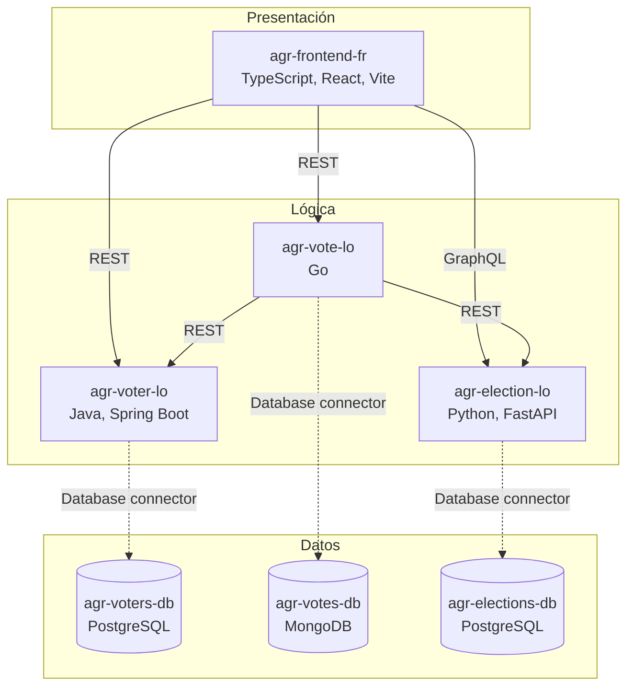
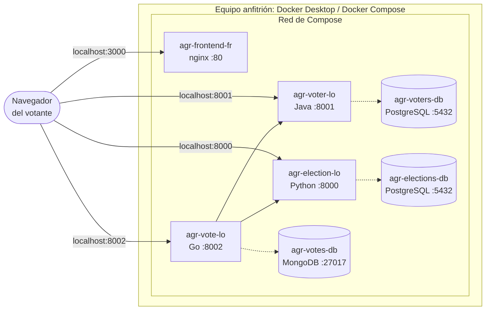
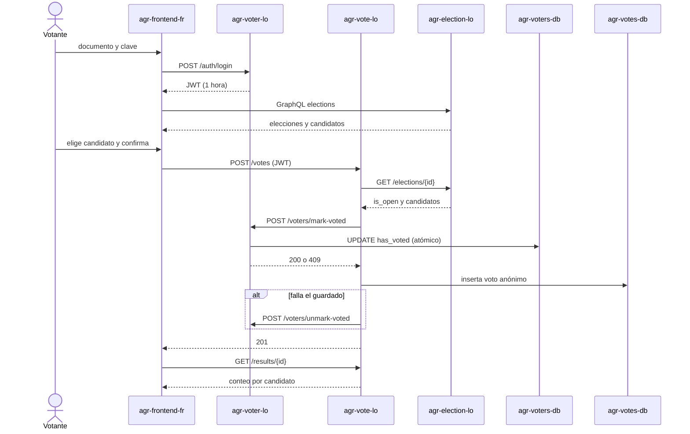

<p align="center">
  
</p>

# AGORA: sistema de votación electrónica (Prototipo 1)

Guía del equipo 1b para el primer prototipo de Arquitectura de Software (UNAL, 2026-II, prof. Jeisson Andrés
Vergara Vargas). Aquí está lo que hace el sistema, cómo está hecho cada componente, cómo ejecutarlo y cómo
comprobar que funciona.

- Entrega del artefacto: lunes 12 de octubre de 2026, archivo `p1_1b.pdf` en MiCampus (lo sube un solo integrante).
  Se genera desde [`artifacts/p1_1b.md`](artifacts/p1_1b.md).
- Presentación en clase: martes 13 de octubre de 2026.
- Plan de pruebas y criterio para pasar a `main`: [`PRUEBAS.md`](PRUEBAS.md).

## Contenido

1. [Estado actual](#1-estado-actual)
2. [Arquitectura](#2-arquitectura)
3. [Cómo ejecutarlo](#3-cómo-ejecutarlo)
4. [Cómo funciona cada componente](#4-cómo-funciona-cada-componente)
5. [Contratos entre servicios](#6-contratos-entre-servicios)
6. [Flujo completo de un voto](#7-flujo-completo-de-un-voto)
7. [Cómo se cumplen los requisitos del enunciado](#8-cómo-se-cumplen-los-requisitos-del-enunciado)
8. [Variables de entorno](#10-variables-de-entorno)

---

## 1. Estado actual

Los siete componentes están implementados y se levantan juntos con Docker Compose.

| Componente (vista C&C) y contenedor | Lenguaje y herramientas | Estado | Responsable |
|---|---|---|---|
| `agr-frontend-fr` | TypeScript, React, Vite, nginx | Completo | Cristian |
| `agr-election-lo` | Python, FastAPI, SQLAlchemy, Strawberry | Completo | David Benjumea |
| `agr-elections-db` | PostgreSQL | Completa | David Benjumea |
| `agr-voter-lo` | Java, Spring Boot, JPA, JWT | Completo | Esteban y Camilo |
| `agr-voters-db` | PostgreSQL | Completa | Esteban y Camilo |
| `agr-vote-lo` | Go, net/http, driver de MongoDB | Completo | Maicol y Miguel |
| `agr-votes-db` | MongoDB | Completa | Maicol y Miguel |

Lo que se puede hacer hoy, todo desde el navegador en http://localhost:3000:

- Ver las elecciones con su estado y sus candidatos.
- Iniciar sesión con un votante de prueba, votar en una elección abierta y ver los resultados.
- Comprobar que no se puede votar dos veces y que una elección cerrada o en borrador rechaza votos.

Lo que se hace por Swagger (http://localhost:8000/docs), porque no hay pantalla de administración: crear, editar,
abrir y cerrar elecciones y candidatos.

Pruebas automáticas que existen: 12 de `pytest` (Election Service), 13 unitarias y 8 de punta a punta en Go
(Vote Service), una prueba de arranque en Java y un flujo de CI en GitHub Actions. Ver [`PRUEBAS.md`](PRUEBAS.md).

## 2. Arquitectura

Estilo: distribuido de tipo **Service-Based** (pocos servicios grandes, uno por dominio, cada uno con su propia
base de datos), con un front-end **SOFEA** (el navegador descarga la aplicación una vez y luego consume los
servicios directamente). Además es cliente-servidor y de tres capas.



La vista formal con puertos (`p1` a `p16`) está en [`artifacts/AGORA_CC.png`](artifacts/AGORA_CC.png) y se
describe en [`artifacts/p1_1b.md`](artifacts/p1_1b.md). Ahí cada API se dibuja con un círculo
del lado del servidor (quien la ofrece) y un semicírculo del lado del cliente (quien la consume).

**Convención de nombres.** `agr-<nombre>-<nivel>`: `-fr` es presentación, `-lo` es lógica y `-db` es datos. Cada
componente de la vista C&C se llama **igual que su contenedor** (`container_name` en `docker-compose.yml`), así que
el nombre del diagrama es el mismo que muestra `docker ps`. Hay un segundo nombre que no hay que confundir con ese:
el del **servicio de Compose** (`election-service`, `voters-db`...). Ese es el que usan los comandos
`docker compose logs|exec|up <servicio>` y las URLs entre contenedores (`http://election-service:8000`).

| Componente y contenedor | Servicio en `docker-compose.yml` | Puerto en tu equipo |
|---|---|---|
| `agr-frontend-fr` | `frontend` | 3000 (el contenedor escucha en 80) |
| `agr-election-lo` | `election-service` | 8000 |
| `agr-elections-db` | `elections-db` | no se publica (5432 interno) |
| `agr-voter-lo` | `voter-service` | 8001 |
| `agr-voters-db` | `voters-db` | 5432 (publicado; se cambia con `VOTERS_DB_PORT`, ver sección 11) |
| `agr-vote-lo` | `vote-service` | 8002 |
| `agr-votes-db` | `votes-db` | no se publica (27017 interno) |

Decisiones de diseño:

- **Una base de datos por servicio, ninguna compartida.** Cada servicio es dueño de sus datos y los demás solo
  los ven a través de su API.
- **Identidad y voto separados.** Quién votó vive en PostgreSQL (`agr-voters-db`) y qué se votó vive en MongoDB
  (`agr-votes-db`). El voto no guarda ningún dato del votante, así que el anonimato depende de esa separación.
- **Dos tipos de conector HTTP:** REST (entre servicios y para votar) y GraphQL (el front-end consulta las
  elecciones con sus candidatos anidados en una sola petición). Los conectores a las bases de datos
  (*Database connector*) no son HTTP: usan el protocolo de cada base.
- **Ningún servicio comparte código con otro.** Se hablan solo por los contratos de la sección 6.
- **`agr-vote-lo` coordina el voto** y es el único servicio que llama a otros dos. `agr-voter-lo` y
  `agr-election-lo` no se llaman entre sí.

## 3. Cómo ejecutarlo

Requisitos: Git y Docker Desktop abierto y con el motor corriendo. Los puertos `3000`, `8000`, `8001`, `8002` y
`5432` de tu equipo deben estar libres.

```bash
git clone https://github.com/Cam152/ArquiSoft.git
cd ArquiSoft
docker compose up --build
```

La primera vez descarga imágenes y compila cuatro servicios (la compilación de Java es la más lenta), así que
puede tardar varios minutos. El sistema está listo cuando los siete contenedores aparecen en `docker compose ps`
y los seis que tienen *healthcheck* dicen `healthy` (el front-end no tiene, solo dice `Up`).

| Qué | URL |
|---|---|
| Front-end | http://localhost:3000 |
| Election Service, Swagger (REST) | http://localhost:8000/docs |
| Election Service, GraphiQL (GraphQL) | http://localhost:8000/graphql |
| Election Service, health check | http://localhost:8000/health |
| Voter Service, health check | http://localhost:8001/health |
| Vote Service, health check | http://localhost:8002/health |
| Vote Service, resultados de la elección 1 | http://localhost:8002/results/1 |

**Datos de ejemplo** (se cargan solos la primera vez):

| Qué | Valor |
|---|---|
| Votantes | documentos `1000000001` a `1000000005`, clave `voter123` |
| Elección `1` | "Elección de representante estudiantil 2026", abierta, 3 candidatos |
| Elección `2` | "Consulta sobre el horario de laboratorios", en borrador, 2 candidatos |
| Elección `3` | "Elección de monitores 2025-II", cerrada, 2 candidatos |
| Llave de administración | `dev-admin-key` (header `X-API-Key`, solo para crear o cambiar elecciones) |

Cada votante puede votar **una sola vez en total**, no una vez por elección (ver sección 11). Con cinco votantes
de ejemplo, para repetir la demostración hay que reiniciar los datos (`docker compose down -v`).

**Comandos útiles:**

```bash
docker compose ps                    # estado de los contenedores
docker compose logs -f vote-service  # logs de un servicio (usa el nombre del servicio, no el del contenedor)
docker compose down                  # detiene el sistema y conserva los datos
docker compose down -v               # detiene y borra los datos (vuelve a cargar los de ejemplo)
```

**Problemas frecuentes:**

- `error during connect ... dockerDesktopLinuxEngine`: Docker Desktop está cerrado. Ábranlo y esperen a que diga
  "Engine running".
- `port is already allocated` o `address already in use`: otro programa usa uno de los puertos. El más común es
  PostgreSQL local en el `5432`. Ciérrenlo o pongan `VOTERS_DB_PORT=5433` en un archivo `.env`.
- Si la compilación se corta por la red, vuelvan a ejecutar `docker compose up --build`: lo ya descargado queda en
  caché.

## 4. Cómo funciona cada componente

### 4.1 Election Service (Python): `agr-election-lo`

Gestiona elecciones y candidatos. Está en `election-service/` y escucha en el puerto 8000.

**Capas del código** (`app/`):

| Archivo | Responsabilidad |
|---|---|
| `main.py` | Crea la app FastAPI, CORS, manejadores de errores, `/health` y monta REST y GraphQL |
| `routers/elections.py` | Endpoints REST (solo traducen HTTP a llamadas de `services`) |
| `graphql_api.py` | Esquema GraphQL de solo lectura (Strawberry) |
| `services.py` | Reglas de negocio, compartidas por REST y GraphQL |
| `models.py` | Tablas SQLAlchemy: `elections` y `candidates` |
| `schemas.py` | Validación de entrada y forma de las respuestas (Pydantic) |
| `security.py` | Protección de escritura con `X-API-Key` |
| `database.py` | Motor de base de datos, sesión por petición, espera a PostgreSQL |
| `seed.py` | Carga las 3 elecciones de ejemplo |
| `config.py` | Lee la configuración de variables de entorno |
| `utils.py` | Utilidades de fechas (todo se compara en UTC) |

**Cómo arranca:** al iniciar espera a que PostgreSQL responda (reintenta hasta 30 veces), crea las tablas si no
existen y, si la base está vacía y `SEED_DATA=true`, carga los datos de ejemplo.

**Reglas de negocio:**

- Una elección tiene estado `draft` (borrador), `active` (abierta) o `closed` (cerrada).
- Solo en `draft` se puede editar, eliminar la elección, agregar o quitar candidatos.
- Para abrirla (`draft` a `active`) se necesitan al menos 2 candidatos.
- Solo una elección `active` se puede cerrar.
- `is_open` es verdadero si el estado es `active` y la fecha actual está dentro de `starts_at` y `ends_at` (si
  existen).
- Cada candidato recibe un número de tarjetón automático (1, 2, 3...). No se repite nombre dentro de una elección.

**Errores:** siempre JSON `{"detail": "mensaje"}`. `401` llave inválida, `404` no existe, `409` operación no
válida para el estado actual, `422` datos inválidos.

**REST** (lectura pública, escritura con header `X-API-Key`, valor por defecto `dev-admin-key`):

| Método y ruta | Descripción | Llave |
|---|---|---|
| `GET /elections?status=active` | Lista elecciones (filtro opcional) | No |
| `GET /elections/{id}` | Detalle con candidatos. Lo usa el Vote Service | No |
| `GET /elections/{id}/candidates/{cid}` | Un candidato | No |
| `POST /elections` | Crea una elección en borrador | Sí |
| `PATCH /elections/{id}` | Edita nombre, descripción o fechas (solo borrador) | Sí |
| `DELETE /elections/{id}` | Elimina (solo borrador) | Sí |
| `POST /elections/{id}/candidates` | Agrega un candidato (solo borrador) | Sí |
| `DELETE /elections/{id}/candidates/{cid}` | Quita un candidato (solo borrador) | Sí |
| `POST /elections/{id}/activate` | Abre la elección | Sí |
| `POST /elections/{id}/close` | Cierra la elección | Sí |

Respuesta típica de `GET /elections/1` (los campos REST van en `snake_case`):

```json
{
  "id": 1,
  "name": "Elección de representante estudiantil 2026",
  "status": "active",
  "is_open": true,
  "candidate_count": 3,
  "candidates": [
    {"id": 1, "election_id": 1, "number": 1, "name": "Ana Torres", "description": "..."}
  ]
}
```

**GraphQL** en `/graphql` (solo lectura, campos en `camelCase`). Lo usa el front-end porque permite pedir la
elección con sus candidatos en una sola consulta y solo los campos necesarios:

```graphql
{
  elections(status: "active") {
    id
    name
    isOpen
    candidates { number name }
  }
}
```

**Pruebas:** desde `election-service/`, `pip install -r requirements-dev.txt` y luego `pytest`. Son 12 y usan
SQLite en memoria, no necesitan Docker.

### 4.2 Elections DB (PostgreSQL): `agr-elections-db`

Dos tablas: `elections` (nombre, descripción, estado, fechas) y `candidates` (con llave foránea a `elections`,
borrado en cascada y número único por elección). Los datos persisten en el volumen `elections-db-data`. El
Election Service se conecta por SQLAlchemy y psycopg2 (*Database connector*). No se publica ningún puerto.

### 4.3 Voter Service (Java): `agr-voter-lo`

Autentica a los votantes y lleva el control de quién ya votó. Está en `voter-service/`, escucha en el puerto 8001 y
es el único dueño de la Voters DB.

**Estructura** (`src/main/java/com/arquisoft/voterservice/`):

| Paquete | Clases | Responsabilidad |
|---|---|---|
| `controller` | `AuthController`, `VoterController`, `HealthController` | Capa HTTP: `/auth/login`, `/voters/mark-voted`, `/voters/unmark-voted`, `/health` |
| `service` | `VoterService` | Buscar votantes y marcar o desmarcar (transaccional) |
| `repository` | `VoterRepository` | Spring Data JPA con dos consultas de actualización |
| `model` | `Voter` | Entidad de la tabla `voters` |
| `dto` | `LoginRequest`, `LoginResponse` | Forma de la petición y la respuesta del login |
| `security` | `JwtService`, `JwtAuthenticationFilter` | Firma y valida el JWT, y autentica cada petición |
| `config` | `SecurityConfig`, `DataSeeder` | Reglas de acceso y CORS; carga de los 5 votantes de ejemplo |

**Cómo funciona lo importante:**

- **Login.** Busca al votante por `document` y compara la clave con `BCryptPasswordEncoder.matches`. Si coincide,
  firma un JWT HS256 (biblioteca `jjwt`) con `sub` igual al id del votante y vencimiento de 1 hora. Si no, responde
  `401 {"detail": "Documento o clave incorrectos"}` sin decir cuál de los dos falló.
- **Seguridad.** La API es sin sesión (*stateless*): `/health` y `/auth/login` son públicos y todo lo demás exige
  `Authorization: Bearer <jwt>`. `JwtAuthenticationFilter` lee el header, valida la firma y la expiración y deja al
  votante autenticado para esa petición.
- **Marcar como votado es atómico.** Es lo que impide votar dos veces aunque lleguen dos peticiones a la vez:

  ```java
  @Modifying
  @Query("UPDATE Voter v SET v.hasVoted = true WHERE v.id = :id AND v.hasVoted = false")
  int markVoted(@Param("id") Long id);   // 1 = marcado, 0 = ya había votado
  ```

  Si devuelve `0`, el endpoint responde `409 {"detail": "El votante ya votó"}`.
- **`unmark-voted`** es la compensación del Vote Service (sección 7): pone `has_voted` en `false` y es idempotente.
- **Llave de servicio.** `mark-voted` y `unmark-voted` exigen además el header `X-Service-Key` igual a
  `SERVICE_API_KEY`. Sin eso, un votante podría llamar a `unmark-voted` con su propio token y votar otra vez.
- **Votantes de ejemplo.** `DataSeeder` (un `CommandLineRunner`) crea 5 votantes si la tabla está vacía, con la
  clave `voter123` guardada con BCrypt. No hay hashes pegados en ningún SQL.
- **CORS.** Acepta el origen `http://localhost:3000` y los headers `Authorization`, `Content-Type` y
  `X-Service-Key` (ver sección 11).
- **Dockerfile.** Dos etapas: se compila con `maven:3.9-eclipse-temurin-21` y se ejecuta en
  `eclipse-temurin:21-jre-alpine`. Lee `DB_URL`, `DB_USER`, `DB_PASSWORD`, `JWT_SECRET` y `SERVICE_API_KEY` de
  variables de entorno (`application.properties`) y crea la tabla sola (`ddl-auto=update`).

**Cómo probarlo** (en PowerShell guarden el JSON en un archivo y usen `curl.exe -d "@login.json"`):

```bash
curl http://localhost:8001/health
curl -X POST http://localhost:8001/auth/login -H "Content-Type: application/json" \
  -d '{"document": "1000000001", "password": "voter123"}'
```

**Pruebas:** `VoterServiceApplicationTests` comprueba que la aplicación arranca contra PostgreSQL, así que
necesita la base. El arranque sano del contenedor (`healthy`) cubre lo mismo. El resto del servicio se prueba por
HTTP con `scripts/smoke_test.py`.

### 4.4 Voters DB (PostgreSQL): `agr-voters-db`

Una tabla, `voters`, que Hibernate crea al arrancar el Voter Service:

| Columna | Tipo | Detalle |
|---|---|---|
| `id` | bigint | Llave primaria autoincremental |
| `document` | texto | Único; es el usuario del login |
| `name` | texto | Nombre del votante |
| `password_hash` | texto | Hash BCrypt de la clave |
| `has_voted` | booleano | `false` por defecto; lo cambian `mark-voted` y `unmark-voted` |

No hay ninguna columna con la fecha o la hora del voto: un dato así permitiría cruzarlo con el voto y romper el
anonimato. Los datos persisten en el volumen `voters-db-data`. Este es el único contenedor de base de datos que
publica su puerto (`5432`), pensado para consultarlo mientras se desarrolla:

```bash
docker compose exec voters-db psql -U voters -d voters -c "select id, document, name, has_voted from voters"
```

### 4.5 Vote Service (Go): `agr-vote-lo`

Recibe el voto, lo valida con los otros dos servicios, guarda el voto anónimo y calcula resultados. Está en
`vote-service/` y escucha en el puerto 8002. Es el único dueño de la Votes DB.

**Estructura:** por capas, en `vote-service/internal/`. Cada capa solo depende de la que tiene debajo
(handler, service, repository y client).

| Paquete | Responsabilidad |
|---|---|
| `main.go` | Arranque: configuración, conexión a MongoDB, armado de las capas, servidor HTTP y apagado ordenado |
| `internal/handler` | Capa HTTP: rutas (`net/http`), `POST /votes`, `GET /results/{election_id}`, `/health` y el middleware de CORS |
| `internal/service` | Capa de lógica: flujo de votación, compensación y cálculo de resultados |
| `internal/repository` | Capa de datos: colecciones `votes` y `audit` de MongoDB, índice y agregación de resultados |
| `internal/client` | Conector REST hacia el Election Service y el Voter Service (timeout de 5 segundos) |
| `internal/model` | Tipos del dominio que comparten las capas |
| `internal/config` | Lee la configuración de variables de entorno |
| `Dockerfile` | Compila el binario en `golang:1.23-alpine` y lo ejecuta en `alpine:3.20` |

**Cómo arranca:** espera a que MongoDB responda (reintenta hasta 30 veces), crea el índice
`{election_id: 1, candidate_id: 1}` sobre `votes` y empieza a escuchar.

**Endpoints** (contrato completo en la sección 6.2):

| Método y ruta | Descripción |
|---|---|
| `GET /health` | `200 {"status": "ok"}` |
| `POST /votes` | Registra un voto. Requiere `Authorization: Bearer <jwt>` |
| `GET /results/{election_id}` | Conteo y porcentaje por candidato (público) |

**Orden de `POST /votes`** (el orden importa, ver sección 7):

1. Valida el cuerpo (`election_id` y `candidate_id` enteros) y que venga el header `Authorization`.
2. `GET {ELECTION_SERVICE_URL}/elections/{id}`: si no existe, 404; si `is_open` es falso, 409; si el candidato no
   está en `candidates`, 422. Se hace antes de marcar para no dejar votantes marcados por una elección cerrada.
3. `POST {VOTER_SERVICE_URL}/voters/mark-voted` reenviando el `Authorization` del cliente y agregando
   `X-Service-Key`. Si responde 401 o 409, se devuelve lo mismo al cliente. Cualquier otra respuesta se trata como
   servicio no disponible (502).
4. Inserta el voto en `votes`, con `candidate_name` tomado de la respuesta del paso 2.
5. Si el paso 4 falla, llama a `POST /voters/unmark-voted` (compensación) y responde 500.
6. Registra el evento en `audit`. Si falla, solo queda en el log; no se deshace el voto.
7. Responde `201 {"status": "recorded"}`.

Si el Election Service o el Voter Service no responden, devuelve `502`. El Vote Service no necesita al Voter
Service para arrancar: solo lo llama cuando llega un voto.

**Resultados:** una agregación `$group` por `candidate_id` cuenta los votos. Luego se completa con la lista de
candidatos de `GET /elections/{id}` para que aparezcan los que tienen 0 votos, se calcula el porcentaje (2
decimales) y se ordena de más a menos votos.

**Cómo ejecutarlo y probarlo:**

```bash
docker compose up --build vote-service     # solo el Vote Service y lo que necesita (votes-db, election-service y elections-db)
docker compose logs -f vote-service        # sus logs

curl http://localhost:8002/health
curl http://localhost:8002/results/1

# Votar (el token sale de POST /auth/login del Voter Service)
curl -i -X POST http://localhost:8002/votes \
  -H "Authorization: Bearer <jwt>" \
  -H "Content-Type: application/json" \
  -d '{"election_id": 1, "candidate_id": 2}'

# Ver los votos guardados (no llevan datos del votante)
docker compose exec votes-db mongosh votes --eval "db.votes.find()"
```

Para votar con solo el Vote Service arriba falta el Voter Service: `POST /votes` responde
`502 {"detail": "El Voter Service no responde"}`.

**Pruebas:** no hace falta instalar Go, se corren en un contenedor. Desde `vote-service/`:

```bash
docker run --rm -v "$PWD":/src -w /src golang:1.23-alpine go test ./...
```

En PowerShell: `docker run --rm -v "${PWD}:/src" -w /src golang:1.23-alpine go test ./...`. Con Go 1.23 o superior
instalado basta `go test ./...`. Las 13 pruebas unitarias simulan MongoDB, el Election Service y el Voter Service,
así que no necesitan el compose. Las 8 de punta a punta (`e2e/`) levantan el sistema con un Voter Service simulado:
`./vote-service/e2e/run.sh` (ver `PRUEBAS.md`). Si cambian dependencias, corran `go mod tidy` y suban `go.mod` y
`go.sum`.

### 4.6 Votes DB (MongoDB): `agr-votes-db`

Base `votes` con dos colecciones. Los datos persisten en el volumen `votes-db-data`. No se publica ningún puerto:
solo el Vote Service la ve, por la red de Compose.

- `votes`: `{election_id, candidate_id, candidate_name, cast_at}`. No lleva nada del votante. `cast_at` se redondea
  a la hora para que no se pueda cruzar con el momento exacto en que alguien fue marcado.
- `audit`: eventos `{type: "vote_registered", election_id, at}`. Tampoco lleva datos del votante, y `at` se
  redondea igual que `cast_at`.

### 4.7 Front-end (TypeScript, React): `agr-frontend-fr`

Está en `frontend/` (su propia guía, más detallada, es [`frontend/README.md`](frontend/README.md)). Es una
aplicación de una sola página (React 18, `react-router-dom` 6, Vite 5, TypeScript) que corre en el navegador y
llama directamente a los tres servicios.

**Pantallas:**

| Ruta | Página | Qué hace |
|---|---|---|
| `/` | `ElectionsPage` | Lista las elecciones (GraphQL) con estado y candidatos. "Votar" si está abierta y hay sesión; "Ingresa para votar" si no hay sesión; "Ver resultados" si no es borrador |
| `/ingresar` | `LoginPage` | Documento y clave; llama a `POST /auth/login`. Después vuelve a donde se venía |
| `/elecciones/:id/votar` | `VotePage` | Protegida. Elegir candidato, confirmar y enviar `POST /votes` |
| `/elecciones/:id/resultados` | `ResultsPage` | Barras y porcentajes de `GET /results/{id}`, con botón "Actualizar" |

**Cómo está organizado** (`frontend/src/`):

| Carpeta o archivo | Responsabilidad |
|---|---|
| `services/api.ts` | Único lugar que hace `fetch`: `fetchElections` (GraphQL), `login`, `castVote`, `fetchResults`, y la clase `ApiError` |
| `context/AuthContext.tsx` | Sesión del votante (`token`, `document`, `expiresAt`). Se guarda en `sessionStorage` y se cierra sola al vencer el token |
| `components/` | `Layout`, `RequireAuth` (manda al login si no hay sesión), `Notice`, `StatusBadge` |
| `hooks/useAsync.ts` | Estados de carga, éxito y error de cada consulta |
| `pages/` | Las cuatro pantallas |

**Qué ve el votante según la respuesta del servidor** (los mensajes salen de `services/api.ts`):

| Respuesta | Mensaje |
|---|---|
| `201` | "Voto registrado. Tu voto quedó guardado de forma anónima." |
| `401` | Vuelve al login con el aviso "Tu sesión expiró" y regresa a la votación al ingresar |
| `404` | "La elección no existe." |
| `409` (ya votó) | "Ya votaste. Cada votante puede votar una sola vez." |
| `409` (otro) | "La elección no está abierta." |
| `422` | "El candidato no pertenece a esta elección. Recarga la página e inténtalo de nuevo." |
| `500` | "No se pudo guardar tu voto y no quedó registrado. Puedes intentarlo de nuevo." |
| `502` | "El sistema de votación no puede validar tu voto en este momento. Intenta de nuevo en unos minutos." |
| Sin respuesta | "No se pudo conectar con el servidor. Revisa que los servicios estén en ejecución." |

**Cómo se construye y se sirve:**

- `npm run build` ejecuta `tsc --noEmit && vite build`: si hay un error de tipos, la imagen de Docker no se
  construye. Por eso un build exitoso también es una comprobación de tipos.
- El `Dockerfile` compila en `node:20-alpine` y sirve los archivos estáticos con `nginx:1.27-alpine`.
  `nginx.conf` redirige todo a `index.html` (`try_files`), para que recargar `/elecciones/1/votar` no dé 404.
- Las URLs de los servicios se fijan al compilar con `VITE_ELECTION_API_URL`, `VITE_VOTER_API_URL` y
  `VITE_VOTE_API_URL`. Son las URLs que ve el navegador, por eso son `http://localhost:8000`, `:8001` y `:8002` y
  no el nombre del contenedor. Si se cambian, hay que reconstruir la imagen (`docker compose up --build`).
- El navegador llama directo a los servicios, así que cada uno permite el origen `http://localhost:3000` con CORS
  (sección 6.4).

### 4.8 Docker Compose y vista de despliegue

`docker-compose.yml` define los siete servicios. Todos corren en una misma red de Compose y se llaman por el
nombre del servicio y el puerto interno (por ejemplo `http://election-service:8000`). Desde el navegador se usa
`localhost` y el puerto publicado. Es la confusión más común: servicio a servicio usa el nombre del servicio, el
navegador usa `localhost`.



| Contenedor | Imagen | Puerto (equipo a contenedor) | Volumen | Healthcheck | Espera a |
|---|---|---|---|---|---|
| `agr-elections-db` | `postgres:16-alpine` | no se publica | `elections-db-data` | `pg_isready` | nada |
| `agr-election-lo` | `./election-service` | `8000:8000` | ninguno | `GET /health` | `elections-db` |
| `agr-voters-db` | `postgres:16-alpine` | `5432:5432` (`VOTERS_DB_PORT`) | `voters-db-data` | `pg_isready` | nada |
| `agr-voter-lo` | `./voter-service` | `8001:8001` | ninguno | `GET /health` | `voters-db` |
| `agr-votes-db` | `mongo:7` | no se publica | `votes-db-data` | `mongosh` (ping) | nada |
| `agr-vote-lo` | `./vote-service` | `8002:8002` | ninguno | `GET /health` | `votes-db`, `election-service` |
| `agr-frontend-fr` | `./frontend` | `3000:80` | ninguno | ninguno | los tres servicios de lógica |

- `depends_on` con `condition: service_healthy`: cada servicio espera a que lo que necesita esté sano. El Vote
  Service no espera al Voter Service porque solo lo usa al recibir un voto.
- Los `container_name` (`agr-*`, los mismos nombres de la vista C&C) son fijos, así que no se pueden levantar dos copias del
  sistema a la vez en el mismo equipo. Las pruebas de punta a punta quitan esos nombres para no chocar.
- Los datos viven en tres volúmenes con nombre. `docker compose down` los conserva y `down -v` los borra.

## 5. Contratos entre servicios

Convenciones comunes a todos los servicios:

- JSON en `snake_case` en REST. Errores siempre como `{"detail": "mensaje"}`.
- Todos exponen `GET /health` que responde `200 {"status": "ok"}`.
- Configuración solo por variables de entorno; logs a la salida estándar.
- El token del votante viaja en `Authorization: Bearer <jwt>`. Las llamadas internas que solo debe hacer otro
  servicio llevan además `X-Service-Key: <SERVICE_API_KEY>`.

### 5.1 Voter Service (puerto 8001)

`POST /auth/login`

```json
// Petición
{"document": "1000000001", "password": "voter123"}
// 200
{"access_token": "<jwt>", "token_type": "Bearer", "expires_in": 3600}
// 401
{"detail": "Documento o clave incorrectos"}
```

`POST /voters/mark-voted` (headers `Authorization` y `X-Service-Key`, sin cuerpo)

| Código | Cuándo | Cuerpo |
|---|---|---|
| 200 | Se marcó al votante | `{"status": "marked"}` |
| 401 | Token inválido o expirado, o llave de servicio incorrecta | `{"detail": "..."}` |
| 409 | El votante ya había votado | `{"detail": "El votante ya votó"}` |

`POST /voters/unmark-voted` (mismos headers, sin cuerpo): revierte la marca. `200 {"status": "unmarked"}`,
idempotente.

### 5.2 Vote Service (puerto 8002)

`POST /votes` (header `Authorization`)

```json
// Petición
{"election_id": 1, "candidate_id": 2}
// 201
{"status": "recorded"}
```

| Código | Cuándo |
|---|---|
| 401 | Falta el header `Authorization`, o el token es inválido o expirado |
| 404 | La elección no existe |
| 409 | La elección no está abierta, o el votante ya votó |
| 422 | El candidato no pertenece a la elección, o el cuerpo es inválido |
| 502 | El Election Service o el Voter Service no responden |
| 500 | Falló el guardado del voto (ya se compensó) |

`GET /results/{election_id}` (público)

```json
{
  "election_id": 1,
  "total_votes": 10,
  "results": [
    {"candidate_id": 2, "candidate_name": "Luis Herrera", "votes": 6, "percentage": 60.0},
    {"candidate_id": 1, "candidate_name": "Ana Torres", "votes": 4, "percentage": 40.0},
    {"candidate_id": 3, "candidate_name": "Camila Duarte", "votes": 0, "percentage": 0.0}
  ]
}
```

404 si la elección no existe. Ordenado de más a menos votos.

### 5.3 Election Service (puerto 8000)

El Vote Service solo necesita `GET /elections/{id}` (ver 4.1): campos `is_open` y `candidates[].id`,
`candidates[].name`. El front-end usa GraphQL (`POST /graphql`) con la consulta `elections { id name description
status startsAt endsAt isOpen candidateCount candidates { id number name description } }`.

### 5.4 CORS

El navegador llama a los servicios desde otro origen (`http://localhost:3000`), así que cada servicio responde la
petición previa `OPTIONS` y acepta ese origen. En el Election Service y el Vote Service el origen se cambia con
`CORS_ORIGINS` (valores separados por coma). Para desarrollar con `npm run dev` el origen pasa a
`http://localhost:5173`: agréguenlo a `CORS_ORIGINS`. El Voter Service tiene `http://localhost:3000` fijo en
`SecurityConfig` (sección 11).

## 6. Flujo completo de un voto



Por qué este orden: primero se valida la elección (para no marcar votantes por una elección cerrada), luego se
marca al votante (atómico, impide el doble voto) y por último se guarda el voto. Como PostgreSQL y MongoDB no
comparten transacción, si el último paso falla se compensa desmarcando al votante.

## 7. Cómo se cumplen los requisitos del enunciado

| Requisito | Cómo se cumple | Cómo comprobarlo |
|---|---|---|
| Arquitectura distribuida | 7 contenedores que se comunican por red | `docker compose ps` |
| Al menos 1 componente de presentación | `agr-frontend-fr` (React) | http://localhost:3000 |
| Al menos 2 componentes de lógica | `agr-voter-lo`, `agr-vote-lo` y `agr-election-lo` | URLs `/health` de la sección 3 |
| Al menos 2 componentes de datos (relacional y NoSQL) | PostgreSQL (`agr-elections-db` y `agr-voters-db`) y MongoDB (`agr-votes-db`) | `docker compose ps` |
| Al menos 2 tipos de conectores HTTP | REST y GraphQL | Swagger y GraphiQL en el puerto 8000 |
| Al menos 3 lenguajes de propósito general | Python, Java y Go (más TypeScript en el front-end) | Carpetas `election-service/`, `voter-service/`, `vote-service/`, `frontend/` |
| Despliegue orientado a contenedores | Docker y Docker Compose | `docker compose up --build` |

El entregable `p1_1b.pdf` (creado en `.md` y exportado a PDF) debe tener: equipo (nombre y nombres completos),
sistema (nombre, logo y descripción), estructura de componentes y conectores (vista C&C, estilos arquitectónicos
usados, descripción de elementos y relaciones) y los comandos para descargar y ejecutar. Está en
[`artifacts/p1_1b.md`](artifacts/p1_1b.md); la vista C&C de la sección 2 y las descripciones de las secciones 4 a 6
son su base.

## 8. Variables de entorno

Se pueden cambiar copiando `.env.example` a `.env`. Todas tienen un valor por defecto en el compose.

| Variable | Componente | Por defecto | Uso |
|---|---|---|---|
| `ELECTIONS_DB_USER`, `ELECTIONS_DB_PASSWORD`, `ELECTIONS_DB_NAME` | Elections DB y Election Service | `elections` | Credenciales de la base |
| `ADMIN_API_KEY` | Election Service | `dev-admin-key` | Llave para escribir (`X-API-Key`) |
| `SEED_DATA` | Election Service | `true` | Cargar elecciones de ejemplo |
| `VOTERS_DB_USER`, `VOTERS_DB_PASSWORD`, `VOTERS_DB_NAME` | Voters DB y Voter Service | `voters` | Credenciales de la base |
| `JWT_SECRET` | Voter Service | `dev-jwt-secret-change-me-0123456789abcdef` | Firma de los JWT (mínimo 32 caracteres) |
| `SERVICE_API_KEY` | Voter Service y Vote Service | `dev-service-key` | Llave para llamadas entre servicios |
| `MONGO_DB` | Vote Service | `votes` | Nombre de la base en MongoDB |
| `CORS_ORIGINS` | Election Service y Vote Service | `http://localhost:3000` | Orígenes permitidos (separados por coma). El Voter Service no la lee |
| `VITE_ELECTION_API_URL`, `VITE_VOTER_API_URL`, `VITE_VOTE_API_URL` | Front-end (al compilar) | `http://localhost:8000`, `:8001`, `:8002` | URLs de los servicios vistas desde el navegador |

Variables que el compose fija y no se cambian por `.env`: `DATABASE_URL`, `DB_URL`, `MONGO_URI`,
`ELECTION_SERVICE_URL` y `VOTER_SERVICE_URL` (usan los nombres de servicio de la red de Compose).

## Estructura del repositorio

```
.
├── docker-compose.yml          (los 7 contenedores)
├── docker-compose.test.yml     (se suma al anterior para las pruebas de punta a punta del Vote Service)
├── .env.example
├── PRUEBAS.md                  (plan de pruebas y criterio para pasar a main)
├── .github/workflows/ci.yml    (CI/CD)
├── artifacts/                  (entregable: p1_1b.md, logo y vista C&C)
├── scripts/
│   └── smoke_test.py           (pruebas de humo del sistema completo)
├── election-service/           (Python, FastAPI)       completo
│   ├── Dockerfile
│   ├── app/
│   └── tests/
├── voter-service/              (Java, Spring Boot)     completo
│   ├── Dockerfile
│   ├── pom.xml
│   └── src/
├── vote-service/               (Go)                    completo
│   ├── Dockerfile
│   ├── go.mod, go.sum
│   ├── main.go
│   ├── internal/               (handler, service, repository, client, model, config)
│   └── e2e/
└── frontend/                   (TypeScript, React)     completo
    ├── Dockerfile
    ├── nginx.conf
    └── src/                    (pages, components, context, hooks, services)
```
