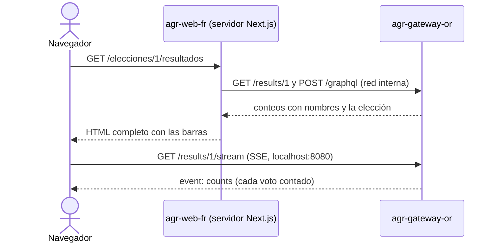

# agr-web-fr: interfaz web del votante (Next.js con SSR)

Componente de presentación de AGORA. Muestra las elecciones, permite iniciar sesión, votar y seguir los resultados
en vivo. Las páginas se generan en el servidor de Next.js, que consulta a `agr-gateway-or` por la red interna; el
navegador solo habla con el gateway para enviar el voto y para recibir los resultados en vivo (SSE).

## 1. Cómo funciona



| Ruta | Se genera en | Llamadas al gateway |
|---|---|---|
| `/` | Servidor | `POST /graphql` (elecciones con candidatos), desde el servidor |
| `/ingresar` | Servidor + Server Action | `POST /auth/login`, desde el servidor (la Server Action) |
| `/elecciones/[id]/votar` | Servidor + cliente | `POST /graphql` desde el servidor; `POST /votes` con el JWT desde el navegador |
| `/elecciones/[id]/resultados` | Servidor + cliente | `GET /results/{id}` y `POST /graphql` desde el servidor; `GET /results/{id}/stream` (SSE) desde el navegador |
| `/api/health` | Servidor | ninguna (*healthcheck* del contenedor) |

Para comprobar el SSR basta con abrir "Ver código fuente" en `/`: las elecciones ya vienen en el HTML. En
`docker compose logs agr-web-fr` aparece cada llamada del servidor al gateway (método, ruta, código y duración).

## 2. Estructura

```
agr-web-fr/
├── app/                              Páginas (App Router)
│   ├── layout.tsx                    Estructura común: encabezado, contenido y pie
│   ├── page.tsx                      /  lista de elecciones (SSR)
│   ├── ingresar/
│   │   ├── page.tsx                  /ingresar
│   │   └── actions.ts                Server Action: login contra el gateway desde el servidor
│   ├── elecciones/[id]/
│   │   ├── votar/page.tsx            SSR de la elección + formulario de voto
│   │   └── resultados/page.tsx       SSR de los resultados + SSE
│   ├── api/health/route.ts           Healthcheck
│   ├── not-found.tsx, error.tsx
│   └── globals.css
├── components/                       Componentes de interfaz
│   ├── SiteHeader.tsx, SessionMenu.tsx
│   ├── ElectionCard.tsx, StatusBadge.tsx, Notice.tsx, PageError.tsx, RetryButton.tsx
│   ├── LoginForm.tsx                 (cliente) useActionState + guarda el JWT
│   ├── VoteForm.tsx                  (cliente) elegir, confirmar y POST /votes
│   ├── LiveResults.tsx               (cliente) SSE + combinación con los candidatos
│   └── ResultBars.tsx
├── lib/
│   ├── api/
│   │   ├── server.ts                 Cliente del gateway para el servidor (server-only, red interna)
│   │   ├── browser.ts                Las dos llamadas del navegador: POST /votes y la URL del SSE
│   │   ├── errors.ts                 ApiError y traducción de códigos a mensajes (único lugar)
│   │   └── types.ts                  Tipos de los contratos
│   ├── config.ts                     Variables de entorno, leídas al ejecutar
│   ├── session.ts                    Sesión en sessionStorage + hook useSession
│   ├── useResultsStream.ts           EventSource con reconexión
│   ├── results.ts                    Conteos + candidatos → filas ordenadas con porcentajes
│   ├── navigation.ts                 Ruta de vuelta segura y validación del id
│   └── results.test.ts               Pruebas (npm test)
├── Dockerfile, next.config.ts, package.json, tsconfig.json
└── .env.development                  URLs para `npm run dev` fuera de Docker
```

Regla de dependencias: `app/` usa `components/` y `lib/`; `components/` usa `lib/`. `lib/api/server.ts` importa
`server-only`, así que la compilación falla si un componente de cliente lo importa por error.

## 3. Contratos que consume

Todos pasan por el gateway (README principal, sección 5.1).

| Llamada | Desde | Respuesta que se usa |
|---|---|---|
| `POST /graphql` `elections` y `election(id)` | Servidor | `id, name, description, status, startsAt, endsAt, isOpen, candidateCount, candidates { id number name description }` |
| `POST /auth/login` `{document, password}` | Servidor (Server Action) | `{access_token, token_type, expires_in}` |
| `POST /votes` `{election_id, candidate_id}` + `Authorization: Bearer` | Navegador | `201 {"status": "recorded"}` |
| `GET /results/{id}` | Servidor | `{election_id, election_name, total_votes, results[]}` |
| `GET /results/{id}/stream` | Navegador | eventos `counts` con `{election_id, total_votes, counts}` |

**Errores.** Cada respuesta fallida se convierte en un `ApiError` con el código y un mensaje para el votante, todo
en `lib/api/errors.ts`:

| Código | Dónde | Mensaje | Qué hace la interfaz |
|---|---|---|---|
| 401 | Login | "Documento o clave incorrectos." | Conserva el documento y borra la clave |
| 401 | Voto | "Tu sesión expiró…" | Cierra la sesión y lleva a `/ingresar?motivo=expirada`; después vuelve a votar |
| 404 | Páginas | | Página "No encontramos lo que buscas" |
| 409 | Voto | "Ya votaste en esta elección…" o "La elección no está abierta." (según `detail`) | Rechazo definitivo: ofrece ver resultados |
| 422 | Voto | "El candidato no pertenece a esta elección…" | Rechazo definitivo |
| 500 | Voto | "No se pudo guardar tu voto y no quedó registrado…" | Conserva la elección y permite reintentar |
| 502 | Voto | El `detail` del gateway (dice si el voto quedó o no registrado) | Permite reintentar |
| 503, 504 | Páginas | "AGORA no está disponible…" / "tardó demasiado…" | Aviso con botón "Reintentar" (vuelve a generar la página) |

## 4. Variables de entorno

| Variable | Por defecto | Uso |
|---|---|---|
| `GATEWAY_INTERNAL_URL` | `http://agr-gateway-or:8080` | Gateway visto desde el servidor de Next.js (red `agr-front`) |
| `NEXT_PUBLIC_GATEWAY_URL` | `http://localhost:8080` | Gateway visto desde el navegador (voto y SSE) |
| `GATEWAY_TIMEOUT_MS` | `8000` | Tiempo máximo de cada llamada del servidor al gateway |

Las tres se leen **al ejecutar**, no al compilar. `NEXT_PUBLIC_GATEWAY_URL` la lee el servidor y la pasa como prop a
los dos componentes que la necesitan, así que cambiarla no exige reconstruir la imagen.

## 5. Cómo ejecutarlo

**Con Docker Compose** (desde la raíz del repositorio):

```bash
docker compose up --build -d --wait agr-web-fr
```

Bloque del servicio en `docker-compose.yml`:

```yaml
  agr-web-fr:
    container_name: agr-web-fr
    build: ./agr-web-fr
    environment:
      GATEWAY_INTERNAL_URL: ${GATEWAY_INTERNAL_URL:-http://agr-gateway-or:8080}
      NEXT_PUBLIC_GATEWAY_URL: ${NEXT_PUBLIC_GATEWAY_URL:-http://localhost:8080}
    ports:
      - "3000:3000"
    depends_on:
      agr-gateway-or:
        condition: service_healthy
    healthcheck:
      test: ["CMD", "wget", "-qO-", "http://127.0.0.1:3000/api/health"]
      interval: 10s
      timeout: 5s
      retries: 6
      start_period: 10s
    networks: [agr-front]
    restart: unless-stopped
```

**Sin Docker** (Node 22 o superior, con el gateway publicado en `localhost:8080`):

```bash
cd agr-web-fr
npm install
npm run dev          # http://localhost:3000, usa .env.development
npm test             # pruebas de lib/ (no necesitan el gateway)
npm run build        # compila y revisa los tipos
```

La imagen se construye en tres etapas sobre `node:22-alpine`: dependencias (`npm ci`), compilación (`next build`
con `output: "standalone"`) y ejecución (`node server.js` como usuario `node`, puerto 3000). La compilación no
necesita al gateway, porque las páginas se generan en cada petición.

## 6. Decisiones de diseño

- **SSR en cada petición** (`export const dynamic = "force-dynamic"`). El HTML sale con los datos del momento y
  `next build` no depende de que el gateway esté arriba.
- **Login por Server Action.** El formulario va al servidor de Next.js (mismo origen) y este llama a
  `POST /auth/login` por la red interna. Así se cumple que el navegador solo hable con el gateway para votar y para
  el SSE.
- **JWT en `sessionStorage`.** El navegador lo necesita para enviar `POST /votes` directo al gateway. La sesión se
  borra al cerrar la pestaña y se cierra sola cuando vence el token (una hora). Las páginas que se generan en el
  servidor no usan el token, porque elecciones y resultados son públicos.
- **Resultados en vivo.** El SSE solo trae conteos por candidato; `lib/results.ts` los combina con los candidatos
  que llegaron en el HTML y calcula total, porcentajes y orden igual que el gateway. Si el gateway responde algo
  que no es un stream (por ejemplo, 502 con `agr-results-lo` caído), `useResultsStream` se reconecta con espera
  creciente hasta 30 segundos. El stream solo se abre si la elección está activa.
- **Logs sin datos sensibles.** El servidor registra método, ruta, código y duración de cada llamada al gateway;
  nunca cuerpos, claves ni tokens.
- **Encabezados de seguridad.** `X-Frame-Options: DENY`, `X-Content-Type-Options: nosniff`,
  `Referrer-Policy: same-origin` y sin `X-Powered-By`.

## 7. Límites conocidos

- El JWT queda al alcance de JavaScript (`sessionStorage`). Una cookie `HttpOnly` sería más segura, pero obligaría a
  que `POST /votes` también pasara por el servidor de Next.js.
- Cada pestaña tiene su propia sesión: abrir una pestaña nueva pide ingresar otra vez.
- Después de votar, los resultados pueden tardar un instante en reflejar el voto (consistencia eventual del broker).
