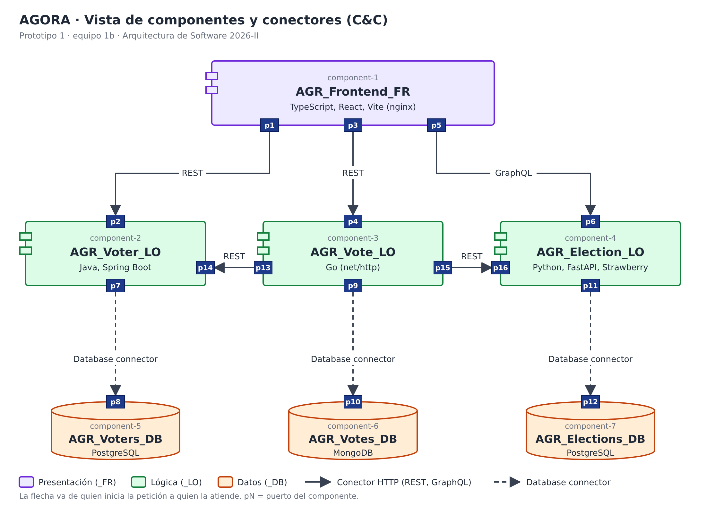

# Prototipo 1 — Equipo 1b

Arquitectura de Software, Universidad Nacional de Colombia, 2026-II.

## 1. Equipo

**Nombre:** 1b

**Integrantes:**

<!-- TODO: completar los nombres marcados abajo antes de exportar a PDF. -->

- David Fernando Benjumea Mora
- Esteban Prieto Lugo
- Miguel Sebastián Olarte Ramírez
- Camilo — *nombre completo pendiente*
- Cristian — *nombre completo pendiente*
- Maicol — *nombre completo pendiente*

## 2. Sistema de software

### 2.1 Nombre

**AGORA**

### 2.2 Logo


### 2.3 Descripción

AGORA es un sistema de votación electrónica. Los administradores crean elecciones, registran sus
candidatos y las abren o cierran. Los votantes inician sesión con su documento y su clave, eligen un
candidato en una elección abierta y emiten un único voto. Después, cualquier persona puede consultar el
conteo y el porcentaje que obtuvo cada candidato.

El sistema se construye alrededor de dos garantías:

- **Una persona, un voto.** El votante se marca como "ya votó" antes de guardar el voto, en una sola
  actualización atómica, de modo que un segundo intento se rechaza.
- **Voto anónimo.** Quién votó y qué se votó viven en bases de datos distintas, cada una de un servicio
  diferente. El voto guardado solo tiene la elección, el candidato y una fecha redondeada a la hora, y
  nada que identifique al votante.

## 3. Estructuras arquitectónicas

### 3.1 Estructura de componentes y conectores (C&C)

#### 3.1.1 Vista C&C



#### 3.1.2 Estilos arquitectónicos usados

| Estilo | Cómo lo usa AGORA |
|---|---|
| **Basado en servicios (distribuido)** | La lógica se divide en tres servicios de grano grueso, uno por dominio (votantes, votos y elecciones). Cada uno se despliega por separado, está escrito en un lenguaje distinto y no comparte código con los demás. |
| **SOFEA (Service-Oriented Front-End Architecture)** | El navegador descarga la aplicación web una sola vez y desde ahí consume los servicios directamente. Ningún servicio genera páginas. |
| **Tres capas (three-tier)** | Los componentes se organizan en los niveles de presentación (`_FR`), lógica (`_LO`) y datos (`_DB`). Un componente solo se comunica con el nivel inferior o con un par del nivel de lógica. |
| **Base de datos por servicio** | Cada servicio es el único dueño de su base de datos. Los demás componentes solo llegan a esos datos a través de la API del dueño. |
| **Cliente-servidor** | Toda interacción es una petición y respuesta síncrona sobre HTTP (REST o GraphQL) o sobre un protocolo de base de datos. |

#### 3.1.3 Elementos arquitectónicos y relaciones

**Componentes**

| # | Componente | Nivel | Tecnología | Responsabilidad |
|---|---|---|---|---|
| 1 | `AGR_Frontend_FR` | Presentación | TypeScript, React, Vite (servido por nginx) | Aplicación web que corre en el navegador. Muestra las elecciones con su estado y sus candidatos y es el punto de entrada de los votantes. |
| 2 | `AGR_Voter_LO` | Lógica | Java, Spring Boot | Autentica a los votantes (documento y clave) y emite un JWT. Lleva el control de quién ya votó con `mark-voted` y `unmark-voted`. |
| 3 | `AGR_Vote_LO` | Lógica | Go (`net/http`) | Recibe el voto, lo valida con los otros dos servicios, lo guarda de forma anónima y calcula los resultados de una elección. |
| 4 | `AGR_Election_LO` | Lógica | Python, FastAPI, Strawberry | Administra las elecciones, sus candidatos y su ciclo de vida (borrador, activa, cerrada). Las expone por REST y GraphQL. |
| 5 | `AGR_Voters_DB` | Datos | PostgreSQL | Base de datos relacional con los votantes, el hash de su clave y la marca "ya votó". |
| 6 | `AGR_Votes_DB` | Datos | MongoDB | Base de datos NoSQL (documental) con los votos anónimos y los eventos de auditoría. |
| 7 | `AGR_Elections_DB` | Datos | PostgreSQL | Base de datos relacional con las elecciones y sus candidatos. |

**Conectores**

| Conector | Desde → Hacia | Puertos | Propósito |
|---|---|---|---|
| REST (HTTP, JSON) | `AGR_Frontend_FR` → `AGR_Voter_LO` | p1 → p2 | Inicio de sesión del votante (`POST /auth/login`), que devuelve el JWT. |
| REST (HTTP, JSON) | `AGR_Frontend_FR` → `AGR_Vote_LO` | p3 → p4 | Emitir un voto (`POST /votes`) y consultar los resultados (`GET /results/{election_id}`). |
| GraphQL (HTTP) | `AGR_Frontend_FR` → `AGR_Election_LO` | p5 → p6 | Consultar las elecciones con sus candidatos anidados en una sola petición. |
| REST (HTTP, JSON) | `AGR_Vote_LO` → `AGR_Election_LO` | p15 → p16 | Comprobar que la elección existe, está abierta y contiene al candidato elegido (`GET /elections/{id}`). |
| REST (HTTP, JSON) | `AGR_Vote_LO` → `AGR_Voter_LO` | p13 → p14 | Marcar al votante como "ya votó" (`POST /voters/mark-voted`) y deshacerlo si el voto no se puede guardar (`POST /voters/unmark-voted`). |
| Conexión a base de datos (JDBC, protocolo de PostgreSQL) | `AGR_Voter_LO` → `AGR_Voters_DB` | p7 → p8 | Leer y actualizar votantes. |
| Conexión a base de datos (protocolo de MongoDB) | `AGR_Vote_LO` → `AGR_Votes_DB` | p9 → p10 | Insertar votos y eventos de auditoría, y agregar los resultados. |
| Conexión a base de datos (protocolo de PostgreSQL) | `AGR_Election_LO` → `AGR_Elections_DB` | p11 → p12 | Leer y escribir elecciones y candidatos. |

**Relaciones**

- El front-end es el único componente que usa una persona. Se conecta con los tres componentes de
  lógica y nunca con una base de datos.
- Cada componente de lógica se conecta con exactamente un componente de datos, y cada componente de
  datos está conectado con exactamente un componente de lógica.
- `AGR_Vote_LO` coordina el flujo de votación. Primero le pregunta a `AGR_Election_LO` si el voto es
  válido, luego le pide a `AGR_Voter_LO` que marque al votante y por último guarda el voto en
  `AGR_Votes_DB`. PostgreSQL y MongoDB no comparten transacción, así que si el último paso falla,
  compensa desmarcando al votante.
- `AGR_Voter_LO` y `AGR_Election_LO` no se llaman entre sí, y ninguno de los dos llama a `AGR_Vote_LO`.
- El sistema usa dos tipos de conector HTTP (REST y GraphQL), dos tipos de base de datos (relacional y
  NoSQL) y tres lenguajes de propósito general en el nivel de lógica (Java, Go y Python), además de
  TypeScript en el nivel de presentación.

### 3.2 Estructura de despliegue

Todo el sistema se despliega en un solo nodo: un equipo con Docker y Docker Compose. Cada componente de la vista
C&C corre en su propio contenedor y los siete contenedores comparten una red privada creada por Compose, en la que
se llaman por el nombre del servicio (por ejemplo `http://election-service:8000`). El navegador del votante queda
fuera de esa red: descarga la aplicación desde `localhost:3000` y desde ahí llama directamente a los puertos
publicados de los tres servicios (por eso el estilo es SOFEA).

| Componente | Contenedor | Imagen | Puerto (equipo → contenedor) | Datos persistentes |
|---|---|---|---|---|
| `AGR_Frontend_FR` | `agr-frontend-fr` | construida desde `frontend/` (Node 20 para compilar, nginx 1.27 para servir) | 3000 → 80 | — |
| `AGR_Voter_LO` | `agr-voter-lo` | construida desde `voter-service/` (Maven y Java 21) | 8001 → 8001 | — |
| `AGR_Vote_LO` | `agr-vote-lo` | construida desde `vote-service/` (Go 1.23) | 8002 → 8002 | — |
| `AGR_Election_LO` | `agr-election-lo` | construida desde `election-service/` (Python 3.12) | 8000 → 8000 | — |
| `AGR_Voters_DB` | `agr-voters-db` | `postgres:16-alpine` | 5432 → 5432 | volumen `voters-db-data` |
| `AGR_Votes_DB` | `agr-votes-db` | `mongo:7` | no se publica (27017 interno) | volumen `votes-db-data` |
| `AGR_Elections_DB` | `agr-elections-db` | `postgres:16-alpine` | no se publica (5432 interno) | volumen `elections-db-data` |

- Las bases de datos de votos y de elecciones no publican puertos: solo su servicio las alcanza, por la red de
  Compose. La base de votantes publica el `5432` para poder consultarla durante el desarrollo.
- Cada contenedor de lógica y de datos tiene un *healthcheck*, y cada uno espera (`depends_on`) a que lo que necesita
  esté sano antes de arrancar. El front-end espera a los tres servicios de lógica.
- El protocolo de transporte de todos los conectores es TCP, sobre los puertos de la tabla.

## 4. Prototipo

### 4.1 Requisitos

- Git.
- Docker con Docker Compose (Docker Desktop en Windows y macOS), con el motor corriendo.
- Los puertos `3000`, `8000`, `8001`, `8002` y `5432` del equipo libres.

### 4.2 Descargar y ejecutar

```bash
git clone https://github.com/Cam152/ArquiSoft.git
cd ArquiSoft
docker compose up --build
```

La primera ejecución descarga las imágenes base y construye los cuatro servicios, así que puede tardar
varios minutos. El sistema está listo cuando los siete contenedores están corriendo (`docker ps`):

| Componente (vista C&C) | Contenedor | Servicio en `docker-compose.yml` |
|---|---|---|
| `AGR_Frontend_FR` | `agr-frontend-fr` | `frontend` |
| `AGR_Voter_LO` | `agr-voter-lo` | `voter-service` |
| `AGR_Vote_LO` | `agr-vote-lo` | `vote-service` |
| `AGR_Election_LO` | `agr-election-lo` | `election-service` |
| `AGR_Voters_DB` | `agr-voters-db` | `voters-db` |
| `AGR_Votes_DB` | `agr-votes-db` | `votes-db` |
| `AGR_Elections_DB` | `agr-elections-db` | `elections-db` |

Los comandos de `docker compose` (`logs`, `exec`, `up`) usan el nombre del servicio.

| Qué | URL |
|---|---|
| Front-end | http://localhost:3000 |
| Election Service, documentación REST (Swagger) | http://localhost:8000/docs |
| Election Service, consola de GraphQL | http://localhost:8000/graphql |
| Voter Service, health check | http://localhost:8001/health |
| Vote Service, health check | http://localhost:8002/health |
| Vote Service, resultados de la elección 1 | http://localhost:8002/results/1 |

### 4.3 Probar desde el navegador

Abrir http://localhost:3000 y seguir estos pasos (los datos de ejemplo se cargan solos la primera vez):

1. La página de inicio lista tres elecciones: una abierta, una en borrador y una cerrada.
2. En la elección abierta, pulsar "Ingresa para votar" e ingresar con el documento `1000000001` y la clave
   `voter123`.
3. Elegir un candidato, pulsar "Continuar" y "Confirmar voto". Aparece "Voto registrado".
4. Intentar votar otra vez en la misma elección: el sistema responde "Ya votaste".
5. Pulsar "Ver resultados" para ver el conteo y el porcentaje de cada candidato.

Cada votante puede votar una sola vez en total. Para repetir la prueba con otro votante se usan los documentos
`1000000002` a `1000000005`, o se reinician los datos con `docker compose down -v`.


### 4.4 Detener

```bash
docker compose down        # detiene el sistema
docker compose down -v     # lo detiene y borra los datos guardados
```
