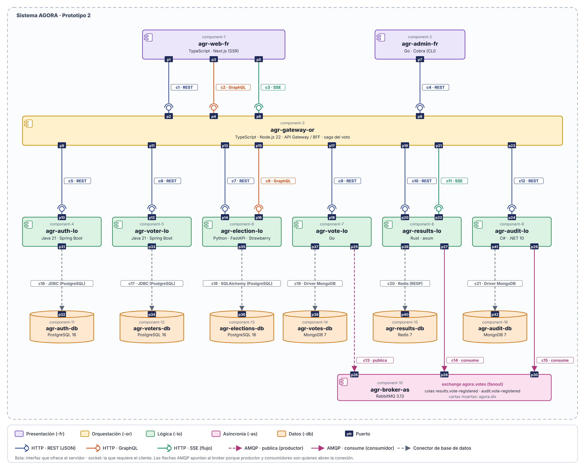
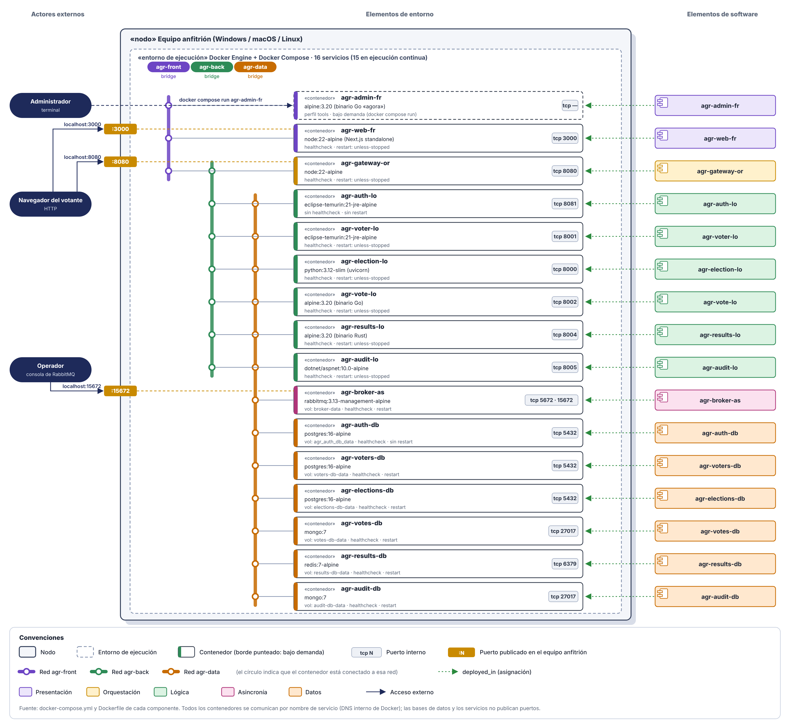
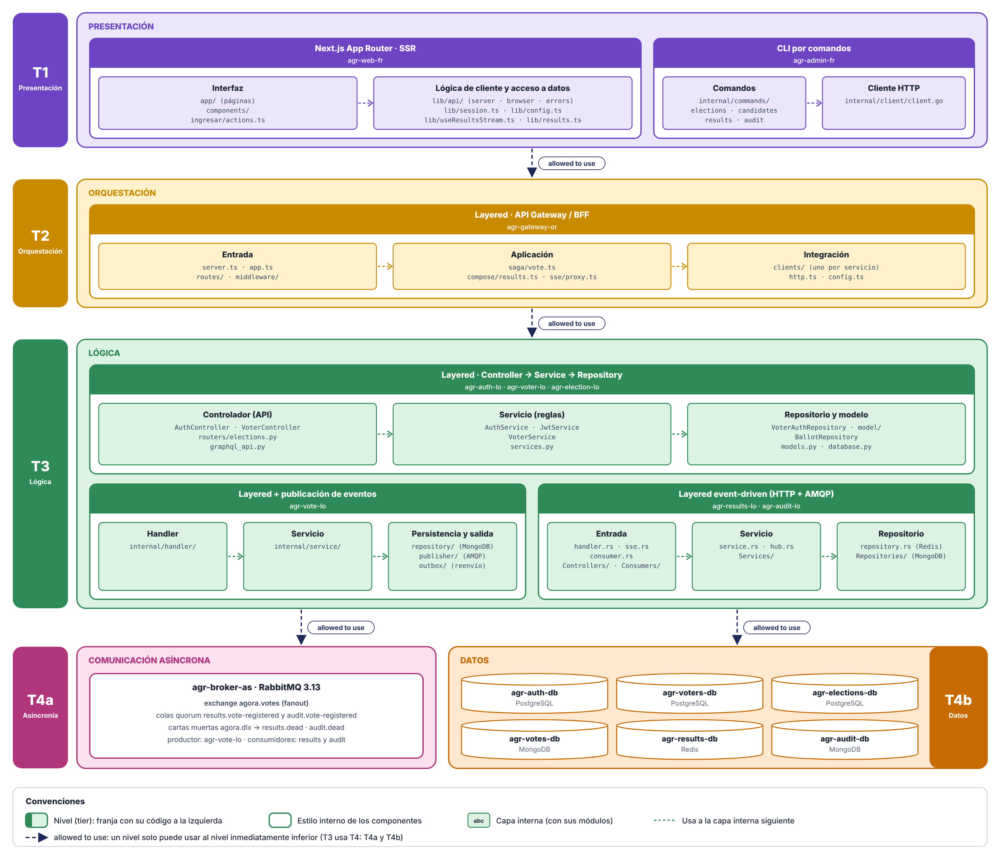
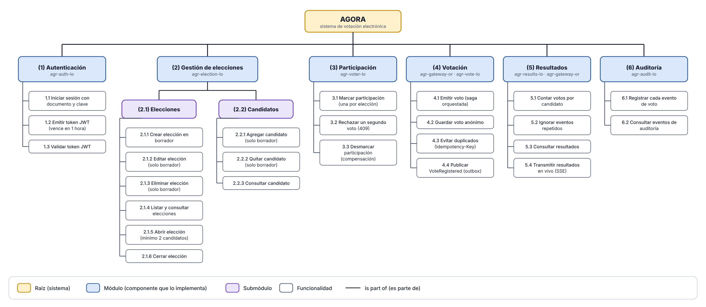

# Prototipo 2 — Equipo 1b

Arquitectura de Software, Universidad Nacional de Colombia, 2026-II.

## 1. Equipo

**Nombre:** 1b

**Integrantes:**

- David Fernando Benjumea Mora
- Esteban Prieto Lugo
- Maicol Sebastián Olarte Ramírez
- Camilo Borja Rojas
- Cristian Felipe Moreno Gomez
- Miguel Angel Zamudio Villa

## 2. Sistema de software

### 2.1 Nombre

**AGORA**

### 2.2 Logo


### 2.3 Descripción

AGORA es un sistema distribuido de votación electrónica para elecciones estudiantiles. Un administrador crea elecciones, registra sus candidatos y las abre o las cierra desde una consola de comandos. Un votante inicia sesión con su documento y su clave en la aplicación web, ve las elecciones abiertas, vota y sigue los resultados, que se actualizan solos mientras la votación está abierta.

El sistema se construye alrededor de dos garantías:

- **Una persona, un voto por elección.** La participación se guarda con la llave (`voter_id`, `election_id`). Un segundo intento en la misma elección se rechaza, pero la persona puede votar en otras elecciones.
- **Voto anónimo.** *Quién votó* y *qué se votó* se guardan en bases de datos distintas, de servicios distintos y sin ningún dato que las una. El voto solo contiene la elección, el candidato y la hora redondeada, y su identificador es aleatorio.

Frente al Prototipo 1, el Prototipo 2 agrega un API Gateway que orquesta el voto, un servicio de autenticación, uno de resultados en vivo, uno de auditoría, un broker de mensajería y una interfaz de administración por línea de comandos. En total son 16 componentes en contenedores: 9 propios, escritos en seis lenguajes (TypeScript, Go, Java, Python, Rust y C#), y 7 de software existente (PostgreSQL, MongoDB, Redis y RabbitMQ).

## 3. Estructuras arquitectónicas

### 3.1 Estructura de componentes y conectores (C&C)

#### 3.1.1 Vista de componentes y conectores

La vista muestra los componentes que existen **en ejecución** y los conectores por los que se comunican. Cada conector se identifica con un número (c1–c21) y un **tipo**: REST, GraphQL o SSE (los tres sobre HTTP), AMQP o conector de base de datos.



**Notación.** En los conectores HTTP, la bola está en el puerto del componente que **ofrece** la interfaz (servidor) y el socket que la abraza sale del componente que la **requiere** (cliente). En los conectores AMQP la flecha apunta al broker, porque tanto el productor como los consumidores son quienes abren la conexión; la línea punteada indica que el componente **publica** y la continua que **consume**. Los conectores de base de datos se dibujan punteados y apuntan a la base.

#### 3.1.2 Descripción de los elementos arquitectónicos y sus relaciones

Los componentes siguen la convención `agr-<nombre>-<nivel>`: `-fr` presentación, `-or` orquestación, `-lo` lógica, `-as` asincronía y `-db` datos. El nombre de cada componente es también el de su carpeta en el repositorio, su servicio en `docker-compose.yml` y su contenedor.

**Componentes**

| # | Componente | Nivel | Tecnología | Responsabilidad |
|---|---|---|---|---|
| 1 | `agr-web-fr` | Presentación | TypeScript, Next.js (SSR) | Aplicación web del votante: elecciones, inicio de sesión, voto y resultados en vivo. |
| 2 | `agr-admin-fr` | Presentación | Go, Cobra | CLI `agora` del administrador: elecciones, candidatos, resultados y auditoría. |
| 3 | `agr-gateway-or` | Orquestación | TypeScript, Node.js 22 | Enruta, valida el JWT (delegando en `agr-auth-lo`) y la llave de administración, compone resultados y orquesta la saga del voto. |
| 4 | `agr-auth-lo` | Lógica | Java 21, Spring Boot | Verifica documento y clave; emite y valida el JWT. |
| 5 | `agr-voter-lo` | Lógica | Java 21, Spring Boot | Registra qué votante participó en qué elección e impide el doble voto. |
| 6 | `agr-election-lo` | Lógica | Python, FastAPI, Strawberry | Elecciones, candidatos y su ciclo de vida (borrador, activa, cerrada). |
| 7 | `agr-vote-lo` | Lógica | Go | Guarda el voto anónimo y publica `VoteRegistered`. |
| 8 | `agr-results-lo` | Lógica | Rust (axum) | Consume los eventos, cuenta los votos y los transmite en vivo por SSE. |
| 9 | `agr-audit-lo` | Lógica | C#, .NET 10 | Consume los eventos y guarda el registro de auditoría. |
| 10 | `agr-broker-as` | Asincronía | RabbitMQ 3.13 | Reparte el evento de voto a resultados y auditoría. |
| 11 | `agr-auth-db` | Datos | PostgreSQL 16 | Votantes y hashes de sus claves. |
| 12 | `agr-voters-db` | Datos | PostgreSQL 16 | Participaciones (`ballots_cast`). Los datos de los votantes están en `agr-auth-db`. |
| 13 | `agr-elections-db` | Datos | PostgreSQL 16 | Elecciones y candidatos. |
| 14 | `agr-votes-db` | Datos | MongoDB 7 | Votos anónimos y su estado de publicación. |
| 15 | `agr-results-db` | Datos | Redis 7 | Conteos por candidato y eventos ya contados. |
| 16 | `agr-audit-db` | Datos | MongoDB 7 | Eventos de auditoría. |

**Conectores**

"Desde" es el cliente (o productor) y "Hacia" el servidor (o el broker).

| Conector | Tipo | Desde → Hacia | Puertos | Uso |
|---|---|---|---|---|
| c1 | REST (HTTP, JSON) | `agr-web-fr` → `agr-gateway-or` | p1 → p2 | `POST /auth/login`, `POST /votes`, `GET /results/{id}` |
| c2 | GraphQL (HTTP) | `agr-web-fr` → `agr-gateway-or` | p3 → p4 | `POST /graphql`: elecciones con sus candidatos |
| c3 | SSE (HTTP) | `agr-web-fr` → `agr-gateway-or` | p5 → p6 | `GET /results/{id}/stream`: resultados en vivo |
| c4 | REST (HTTP, JSON) | `agr-admin-fr` → `agr-gateway-or` | p7 → p8 | `GET /elections`, `/admin/elections/*`, `GET /results/{id}`, `GET /admin/audit` |
| c5 | REST (HTTP, JSON) | `agr-gateway-or` → `agr-auth-lo` | p9 → p10 | `POST /auth/login`, `GET /auth/validate` |
| c6 | REST (HTTP, JSON) | `agr-gateway-or` → `agr-voter-lo` | p11 → p12 | `POST /voters/mark-voted`, `POST /voters/unmark-voted` |
| c7 | REST (HTTP, JSON) | `agr-gateway-or` → `agr-election-lo` | p13 → p14 | Consultar una elección en la saga y operaciones de administración |
| c8 | GraphQL (HTTP) | `agr-gateway-or` → `agr-election-lo` | p15 → p16 | Reenvío de las consultas GraphQL de la web |
| c9 | REST (HTTP, JSON) | `agr-gateway-or` → `agr-vote-lo` | p17 → p18 | `POST /votes` con `Idempotency-Key` |
| c10 | REST (HTTP, JSON) | `agr-gateway-or` → `agr-results-lo` | p19 → p20 | `GET /results/{id}` |
| c11 | SSE (HTTP) | `agr-gateway-or` → `agr-results-lo` | p21 → p22 | `GET /results/{id}/stream` |
| c12 | REST (HTTP, JSON) | `agr-gateway-or` → `agr-audit-lo` | p23 → p24 | `GET /audit/events` |
| c13 | AMQP (publica) | `agr-vote-lo` → `agr-broker-as` | p25 → p26 | Publica `VoteRegistered` en el exchange `agora.votes` |
| c14 | AMQP (consume) | `agr-results-lo` → `agr-broker-as` | p27 → p28 | Consume la cola `results.vote-registered` |
| c15 | AMQP (consume) | `agr-audit-lo` → `agr-broker-as` | p29 → p30 | Consume la cola `audit.vote-registered` |
| c16 | Base de datos (JDBC, PostgreSQL) | `agr-auth-lo` → `agr-auth-db` | p31 → p32 | Votantes y claves |
| c17 | Base de datos (JDBC, PostgreSQL) | `agr-voter-lo` → `agr-voters-db` | p33 → p34 | Participaciones |
| c18 | Base de datos (SQLAlchemy, PostgreSQL) | `agr-election-lo` → `agr-elections-db` | p35 → p36 | Elecciones y candidatos |
| c19 | Base de datos (driver MongoDB) | `agr-vote-lo` → `agr-votes-db` | p37 → p38 | Votos anónimos |
| c20 | Base de datos (Redis, RESP) | `agr-results-lo` → `agr-results-db` | p39 → p40 | Conteos |
| c21 | Base de datos (driver MongoDB) | `agr-audit-lo` → `agr-audit-db` | p41 → p42 | Eventos de auditoría |

**Relaciones**

- La web y la CLI solo se conectan con el gateway (c1–c4); nunca con un servicio de lógica ni con una base de datos.
- El gateway se conecta con los seis servicios de lógica (c5–c12). **Los servicios de lógica no se llaman entre sí**: cuando el voto necesita a varios, el gateway los llama uno por uno.
- El voto es una saga orquestada por el gateway: pide a `agr-auth-lo` validar el JWT (c5), comprueba que la elección esté abierta y el candidato le pertenezca (c7), marca la participación (c6) y guarda el voto (c9). Si guardar el voto falla de forma confirmada (`agr-vote-lo` responde con error o rechaza la conexión), el gateway compensa con `unmark-voted` (c6); si no hay respuesta, no compensa, porque el voto pudo haberse guardado.
- `agr-web-fr` se ejecuta en dos lugares: en su contenedor (páginas SSR e inicio de sesión por Server Action) y en el navegador del votante, desde donde salen el voto (c1) y el flujo SSE (c3) hacia el gateway.
- La comunicación entre `agr-vote-lo` y sus consumidores es asíncrona (c13–c15): `agr-vote-lo` no conoce a `agr-results-lo` ni a `agr-audit-lo`. Las colas son de tipo *quorum* (durables) y un mensaje que falla cinco veces pasa al exchange de cartas muertas `agora.dlx` (colas `results.dead` y `audit.dead`).
- Cada servicio de lógica se conecta con exactamente una base de datos y cada base con exactamente un servicio (c16–c21).

#### 3.1.3 Descripción de los estilos y patrones arquitectónicos utilizados

| Estilo o patrón | Cómo se aplica en AGORA |
|---|---|
| **Microservicios** | La lógica se divide en seis servicios independientes, cada uno con una responsabilidad, su propio lenguaje y su propio despliegue. |
| **Cliente-servidor** | Las interfaces y el gateway son clientes; el gateway y los servicios son servidores. Toda interacción HTTP es petición-respuesta. |
| **API Gateway** | `agr-gateway-or` es el único punto de entrada para votantes y administrador (la web y la CLI). Ningún componente de presentación conoce a los servicios de lógica. La consola de RabbitMQ es una entrada aparte, solo para operación. |
| **Backend for Frontend (BFF)** | El gateway arma respuestas a la medida del cliente; por ejemplo, une los conteos de `agr-results-lo` con los nombres de los candidatos de `agr-election-lo`. |
| **Server-Side Rendering (SSR)** | `agr-web-fr` arma en su servidor las páginas de elecciones y resultados, y el inicio de sesión se hace con una Server Action. |
| **Saga orquestada** | El gateway coordina los cuatro pasos del voto (auth → election → voter → vote). Si guardar el voto falla de forma confirmada, compensa desmarcando la participación. |
| **Publish/Subscribe (broker)** | `agr-vote-lo` publica `VoteRegistered` en el exchange `agora.votes`; RabbitMQ entrega una copia a la cola de resultados y otra a la de auditoría. |
| **Outbox** | `agr-vote-lo` guarda el voto marcado como pendiente de publicar y un proceso lo reenvía si RabbitMQ no estaba disponible. |
| **Dead Letter Queue** | Los mensajes que fallan cinco veces se apartan a `results.dead` o `audit.dead` para no bloquear la cola principal. |
| **Consumidor idempotente** | Resultados y auditoría usan el `event_id` del evento para no contar ni registrar dos veces el mismo voto. |
| **CQRS ligero** | El voto se escribe en MongoDB y los resultados se leen de Redis, donde los conteos ya están calculados. |
| **Base de datos por servicio** | Cada servicio de lógica es el único que se conecta a su base. |

### 3.2 Estructura de despliegue

#### 3.2.1 Vista de despliegue

La vista muestra **dónde y cómo** se ejecuta cada componente: el nodo, el entorno de ejecución, los contenedores con su imagen y sus puertos, las redes de Docker y los puertos publicados hacia fuera del nodo. Cada elemento de software se asigna a su contenedor con la relación `deployed_in`.



#### 3.2.2 Descripción de los elementos arquitectónicos y sus relaciones

**Elementos de software**

Son los 16 componentes de la vista C&C, dibujados con el color de su nivel. Cada uno se asigna (`deployed_in`) a un contenedor con su mismo nombre.

**Elementos de entorno**

| Elemento | Tipo | Descripción |
|---|---|---|
| Equipo anfitrión | Nodo | Computador con Windows, macOS o Linux donde se ejecuta todo el sistema. |
| Docker Engine + Docker Compose | Entorno de ejecución | Construye las imágenes, crea las redes y los volúmenes y ejecuta los 16 servicios definidos en `docker-compose.yml`. |
| `agr-front` | Red de Docker (bridge) | Une la web, la CLI y el gateway. |
| `agr-back` | Red de Docker (bridge) | Une el gateway con los seis servicios de lógica. |
| `agr-data` | Red de Docker (bridge) | Une los seis servicios de lógica con las seis bases de datos y RabbitMQ. |
| Navegador del votante | Actor externo | Abre la web por `localhost:3000` y llama al gateway por `localhost:8080` para votar y recibir los resultados en vivo. |
| Administrador | Actor externo | Ejecuta la CLI con `docker compose run --rm agr-admin-fr <comando>`. |
| Operador | Actor externo | Abre la consola de RabbitMQ en `localhost:15672`. |

**Relación `deployed_in`**

| Elemento de software | Contenedor | Imagen base | Puerto interno | Puerto publicado | Redes | Volumen |
|---|---|---|---|---|---|---|
| `agr-admin-fr` | `agr-admin-fr` (bajo demanda) | `alpine:3.20` | — | — | front | — |
| `agr-web-fr` | `agr-web-fr` | `node:22-alpine` | 3000 | **3000** | front | — |
| `agr-gateway-or` | `agr-gateway-or` | `node:22-alpine` | 8080 | **8080** | front, back | — |
| `agr-auth-lo` | `agr-auth-lo` | `eclipse-temurin:21-jre-alpine` | 8081 | — | back, data | — |
| `agr-voter-lo` | `agr-voter-lo` | `eclipse-temurin:21-jre-alpine` | 8001 | — | back, data | — |
| `agr-election-lo` | `agr-election-lo` | `python:3.12-slim` | 8000 | — | back, data | — |
| `agr-vote-lo` | `agr-vote-lo` | `alpine:3.20` | 8002 | — | back, data | — |
| `agr-results-lo` | `agr-results-lo` | `alpine:3.20` | 8004 | — | back, data | — |
| `agr-audit-lo` | `agr-audit-lo` | `dotnet/aspnet:10.0-alpine` | 8005 | — | back, data | — |
| `agr-broker-as` | `agr-broker-as` | `rabbitmq:3.13-management-alpine` | 5672, 15672 | **15672** | data | `broker-data` |
| `agr-auth-db` | `agr-auth-db` | `postgres:16-alpine` | 5432 | — | data | `agr_auth_db_data` |
| `agr-voters-db` | `agr-voters-db` | `postgres:16-alpine` | 5432 | — | data | `voters-db-data` |
| `agr-elections-db` | `agr-elections-db` | `postgres:16-alpine` | 5432 | — | data | `elections-db-data` |
| `agr-votes-db` | `agr-votes-db` | `mongo:7` | 27017 | — | data | `votes-db-data` |
| `agr-results-db` | `agr-results-db` | `redis:7-alpine` | 6379 | — | data | `results-db-data` |
| `agr-audit-db` | `agr-audit-db` | `mongo:7` | 27017 | — | data | `audit-db-data` |

**Relaciones**

- Cada elemento de software se despliega en un contenedor propio. Los componentes propios se construyen con su `Dockerfile`; las bases de datos usan imágenes oficiales.
- Solo tres puertos se publican en el equipo anfitrión: 3000 (web), 8080 (gateway) y 15672 (consola de RabbitMQ). Los demás son internos y solo se alcanzan dentro de las redes de Docker.
- El gateway es el único contenedor en `agr-front` y `agr-back` a la vez, así que es el único camino entre la presentación y la lógica.
- El contenedor `agr-web-fr` sirve las páginas y hace el inicio de sesión desde el servidor. El código de la web que corre en el navegador (voto y resultados en vivo) llama al gateway por el puerto publicado 8080.
- Los contenedores se encuentran por nombre de servicio (DNS interno de Docker), sin direcciones IP fijas.
- El arranque sigue `depends_on` y los healthchecks: bases y broker → servicios de lógica → gateway → web. `agr-auth-lo` es el único servicio sin healthcheck; el gateway solo espera a que haya arrancado.
- Todos los servicios tienen `restart: unless-stopped`, salvo `agr-auth-lo`, `agr-auth-db` y la CLI. La CLI tiene el perfil `tools`, así que `docker compose up` no la arranca.
- Los siete volúmenes nombrados conservan los datos aunque los contenedores se recreen.

#### 3.2.3 Descripción de los patrones arquitectónicos utilizados

| Patrón | Cómo se aplica |
|---|---|
| **Despliegue en contenedores** | Cada componente corre en su propio contenedor, con su propio entorno de ejecución. |
| **Nodo único con múltiples contenedores** | Los 16 servicios se ejecutan en un solo equipo anfitrión, orquestados por Docker Compose. |
| **Segmentación de red** | Tres redes separan la presentación, la lógica y los datos; la web no comparte red con ningún servicio de lógica. |
| **Descubrimiento de servicios** | Los contenedores se llaman por nombre (`http://agr-vote-lo:8002`). |
| **Volúmenes persistentes** | Bases de datos y broker guardan sus datos en volúmenes nombrados. |
| **Health checks y política de reinicio** | Docker comprueba la salud de los servicios y reinicia los configurados con `restart: unless-stopped`. |
| **Configuración externa** | Credenciales, URLs internas y llaves se leen de variables de entorno; el `.env` (opcional) reemplaza los valores por defecto de `docker-compose.yml`. |

### 3.3 Estructura por capas

#### 3.3.1 Vista por capas

La vista organiza el sistema en **niveles (tiers)** con la relación *allowed to use*: un nivel solo puede usar al nivel inmediatamente inferior. El nivel inferior T4 tiene dos partes al mismo nivel: comunicación asíncrona (T4a) y datos (T4b). Dentro de cada nivel se muestran las **capas internas** de sus componentes, agrupadas por el estilo que comparten.



#### 3.3.2 Descripción de los elementos arquitectónicos y sus relaciones

**Niveles**

| Nivel | Componentes | Responsabilidad | Puede usar a |
|---|---|---|---|
| T1 · Presentación | `agr-web-fr`, `agr-admin-fr` | Interacción con el votante y con el administrador. | T2 |
| T2 · Orquestación | `agr-gateway-or` | Punto único de entrada de la web y la CLI, seguridad, composición y saga del voto. | T3 |
| T3 · Lógica | Los seis servicios `-lo` | Reglas del negocio, cada servicio sobre sus propios datos. | T4 (T4a y T4b) |
| T4a · Comunicación asíncrona | `agr-broker-as` | Recibe y reparte los eventos de voto. | — |
| T4b · Datos | Las seis bases `-db` | Persistencia de cada servicio. | — |

**Capas internas de cada componente**

| Componente(s) | Estilo interno | Capas (de arriba hacia abajo) |
|---|---|---|
| `agr-web-fr` | Next.js App Router con SSR | **Interfaz** (`app/` páginas, `components/`, `ingresar/actions.ts`) → **Lógica de cliente y acceso a datos** (`lib/api/server.ts`, `lib/api/browser.ts`, `lib/api/errors.ts`, `lib/session.ts`, `lib/useResultsStream.ts`, `lib/results.ts`, `lib/config.ts`) |
| `agr-admin-fr` | CLI por comandos | **Comandos** (`internal/commands/`: `elections`, `candidates`, `results`, `audit`) → **Cliente HTTP** (`internal/client/client.go`) |
| `agr-gateway-or` | Layered | **Entrada** (`server.ts`, `app.ts`, `routes/`, `middleware/`) → **Aplicación** (`saga/vote.ts`, `compose/results.ts`, `sse/proxy.ts`) → **Integración** (`clients/`, `http.ts`, `config.ts`) |
| `agr-auth-lo`, `agr-voter-lo`, `agr-election-lo` | Layered: Controller → Service → Repository | **Controlador** (`AuthController`, `VoterController`, `routers/`, `graphql_api.py`) → **Servicio** (`AuthService`, `JwtService`, `VoterService`, `services.py`) → **Repositorio y modelo** (`VoterAuthRepository`, `model/`, `BallotRepository`, `models.py`, `database.py`) |
| `agr-vote-lo` | Layered con publicación de eventos | **Handler** (`internal/handler/`) → **Servicio** (`internal/service/`) → **Persistencia y salida** (`repository/` MongoDB, `publisher/` AMQP, `outbox/`) |
| `agr-results-lo`, `agr-audit-lo` | Layered event-driven | **Entrada** HTTP y AMQP (`handler.rs`, `sse.rs`, `consumer.rs`; `Controllers/`, `Consumers/`) → **Servicio** (`service.rs`, `hub.rs`; `Services/`) → **Repositorio** (`repository.rs` Redis; `Repositories/` MongoDB) |

**Relaciones**

- *Allowed to use* entre niveles: T1 → T2 → T3 → T4. Ningún nivel usa a uno superior ni se salta un nivel: la presentación no llama a la lógica ni a los datos.
- La lógica (T3) usa la comunicación asíncrona (T4a) para publicar y consumir eventos, y los datos (T4b) para persistir. Results y audit *usan* el broker porque son ellos quienes se suscriben a su cola.
- Dentro de cada componente, cada capa solo usa a la siguiente (flechas punteadas de la vista).

#### 3.3.3 Descripción de los patrones arquitectónicos utilizados

| Patrón | Cómo se aplica |
|---|---|
| **Arquitectura por niveles (4 tiers)** | Presentación, orquestación, lógica y un nivel inferior con comunicación asíncrona y datos, con relación *allowed to use* hacia abajo. |
| **Layered (dentro de cada componente)** | Cada componente separa entrada, lógica y acceso a datos en capas con dependencia en un solo sentido. |
| **Layered event-driven** | En results y audit la entrada no es solo HTTP: también son consumidores de eventos AMQP. |
| **Separación de responsabilidades** | Cada nivel y cada capa tiene una responsabilidad distinta. |
| **Base de datos por servicio** | En T4b, cada base pertenece a un único servicio de T3. |

### 3.4 Estructura de descomposición

#### 3.4.1 Vista de descomposición

La vista descompone AGORA de forma jerárquica en **módulos** funcionales, **submódulos** y **funcionalidades**. Cada módulo indica el componente que lo implementa. La relación entre niveles es *is part of*.



#### 3.4.2 Descripción de los elementos arquitectónicos y sus relaciones

| Elemento | Tipo | Implementado en | Descripción | Relaciones |
|---|---|---|---|---|
| (1) Autenticación | Módulo | `agr-auth-lo` | Inicio de sesión y manejo del JWT. | Votación lo usa para validar el token del votante. |
| (2) Gestión de elecciones | Módulo | `agr-election-lo` | Ciclo de vida de elecciones y candidatos. | Votación lo usa para comprobar que la elección esté abierta. El gateway toma de él los nombres de los candidatos para componer los resultados (5.3). |
| (2.1) Elecciones | Submódulo | `agr-election-lo` | Crear, editar, eliminar, consultar, abrir y cerrar elecciones. | Parte de (2). |
| (2.2) Candidatos | Submódulo | `agr-election-lo` | Agregar, quitar y consultar candidatos. | Parte de (2). Agregar y quitar candidatos solo se permite en elecciones en borrador; consultarlos, siempre. |
| (3) Participación | Módulo | `agr-voter-lo` | Registra quién votó en qué elección. | Votación lo usa para marcar y, si falla, desmarcar. |
| (4) Votación | Módulo | `agr-gateway-or` (saga) y `agr-vote-lo` | Emite el voto, lo guarda de forma anónima y publica el evento. | Usa (1), (2) y (3); produce los eventos que consumen (5) y (6). |
| (5) Resultados | Módulo | `agr-results-lo` y `agr-gateway-or` | Cuenta los votos y los transmite en vivo. | Consume los eventos de (4). El gateway une sus conteos con los nombres de (2) y reenvía el flujo SSE. |
| (6) Auditoría | Módulo | `agr-audit-lo` | Registra y consulta los eventos de voto. | Consume los eventos de (4). |

**Funcionalidades**

| Código | Funcionalidad | Regla de negocio |
|---|---|---|
| 1.1 | Iniciar sesión con documento y clave | La clave se compara con su hash BCrypt. |
| 1.2 | Emitir token JWT | Vence en una hora. |
| 1.3 | Validar token JWT | Lo pide el gateway antes de cada voto. |
| 2.1.1 | Crear elección | Queda en estado borrador. |
| 2.1.2 | Editar elección | Solo en borrador. |
| 2.1.3 | Eliminar elección | Solo en borrador. |
| 2.1.4 | Listar y consultar elecciones | Por REST o GraphQL; se puede filtrar por estado. |
| 2.1.5 | Abrir elección | Requiere al menos dos candidatos. Se puede votar si está activa y la hora está entre `starts_at` y `ends_at`, cuando están definidas. |
| 2.1.6 | Cerrar elección | Solo una elección activa; cerrada no vuelve atrás. |
| 2.2.1 | Agregar candidato | Solo en borrador; nombre único dentro de la elección; el número se asigna solo. |
| 2.2.2 | Quitar candidato | Solo en borrador. |
| 2.2.3 | Consultar candidato | En cualquier estado de la elección (la web los muestra por GraphQL). |
| 3.1 | Marcar participación | `INSERT` atómico sobre la llave (`voter_id`, `election_id`). |
| 3.2 | Rechazar un segundo voto | Si la fila ya existe, responde 409. |
| 3.3 | Desmarcar participación | Compensación de la saga cuando el voto no se guardó. |
| 4.1 | Emitir voto | Saga: validar token → comprobar elección → marcar → guardar. |
| 4.2 | Guardar voto anónimo | Sin datos del votante, `_id` aleatorio y hora redondeada. |
| 4.3 | Evitar duplicados | La `Idempotency-Key` hace que un reintento no guarde el voto dos veces. |
| 4.4 | Publicar `VoteRegistered` | Con confirmación del broker; el outbox reintenta los pendientes. |
| 5.1 | Contar votos por candidato | Incremento atómico en Redis. |
| 5.2 | Ignorar eventos repetidos | Un script Lua registra cada `event_id` y solo suma si es nuevo. |
| 5.3 | Consultar resultados | El gateway agrega los nombres de los candidatos. |
| 5.4 | Transmitir resultados en vivo | Server-Sent Events hacia el navegador, a través del gateway. |
| 6.1 | Registrar cada evento de voto | `_id` igual al `event_id`; sin votante ni candidato. |
| 6.2 | Consultar eventos de auditoría | Desde la CLI (`agora audit list`), con la llave de administración. |

#### 3.4.3 Descripción de los patrones arquitectónicos utilizados

| Patrón | Cómo se aplica |
|---|---|
| **Descomposición funcional jerárquica** | El sistema se divide en módulos, submódulos y funcionalidades, con la relación *is part of*. |
| **Descomposición por capacidad de negocio** | Cada módulo corresponde a una capacidad del dominio (autenticación, elecciones, participación, votación, resultados y auditoría). |
| **Alta cohesión y bajo acoplamiento** | Cada módulo agrupa funcionalidades de un mismo dominio y se relaciona con los demás solo por contratos. |
| **Responsabilidad única** | Cada módulo tiene un componente principal distinto. El gateway participa en dos módulos como orquestador: dirige la saga de Votación y, en Resultados, compone los nombres y reenvía el SSE. |
| **Separación de responsabilidades** | Las reglas de cada dominio viven en su módulo y no se repiten en otros. |

## 4. Prototipo

### 4.1 Instrucciones

Requisitos: Git y Docker con Docker Compose (con el motor en ejecución), y los puertos `3000`, `8080` y `15672` libres.

**Descargar los artefactos**

```bash
git clone https://github.com/Cam152/ArquiSoft.git
cd ArquiSoft
```

**Configurar las variables de entorno (opcional)**

`docker-compose.yml` trae valores por defecto para todas las variables, así que el sistema arranca sin `.env`. Para cambiar credenciales o llaves, se crea a partir del ejemplo y se edita:

```bash
cp .env.example .env              # Windows PowerShell: Copy-Item .env.example .env
```

**Ejecutar el sistema**

```bash
docker compose up --build -d --wait
docker compose ps
```

El sistema está listo cuando `docker compose ps` muestra 15 contenedores en ejecución (la CLI solo corre bajo demanda).

| Qué | Dirección |
|---|---|
| Aplicación web | http://localhost:3000 |
| API Gateway | http://localhost:8080/health |
| Consola de RabbitMQ | http://localhost:15672 (usuario y clave `agora`) |

Votantes de prueba: documentos `1001` a `1005`, clave `123456`. La CLI de administración se ejecuta con:

```bash
docker compose run --rm agr-admin-fr elections list
```

**Detener el sistema**

```bash
docker compose down        # conserva los datos
docker compose down -v     # borra también los volúmenes
```

### 4.2 Video de presentación

[Proyecto AGORA](https://drive.google.com/file/d/1N9AWtXMQR2GstSK1Xb5_8Nc50lGTeyPI/view?usp=sharing)
