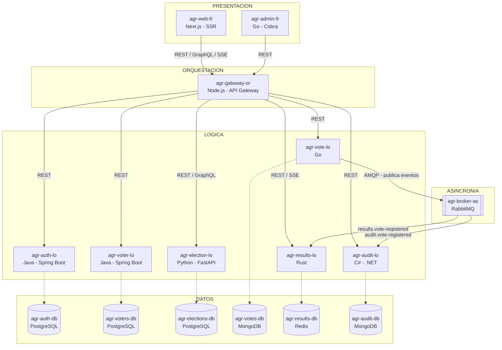
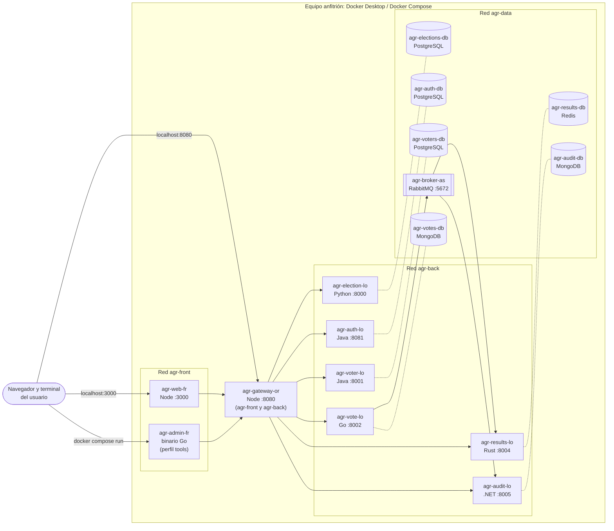
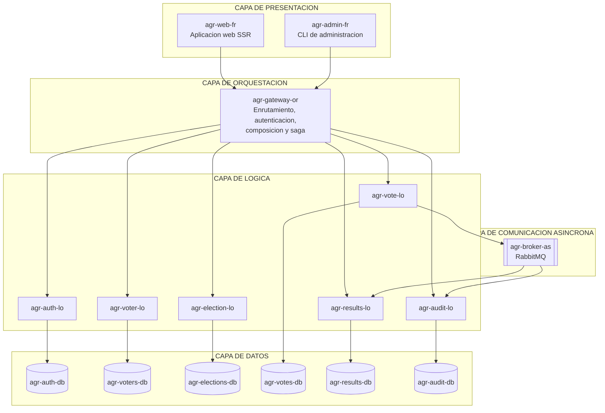

# Prototipo 2 — Equipo 1b

Arquitectura de Software, Universidad Nacional de Colombia, 2026-II.

## 1. Equipo

**Nombre:** 1b

**Integrantes:**

- David Fernando Benjumea Mora
- Esteban Prieto Lugo
- Maicol Sebastián Olarte Ramírez
- Camilo Borja Rojas
- Cristian Felipe Moreno Gomez
- Miguel Angel Zamudio Villa

## 2. Sistema de software

### 2.1 Nombre

**AGORA**

### 2.2 Logo


### 2.3 Descripción

AGORA es un sistema distribuido de votación electrónica que permite
administrar elecciones, registrar candidatos, autenticar votantes,
emitir votos anónimos y consultar resultados en tiempo real.

Los administradores pueden crear, modificar y eliminar elecciones,
registrar o retirar candidatos y controlar el estado de las elecciones
mediante operaciones de activación y cierre. Los votantes pueden iniciar
sesión utilizando su documento y contraseña, consultar las elecciones
disponibles, seleccionar un candidato y emitir su voto.

El sistema está desarrollado mediante una arquitectura de
microservicios, en la que cada servicio posee responsabilidades
independientes y administra su propia base de datos. La comunicación
entre los componentes se realiza mediante APIs REST, GraphQL y
Server-Sent Events (SSE), además de mensajería asíncrona utilizando
RabbitMQ.

El sistema se construye alrededor de dos garantías principales:

- **Una persona, un voto por elección:** cada participación se registra
  mediante una combinación única de `voter_id` y `election_id`. Esto
  permite que un votante participe una sola vez en cada elección, sin
  impedirle votar en otras elecciones.
- **Voto anónimo:** la información de identidad, la participación y el
  contenido del voto se almacenan en bases de datos independientes,
  administradas por servicios diferentes. El documento del voto contiene
  únicamente el identificador de la elección, el candidato seleccionado
  y una marca de tiempo redondeada a la hora, sin almacenar información
  que identifique al votante.

El Prototipo 2 amplía la arquitectura inicial mediante la incorporación
de un API Gateway, un servicio independiente de autenticación, un
servicio de resultados, un servicio de auditoría, un broker de
mensajería y una nueva interfaz de administración mediante CLI.

## 3. Estructuras arquitectónicas

### 3.1 Estructura de componentes y conectores (C&C)

#### 3.1.1 Vista de componentes y conectores

La estructura de componentes y conectores representa los componentes
principales del sistema y las conexiones que permiten su comunicación.

AGORA está organizado en cinco niveles arquitectónicos:

1.  **Presentación:** contiene la aplicación web y la CLI de
    administración.
2.  **Orquestación:** contiene el API Gateway, responsable de
    centralizar las solicitudes y coordinar operaciones.
3.  **Lógica:** contiene los seis microservicios que implementan las
    funcionalidades del sistema.
4.  **Asincronía:** contiene RabbitMQ, encargado de distribuir los
    eventos generados durante la votación.
5.  **Datos:** contiene las seis bases de datos independientes
    utilizadas por los servicios.



#### 3.1.2 Descripción de los elementos arquitectónicos y sus relaciones

**Elementos arquitectónicos**

Los componentes mantienen la convención de nombres
`agr-<nombre>-<nivel>`, donde:

- `-fr`: presentación.
- `-or`: orquestación.
- `-lo`: lógica.
- `-as`: asincronía.
- `-db`: datos.

En el Prototipo 2, el nombre del componente coincide con el nombre de su
carpeta en el repositorio, su servicio de Docker Compose y su
contenedor.

|  \# | Componente         | Nivel        | Tecnología                  | Responsabilidad                                                                                                |
|---|---|---|---|---|
|   1 | `agr-web-fr`       | Presentación | TypeScript, Next.js         | Aplicación web para consultar elecciones, iniciar sesión, emitir votos y visualizar resultados en tiempo real. |
|   2 | `agr-admin-fr`     | Presentación | Go, Cobra                   | Interfaz de línea de comandos para administrar elecciones, candidatos y consultar resultados y auditoría.      |
|   3 | `agr-gateway-or`   | Orquestación | TypeScript, Node.js         | Centraliza las solicitudes, realiza el enrutamiento, valida la autenticación y coordina la saga de votación.   |
|   4 | `agr-auth-lo`      | Lógica       | Java 21, Spring Boot        | Autentica a los votantes mediante documento y contraseña, genera y valida tokens JWT.                          |
|   5 | `agr-voter-lo`     | Lógica       | Java 21, Spring Boot        | Registra las participaciones de los votantes por elección e impide la duplicación de votos.                    |
|   6 | `agr-election-lo`  | Lógica       | Python, FastAPI, Strawberry | Administra las elecciones, los candidatos y los estados de las elecciones.                                     |
|   7 | `agr-vote-lo`      | Lógica       | Go                          | Almacena los votos anónimos en MongoDB y publica eventos de votación mediante RabbitMQ.                        |
|   8 | `agr-results-lo`   | Lógica       | Rust                        | Consume eventos de votación, actualiza los conteos en Redis y transmite resultados mediante SSE.               |
|   9 | `agr-audit-lo`     | Lógica       | C#, .NET                    | Consume eventos de votación y almacena registros de auditoría en MongoDB.                                      |
|  10 | `agr-broker-as`    | Asincronía   | RabbitMQ                    | Distribuye los eventos de votación a los servicios de resultados y auditoría.                                  |
|  11 | `agr-auth-db`      | Datos        | PostgreSQL 16               | Almacena la información de identidad de los votantes y los hashes de sus contraseñas.                          |
|  12 | `agr-voters-db`    | Datos        | PostgreSQL 16               | Almacena los registros de participación de los votantes en las elecciones.                                     |
|  13 | `agr-elections-db` | Datos        | PostgreSQL 16               | Almacena las elecciones y sus respectivos candidatos.                                                          |
|  14 | `agr-votes-db`     | Datos        | MongoDB 7                   | Almacena los votos anónimos y su estado de publicación.                                                        |
|  15 | `agr-results-db`   | Datos        | Redis 7                     | Almacena los conteos de votos y los identificadores de eventos procesados.                                     |
|  16 | `agr-audit-db`     | Datos        | MongoDB 7                   | Almacena los registros de auditoría generados por los eventos de votación.                                     |

**Conectores**

| Conector | Desde → Hacia                          | Tipo                | Propósito                                                                               |
|---|---|---|---|
| c1       | `agr-web-fr` → `agr-gateway-or`        | REST, GraphQL y SSE | Consultar elecciones, iniciar sesión, emitir votos y recibir resultados en tiempo real. |
| c2       | `agr-admin-fr` → `agr-gateway-or`      | REST                | Ejecutar operaciones administrativas y consultar resultados y auditoría.                |
| c3       | `agr-gateway-or` → `agr-auth-lo`       | REST                | Autenticar votantes y validar tokens JWT.                                               |
| c4       | `agr-gateway-or` → `agr-voter-lo`      | REST                | Registrar o retirar la participación de un votante.                                     |
| c5       | `agr-gateway-or` → `agr-election-lo`   | REST y GraphQL      | Consultar elecciones, candidatos y ejecutar operaciones administrativas.                |
| c6       | `agr-gateway-or` → `agr-vote-lo`       | REST                | Solicitar el almacenamiento de un voto anónimo.                                         |
| c7       | `agr-gateway-or` → `agr-results-lo`    | REST y SSE          | Consultar resultados y retransmitir actualizaciones en tiempo real.                     |
| c8       | `agr-gateway-or` → `agr-audit-lo`      | REST                | Consultar los registros de auditoría.                                                   |
| c9       | `agr-vote-lo` → `agr-broker-as`        | AMQP                | Publicar el evento `VoteRegistered`.                                                    |
| c10      | `agr-broker-as` → `agr-results-lo`     | AMQP                | Entregar eventos para actualizar los conteos de votos.                                  |
| c11      | `agr-broker-as` → `agr-audit-lo`       | AMQP                | Entregar eventos para generar registros de auditoría.                                   |
| c12      | `agr-auth-lo` → `agr-auth-db`          | PostgreSQL          | Consultar y almacenar información de autenticación.                                     |
| c13      | `agr-voter-lo` → `agr-voters-db`       | PostgreSQL          | Registrar y consultar las participaciones.                                              |
| c14      | `agr-election-lo` → `agr-elections-db` | PostgreSQL          | Consultar y modificar elecciones y candidatos.                                          |
| c15      | `agr-vote-lo` → `agr-votes-db`         | MongoDB             | Insertar votos anónimos y gestionar su estado de publicación.                           |
| c16      | `agr-results-lo` → `agr-results-db`    | Redis               | Consultar y actualizar los conteos de votos.                                            |
| c17      | `agr-audit-lo` → `agr-audit-db`        | MongoDB             | Insertar y consultar los registros de auditoría.                                        |

**Relaciones entre los elementos**

- Los componentes de presentación se comunican únicamente con el API
  Gateway para acceder a las funcionalidades del sistema.
- El API Gateway es el punto central de entrada y distribución de las
  solicitudes. Se comunica con los seis servicios de lógica mediante
  HTTP.
- Cada servicio de lógica administra exclusivamente su propia base de
  datos, evitando el acceso compartido a información.
- El servicio de votos recibe la solicitud del gateway, almacena el voto
  anónimo en MongoDB y publica el evento `VoteRegistered` mediante
  RabbitMQ.
- RabbitMQ distribuye el evento a dos consumidores independientes:
  Results Service y Audit Service.
- Results Service actualiza los conteos en Redis y permite consultar los
  resultados mediante HTTP y SSE.
- Audit Service almacena los eventos recibidos en MongoDB y permite
  consultar los registros mediante el gateway.
- El gateway coordina el proceso de votación mediante una saga. Si el
  almacenamiento del voto falla de manera confirmada, ejecuta una
  operación de compensación para retirar la marca de participación.
- Los servicios de lógica no acceden directamente a las bases de datos
  de otros servicios ni realizan llamadas directas entre ellos.

#### 3.1.3 Descripción de los estilos y patrones arquitectónicos utilizados

| Estilo o patrón                       | Aplicación en AGORA                                                                                                      |
|---|---|
| **Microservicios**                    | La lógica del sistema se distribuye en seis servicios independientes, cada uno con una responsabilidad específica.       |
| **API Gateway**                       | `agr-gateway-or` centraliza las solicitudes y funciona como punto de entrada para las interfaces.                        |
| **Backend for Frontend (BFF)**        | El gateway adapta y combina información de los servicios para entregar respuestas a los clientes.                        |
| **Server-Side Rendering (SSR)**       | Next.js genera las páginas iniciales en el servidor antes de enviarlas al navegador.                                     |
| **Base de datos por servicio**        | Cada microservicio administra su propio almacenamiento y evita el acceso directo de otros servicios.                     |
| **Saga orquestada**                   | El gateway coordina las operaciones necesarias para registrar un voto y ejecutar compensaciones ante fallos confirmados. |
| **Publish/Subscribe**                 | RabbitMQ distribuye los eventos de votación a los consumidores de resultados y auditoría.                                |
| **Arquitectura dirigida por eventos** | Los servicios reaccionan a eventos sin depender de llamadas síncronas directas entre ellos.                              |
| **Outbox Pattern**                    | Vote Service conserva los votos pendientes de publicación y permite reintentar el envío de eventos.                      |
| **CQRS ligero**                       | MongoDB almacena los votos y Redis mantiene una estructura optimizada para consultar los resultados.                     |
| **Idempotencia**                      | Las claves de idempotencia y los identificadores de eventos evitan duplicar operaciones ante reintentos.                 |
| **Cliente-servidor**                  | Las interfaces y los servicios se comunican mediante APIs HTTP y conexiones de mensajería.                               |

### 3.2 Estructura de despliegue

#### 3.2.1 Vista de despliegue

La estructura de despliegue representa cómo se ejecutan los componentes
del sistema en el entorno de infraestructura.

AGORA utiliza Docker Compose para construir y ejecutar los servicios en
contenedores independientes. Cada servicio cuenta con su propia
configuración, imagen y dependencias.

La infraestructura está organizada en tres redes Docker:

- `agr-front`: conecta los componentes de presentación con el API
  Gateway.
- `agr-back`: conecta el API Gateway con los servicios de lógica.
- `agr-data`: conecta los servicios de lógica con sus respectivas bases
  de datos y con RabbitMQ.

La separación de redes permite limitar la comunicación entre los
componentes según sus responsabilidades.



#### 3.2.2 Descripción de los elementos arquitectónicos y sus relaciones

**Elementos de despliegue**

El archivo `docker-compose.yml` define los servicios, las imágenes, las
dependencias, las redes, los volúmenes y las comprobaciones de salud.

| Componente         | Tipo de despliegue      | Imagen o tecnología   | Puerto interno | Puerto publicado |
|---|---|---|---|---|
| `agr-web-fr`       | Contenedor              | Next.js / Node.js     |           3000 | 3000             |
| `agr-admin-fr`     | Contenedor bajo demanda | Go / Cobra            |      No aplica | Ninguno          |
| `agr-gateway-or`   | Contenedor              | Node.js               |           8080 | 8080             |
| `agr-auth-lo`      | Contenedor              | Java 21 / Spring Boot |           8081 | Ninguno          |
| `agr-voter-lo`     | Contenedor              | Java 21 / Spring Boot |           8001 | Ninguno          |
| `agr-election-lo`  | Contenedor              | Python / FastAPI      |           8000 | Ninguno          |
| `agr-vote-lo`      | Contenedor              | Go                    |           8002 | Ninguno          |
| `agr-results-lo`   | Contenedor              | Rust                  |           8004 | Ninguno          |
| `agr-audit-lo`     | Contenedor              | C# / .NET             |           8005 | Ninguno          |
| `agr-broker-as`    | Contenedor              | RabbitMQ              |   5672 / 15672 | 15672            |
| `agr-auth-db`      | Contenedor              | PostgreSQL 16         |           5432 | Ninguno          |
| `agr-voters-db`    | Contenedor              | PostgreSQL 16         |           5432 | Ninguno          |
| `agr-elections-db` | Contenedor              | PostgreSQL 16         |           5432 | Ninguno          |
| `agr-votes-db`     | Contenedor              | MongoDB 7             |          27017 | Ninguno          |
| `agr-results-db`   | Contenedor              | Redis 7               |           6379 | Ninguno          |
| `agr-audit-db`     | Contenedor              | MongoDB 7             |          27017 | Ninguno          |

En total, Docker Compose define 16 servicios de despliegue. La CLI
utiliza el perfil `tools`, por lo que se ejecuta bajo demanda y no se
inicia con el comando normal `docker compose up`.

**Redes de despliegue**

| Red         | Componentes conectados                                       | Función                                                    |
|---|---|---|
| `agr-front` | `agr-web-fr`, `agr-admin-fr`, `agr-gateway-or`               | Permite la comunicación entre las interfaces y el gateway. |
| `agr-back`  | `agr-gateway-or` y los seis servicios de lógica              | Permite que el gateway alcance las APIs internas.          |
| `agr-data`  | Los seis servicios de lógica, seis bases de datos y RabbitMQ | Permite el acceso a persistencia y mensajería.             |

**Volúmenes persistentes**

Docker Compose define volúmenes nombrados para conservar la información
aunque los contenedores sean detenidos o recreados.

| Volumen             | Componente asociado | Información conservada                     |
|---|---|---|
| `elections-db-data` | `agr-elections-db`  | Elecciones y candidatos.                   |
| `voters-db-data`    | `agr-voters-db`     | Participaciones de los votantes.           |
| `votes-db-data`     | `agr-votes-db`      | Votos anónimos y registros de publicación. |
| `results-db-data`   | `agr-results-db`    | Conteos y eventos procesados.              |
| `audit-db-data`     | `agr-audit-db`      | Registros de auditoría.                    |
| `agr_auth_db_data`  | `agr-auth-db`       | Información de autenticación.              |
| `broker-data`       | `agr-broker-as`     | Datos persistentes de RabbitMQ.            |

**Relaciones de despliegue**

- Docker Compose construye los contenedores a partir de los Dockerfile
  de los componentes o utiliza imágenes oficiales para las bases de
  datos.
- Los servicios de lógica esperan a que sus respectivas bases de datos
  estén disponibles mediante `depends_on` y comprobaciones de salud
  cuando están configuradas.
- Vote Service y Audit Service dependen de RabbitMQ para publicar o
  consumir eventos.
- El API Gateway espera a que los servicios necesarios estén disponibles
  antes de iniciar su operación normal.
- La aplicación web depende del estado saludable del gateway.
- Los contenedores se comunican mediante los nombres de servicio de
  Docker Compose, sin necesitar direcciones IP fijas.
- Únicamente se publican los puertos `3000`, `8080` y `15672` hacia el
  equipo anfitrión. Los demás servicios y bases de datos permanecen
  accesibles dentro de las redes Docker correspondientes.
- Los volúmenes nombrados permiten conservar los datos entre reinicios.

#### 3.2.3 Descripción de los patrones arquitectónicos utilizados

| Patrón                                          | Aplicación en el despliegue                                                                                                          |
|---|---|
| **Containerization**                            | Cada componente se ejecuta en un contenedor independiente.                                                                           |
| **Multi-container deployment**                  | Docker Compose administra los contenedores y sus dependencias como un único sistema.                                                 |
| **Network segmentation**                        | Las redes `agr-front`, `agr-back` y `agr-data` separan los canales de comunicación.                                                  |
| **Service discovery**                           | Docker Compose permite localizar servicios utilizando sus nombres como nombres de host.                                              |
| **Persistent volumes**                          | Los volúmenes nombrados conservan los datos de las bases de datos y del broker.                                                      |
| **Health checks**                               | Los servicios que tienen configurado un healthcheck permiten comprobar su disponibilidad.                                            |
| **Restart policy**                              | Los servicios configurados con `restart: unless-stopped` pueden reiniciarse automáticamente después de fallos o reinicios del motor. |
| **Configuration through environment variables** | Las credenciales, direcciones internas y parámetros de ejecución se configuran mediante variables de entorno.                        |
| **Build per service**                           | Los servicios que contienen un Dockerfile se construyen de manera independiente.                                                     |

### 3.3 Estructura por capas

#### 3.3.1 Vista por capas

La estructura por capas representa la organización lógica del sistema
según las responsabilidades de sus componentes.

AGORA utiliza una separación de responsabilidades que permite mantener
las interfaces, la coordinación de operaciones, las reglas del negocio,
la comunicación asíncrona y el almacenamiento de información en niveles
independientes.



#### 3.3.2 Descripción de los elementos arquitectónicos y sus relaciones

**Capa de presentación**

Está formada por los componentes que permiten la interacción de los
usuarios con el sistema.

- `agr-web-fr`: aplicación web desarrollada con Next.js y TypeScript.
  Utiliza SSR para generar las páginas iniciales y permite a los
  votantes consultar elecciones, iniciar sesión, emitir votos y
  visualizar resultados.
- `agr-admin-fr`: interfaz de línea de comandos desarrollada en Go
  mediante Cobra. Permite ejecutar operaciones administrativas a través
  del gateway.

La capa de presentación no accede directamente a las bases de datos ni
contiene la lógica central del negocio.

**Capa de orquestación**

Está formada por `agr-gateway-or`, desarrollado con TypeScript y
Node.js.

Sus responsabilidades son:

- Centralizar las solicitudes provenientes de la aplicación web y la
  151. 
- Enrutar las solicitudes hacia los microservicios correspondientes.
- Validar los tokens JWT de los votantes mediante Auth Service.
- Proteger las operaciones administrativas mediante una API Key.
- Coordinar la saga del proceso de votación.
- Combinar la información de resultados con los datos de las elecciones
  y candidatos.
- Retransmitir las actualizaciones SSE hacia la aplicación web.

Esta capa evita que las interfaces tengan que conocer la ubicación y los
contratos internos de todos los microservicios.

**Capa de lógica**

Contiene los seis microservicios encargados de implementar las
funcionalidades del sistema.

| Servicio          | Responsabilidad principal                                     |
|---|---|
| `agr-auth-lo`     | Autenticación de votantes y gestión de tokens JWT.            |
| `agr-voter-lo`    | Registro de participaciones y prevención del doble voto.      |
| `agr-election-lo` | Administración de elecciones y candidatos.                    |
| `agr-vote-lo`     | Almacenamiento de votos anónimos y publicación de eventos.    |
| `agr-results-lo`  | Procesamiento de eventos y cálculo incremental de resultados. |
| `agr-audit-lo`    | Registro y consulta de eventos de auditoría.                  |

Cada servicio implementa sus propias reglas y mantiene independencia
respecto a los demás.

**Capa de comunicación asíncrona**

Está representada por `agr-broker-as`, implementado mediante RabbitMQ.

Esta capa permite distribuir los eventos de votación sin requerir que el
servicio que registra el voto espere a que todos los consumidores
terminen su procesamiento.

RabbitMQ recibe los eventos publicados por Vote Service y los distribuye
a:

- `results.vote-registered`: cola consumida por Results Service.
- `audit.vote-registered`: cola consumida por Audit Service.

También dispone de mecanismos de confirmación y colas de mensajes
fallidos.

**Capa de datos**

Está formada por las seis bases de datos independientes:

| Base de datos      | Tecnología | Información                                               |
|---|---|---|
| `agr-auth-db`      | PostgreSQL | Identidad de los votantes y hashes de contraseñas.        |
| `agr-voters-db`    | PostgreSQL | Participación de los votantes por elección.               |
| `agr-elections-db` | PostgreSQL | Elecciones y candidatos.                                  |
| `agr-votes-db`     | MongoDB    | Votos anónimos y estado de publicación.                   |
| `agr-results-db`   | Redis      | Conteos de votos e identificadores de eventos procesados. |
| `agr-audit-db`     | MongoDB    | Eventos y registros de auditoría.                         |

**Relaciones entre capas**

- La capa de presentación depende de la capa de orquestación para
  acceder a las funcionalidades del sistema.
- La capa de orquestación coordina las operaciones y se comunica con los
  servicios de lógica.
- La capa de lógica utiliza sus respectivas bases de datos para
  almacenar y consultar información.
- Vote Service publica eventos hacia la capa de comunicación asíncrona.
- RabbitMQ distribuye esos eventos a Results Service y Audit Service.
- Results Service y Audit Service actualizan sus respectivas bases de
  datos después de procesar los eventos.
- La información de cada servicio permanece aislada y solo se comparte
  mediante contratos de comunicación.

#### 3.3.3 Descripción de los patrones arquitectónicos utilizados

| Patrón                              | Aplicación en AGORA                                                                                       |
|---|---|
| **Layered Architecture**            | Divide el sistema en presentación, orquestación, lógica, comunicación asíncrona y datos.                  |
| **Separation of Concerns**          | Cada capa y servicio tiene responsabilidades claramente diferenciadas.                                    |
| **Dependency Direction**            | Las interfaces dependen del gateway y los servicios de lógica dependen de sus mecanismos de persistencia. |
| **Single Responsibility Principle** | Cada microservicio se encarga de una responsabilidad específica del dominio.                              |
| **Database per Service**            | Cada servicio de lógica administra su propia base de datos.                                               |
| **API Gateway**                     | La capa de orquestación centraliza el acceso a los servicios internos.                                    |
| **Event-Driven Communication**      | La comunicación entre el servicio de votos y sus consumidores se realiza mediante eventos.                |

### 3.4 Estructura de descomposición

#### 3.4.1 Vista de descomposición

La estructura de descomposición representa cómo se encuentran
organizados internamente los componentes principales del sistema.

Cada microservicio está dividido en módulos, paquetes, controladores,
servicios, modelos y repositorios que permiten separar las
responsabilidades internas.

El siguiente diagrama muestra la descomposición de los principales
componentes del Prototipo 2.

```mermaid
flowchart TB
    subgraph GW["agr-gateway-or"]
        GAPP["app.ts / server.ts"]
        GCLIENT["clients/"]
        GMIDDLE["middleware/"]
        GROUTES["routes/"]
        GCOMPOSE["compose/"]
        GSAGA["saga/"]
        GSSE["sse/"]
    end

    subgraph AUTH["agr-auth-lo"]
        ACONT["controller/"]
        ASERVICE["service/"]
        AREPO["repository/"]
        AMODEL["model/"]
        ACONFIG["config/"]
    end

    subgraph VOTER["agr-voter-lo"]
        VCONT["controller/"]
        VSERVICE["service/"]
        VREPO["repository/"]
        VDTO["dto/"]
        VSEC["security/"]
    end

    subgraph ELECTION["agr-election-lo"]
        EMAIN["main.py"]
        EROUTER["routers/"]
        ESERVICE["services.py"]
        EMODEL["models.py"]
        ESCHEMA["schemas.py"]
        EGRAPH["graphql_api.py"]
        ECONFIG["config.py / database.py"]
    end

    subgraph VOTE["agr-vote-lo"]
        VHANDLER["handler/"]
        VSERVICE2["service/"]
        VREPOSITORY["repository/"]
        VPUBLISH["publisher/"]
        VOUTBOX["outbox/"]
        VMODEL["model/"]
    end

    subgraph RESULTS["agr-results-lo"]
        RMAIN["main.rs"]
        RHANDLER["handler.rs"]
        RSERVICE["service.rs"]
        RREPO["repository.rs"]
        RCONSUMER["consumer.rs"]
        RHUB["hub.rs"]
        RSSE["sse.rs"]
        RMODEL["model.rs"]
    end

    subgraph AUDIT["agr-audit-lo"]
        APROGRAM["Program.cs"]
        ACONTROLLER["Controllers/"]
        ASVC["Services/"]
        AREPOSITORY["Repositories/"]
        ACONSUMER["Consumers/"]
        AMODELS["Models/"]
    end

    GAPP --> GCLIENT
    GAPP --> GMIDDLE
    GAPP --> GROUTES
    GAPP --> GCOMPOSE
    GAPP --> GSAGA
    GAPP --> GSSE

    ACONT --> ASERVICE
    ASERVICE --> AREPO
    AREPO --> AMODEL
    ACONFIG --> AMODEL

    VCONT --> VSERVICE
    VSERVICE --> VREPO
    VCONT --> VDTO
    VSEC --> VCONT

    EMAIN --> EROUTER
    EROUTER --> ESERVICE
    ESERVICE --> EMODEL
    EROUTER --> ESCHEMA
    EMAIN --> EGRAPH
    EMAIN --> ECONFIG

    VHANDLER --> VSERVICE2
    VSERVICE2 --> VREPOSITORY
    VSERVICE2 --> VPUBLISH
    VPUBLISH --> VOUTBOX
    VHANDLER --> VMODEL

    RMAIN --> RHANDLER
    RHANDLER --> RSERVICE
    RSERVICE --> RREPO
    RMAIN --> RCONSUMER
    RCONSUMER --> RHUB
    RHUB --> RSSE
    RSERVICE --> RMODEL

    APROGRAM --> ACONTROLLER
    ACONTROLLER --> ASVC
    ASVC --> AREPOSITORY
    APROGRAM --> ACONSUMER
    ACONSUMER --> AMODELS
```



#### 3.4.2 Descripción de los elementos arquitectónicos y sus relaciones

**1. API Gateway — `agr-gateway-or`**

El gateway está desarrollado en TypeScript y utiliza una organización
modular dentro de `src/`.

| Módulo        | Archivos                                                                                                                     | Responsabilidad                                                    |
|---|---|---|
| Aplicación    | `app.ts`, `server.ts`                                                                                                        | Configuración e inicio del servidor HTTP.                          |
| Clientes      | `clients/auth.ts`, `clients/election.ts`, `clients/results.ts`, `clients/vote.ts`, `clients/voter.ts`, `clients/upstream.ts` | Comunicación con los microservicios internos.                      |
| Configuración | `config.ts`                                                                                                                  | Lectura y organización de variables de entorno.                    |
| HTTP          | `http.ts`                                                                                                                    | Funciones de comunicación HTTP y manejo de solicitudes.            |
| Middleware    | `middleware/admin.ts`, `middleware/cors.ts`                                                                                  | Protección administrativa y configuración CORS.                    |
| Rutas         | `routes/index.ts`, `routes/forward.ts`                                                                                       | Definición y distribución de las rutas de la API.                  |
| Composición   | `compose/results.ts`                                                                                                         | Integración de conteos con información de elecciones y candidatos. |
| Saga          | `saga/vote.ts`                                                                                                               | Coordinación del proceso de emisión de votos y compensaciones.     |
| SSE           | `sse/proxy.ts`                                                                                                               | Retransmisión de eventos de resultados hacia los clientes.         |

Las rutas reciben las solicitudes, los clientes se comunican con los
servicios internos y los módulos de composición y saga coordinan los
procesos que necesitan información de varios componentes.

**2. Auth Service — `agr-auth-lo`**

Desarrollado en Java 21 utilizando Spring Boot.

| Módulo        | Archivos                                                          | Responsabilidad                                                |
|---|---|---|
| Aplicación    | `AuthServiceApplication.java`                                     | Punto de entrada del servicio.                                 |
| Configuración | `SecurityConfig.java`, `DataSeeder.java`                          | Configuración de seguridad y datos iniciales.                  |
| Controlador   | `AuthController.java`                                             | Expone los endpoints de autenticación y validación.            |
| DTO           | `LoginRequest.java`, `AuthResponse.java`, `ValidateResponse.java` | Define los objetos de entrada y salida.                        |
| Modelo        | `VoterAuth.java`                                                  | Representa la información de autenticación del votante.        |
| Repositorio   | `VoterAuthRepository.java`                                        | Acceso a la información almacenada en PostgreSQL.              |
| Servicio      | `AuthService.java`, `JwtService.java`                             | Verificación de credenciales y generación y validación de JWT. |

El controlador recibe las solicitudes, delega las operaciones al
servicio de autenticación y utiliza el repositorio para consultar la
información del votante.

**3. Voter Service — `agr-voter-lo`**

Desarrollado en Java 21 con Spring Boot.

| Módulo        | Archivos                                                                    | Responsabilidad                                    |
|---|---|---|
| Aplicación    | `VoterServiceApplication.java`                                              | Inicio del servicio.                               |
| Configuración | `WebConfig.java`                                                            | Configuración de la aplicación web.                |
| Controladores | `VoterController.java`, `HealthController.java`, `ApiExceptionHandler.java` | Exposición de operaciones y manejo de errores.     |
| DTO           | `ParticipationRequest.java`                                                 | Datos necesarios para registrar una participación. |
| Repositorio   | `BallotRepository.java`                                                     | Acceso a la tabla `ballots_cast`.                  |
| Seguridad     | `ServiceKeyInterceptor.java`                                                | Validación de la llave de servicio.                |
| Servicio      | `VoterService.java`                                                         | Registro y eliminación de participaciones.         |
| Persistencia  | `schema.sql`                                                                | Definición de la estructura de la base de datos.   |

La clave primaria compuesta de `ballots_cast` garantiza que no se pueda
registrar más de una participación para el mismo votante y elección.

**4. Election Service — `agr-election-lo`**

Desarrollado en Python utilizando FastAPI y Strawberry GraphQL.

| Módulo          | Archivos                   | Responsabilidad                                    |
|---|---|---|
| Aplicación      | `main.py`                  | Inicialización y configuración de FastAPI.         |
| Configuración   | `config.py`, `database.py` | Variables de entorno y conexión a PostgreSQL.      |
| Modelos         | `models.py`                | Entidades de elecciones y candidatos.              |
| Esquemas        | `schemas.py`               | Validación de datos mediante Pydantic.             |
| Rutas           | `routers/elections.py`     | Endpoints REST para operaciones sobre elecciones.  |
| Servicios       | `services.py`              | Reglas de negocio y operaciones de administración. |
| GraphQL         | `graphql_api.py`           | Definición de consultas GraphQL.                   |
| Seguridad       | `security.py`              | Protección de operaciones administrativas.         |
| Datos iniciales | `seed.py`                  | Carga de elecciones y candidatos de ejemplo.       |
| Utilidades      | `utils.py`                 | Funciones auxiliares.                              |

Este servicio mantiene la lógica relacionada con el ciclo de vida de las
elecciones y sus candidatos.

**5. Vote Service — `agr-vote-lo`**

Desarrollado en Go.

| Módulo        | Archivos                       | Responsabilidad                                            |
|---|---|---|
| Aplicación    | `main.go`                      | Inicio del servidor y configuración de dependencias.       |
| Configuración | `internal/config/config.go`    | Lectura de la configuración del servicio.                  |
| Handler       | `internal/handler/handler.go`  | Recepción y procesamiento de solicitudes HTTP.             |
| Modelo        | `internal/model/model.go`      | Estructuras de datos relacionadas con los votos y eventos. |
| Servicio      | `internal/service/votes.go`    | Reglas de negocio para registrar votos.                    |
| Repositorio   | `internal/repository/mongo.go` | Persistencia de votos en MongoDB.                          |
| Publicador    | `internal/publisher/amqp.go`   | Publicación de eventos mediante RabbitMQ.                  |
| Outbox        | `internal/outbox/relay.go`     | Reintentos y publicación de eventos pendientes.            |

El handler recibe la solicitud del gateway y delega el registro al
servicio. Este utiliza el repositorio para almacenar el voto y el
mecanismo Outbox para garantizar que los eventos pendientes puedan
volver a publicarse.

**6. Results Service — `agr-results-lo`**

Desarrollado en Rust.

| Módulo        | Archivos            | Responsabilidad                                               |
|---|---|---|
| Aplicación    | `main.rs`, `lib.rs` | Inicialización y organización de la aplicación.               |
| Configuración | `config.rs`         | Lectura de las variables de entorno.                          |
| Modelo        | `model.rs`          | Estructuras utilizadas para los resultados y eventos.         |
| Handler       | `handler.rs`        | Recepción de solicitudes HTTP.                                |
| Servicio      | `service.rs`        | Procesamiento de operaciones relacionadas con los resultados. |
| Repositorio   | `repository.rs`     | Acceso y actualización de datos en Redis.                     |
| Consumidor    | `consumer.rs`       | Consumo de eventos de RabbitMQ.                               |
| Hub           | `hub.rs`            | Distribución de actualizaciones a los clientes conectados.    |
| SSE           | `sse.rs`            | Comunicación de resultados mediante Server-Sent Events.       |
| Errores       | `error.rs`          | Manejo de errores.                                            |
| Apagado       | `shutdown.rs`       | Gestión del cierre controlado del servicio.                   |

El consumidor procesa los eventos recibidos y actualiza Redis. El
servicio también permite consultar los resultados actuales y transmitir
las actualizaciones a través de SSE.

**7. Audit Service — `agr-audit-lo`**

Desarrollado en C# utilizando .NET.

| Módulo        | Archivos                                                                   | Responsabilidad                                                   |
|---|---|---|
| Aplicación    | `Program.cs`                                                               | Configuración e inicio del servicio.                              |
| Controladores | `Controllers/AuditController.cs`, `Controllers/HealthController.cs`        | Exposición de endpoints de auditoría y salud.                     |
| Consumidor    | `Consumers/VoteRegisteredConsumer.cs`                                      | Consumo de eventos de votación desde RabbitMQ.                    |
| Modelos       | `Models/AuditEvent.cs`, `Models/VoteRegistered.cs`                         | Representación de los registros de auditoría y eventos recibidos. |
| Repositorios  | `Repositories/IAuditRepository.cs`, `Repositories/MongoAuditRepository.cs` | Abstracción y persistencia de auditoría en MongoDB.               |
| Servicios     | `Services/AuditService.cs`                                                 | Lógica de consulta y administración de auditoría.                 |
| Configuración | `Settings.cs`, `appsettings.json`                                          | Parámetros de ejecución y conexión.                               |

El consumidor recibe los eventos publicados por Vote Service, el
servicio procesa la información y el repositorio la almacena en MongoDB.

**8. Web — `agr-web-fr`**

Aplicación desarrollada en TypeScript con Next.js.

| Módulo        | Archivos                                                                                                                 | Responsabilidad                                                                           |
|---|---|---|
| Páginas       | `app/page.tsx`, `app/ingresar/page.tsx`, `app/elecciones/[id]/votar/page.tsx`, `app/elecciones/[id]/resultados/page.tsx` | Interfaces para consultar elecciones, iniciar sesión, votar y consultar resultados.       |
| Componentes   | `components/`                                                                                                            | Elementos reutilizables de interfaz, formularios, tarjetas y visualización de resultados. |
| API           | `lib/api/browser.ts`, `lib/api/server.ts`, `lib/api/types.ts`, `lib/api/errors.ts`                                       | Comunicación con el gateway, tipos y manejo de errores.                                   |
| Sesión        | `lib/session.ts`, `lib/navigation.ts`                                                                                    | Gestión de la sesión y navegación.                                                        |
| Resultados    | `lib/results.ts`, `lib/useResultsStream.ts`                                                                              | Procesamiento de resultados y conexión al flujo SSE.                                      |
| Configuración | `lib/config.ts`, `next.config.ts`                                                                                        | Configuración de la aplicación.                                                           |

La aplicación utiliza SSR para generar las páginas iniciales y
mecanismos del lado del navegador para operaciones interactivas y
actualizaciones en tiempo real.

**9. CLI de administración — `agr-admin-fr`**

Aplicación desarrollada en Go con Cobra.

| Módulo               | Archivos                         | Responsabilidad                                                      |
|---|---|---|
| Aplicación           | `cmd/agora/main.go`              | Punto de entrada de la CLI.                                          |
| Cliente HTTP         | `internal/client/client.go`      | Comunicación con el API Gateway.                                     |
| Comandos principales | `internal/commands/root.go`      | Configuración del comando raíz.                                      |
| Elecciones           | `internal/commands/elections.go` | Creación, consulta, modificación, activación y cierre de elecciones. |
| Otros comandos       | `internal/commands/others.go`    | Administración de candidatos y consultas de resultados y auditoría.  |

La CLI funciona como una interfaz alternativa de administración y no
accede directamente a los microservicios ni a las bases de datos.

#### 3.4.3 Descripción de los patrones arquitectónicos utilizados

| Patrón                              | Aplicación en la descomposición                                                                                          |
|---|---|
| **Modular Design**                  | Cada servicio se divide en módulos especializados según sus responsabilidades.                                           |
| **Separation of Concerns**          | Controladores, servicios, modelos y repositorios mantienen funciones diferenciadas.                                      |
| **Controller-Service-Repository**   | Los servicios Java, C# y otros componentes separan la recepción de solicitudes, las reglas de negocio y la persistencia. |
| **Layered Internal Architecture**   | Los componentes mantienen una organización interna por responsabilidades.                                                |
| **Dependency Injection**            | Los servicios gestionan sus dependencias mediante mecanismos de configuración e inyección propios de sus frameworks.     |
| **Repository Pattern**              | Los repositorios encapsulan el acceso a las bases de datos.                                                              |
| **DTO Pattern**                     | Los objetos de transferencia permiten separar los datos recibidos y enviados de los modelos internos.                    |
| **Single Responsibility Principle** | Cada módulo tiene una responsabilidad específica y definida.                                                             |
| **Interface-based Design**          | Se utilizan contratos e interfaces para desacoplar implementaciones, por ejemplo, en el repositorio de auditoría.        |

### 3.5 Resumen de las estructuras arquitectónicas

Las cuatro estructuras permiten observar AGORA desde diferentes
perspectivas:

| Estructura              | Elementos principales                                           | Propósito                                                       |
|---|---|---|
| Component-and-Connector | Interfaces, gateway, microservicios, RabbitMQ y bases de datos. | Representar la comunicación y las relaciones entre componentes. |
| Deployment              | Contenedores Docker, redes, volúmenes y puertos.                | Representar la infraestructura donde se ejecuta el sistema.     |
| Layered                 | Presentación, orquestación, lógica, asincronía y datos.         | Organizar las responsabilidades del sistema.                    |
| Decomposition           | Paquetes, módulos, controladores, servicios y repositorios.     | Mostrar la organización interna de los componentes.             |

## 4. Prototipo

### 4.1 Requisitos

Para descargar y ejecutar el Prototipo 2 se necesitan los siguientes
elementos:

- Git instalado.
- Docker Desktop instalado.
- Docker Engine en ejecución.
- Docker Compose.
- Los puertos `3000`, `8080` y `15672` disponibles en el equipo.

### 4.2 Descarga de los artefactos

Clonar el repositorio oficial del proyecto:

``` bash
git clone https://github.com/Cam152/ArquiSoft.git
```

Ingresar a la carpeta del repositorio:

``` bash
cd ArquiSoft
```

El repositorio contiene los siguientes componentes:

``` text
ArquiSoft/
│
├── agr-web-fr/
├── agr-admin-fr/
├── agr-gateway-or/
│
├── agr-auth-lo/
├── agr-voter-lo/
├── agr-election-lo/
├── agr-vote-lo/
├── agr-results-lo/
├── agr-audit-lo/
│
├── agr-broker-as/
│
├── artifacts/
│   ├── AGORA_logo.png
│   ├── AGORA_CC.png
│   ├── AGORA_CC.svg
│   └── p2_1b.md
│
├── docker-compose.yml
├── docker-compose.test.yml
├── .env.example
└── README.md
```

Los componentes contienen sus respectivos Dockerfile y archivos de
configuración para construir y ejecutar el sistema.

### 4.3 Ejecución del sistema de software

**Paso 1. Configurar las variables de entorno.**

Crear un archivo `.env` a partir del archivo de ejemplo:

``` powershell
Copy-Item .env.example .env
```

**Paso 2. Construir e iniciar los contenedores.**

Desde la raíz del repositorio ejecutar:

``` bash
docker compose up --build -d --wait
```

Este comando construye las imágenes necesarias, crea las redes y los
volúmenes, e inicia los servicios en el orden establecido por sus
dependencias.

**Paso 3. Verificar el estado del sistema.**

``` bash
docker compose ps
```

Los contenedores que cuentan con healthchecks deben aparecer como
`healthy` cuando sus comprobaciones hayan terminado satisfactoriamente.

**Paso 4. Acceder a la aplicación.**

| Componente                  | Dirección                       |
|---|---|
| Aplicación web              | http://localhost:3000           |
| API Gateway                 | http://localhost:8080           |
| Estado del Gateway          | http://localhost:8080/health    |
| Resultados de la elección 1 | http://localhost:8080/results/1 |
| GraphQL                     | http://localhost:8080/graphql   |
| Consola de RabbitMQ         | http://localhost:15672          |

La aplicación web permite a los votantes consultar las elecciones,
iniciar sesión, emitir sus votos y observar los resultados.

### 4.4 Datos de prueba

El sistema incluye información inicial para facilitar las pruebas.

| Elemento             | Información                                           |
|---|---|
| Votantes             | Documentos desde `1000000001` hasta `1000000005`.     |
| Contraseña de prueba | `voter123`.                                           |
| Elección 1           | Elección de representante estudiantil 2026 (activa).  |
| Elección 2           | Consulta sobre el horario de laboratorios (borrador). |
| Elección 3           | Elección de monitores 2025-II (cerrada).              |
| Llave administrativa | `dev-admin-key`.                                      |

Cada votante puede emitir un voto por elección.

### 4.5 Interfaz de línea de comandos de administración

La administración del sistema se realiza mediante `agr-admin-fr`, una
interfaz de línea de comandos desarrollada en Go con Cobra.

La CLI utiliza el API Gateway para realizar las operaciones
administrativas y se ejecuta bajo demanda mediante Docker Compose.

**Consultar elecciones:**

``` bash
docker compose run --rm agr-admin-fr elections list
```

**Crear una elección:**

``` bash
docker compose run --rm agr-admin-fr elections create --name "Elección 2026" --description "Elección de prueba"
```

**Agregar candidatos:**

``` bash
docker compose run --rm agr-admin-fr candidates add --election 4 --name "Ana Torres"

docker compose run --rm agr-admin-fr candidates add --election 4 --name "Luis Herrera"
```

**Activar una elección:**

``` bash
docker compose run --rm agr-admin-fr elections open 4
```

**Consultar resultados:**

``` bash
docker compose run --rm agr-admin-fr results show 4
```

**Consultar auditoría:**

``` bash
docker compose run --rm agr-admin-fr audit list --election 4
```

### 4.6 Detención y reinicio del sistema

Para detener los contenedores sin eliminar los datos almacenados:

``` bash
docker compose down
```

Para iniciar nuevamente el sistema:

``` bash
docker compose up -d --wait
```

Para detener los contenedores y eliminar también los volúmenes:

``` bash
docker compose down -v
```

**Nota:** el último comando elimina los datos persistidos en las bases
de datos y en RabbitMQ. Al iniciar nuevamente el sistema se cargarán los
datos iniciales de demostración.

### 4.7 Pruebas

El repositorio incluye pruebas unitarias, pruebas de integración y
verificaciones automatizadas mediante GitHub Actions.

El archivo principal de configuración de integración continua se
encuentra en:

``` text
.github/workflows/ci.yml
```

Las pruebas se distribuyen entre los diferentes componentes:

| Componente        | Herramienta de pruebas                          |
|---|---|
| `agr-web-fr`      | Pruebas automatizadas y compilación de Next.js. |
| `agr-admin-fr`    | Go Testing.                                     |
| `agr-gateway-or`  | Pruebas automatizadas de TypeScript.            |
| `agr-auth-lo`     | Maven.                                          |
| `agr-voter-lo`    | Maven y JUnit.                                  |
| `agr-election-lo` | Pytest.                                         |
| `agr-vote-lo`     | Go Testing y pruebas E2E.                       |
| `agr-results-lo`  | Cargo Test y pruebas de integración.            |
| `agr-audit-lo`    | .NET Testing.                                   |

Para ejecutar las verificaciones de construcción y pruebas del sistema
completo se puede utilizar:

``` bash
docker compose -f docker-compose.yml -f docker-compose.test.yml up --build
```

La configuración específica de pruebas se encuentra en
`docker-compose.test.yml`.
