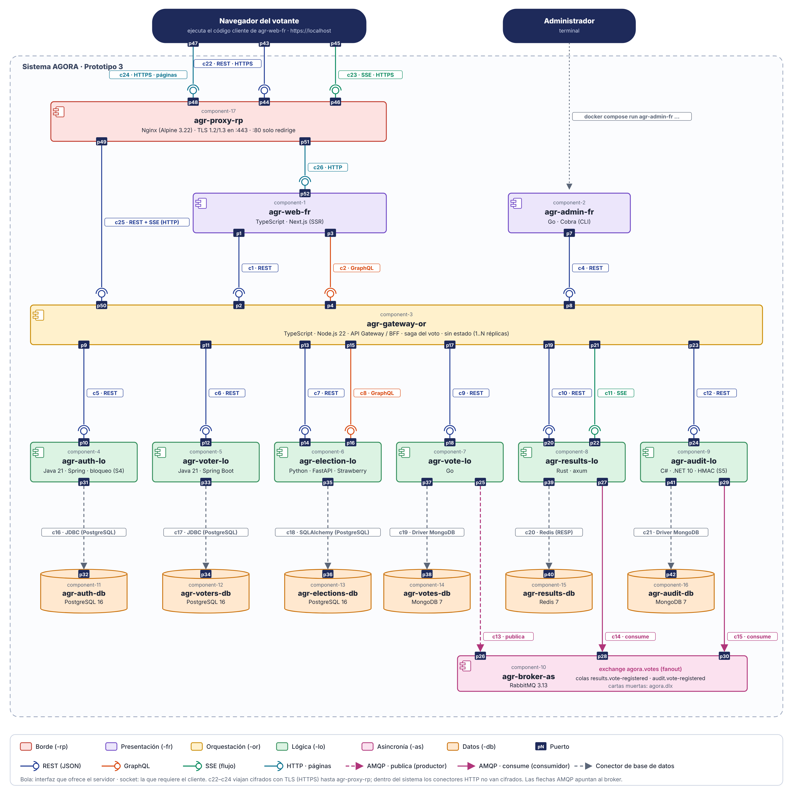
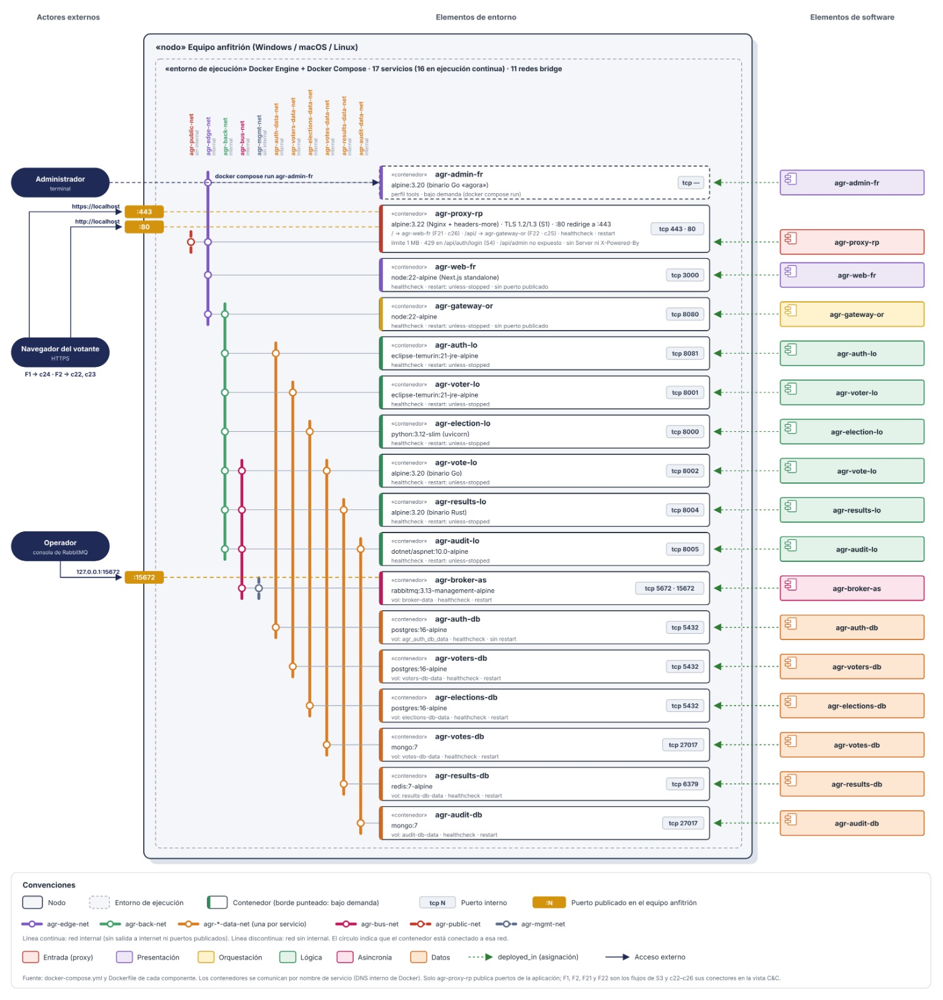
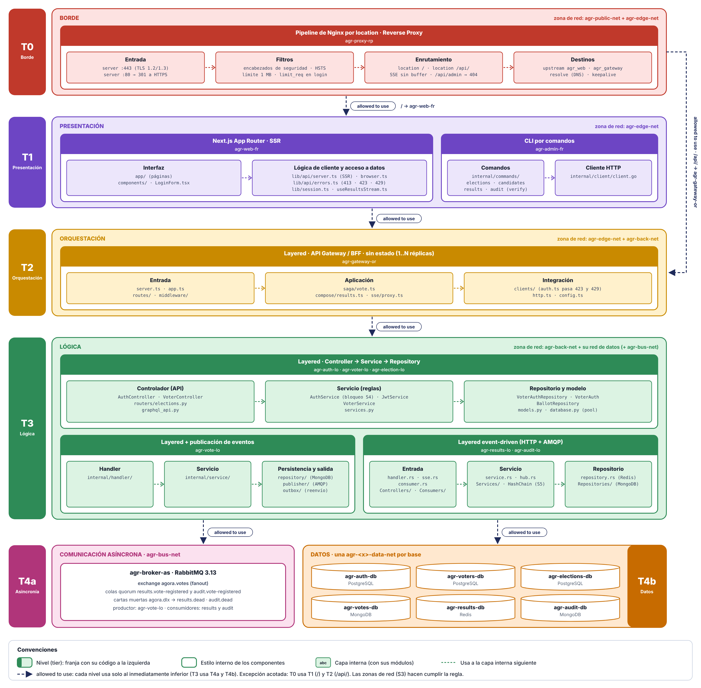
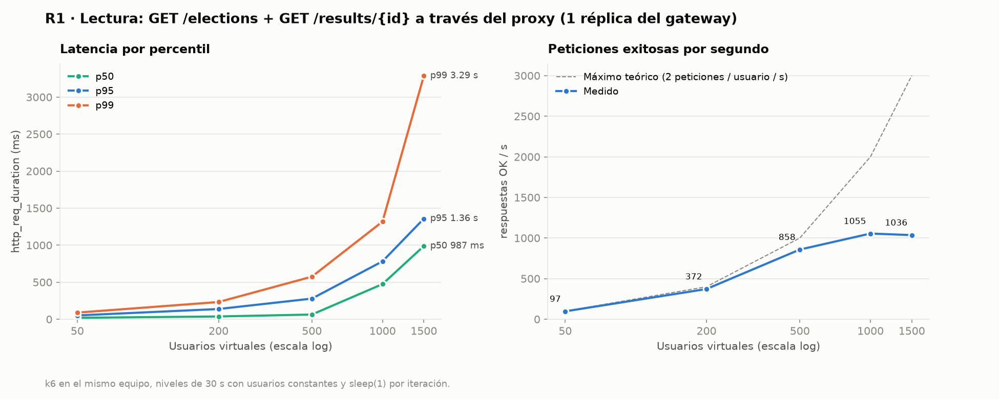
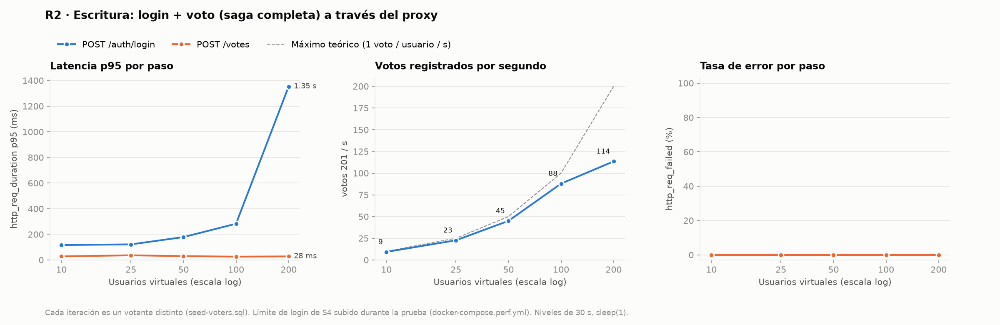
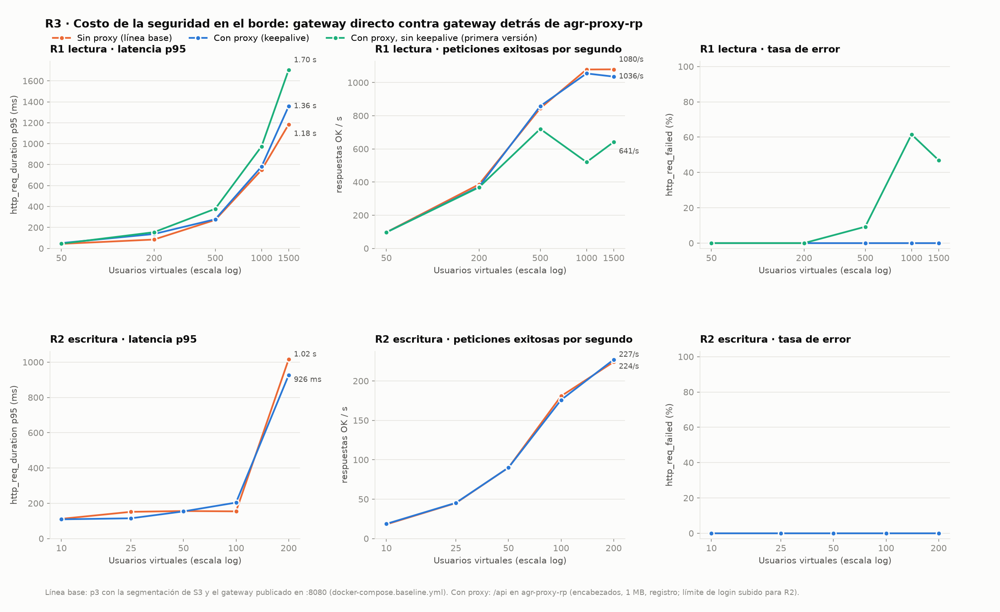
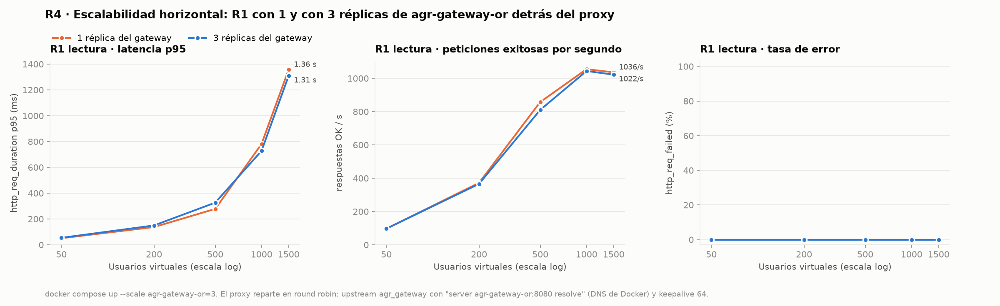
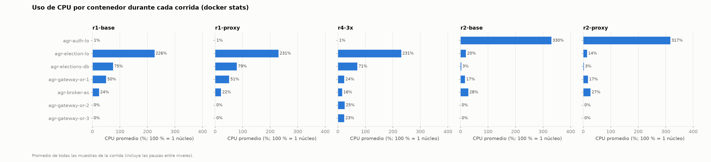

# Prototipo 3 — Equipo 1b

Arquitectura de Software, Universidad Nacional de Colombia, 2026-II.

## 1. Equipo

**Nombre:** 1b

**Integrantes:**

- David Fernando Benjumea Mora
- Esteban Prieto Lugo
- Maicol Sebastián Olarte Ramírez
- Camilo Borja Rojas
- Cristian Felipe Moreno Gomez
- Miguel Angel Zamudio Villa

## 2. Sistema de software

### 2.1 Nombre

**AGORA**

### 2.2 Logo

### 2.3 Descripción

AGORA es un sistema distribuido de votación electrónica para elecciones estudiantiles. Un administrador crea elecciones, registra sus candidatos y las abre o las cierra desde una consola de comandos. Un votante entra a la aplicación web por `https://localhost`, inicia sesión con su documento y su clave, ve las elecciones abiertas, vota y sigue los resultados, que se actualizan solos mientras la votación está abierta.

El sistema se construye alrededor de dos garantías:

- **Una persona, un voto por elección.** La participación se guarda con la llave (`voter_id`, `election_id`). Un segundo intento en la misma elección se rechaza, pero la persona puede votar en otras elecciones.
- **Voto anónimo.** *Quién votó* y *qué se votó* se guardan en bases de datos distintas, de servicios distintos y sin ningún dato que las una. El voto solo contiene la elección, el candidato y la hora redondeada, y su identificador es aleatorio.

El Prototipo 3 rediseña la arquitectura alrededor de dos atributos de calidad, **seguridad** y **rendimiento**, sin quitar ninguna función. Agrega un componente de borde, `agr-proxy-rp` (Nginx), que es la única entrada desde fuera y atiende solo por HTTPS; separa los contenedores en once redes de Docker; protege el inicio de sesión contra la fuerza bruta; encadena con HMAC los eventos de auditoría para detectar cualquier alteración, y deja el gateway sin estado para poder replicarlo. En total son 17 componentes en contenedores: 9 propios, escritos en seis lenguajes (TypeScript, Go, Java, Python, Rust y C#), y 8 de software existente (Nginx, PostgreSQL, MongoDB, Redis y RabbitMQ).

**Completitud funcional.** El equipo definió las siguientes funciones; todas funcionan de punta a punta a través del proxy y con HTTPS.

| Actor | Función | Dónde |
|---|---|---|
| Votante | Iniciar sesión con documento y clave (token JWT de 1 hora) | Web |
| Votante | Ver las elecciones abiertas y sus candidatos | Web |
| Votante | Votar una vez por elección | Web |
| Votante | Ver los resultados en vivo mientras la elección está abierta | Web |
| Administrador | Crear, editar y eliminar elecciones en borrador | CLI `agora elections` |
| Administrador | Agregar y quitar candidatos en borrador | CLI `agora candidates` |
| Administrador | Abrir (con al menos dos candidatos) y cerrar elecciones | CLI `agora elections open/close` |
| Administrador | Consultar resultados y el registro de auditoría | CLI `agora results`, `agora audit list` |
| Administrador | Verificar que la auditoría no fue alterada *(nueva en el P3)* | CLI `agora audit verify` |
| Sistema | Bloquear 15 minutos una cuenta tras cinco claves erradas *(nueva en el P3)* | `agr-auth-lo` |
| Sistema | Limitar los intentos de inicio de sesión por dirección IP *(nueva en el P3)* | `agr-proxy-rp` |

## 3. Estructuras arquitectónicas

### 3.1 Estructura de componentes y conectores (C&C)

#### 3.1.1 Vista de componentes y conectores

La vista muestra los componentes que existen **en ejecución** y los conectores por los que se comunican. Cada conector se identifica con un número (c1–c26) y un **tipo**: REST, GraphQL, SSE o HTTP de páginas (todos sobre HTTP o HTTPS), AMQP o conector de base de datos. Frente al Prototipo 2 aparecen el componente 17 (`agr-proxy-rp`) y los conectores c22–c26; el conector c3 desaparece, porque el navegador ya no llama directo al gateway.

**Notación.** En los conectores HTTP, la bola está en el puerto del componente que **ofrece** la interfaz (servidor) y el socket que la abraza sale del componente que la **requiere** (cliente). En los conectores AMQP la flecha apunta al broker, porque tanto el productor como los consumidores son quienes abren la conexión; la línea punteada indica que el componente **publica** y la continua que **consume**. Los conectores de base de datos se dibujan punteados y apuntan a la base. El navegador y el administrador están fuera del límite del sistema.

#### 3.1.2 Descripción de los elementos arquitectónicos y sus relaciones

Los componentes siguen la convención `agr-<nombre>-<nivel>`: `-rp` borde (reverse proxy), `-fr` presentación, `-or` orquestación, `-lo` lógica, `-as` asincronía y `-db` datos. El nombre de cada componente es también el de su carpeta en el repositorio y su servicio en `docker-compose.yml`.

**Componentes**

| # | Componente | Nivel | Tecnología | Responsabilidad |
|---|---|---|---|---|
| 17 | `agr-proxy-rp` | Borde | Nginx (Alpine 3.22) | **Nuevo.** Única entrada desde fuera: termina TLS, redirige HTTP a HTTPS, envía `/` a la web y `/api/...` al gateway, agrega encabezados de seguridad, limita el tamaño de las peticiones y los intentos de inicio de sesión, y reparte entre las réplicas del gateway. |
| 1 | `agr-web-fr` | Presentación | TypeScript, Next.js (SSR) | Aplicación web del votante: elecciones, inicio de sesión, voto y resultados en vivo. |
| 2 | `agr-admin-fr` | Presentación | Go, Cobra | CLI `agora` del administrador: elecciones, candidatos, resultados y auditoría (incluida su verificación). |
| 3 | `agr-gateway-or` | Orquestación | TypeScript, Node.js 22 | Enruta, valida el JWT (delegando en `agr-auth-lo`) y la llave de administración, compone resultados y orquesta la saga del voto. No guarda estado, así que corre con 1 a N réplicas. |
| 4 | `agr-auth-lo` | Lógica | Java 21, Spring Boot | Verifica documento y clave, emite y valida el JWT y **bloquea la cuenta** tras cinco intentos fallidos. |
| 5 | `agr-voter-lo` | Lógica | Java 21, Spring Boot | Registra qué votante participó en qué elección e impide el doble voto. |
| 6 | `agr-election-lo` | Lógica | Python, FastAPI, Strawberry | Elecciones, candidatos y su ciclo de vida (borrador, activa, cerrada). |
| 7 | `agr-vote-lo` | Lógica | Go | Guarda el voto anónimo y publica `VoteRegistered`. |
| 8 | `agr-results-lo` | Lógica | Rust (axum) | Consume los eventos, cuenta los votos y los transmite en vivo por SSE. |
| 9 | `agr-audit-lo` | Lógica | C#, .NET 10 | Consume los eventos, los guarda **encadenados con HMAC-SHA256** y verifica la cadena. |
| 10 | `agr-broker-as` | Asincronía | RabbitMQ 3.13 | Reparte el evento de voto a resultados y auditoría. |
| 11 | `agr-auth-db` | Datos | PostgreSQL 16 | Votantes, hashes de sus claves e intentos fallidos. |
| 12 | `agr-voters-db` | Datos | PostgreSQL 16 | Participaciones (`ballots_cast`). |
| 13 | `agr-elections-db` | Datos | PostgreSQL 16 | Elecciones y candidatos. |
| 14 | `agr-votes-db` | Datos | MongoDB 7 | Votos anónimos y su estado de publicación. |
| 15 | `agr-results-db` | Datos | Redis 7 | Conteos por candidato y eventos ya contados. |
| 16 | `agr-audit-db` | Datos | MongoDB 7 | Eventos de auditoría con su `seq`, `prev_hash` y `hash`. |

**Conectores**

"Desde" es el cliente (o productor) y "Hacia" el servidor (o el broker). Las rutas que pasan por el proxy llevan el prefijo `/api`, que el proxy quita antes de reenviarlas al gateway.

| Conector | Tipo | Desde → Hacia | Puertos | Uso |
|---|---|---|---|---|
| c22 | REST (HTTPS, JSON) | Navegador → `agr-proxy-rp` | p43 → p44 | `POST /api/auth/login`, `POST /api/votes` |
| c23 | SSE (HTTPS) | Navegador → `agr-proxy-rp` | p45 → p46 | `GET /api/results/{id}/stream`: resultados en vivo |
| c24 | HTTP de páginas (HTTPS) | Navegador → `agr-proxy-rp` | p47 → p48 | Páginas, scripts y estilos de la web |
| c25 | REST + SSE (HTTP) | `agr-proxy-rp` → `agr-gateway-or` | p49 → p50 | Reenvío de `/api/...` sin el prefijo; el SSE pasa sin buffer |
| c26 | HTTP de páginas | `agr-proxy-rp` → `agr-web-fr` | p51 → p52 | Reenvío de `/` |
| c1 | REST (HTTP, JSON) | `agr-web-fr` → `agr-gateway-or` | p1 → p2 | `GET /results/{id}` al armar la página de resultados (SSR) |
| c2 | GraphQL (HTTP) | `agr-web-fr` → `agr-gateway-or` | p3 → p4 | `POST /graphql`: elecciones con sus candidatos (SSR) |
| c4 | REST (HTTP, JSON) | `agr-admin-fr` → `agr-gateway-or` | p7 → p8 | `GET /elections`, `/admin/elections/*`, `GET /results/{id}`, `GET /admin/audit`, `GET /admin/audit/verify` |
| c5 | REST (HTTP, JSON) | `agr-gateway-or` → `agr-auth-lo` | p9 → p10 | `POST /auth/login`, `GET /auth/validate` |
| c6 | REST (HTTP, JSON) | `agr-gateway-or` → `agr-voter-lo` | p11 → p12 | `POST /voters/mark-voted`, `POST /voters/unmark-voted` |
| c7 | REST (HTTP, JSON) | `agr-gateway-or` → `agr-election-lo` | p13 → p14 | Consultar una elección en la saga y operaciones de administración |
| c8 | GraphQL (HTTP) | `agr-gateway-or` → `agr-election-lo` | p15 → p16 | Reenvío de las consultas GraphQL de la web |
| c9 | REST (HTTP, JSON) | `agr-gateway-or` → `agr-vote-lo` | p17 → p18 | `POST /votes` con `Idempotency-Key` |
| c10 | REST (HTTP, JSON) | `agr-gateway-or` → `agr-results-lo` | p19 → p20 | `GET /results/{id}` |
| c11 | SSE (HTTP) | `agr-gateway-or` → `agr-results-lo` | p21 → p22 | `GET /results/{id}/stream` |
| c12 | REST (HTTP, JSON) | `agr-gateway-or` → `agr-audit-lo` | p23 → p24 | `GET /audit/events`, `GET /audit/verify` |
| c13 | AMQP (publica) | `agr-vote-lo` → `agr-broker-as` | p25 → p26 | Publica `VoteRegistered` en el exchange `agora.votes` |
| c14 | AMQP (consume) | `agr-results-lo` → `agr-broker-as` | p27 → p28 | Consume la cola `results.vote-registered` |
| c15 | AMQP (consume) | `agr-audit-lo` → `agr-broker-as` | p29 → p30 | Consume la cola `audit.vote-registered` |
| c16 | Base de datos (JDBC, PostgreSQL) | `agr-auth-lo` → `agr-auth-db` | p31 → p32 | Votantes, claves e intentos fallidos |
| c17 | Base de datos (JDBC, PostgreSQL) | `agr-voter-lo` → `agr-voters-db` | p33 → p34 | Participaciones |
| c18 | Base de datos (SQLAlchemy, PostgreSQL) | `agr-election-lo` → `agr-elections-db` | p35 → p36 | Elecciones y candidatos |
| c19 | Base de datos (driver MongoDB) | `agr-vote-lo` → `agr-votes-db` | p37 → p38 | Votos anónimos |
| c20 | Base de datos (Redis, RESP) | `agr-results-lo` → `agr-results-db` | p39 → p40 | Conteos |
| c21 | Base de datos (driver MongoDB) | `agr-audit-lo` → `agr-audit-db` | p41 → p42 | Eventos de auditoría encadenados |

**Relaciones**

- El navegador solo se conecta con `agr-proxy-rp` (c22–c24), siempre por HTTPS. El proxy reenvía las páginas a la web (c26) y la API al gateway (c25). Ni la web ni el gateway reciben conexiones desde fuera del sistema.
- `agr-web-fr` se ejecuta en dos lugares. En su contenedor arma las páginas (SSR) y para eso llama al gateway por la red interna (c1 y c2). En el navegador, su código cliente hace el inicio de sesión, el voto y la suscripción a los resultados en vivo, que salen por el proxy (c22 y c23). El inicio de sesión se hace desde el navegador para que el límite por IP del proxy vea la dirección real de cada votante.
- La CLI la ejecuta el administrador con `docker compose run` y llama al gateway por la red interna (c4), sin pasar por el proxy. Por eso `/api/admin/...` no se expone hacia fuera.
- El gateway se conecta con los seis servicios de lógica (c5–c12). **Los servicios de lógica no se llaman entre sí**: cuando el voto necesita a varios, el gateway los llama uno por uno.
- El voto es una saga orquestada por el gateway: pide a `agr-auth-lo` validar el JWT (c5), comprueba que la elección esté abierta y el candidato le pertenezca (c7), marca la participación (c6) y guarda el voto (c9). Si guardar el voto falla de forma confirmada, el gateway compensa con `unmark-voted` (c6); si no hay respuesta, no compensa, porque el voto pudo haberse guardado.
- Los resultados en vivo son una cadena de tres tramos SSE: navegador → proxy (c23), proxy → gateway (c25, sin buffer) y gateway → `agr-results-lo` (c11).
- La comunicación entre `agr-vote-lo` y sus consumidores es asíncrona (c13–c15): `agr-vote-lo` no conoce a `agr-results-lo` ni a `agr-audit-lo`. Las colas son de tipo *quorum* (durables) y un mensaje que falla cinco veces pasa al exchange de cartas muertas `agora.dlx`.
- Cada servicio de lógica se conecta con exactamente una base de datos y cada base con exactamente un servicio (c16–c21).

#### 3.1.3 Descripción de los estilos y patrones arquitectónicos utilizados

| Estilo o patrón | Cómo se aplica en AGORA |
|---|---|
| **Microservicios** | La lógica se divide en seis servicios independientes, cada uno con una responsabilidad, su propio lenguaje y su propio despliegue. |
| **Cliente-servidor** | El navegador, la web y la CLI son clientes; el proxy, el gateway y los servicios son servidores. Toda interacción HTTP es petición-respuesta. |
| **Reverse Proxy** *(nuevo)* | `agr-proxy-rp` se ubica entre el navegador y los componentes internos: recibe todas las peticiones y decide a quién se reenvían. Es el patrón de S2. |
| **Secure Channel** *(nuevo)* | Los conectores que cruzan el límite del sistema (c22–c24) van cifrados con TLS 1.2/1.3 y terminan en el proxy. Es el patrón de S1. |
| **API Gateway** | `agr-gateway-or` es el único punto de entrada a la API para la web y la CLI. Ningún componente de presentación conoce a los servicios de lógica. |
| **Backend for Frontend (BFF)** | El gateway arma respuestas a la medida del cliente; por ejemplo, une los conteos de `agr-results-lo` con los nombres de los candidatos de `agr-election-lo`. |
| **Server-Side Rendering (SSR)** | `agr-web-fr` arma en su servidor las páginas de elecciones y resultados. |
| **Saga orquestada** | El gateway coordina los cuatro pasos del voto (auth → election → voter → vote) y compensa si guardar el voto falla de forma confirmada. |
| **Publish/Subscribe (broker)** | `agr-vote-lo` publica `VoteRegistered` en el exchange `agora.votes`; RabbitMQ entrega una copia a la cola de resultados y otra a la de auditoría. |
| **Outbox** | `agr-vote-lo` guarda el voto marcado como pendiente de publicar y un proceso lo reenvía si RabbitMQ no estaba disponible. |
| **Dead Letter Queue** | Los mensajes que fallan cinco veces se apartan a `results.dead` o `audit.dead` para no bloquear la cola principal. |
| **Consumidor idempotente** | Resultados y auditoría usan el `event_id` del evento para no contar ni registrar dos veces el mismo voto. |
| **Tamper-evident log** *(nuevo)* | `agr-audit-lo` encadena cada evento con el anterior mediante HMAC-SHA256 y verifica la cadena. Es el patrón de S5. |
| **CQRS ligero** | El voto se escribe en MongoDB y los resultados se leen de Redis, donde los conteos ya están calculados. |
| **Base de datos por servicio** | Cada servicio de lógica es el único que se conecta a su base. |

### 3.2 Estructura de despliegue

#### 3.2.1 Vista de despliegue

La vista muestra **dónde y cómo** se ejecuta cada componente: el nodo, el entorno de ejecución, los contenedores con su imagen y sus puertos, las once redes de Docker y los puertos publicados hacia fuera del nodo. Cada elemento de software se asigna a su contenedor con la relación `deployed_in`.

#### 3.2.2 Descripción de los elementos arquitectónicos y sus relaciones

**Elementos de software**

Son los 17 componentes de la vista C&C, dibujados con el color de su nivel. Cada uno se asigna (`deployed_in`) a un contenedor con su mismo nombre, salvo el gateway, cuyos contenedores se llaman `arquisoft-agr-gateway-or-N` porque puede tener varias réplicas.

**Elementos de entorno**

| Elemento | Tipo | Descripción |
|---|---|---|
| Equipo anfitrión | Nodo | Computador con Windows, macOS o Linux donde se ejecuta todo el sistema. |
| Docker Engine + Docker Compose | Entorno de ejecución | Construye las imágenes, crea las redes y los volúmenes y ejecuta los 17 servicios de `docker-compose.yml` (16 en ejecución continua y la CLI bajo demanda). |
| Redes de Docker (11) | Red (bridge) | Detalladas en la tabla siguiente. Nueve son `internal`: no tienen salida a internet ni pueden publicar puertos. |
| Volúmenes nombrados (7) | Almacenamiento | Guardan los datos de las seis bases y del broker aunque los contenedores se recreen. |
| Certificado de desarrollo | Archivo montado | `p3/s1/certs/` (generado con `p3/s1/gen-certs.sh`, fuera de Git) se monta en solo lectura en `agr-proxy-rp`. La llave nunca entra a la imagen. |
| Navegador del votante | Actor externo | Entra solo por `https://localhost` (443). Si usa `http://localhost` (80), el proxy lo redirige. |
| Administrador | Actor externo | Ejecuta la CLI con `docker compose run --rm agr-admin-fr <comando>`. |
| Operador | Actor externo | Abre la consola de RabbitMQ en `127.0.0.1:15672`, solo desde el mismo equipo. |

| Red | `internal` | Contenedores | Para qué |
|---|---|---|---|
| `agr-public-net` | no | `agr-proxy-rp` | La única red desde la que se publican los puertos de la aplicación (80 y 443). |
| `agr-edge-net` | sí | proxy, web, CLI y gateway | El proxy llega a la web y al gateway; la web y la CLI llegan al gateway. |
| `agr-back-net` | sí | gateway y los seis servicios de lógica | El gateway llega a los servicios. |
| `agr-<x>-data-net` (6) | sí | cada servicio con su base | Ningún servicio ve una base ajena. |
| `agr-bus-net` | sí | broker, `agr-vote-lo`, `agr-results-lo`, `agr-audit-lo` | Solo los clientes reales del broker. |
| `agr-mgmt-net` | no | `agr-broker-as` | Publica la consola de RabbitMQ en `127.0.0.1`. |

**Relación `deployed_in`**

| Elemento de software | Contenedor | Imagen base | Puerto interno | Puerto publicado | Redes | Volumen |
|---|---|---|---|---|---|---|
| `agr-proxy-rp` | `agr-proxy-rp` | `alpine:3.22` (Nginx) | 443, 80 | **443, 80** | public, edge | — |
| `agr-admin-fr` | `agr-admin-fr` (bajo demanda) | `alpine:3.20` | — | — | edge | — |
| `agr-web-fr` | `agr-web-fr` | `node:22-alpine` | 3000 | — | edge | — |
| `agr-gateway-or` | `arquisoft-agr-gateway-or-N` | `node:22-alpine` | 8080 | — | edge, back | — |
| `agr-auth-lo` | `agr-auth-lo` | `eclipse-temurin:21-jre-alpine` | 8081 | — | back, auth-data | — |
| `agr-voter-lo` | `agr-voter-lo` | `eclipse-temurin:21-jre-alpine` | 8001 | — | back, voters-data | — |
| `agr-election-lo` | `agr-election-lo` | `python:3.12-slim` | 8000 | — | back, elections-data | — |
| `agr-vote-lo` | `agr-vote-lo` | `alpine:3.20` | 8002 | — | back, votes-data, bus | — |
| `agr-results-lo` | `agr-results-lo` | `alpine:3.20` | 8004 | — | back, results-data, bus | — |
| `agr-audit-lo` | `agr-audit-lo` | `dotnet/aspnet:10.0-alpine` | 8005 | — | back, audit-data, bus | — |
| `agr-broker-as` | `agr-broker-as` | `rabbitmq:3.13-management-alpine` | 5672, 15672 | **127.0.0.1:15672** | bus, mgmt | `broker-data` |
| `agr-auth-db` | `agr-auth-db` | `postgres:16-alpine` | 5432 | — | auth-data | `agr_auth_db_data` |
| `agr-voters-db` | `agr-voters-db` | `postgres:16-alpine` | 5432 | — | voters-data | `voters-db-data` |
| `agr-elections-db` | `agr-elections-db` | `postgres:16-alpine` | 5432 | — | elections-data | `elections-db-data` |
| `agr-votes-db` | `agr-votes-db` | `mongo:7` | 27017 | — | votes-data | `votes-db-data` |
| `agr-results-db` | `agr-results-db` | `redis:7-alpine` | 6379 | — | results-data | `results-db-data` |
| `agr-audit-db` | `agr-audit-db` | `mongo:7` | 27017 | — | audit-data | `audit-db-data` |

**Relaciones**

- Cada elemento de software se despliega en un contenedor propio. Los componentes propios se construyen con su `Dockerfile`; las bases de datos usan imágenes oficiales.
- Solo `agr-proxy-rp` publica puertos de la aplicación: 443 (HTTPS) y 80 (que solo redirige). La consola de RabbitMQ se publica en `127.0.0.1:15672`. La web (3000) y el gateway (8080) ya no se publican.
- El proxy es el único contenedor en `agr-public-net`, y el gateway el único en `agr-edge-net` y `agr-back-net` a la vez: son los dos únicos caminos de una zona a la siguiente.
- Los contenedores se encuentran por nombre de servicio (DNS interno de Docker). El proxy vuelve a resolver `agr-gateway-or` y `agr-web-fr` mientras corre, así que encuentra todas las réplicas del gateway (`docker compose up --scale agr-gateway-or=3`).
- El arranque sigue `depends_on` y los healthchecks: bases y broker → servicios de lógica → gateway → web → proxy.
- Todos los servicios tienen `restart: unless-stopped`, salvo `agr-auth-db` y la CLI. La CLI tiene el perfil `tools`, así que `docker compose up` no la arranca.

#### 3.2.3 Descripción de los patrones arquitectónicos utilizados

| Patrón | Cómo se aplica |
|---|---|
| **Despliegue en contenedores** | Cada componente corre en su propio contenedor, con su propio entorno de ejecución. |
| **Nodo único con múltiples contenedores** | Los 17 servicios se ejecutan en un solo equipo anfitrión, orquestados por Docker Compose. |
| **Reverse Proxy (punto único de entrada)** | Solo `agr-proxy-rp` es alcanzable desde fuera del nodo (S2). |
| **Network Segmentation** | Once redes con nombre, nueve de ellas `internal`: una pública, una de borde, una de lógica, una de datos por servicio, una de mensajería y una de administración (S3). |
| **Escalado horizontal de un servicio sin estado** | El gateway no tiene `container_name` ni puertos publicados, así que se replica con `--scale` y el proxy reparte entre las réplicas (R4). |
| **Descubrimiento de servicios** | Los contenedores se llaman por nombre (`http://agr-vote-lo:8002`), resuelto por el DNS de Docker. |
| **Volúmenes persistentes** | Bases de datos y broker guardan sus datos en volúmenes nombrados. |
| **Secretos fuera de la imagen** | La llave TLS se monta en solo lectura y la llave de la cadena de auditoría (`AUDIT_CHAIN_KEY`) llega solo a `agr-audit-lo` como variable de entorno. |
| **Health checks y política de reinicio** | Docker comprueba la salud de los 16 servicios que arrancan con `up`, ordena el arranque con ella y reinicia los configurados con `restart: unless-stopped`. |
| **Configuración externa** | Credenciales, URLs internas, orígenes de CORS y los límites del proxy (`LOGIN_RATE`, `LOGIN_BURST`) vienen de variables de entorno (`.env`). |

### 3.3 Estructura por capas

#### 3.3.1 Vista por capas

La vista organiza AGORA en **niveles (tiers)** con la relación *allowed to use*: un nivel solo puede usar al nivel inmediatamente inferior. Dentro de cada nivel se muestran las **capas internas** de sus componentes. Frente al Prototipo 2 aparece el nivel **T0 · Borde**, y cada nivel queda además en su propia zona de red (S3).

#### 3.3.2 Descripción de los elementos arquitectónicos y sus relaciones

**Niveles**

| Nivel | Componentes | Responsabilidad | Puede usar a | Zona de red |
|---|---|---|---|---|
| T0 · Borde | `agr-proxy-rp` | Única entrada: TLS, encabezados de seguridad, límites de tamaño y de inicio de sesión, reparto entre réplicas | T1 (`/`) y T2 (`/api/`) | `agr-public-net`, `agr-edge-net` |
| T1 · Presentación | `agr-web-fr`, `agr-admin-fr` | Interacción con el votante y con el administrador | T2 | `agr-edge-net` |
| T2 · Orquestación | `agr-gateway-or` (1 a N réplicas) | Punto único de la API, composición de respuestas y saga del voto | T3 | `agr-edge-net`, `agr-back-net` |
| T3 · Lógica | Los seis servicios `-lo` | Reglas del negocio, cada servicio sobre sus propios datos | T4a y T4b | `agr-back-net`, su red de datos y, si usa eventos, `agr-bus-net` |
| T4a · Comunicación asíncrona | `agr-broker-as` | Recibe y reparte los eventos de voto | — | `agr-bus-net` |
| T4b · Datos | Las seis bases `-db` | Persistencia de cada servicio | — | `agr-<x>-data-net` |

T4a y T4b están al mismo nivel: los dos son usados por T3 y no se usan entre sí.

**Capas internas de cada componente** (en negrita lo que cambió en el Prototipo 3)

| Componente(s) | Estilo interno | Capas, de arriba hacia abajo |
|---|---|---|
| `agr-proxy-rp` | **Pipeline de Nginx** | **Entrada** (`server` 443 con TLS y 80 que redirige) → **Filtros** (encabezados, HSTS, límite de 1 MB, `limit_req` en el inicio de sesión) → **Enrutamiento** (`location /`, `/api/`, SSE sin buffer, `/api/admin` → 404) → **Destinos** (`upstream` con `resolve` y `keepalive`) |
| `agr-web-fr` | Next.js App Router con SSR | Interfaz (`app/`, `components/`, **`LoginForm.tsx`**) → Lógica de cliente y acceso a datos (`lib/api/server.ts` para el SSR, **`lib/api/browser.ts`** con el inicio de sesión desde el navegador, **`lib/api/errors.ts`** con los mensajes de 413, 423 y 429, `lib/session.ts`, `lib/useResultsStream.ts`) |
| `agr-admin-fr` | CLI por comandos | Comandos (`internal/commands/`, con **`audit verify`**) → Cliente HTTP (`internal/client/client.go`) |
| `agr-gateway-or` | Layered | Entrada (`server.ts`, `app.ts`, `routes/`, `middleware/`) → Aplicación (`saga/vote.ts`, `compose/results.ts`, `sse/proxy.ts`) → Integración (`clients/`, **`clients/auth.ts` deja pasar 423 y 429**, `http.ts`, `config.ts`) |
| `agr-auth-lo`, `agr-voter-lo`, `agr-election-lo` | Controller → Service → Repository | Controlador (`AuthController`, `VoterController`, `routers/elections.py`, `graphql_api.py`) → Servicio (**`AuthService` con el conteo de intentos y el bloqueo**, `JwtService`, `VoterService`, `services.py`) → Repositorio y modelo (`VoterAuthRepository` con **lectura bloqueante del votante**, **`VoterAuth` con `failedAttempts` y `lockedUntil`**, `BallotRepository`, `models.py`, **`database.py` con pool configurable**) |
| `agr-vote-lo` | Layered con publicación de eventos | `internal/handler/` → `internal/service/` → `repository/` (MongoDB), `publisher/` (AMQP), `outbox/` |
| `agr-results-lo`, `agr-audit-lo` | Layered event-driven (HTTP + AMQP) | Entrada (`handler.rs`, `sse.rs`, `consumer.rs`, `Controllers/`, `Consumers/`) → Servicio (`service.rs`, `hub.rs`, `Services/` con **`HashChain`**) → Repositorio (`repository.rs` con Redis, `Repositories/` con MongoDB) |

**Relaciones**

- *Allowed to use* entre niveles: T0 → T1 → T2 → T3 → T4. La única excepción es T0, que usa a T1 **y** a T2: el navegador pide las páginas a la web (`/`) y llama a la API (`/api/...`) por el mismo origen. El proxy no tiene lógica de negocio, así que no reemplaza a la presentación.
- La regla la hace cumplir la red: un nivel no comparte red con los niveles a los que no puede usar. La web no alcanza a los servicios ni a las bases, y el gateway no alcanza a las bases ni al broker.
- T3 usa T4a para publicar y consumir eventos y T4b para persistir; cada servicio solo ve su base.
- Dentro de cada componente, cada capa solo usa a la siguiente.

#### 3.3.3 Descripción de los patrones arquitectónicos utilizados

| Patrón | Cómo se aplica |
|---|---|
| **Arquitectura por niveles (n-tier)** | Cinco niveles (borde, presentación, orquestación, lógica y un nivel inferior con mensajería y datos) con *allowed to use* hacia abajo. |
| **Layering relajado en el borde** | T0 puede usar T1 y T2 directamente; es la única excepción y la acotan las rutas `/` y `/api/`. |
| **Niveles alineados con zonas de red** | Cada nivel es una zona de S3 (pública, borde, lógica, datos, mensajería), así que la red impide saltarse un nivel. |
| **Pipes and filters** | En el proxy cada petición pasa por etapas fijas: entrada TLS, filtros de seguridad, enrutamiento y destino. |
| **Layered** | Dentro de cada componente, entrada, lógica y acceso a datos están separados y dependen en un solo sentido. |
| **Layered event-driven** | `agr-results-lo` y `agr-audit-lo` tienen dos entradas: HTTP y un consumidor AMQP. |
| **Nivel de orquestación sin estado** | `agr-gateway-or` no guarda sesión ni datos; por eso se replica y el proxy reparte entre las réplicas (R4). |
| **Base de datos por servicio** | En T4b cada base pertenece a un único servicio de T3 y vive en su propia red. |

### 3.4 Estructura de descomposición

#### 3.4.1 Vista de descomposición

La vista descompone AGORA en módulos funcionales, submódulos y funcionalidades, con la relación *is part of*. Junto a cada módulo se indica el componente que lo implementa. Las funcionalidades nuevas del Prototipo 3 están resaltadas.

#### 3.4.2 Descripción de los elementos arquitectónicos y sus relaciones

**Módulos y submódulos**

| Elemento | Tipo | Implementado en | Descripción |
|---|---|---|---|
| (1) Autenticación | Módulo | `agr-auth-lo` | Inicio de sesión, emisión y validación del JWT y **bloqueo de cuentas** (S4). |
| (2) Gestión de elecciones | Módulo | `agr-election-lo` | Ciclo de vida de las elecciones y sus candidatos. |
| (2.1) Elecciones | Submódulo | `agr-election-lo` | Crear, editar, eliminar, listar, abrir y cerrar elecciones. |
| (2.2) Candidatos | Submódulo | `agr-election-lo` | Agregar, quitar y consultar candidatos. |
| (3) Participación | Módulo | `agr-voter-lo` | Registro de qué votante ya votó en qué elección. |
| (4) Votación | Módulo | `agr-gateway-or` y `agr-vote-lo` | La saga del voto, el voto anónimo y la publicación del evento. |
| (5) Resultados | Módulo | `agr-results-lo` y `agr-gateway-or` | Conteo, consulta y transmisión en vivo. |
| (6) Auditoría | Módulo | `agr-audit-lo`, `agr-gateway-or` y `agr-admin-fr` | Registro de los eventos de voto en una cadena de hashes y verificación de su integridad (S5). |
| (6.1) Registro | Submódulo | `agr-audit-lo` | Guarda y encadena cada evento recibido y permite consultarlos. |
| (6.2) Verificación de integridad | Submódulo | `agr-audit-lo`, `agr-gateway-or` y `agr-admin-fr` | Recorre la cadena y señala eventos alterados, borrados, insertados o truncados. |
| **(7) Acceso seguro** | **Módulo nuevo** | `agr-proxy-rp` | Canal cifrado (S1), enrutamiento y protección del borde (S2), límite de inicio de sesión por IP (S4) y reparto entre réplicas (R4). |

**Funcionalidades nuevas o modificadas en el Prototipo 3** (las demás son las del Prototipo 2)

| Código | Funcionalidad | Regla de negocio |
|---|---|---|
| 1.4 | Contar intentos fallidos | Cada clave errada suma uno en `failed_attempts`; un inicio de sesión correcto reinicia la cuenta. |
| 1.5 | Bloquear la cuenta | Al quinto intento fallido se fija `locked_until` 15 minutos adelante; mientras tanto, incluso la clave correcta recibe 423. |
| 6.1.2 | Encadenar el evento | Cada evento recibe el siguiente `seq` (índice único), `prev_hash` (el hash del evento anterior; 64 ceros en el primero) y `hash` = HMAC-SHA256 con una llave que solo conoce `agr-audit-lo`. |
| 6.1.3 | Encadenar eventos previos al iniciar | Si la cadena está vacía al arrancar, encadena una sola vez los eventos guardados antes de S5; después, un documento sin `seq` se considera insertado a mano. |
| 6.1.4 | Consultar eventos de auditoría | `agora audit list` con la llave de administración; ahora incluye `seq`, `prev_hash` y `hash`. |
| 6.2.1 | Verificar la cadena | `GET /admin/audit/verify` o `agora audit verify`. Señala `altered`, `missing`, `broken_link`, `out_of_order`, `unchained` y `truncated` con el `seq` afectado; la CLI termina con código 1 si hay problemas. |
| 7.1 | Cifrar el canal | Solo HTTPS con TLS 1.2 o 1.3 y HSTS; el puerto 80 responde 301 hacia HTTPS. |
| 7.2 | Enrutar peticiones | `/` a la web y `/api/` al gateway sin el prefijo; `/api/admin` responde 404; el SSE pasa sin buffer. |
| 7.3 | Proteger la entrada | Máximo 1 MB por petición (413); encabezados de seguridad; sin `Server`, `X-Powered-By` ni `X-Nextjs-*`. |
| 7.4 | Limitar el inicio de sesión por IP | 5 intentos por minuto con ráfaga de 5 en `/api/auth/login`; al superarlo responde 429 sin llegar al gateway. |
| 7.5 | Repartir entre réplicas del gateway | Resuelve las réplicas por el DNS de Docker y reutiliza conexiones (*keepalive*). |

**Relaciones**

- Cada funcionalidad *is part of* un submódulo o un módulo, y cada módulo *is part of* AGORA.
- (4) Votación produce los eventos que consumen (5) Resultados y (6) Auditoría, y usa a (1) para validar el token y a (2) y (3) para las reglas del voto.
- (7) Acceso seguro está delante de (1), (4) y (5) para todo lo que llega del navegador. La administración (2, 6) no pasa por él, porque la CLI usa la red interna.
- (1.5) y (7.4) se complementan: el bloqueo protege cada cuenta y el límite por IP frena a quien prueba muchas cuentas a la vez.
- La segmentación de red (S3) no es una función del sistema sino una decisión de despliegue, así que no aparece en esta vista.

## 4. Atributos de calidad

### 4.1 Seguridad

El Prototipo 3 responde a cinco escenarios de seguridad. Los tres primeros aplican los patrones que pide el enunciado; los dos últimos responden a problemas propios de AGORA: el inicio de sesión aceptaba intentos sin límite y la auditoría podía alterarse sin que nadie lo notara.

| # | Problema en el Prototipo 2 | Patrón | Dónde se implementa |
|---|---|---|---|
| S1 | Documento, clave y token viajaban en HTTP plano | **Secure Channel** | `agr-proxy-rp` (TLS) |
| S2 | La web y el gateway se publicaban directo y revelaban su tecnología | **Reverse Proxy** | `agr-proxy-rp` |
| S3 | Una red de datos plana: cualquier servicio alcanzaba cualquier base | **Network Segmentation** | `docker-compose.yml` (11 redes) |
| S4 | El inicio de sesión aceptaba intentos sin límite | **Rate Limiting + Account Lockout** | `agr-proxy-rp` y `agr-auth-lo` |
| S5 | Quien entrara a `agr-audit-db` podía cambiar eventos sin dejar rastro | **Tamper-evident Log** | `agr-audit-lo` |

#### 4.1.1 Escenarios de seguridad

Cada escenario se describe en seis partes: fuente, estímulo, artefacto, entorno, respuesta y medida de la respuesta. Las medidas son las que se obtuvieron en las pruebas (sección 4.1.3).

**S1 · Canal seguro**

| Parte | Descripción |
|---|---|
| **Fuente** | Un atacante en la misma red que el votante (Wi-Fi compartido o un equipo intermedio) que observa o altera el tráfico. |
| **Estímulo** | Intercepta la comunicación entre el navegador y AGORA mientras alguien inicia sesión, vota o consulta resultados. |
| **Artefacto** | El canal entre el navegador y `agr-proxy-rp` (puertos 80 y 443). |
| **Entorno** | Operación normal, desplegado con Docker Compose y con un certificado de desarrollo. |
| **Respuesta** | El proxy atiende la aplicación solo por HTTPS con TLS 1.2 o 1.3, rechaza versiones anteriores, redirige el puerto 80 al 443 y envía HSTS. |
| **Medida de la respuesta** | En la captura del puerto 443, el documento, la clave y el token aparecen en texto legible **0** veces (en la captura del Prototipo 2, en el puerto 80, aparecían los tres). TLS 1.2 y 1.3 aceptados y TLS 1.1 rechazado. El 100 % de las respuestas HTTPS revisadas lleva `Strict-Transport-Security`, y HTTP responde 301 hacia la misma ruta en HTTPS. |

**S2 · Reverse proxy**

| Parte | Descripción |
|---|---|
| **Fuente** | Un atacante externo, sin credenciales, con acceso de red al equipo donde corre AGORA. |
| **Estímulo** | Explora los puertos y envía peticiones directas a la web y al gateway: lee los encabezados para identificar la tecnología, manda cuerpos de varios megabytes y prueba rutas de administración. |
| **Artefacto** | El borde del sistema: `agr-web-fr`, `agr-gateway-or` y su configuración de despliegue. |
| **Entorno** | Operación normal, con elecciones abiertas. |
| **Respuesta** | Todo el tráfico entra por `agr-proxy-rp`. La web y el gateway no aceptan conexiones desde fuera de Docker. El proxy quita los encabezados que revelan la tecnología, agrega encabezados de seguridad, rechaza cuerpos de más de 1 MB antes de que lleguen a los servicios y no expone `/api/admin`. |
| **Medida de la respuesta** | Puertos de la aplicación publicados: solo 443 y 80; 3000 y 8080 no se publican. **0** respuestas con `Server`, `X-Powered-By` o `X-Nextjs-*` en las rutas revisadas, y los seis encabezados de seguridad presentes en todas, incluidos los errores. Una petición de más de 1 MB recibe 413 del proxy. `/api/admin` responde 404. Inicio de sesión, voto y resultados en vivo funcionan de punta a punta por `/api`. |

**S3 · Segmentación de red**

| Parte | Descripción |
|---|---|
| **Fuente** | Un atacante que ya controla un contenedor interno, por ejemplo `agr-vote-lo`, a través de una vulnerabilidad o de una dependencia comprometida. |
| **Estímulo** | Desde ese contenedor intenta conectarse a bases y servicios que no le corresponden (`agr-voters-db`, `agr-auth-db`, `agr-election-lo`...) o salir a internet para sacar datos. |
| **Artefacto** | La red de despliegue: las redes de Docker y la red a la que se une cada contenedor. |
| **Entorno** | Operación normal, con una elección abierta. |
| **Respuesta** | El nombre del destino no resuelve o la conexión no se establece. El compromiso queda contenido en el segmento del contenedor atacado, y las funciones del sistema siguen operando. |
| **Medida de la respuesta** | **0** caminos no autorizados en la matriz de alcanzabilidad, frente a **108** en el Prototipo 2. Los 18 flujos internos entre los contenedores en ejecución siguen abiertos (el de la CLI se usa bajo demanda). Solo **2 de 16** contenedores tienen salida a internet, frente a 15 de 15. |

**S4 · Fuerza bruta contra el inicio de sesión**

| Parte | Descripción |
|---|---|
| **Fuente** | Un atacante externo que conoce documentos de votantes (son números de identificación, fáciles de adivinar) y no conoce sus claves. |
| **Estímulo** | Envía muchos intentos de inicio de sesión: muchas claves contra una misma cuenta, o una clave común contra muchas cuentas (*password spraying*). |
| **Artefacto** | El inicio de sesión: `POST /api/auth/login` en `agr-proxy-rp` y `agr-auth-lo` con su base `agr-auth-db`. |
| **Entorno** | Operación normal, con el sistema disponible para los votantes. |
| **Respuesta** | El proxy limita los intentos por dirección IP y responde 429 al superarlos, sin que la petición llegue al gateway. `agr-auth-lo` cuenta las claves erradas de cada cuenta y la bloquea 15 minutos al quinto fallo; mientras dura el bloqueo responde 423, incluso con la clave correcta. La web muestra un mensaje claro en ambos casos. |
| **Medida de la respuesta** | El quinto intento fallido contra una cuenta la bloquea (423) y la clave correcta también recibe 423 durante 15 minutos. Desde una misma IP, el séptimo intento seguido recibe 429 aunque cambie de documento, y esas peticiones no cuentan como intentos en `agr-auth-db`. Un atacante queda limitado a 5 intentos por minuto por IP y a 5 claves por cuenta cada 15 minutos. |

**S5 · Auditoría a prueba de alteraciones**

| Parte | Descripción |
|---|---|
| **Fuente** | Un intruso, o alguien de adentro, con el usuario y la clave de `agr-audit-db`. |
| **Estímulo** | Cambia, borra o inserta eventos directamente en la base para ocultar o inventar votos. |
| **Artefacto** | El registro de auditoría: `agr-audit-lo` y `agr-audit-db`. |
| **Entorno** | Operación normal, con elecciones abiertas o cerradas. |
| **Respuesta** | La verificación (`GET /admin/audit/verify` o `agora audit verify`) recorre la cadena de hashes y señala el evento afectado y el tipo de alteración. |
| **Medida de la respuesta** | **5 de 5** tipos de ataque detectados (modificar, modificar y recalcular el hash sin la llave, borrar en medio, insertar y borrar el último), cada uno con el `seq` exacto del evento; **0** falsos positivos con la cadena intacta. En el Prototipo 2 no se detectaba ninguno. |

#### 4.1.2 Tácticas arquitectónicas aplicadas

Las tácticas se clasifican según las categorías de seguridad de Bass, Clements y Kazman: detectar, resistir, reaccionar ante y recuperarse de los ataques.

| Escenario | Táctica | Categoría | Cómo se aplica en AGORA |
|---|---|---|---|
| S1 | **Encrypt Data** | Resistir | TLS 1.2/1.3 entre el navegador y el proxy, con suites ECDHE y AEAD (secreto perfecto hacia adelante). |
| S1 | **Change Default Settings** | Resistir | HTTP no atiende la aplicación: solo redirige con 301. HSTS (`max-age=31536000`) hace que el navegador use HTTPS en las visitas siguientes. |
| S1, S2 | **Limit Exposure** | Resistir | La llave privada no se versiona ni entra a la imagen; se monta en solo lectura. Se cierran los puertos 3000 y 8080 y se ocultan `Server`, `X-Powered-By` y `X-Nextjs-*`. |
| S2 | **Limit Access** | Resistir | Un solo punto de entrada: solo el proxy publica puertos y está en `agr-public-net`. `/api/admin` no se expone. |
| S2 | **Separate Entities** | Resistir | El componente expuesto (el proxy) no tiene lógica ni datos y vive en otra red; comprometerlo no da acceso a la lógica ni a las bases. |
| S2 | **Detect Service Denial** | Detectar | El proxy rechaza cuerpos de más de 1 MB (413) antes de que lleguen a los servicios. |
| S3 | **Separate Entities** | Resistir | Una red de datos por servicio: `agr-vote-lo` y `agr-voter-lo` quedan en segmentos distintos, así que nadie llega a la vez a quién votó y a qué se votó. |
| S3 | **Limit Access** | Resistir | Cada contenedor se une solo a las redes de los componentes que llama; el broker solo comparte red con sus clientes. |
| S3 | **Limit Exposure** | Resistir | Nueve de las once redes son `internal`: sin salida a internet ni puertos publicados. |
| S4 | **Detect Service Denial** | Detectar | `limit_req` cuenta los intentos de inicio de sesión de cada IP y reconoce la ráfaga. |
| S4 | **Lock Computer** | Reaccionar | `agr-auth-lo` bloquea la cuenta 15 minutos tras cinco intentos fallidos. |
| S4 | **Authenticate Actors** | Resistir | La clave se verifica con BCrypt, costoso a propósito, y la lectura del votante es bloqueante para que intentos simultáneos no se salten el conteo. |
| S4 | **Inform Actors** | Reaccionar | 423 y 429 llevan un `detail` claro que la web traduce en un mensaje para el votante; el proxy deja en su registro cada petición rechazada. |
| S5 | **Verify Message Integrity** | Detectar | Cada evento lleva un HMAC-SHA256 que cubre su contenido, su `seq` y el hash del evento anterior. |
| S5 | **Detect Intrusion** | Detectar | La verificación compara la cadena guardada con la esperada y nombra el evento alterado. |
| S5 | **Maintain Audit Trail** | Recuperarse | El registro de eventos de voto es verificable, y `seq` y `hash` de cada evento quedan además en el log del servicio. |

#### 4.1.3 Patrones arquitectónicos aplicados

**S1 · Secure Channel (con terminación TLS en el proxy)**

- **Implementación.** El mismo `agr-proxy-rp` de S2 termina TLS: `listen 443 ssl` con `ssl_protocols TLSv1.2 TLSv1.3`, sesiones reanudables y HSTS en todas las respuestas HTTPS, incluidos los errores. El puerto 80 responde `301` hacia `https://` conservando la ruta. El certificado de desarrollo (SAN: `localhost`, `127.0.0.1` y `::1`) lo genera `p3/s1/gen-certs.sh`; la carpeta `p3/s1/certs/` está en `.gitignore` y se monta en solo lectura.
- **Verificación** (`p3/s1/`). Se capturó el inicio de sesión en los dos puertos: en el 80 del Prototipo 2 el documento, la clave y el JWT aparecen en claro; en el 443 no aparece ninguno. Las pruebas de `verificar-tls.ps1` pasan todas: TLS 1.2 (`ECDHE-RSA-AES256-GCM-SHA384`) y TLS 1.3 (`TLS_AES_256_GCM_SHA384`) aceptados, TLS 1.1 rechazado, redirección 301, HSTS presente, llave fuera de Git y de la imagen, y login, voto y SSE por HTTPS.
- **Riesgo que queda.** Del proxy hacia la web y el gateway el tráfico va en HTTP, aunque solo por `agr-edge-net`, que es `internal`. Cifrarlo exigiría TLS mutuo entre contenedores.

**S2 · Reverse Proxy**

- **Implementación.** Componente nuevo `agr-proxy-rp` (Nginx sobre Alpine con el módulo `headers-more`):

| Ruta | Destino | Conectores | Tratamiento |
|---|---|---|---|
| `/` | `agr-web-fr:3000` | c24 → c26 | Páginas de Next.js |
| `/api/...` | `agr-gateway-or:8080/...` | c22 → c25 | Se quita el prefijo: `/api/votes` llega como `/votes` |
| `/api/results/{id}/stream` | `agr-gateway-or:8080/results/{id}/stream` | c23 → c25 | SSE sin buffer, conexión de hasta una hora |
| `/api/auth/login` | `agr-gateway-or:8080/auth/login` | c22 → c25 | Límite por IP de S4 |
| `/api/admin/...` | — | — | 404: la administración solo se hace por la red interna |

  Los destinos son grupos `upstream` con `resolve` (el DNS de Docker) y `keepalive`, para encontrar todas las réplicas del gateway y reutilizar conexiones. La web llama a la API en `/api`, el mismo origen, así que ya no necesita CORS hacia el gateway.
- **Verificación** (`p3/s2/`, `p3/s1/despues/`). 3000 y 8080 sin publicar; seis encabezados de seguridad y ningún encabezado de tecnología en las rutas revisadas; 413 para más de 1 MB; 404 en `/api/admin`; login, voto y SSE funcionando por el proxy; tres réplicas del gateway atendidas detrás del proxy.

**S3 · Network Segmentation**

- **Implementación.** Las tres redes planas del Prototipo 2 se reemplazan por once redes con nombre (sección 3.2). El diseño está en `p3/s3/flujos-permitidos.md`: 22 flujos permitidos (F1–F22) y los casos que deben quedar bloqueados.
- **Verificación** (`p3/s3/`). `verify-segmentation.sh` intenta, desde el espacio de red de cada contenedor, abrir una conexión TCP con el puerto de servicio de cada otro contenedor, por nombre y por cada IP, y prueba la salida a internet. Cada camino abierto se clasifica contra la matriz de flujos.

| Medida | Prototipo 2 | Segmentación | Prototipo 3 con proxy |
|---|:-:|:-:|:-:|
| Contenedores probados | 15 | 15 | 16 |
| Flujos internos permitidos abiertos | 16 | 16 | 18 |
| **Caminos no autorizados** | **108** | **0** | **0** |
| Contenedores con salida a internet | 15 de 15 | 3 de 15 | 2 de 16 |

  Entre los caminos cerrados están `agr-vote-lo` → `agr-voters-db` y `agr-voter-lo` → `agr-votes-db` (el cruce que rompería el anonimato), cualquier servicio hacia `agr-auth-db` salvo `agr-auth-lo`, y los servicios que no usan mensajería hacia el broker. Votar y ver los resultados en vivo funciona con la red segmentada (`p3/s3/e2e_proxy.png`).
- **Riesgo que queda.** Los seis servicios comparten `agr-back-net` con el gateway y podrían conectarse entre sí. Se acepta porque no se llaman entre sí y cada uno exige `SERVICE_API_KEY` o la llave de administración; separarlos requeriría seis redes más.

**S4 · Rate Limiting y Account Lockout**

- **Implementación.** Dos defensas en capas distintas. En el borde, `limit_req_zone` por IP con `LOGIN_RATE=5r/m` y `LOGIN_BURST=5` solo en `/api/auth/login`, con respuesta 429 propia. En la lógica, `AuthService` lee al votante con un bloqueo de fila (`SELECT ... FOR UPDATE`), suma cada clave errada en `failed_attempts` y al quinto fallo fija `locked_until` 15 minutos adelante; un inicio de sesión correcto reinicia el contador. El gateway deja pasar 423 y 429 tal cual, y la web muestra un mensaje para cada uno. El inicio de sesión sale del navegador y no del servidor de Next.js, para que el proxy vea la IP real de cada votante.
- **Verificación** (`p3/s4/test-brute-force.sh` y `p3/s4/evidencia_s4.txt`, por `https://localhost/api`):

| # | Prueba | Esperado | Obtenido |
|---|---|:-:|:-:|
| 1–4 | Clave errada para el documento 1001 | 401 | 401 |
| 5 | Quinta clave errada: la cuenta se bloquea | 423 | 423 |
| 6 | Clave **correcta** durante el bloqueo | 423 | 423 |
| 7 | Séptimo intento seguido desde la misma IP, otro documento (1002) | 429 | 429 |
| 8 | Octavo intento, otro documento (1003) | 429 | 429 |

  En `agr-auth-db`, la cuenta 1001 quedó con `failed_attempts = 5` y `locked_until` 15 minutos después del ataque, mientras que 1002 y 1003 quedaron en 0: las peticiones rechazadas por el proxy no llegaron a `agr-auth-lo`.
- **Riesgo que queda.** El bloqueo de cuenta permite que alguien bloquee a propósito la cuenta de otra persona durante 15 minutos, y el límite por IP no frena a un atacante con muchas direcciones IP. La combinación de las dos defensas reduce ambos casos, pero no los elimina.

**S5 · Tamper-evident Log**

- **Implementación.** `agr-audit-lo` calcula `hash = HMAC-SHA256(AUDIT_CHAIN_KEY, [versión, seq, event_id, type, election_id, occurred_at, recorded_at, prev_hash])`; el primer evento usa `prev_hash` = 64 ceros. Un índice único sobre `seq` impide repetirlo. La llave solo llega a `agr-audit-lo` (no está en la base ni en su red), así que quien entra a la base no puede recalcular un hash válido. `GET /audit/verify` recorre la cadena; el gateway lo expone en `GET /admin/audit/verify` con la llave de administración y la CLI en `agora audit verify`, que termina con código 1 si hay problemas.
- **Verificación** (`p3/s5/`). En el Prototipo 2, un evento movido a otra elección aparece como un voto normal y no existe verificación (404). En el Prototipo 3:

| Ataque contra `agr-audit-db` | Detección |
|---|---|
| Modificar un evento | `altered`, con su `seq` |
| Modificar y recalcular el hash con SHA-256 o una llave adivinada | `altered`, con su `seq` |
| Borrar un evento de en medio | `missing`, con el `seq` que falta |
| Insertar un evento falso | `unchained`, con el `event_id` insertado |
| Borrar el último evento | `truncated`, con el último `seq` registrado |

  Al restaurar cada documento la cadena vuelve a `valid: true` (0 falsos positivos).
- **Riesgo que queda.** El patrón detecta, no previene: impedir el acceso a la base es tarea de S3. Quien tenga la llave o controle el contenedor `agr-audit-lo` podría rehacer la cadena, y si se borran los últimos eventos y luego se reinicia el servicio, el truncamiento no se detecta. Publicar periódicamente la cabeza de la cadena en otro sistema cerraría ese hueco.

### 4.2 Rendimiento y escalabilidad

#### 4.2.1 Análisis y resultados de las pruebas de rendimiento

**Objetivo y escenarios de prueba.** Medir cuánta carga soporta AGORA antes de degradarse, qué componente lo limita, cuánto cuesta la seguridad de borde y si el sistema escala al replicar el gateway. Se definieron cuatro pruebas con **k6**:

| Prueba | Qué mide | Carga |
|---|---|---|
| R1 · Lectura | `GET /elections` + `GET /results/{id}` | 50, 200, 500, 1000 y 1500 usuarios virtuales |
| R2 · Escritura | Inicio de sesión + voto (la saga completa) | 10, 25, 50, 100 y 200 usuarios virtuales |
| R3 · Costo de la seguridad | R1 y R2 sin proxy (línea base) contra R1 y R2 detrás de `agr-proxy-rp` | Los mismos niveles |
| R4 · Escalabilidad | R1 con 1 y con 3 réplicas del gateway detrás del proxy | Los mismos niveles de R1 |

**Condiciones.** Un solo equipo con 12 núcleos y 15 GB de RAM, en el que corren k6 y los 16 contenedores; por eso las cifras sirven para comparar configuraciones y no como capacidad absoluta. Cada nivel dura 30 s con usuarios constantes y una pausa de 1 s por iteración. Para R2 se sembraron 40 000 votantes y se subió el límite de inicio de sesión de S4 solo durante la prueba, para medir el sistema y no el límite. La línea base es el sistema con la segmentación de S3 pero sin proxy. Las métricas son las de k6 (p50, p95 y p99 de la latencia, peticiones por segundo y tasa de error) y `docker stats` (CPU y memoria de cada contenedor). Los scripts y los resultados completos están en `p3/perf/`.

**R1 · Lectura**

| Usuarios | Peticiones/s | p50 | p95 | p99 | Error |
|---:|---:|---:|---:|---:|---:|
| 50 | 96.9 | 19 ms | 51 ms | 89 ms | 0 % |
| 200 | 371.8 | 37 ms | 138 ms | 232 ms | 0 % |
| 500 | 857.8 | 63 ms | 278 ms | 574 ms | 0 % |
| 1000 | 1054.9 | 474 ms | 781 ms | 1.32 s | 0 % |
| 1500 | 1035.9 | 987 ms | 1.36 s | 3.29 s | 0 % |

Hasta 500 usuarios el sistema atiende casi el máximo posible (dos peticiones por usuario por segundo) con un p95 menor de 300 ms. **La rodilla está entre 500 y 1000 usuarios**: la capacidad se estanca en unas 1050 peticiones/s y la carga extra se convierte en espera, no en errores. El cuello de botella es `agr-election-lo` (231 % de CPU en promedio y 548 % de pico, cerca de sus cuatro procesos), porque las dos rutas de R1 pasan por él.

**R2 · Escritura (saga del voto)**

| Usuarios | Votos/s | p95 del inicio de sesión | p95 del voto | Error |
|---:|---:|---:|---:|---:|
| 10 | 9 | 117 ms | 28 ms | 0 % |
| 25 | 23 | 122 ms | 37 ms | 0 % |
| 50 | 45 | 179 ms | 30 ms | 0 % |
| 100 | 88 | 283 ms | 26 ms | 0 % |
| 200 | 114 | 1.35 s | 28 ms | 0 % |

La saga completa (auth, election, voter, vote y el evento al broker) se mantiene entre 26 y 37 ms de p95 en todos los niveles. Lo caro es el inicio de sesión: el quiebre está entre 100 y 200 usuarios y lo marca `agr-auth-lo`, que llega a 927 % de CPU de pico por BCrypt. Es un costo buscado, porque BCrypt es lento a propósito para frenar la fuerza bruta. No hubo votos perdidos ni duplicados.

**R3 · Costo de la seguridad en el borde**

| Medida | Sin proxy | Con proxy | Diferencia |
|---|---:|---:|---:|
| R1 · capacidad máxima | 1079 req/s | 1055 req/s | −2 % |
| R1 · p95 con 200 usuarios | 85 ms | 138 ms | +53 ms |
| R1 · p95 con 500 usuarios | 272 ms | 278 ms | +6 ms |
| R2 · peticiones/s con 200 usuarios | 224 | 227 | igual |
| Errores en R1 y R2 | 0 % | 0 % | — |

El proxy cuesta poco: unas decenas de milisegundos en el p95 con poca carga y cerca de 2 % de capacidad en saturación. La primera versión del proxy, en cambio, **fallaba con 61 % de errores** (502) con 1000 usuarios (curva verde). Abría una conexión TCP nueva hacia el gateway en cada petición y agotaba los puertos locales del contenedor (miles de conexiones en `TIME_WAIT`). Se corrigió con grupos `upstream` con `keepalive` y `resolve`: 0 % de errores, la capacidad pasó de 520–640 a unas 1050 peticiones/s y la CPU del proxy bajó de 171 % a 8 % en promedio. El patrón *reverse proxy* no es caro, pero mal configurado se vuelve el cuello de botella de todo el sistema.

**R4 · Escalabilidad horizontal del gateway**

| Usuarios | 1 réplica · req/s | p95 | 3 réplicas · req/s | p95 |
|---:|---:|---:|---:|---:|
| 200 | 371.8 | 138 ms | 365.7 | 150 ms |
| 500 | 857.8 | 278 ms | 810.5 | 327 ms |
| 1000 | 1054.9 | 781 ms | 1044.0 | 728 ms |
| 1500 | 1035.9 | 1.36 s | 1022.1 | 1.31 s |

Con `--scale agr-gateway-or=3` el proxy encuentra las tres réplicas por DNS y reparte en *round robin*: cada una atendió un tercio exacto de las peticiones (33 393, 33 392 y 33 392), y la CPU de cada réplica bajó de 51 % a unos 24 %. **Pero la capacidad no sube**, porque el gateway no era el cuello de botella: `agr-election-lo` sigue igual de cargado. R4 confirma que el gateway es sin estado y se replica sin cambios, y deja medido dónde está el siguiente límite.

**Uso de recursos**

La memoria no limitó en ninguna corrida: el máximo fue de unos 430 MiB en `agr-election-lo` y el proxy no pasó de 53 MiB.

**Cambios en el sistema que salieron de las pruebas**

| Cambio | Por qué |
|---|---|
| `upstream` con `keepalive` y `resolve` en el proxy | Eliminó el 61 % de errores de la primera versión (R3) sin perder el reparto entre réplicas (R4). |
| `agr-election-lo`: liberar la conexión antes de serializar, pool configurable (10 + 10) y cuatro procesos de uvicorn | En el Lab 6 el servicio colapsaba con 200 usuarios (95 % de errores); ahora pasa de 1000 peticiones/s sin errores. |
| Gateway sin `container_name` | Permite replicarlo con `--scale`. |

**Conclusiones**

- AGORA atiende unas **1050 lecturas/s** y unos **110 votos/s** sin errores en un solo equipo. Al saturarse se degrada con latencia, no con errores.
- La seguridad de borde (S2 y S4) cuesta cerca de **2 %** de capacidad una vez configurada con conexiones reutilizables.
- La escritura la limita el inicio de sesión (BCrypt en `agr-auth-lo`), no la saga del voto. La lectura la limita `agr-election-lo`, no el gateway.
- El siguiente paso para escalar las lecturas es replicar `agr-election-lo` o poner una caché de `GET /elections` en el gateway; para la escritura, replicar `agr-auth-lo`.
- **Limitaciones.** Las corridas con proxy se hicieron antes de activar TLS (S1), así que no incluyen el costo del cifrado; con *keepalive* y sesiones reanudables, ese costo se paga sobre todo una vez por conexión. Además, k6 compite por la CPU con el sistema en el mismo equipo.
