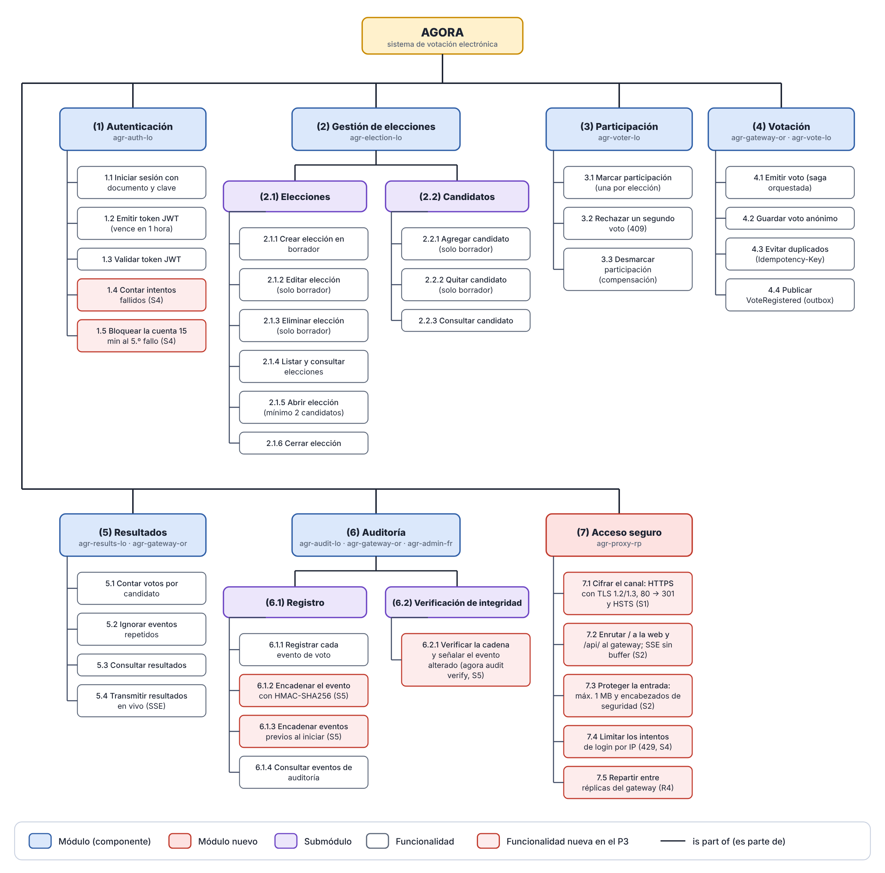

# Prototipo 3 — Equipo 1b

Arquitectura de Software, Universidad Nacional de Colombia, 2026-II.

## 1. Equipo

**Nombre:** 1b

**Integrantes:**

- David Fernando Benjumea Mora
- Esteban Prieto Lugo
- Maicol Sebastián Olarte Ramírez
- Camilo Borja Rojas
- Cristian Felipe Moreno Gomez
- Miguel Angel Zamudio Villa

## 2. Sistema de software

### 2.1 Nombre

**AGORA**

### 2.2 Logo


### 2.3 Descripción

AGORA es un sistema distribuido de votación electrónica para elecciones estudiantiles. Un administrador crea elecciones, registra sus candidatos y las abre o las cierra desde una consola de comandos. Un votante inicia sesión con su documento y su clave en la aplicación web, consulta las elecciones abiertas, emite su voto y sigue los resultados, que se actualizan automáticamente mientras la votación está abierta.

El sistema se construye alrededor de dos garantías fundamentales:

- **Una persona, un voto por elección.** La participación se registra utilizando la combinación de identificadores del votante y de la elección (`voter_id`, `election_id`). Un segundo intento de votación en la misma elección se rechaza, pero la persona puede participar en otras elecciones.
- **Separación de la identidad del votante y su voto.** La información que identifica quién participó y la información que representa qué se votó se almacena en bases de datos y servicios separados. El registro del voto contiene la elección, el candidato y la hora redondeada, y utiliza un identificador aleatorio. Esta separación busca preservar el anonimato de los votos.

#### 2.3.1 Completitud funcional

AGORA integra las funcionalidades necesarias para gestionar el proceso de votación electrónica, desde la administración de elecciones hasta la consulta de resultados. En su versión correspondiente al Prototipo 3, el sistema contempla las siguientes capacidades:

- **Administración de elecciones:** permite crear elecciones, registrar candidatos y controlar su apertura y cierre mediante una interfaz de línea de comandos.
- **Autenticación de votantes:** permite a los votantes iniciar sesión utilizando su número de documento y contraseña para acceder a las funcionalidades de la aplicación web.
- **Consulta de elecciones y candidatos:** permite visualizar las elecciones disponibles, consultar su información y conocer los candidatos participantes.
- **Emisión de votos:** permite seleccionar y registrar un candidato en una elección, garantizando que cada votante pueda emitir como máximo un voto por elección.
- **Consulta de resultados en tiempo real:** permite consultar los resultados de las elecciones y recibir actualizaciones automáticas mientras se desarrolla el proceso de votación.
- **Auditoría de eventos:** incorpora un servicio independiente encargado de registrar eventos relevantes de la operación del sistema, facilitando su trazabilidad.
- **Protección contra ataques de fuerza bruta (S4):** incorpora un mecanismo de bloqueo temporal de cuentas que limita los intentos fallidos de autenticación. Después de cinco intentos incorrectos, la cuenta queda bloqueada durante 15 minutos, impidiendo nuevos intentos de inicio de sesión durante ese periodo.

El Prototipo 3 mantiene las funcionalidades principales de votación electrónica e incorpora mecanismos orientados a fortalecer los atributos de calidad del sistema. Entre ellos se encuentra la protección de las cuentas de usuario frente a intentos repetitivos de autenticación no autorizados.

## 3. Estructuras arquitectónicas

### 3.1 Estructura de componentes y conectores (C&C)

#### 3.1.1 Vista de componentes y conectores


#### 3.1.2 Descripción de los elementos arquitectónicos y sus relaciones
La arquitectura de componentes y conectores del Prototipo 3 está conformada por **17 componentes**, correspondientes a los 16 componentes existentes en el Prototipo 2 y la incorporación del componente `agr-proxy-rp`, que actúa como punto único de entrada al sistema. La arquitectura conserva la separación entre presentación, orquestación, lógica de negocio, procesamiento asíncrono y persistencia de datos.

#### Componentes arquitectónicos

Los componentes que conforman la arquitectura se describen a continuación:

| N.º | Componente | Nivel arquitectónico | Tecnología | Responsabilidad |
|---|---|---|---|---|
| 1 | `agr-web-fr` | Presentación | TypeScript · Next.js (SSR) | Proporciona la interfaz web para los votantes, permite autenticarse, consultar elecciones, emitir votos y visualizar resultados. También realiza renderizado del lado del servidor. |
| 2 | `agr-admin-fr` | Presentación | Go · Cobra (CLI) | Proporciona la interfaz de línea de comandos para las operaciones administrativas, como la creación, apertura y cierre de elecciones y la gestión de candidatos. |
| 3 | `agr-gateway-or` | Orquestación | TypeScript · Node.js 22 | Actúa como API Gateway y Backend for Frontend (BFF). Recibe solicitudes, coordina los servicios de lógica de negocio y ejecuta la saga asociada al proceso de votación. |
| 4 | `agr-auth-lo` | Lógica | Java 21 · Spring Boot | Gestiona la autenticación de los votantes, valida las credenciales y participa en la generación y validación de la información de autenticación. |
| 5 | `agr-voter-lo` | Lógica | Java 21 · Spring Boot | Gestiona la participación de los votantes y registra si una persona ya ha votado en una elección determinada. |
| 6 | `agr-election-lo` | Lógica | Python · FastAPI · Strawberry | Gestiona las elecciones y los candidatos, incluyendo las operaciones de consulta y administración correspondientes. |
| 7 | `agr-vote-lo` | Lógica | Go | Registra los votos anónimos y publica eventos de votación para su procesamiento asíncrono. |
| 8 | `agr-results-lo` | Lógica | Rust · axum | Procesa los eventos de votación, mantiene los conteos de resultados y ofrece consultas y actualizaciones en tiempo real mediante SSE. |
| 9 | `agr-audit-lo` | Lógica | C# · .NET 10 | Registra eventos relevantes de la operación del sistema para facilitar su trazabilidad y auditoría. |
| 10 | `agr-broker-as` | Asincronía | RabbitMQ 3.13 | Gestiona la mensajería asíncrona mediante el intercambio `agora.votes` y las colas utilizadas por los servicios de resultados y auditoría. |
| 11 | `agr-auth-db` | Datos | PostgreSQL 16 | Almacena la información persistente relacionada con la autenticación. |
| 12 | `agr-voters-db` | Datos | PostgreSQL 16 | Almacena la información de participación de los votantes, incluyendo el registro de elecciones en las que ya han participado. |
| 13 | `agr-elections-db` | Datos | PostgreSQL 16 | Almacena la información de las elecciones y sus candidatos. |
| 14 | `agr-votes-db` | Datos | MongoDB 7 | Almacena los votos anónimos y la información asociada al mecanismo de publicación de eventos. |
| 15 | `agr-results-db` | Datos | Redis 7 | Almacena los conteos de resultados utilizados por el servicio de resultados. |
| 16 | `agr-audit-db` | Datos | MongoDB 7 | Almacena los eventos de auditoría generados por el servicio correspondiente. |
| 17 | `agr-proxy-rp` | Entrada / borde | Nginx | Actúa como punto único de entrada público. Termina las conexiones TLS, redirige las solicitudes HTTP hacia HTTPS y distribuye las peticiones hacia la aplicación web o el API Gateway. También aplica el límite de solicitudes de autenticación y permite el balanceo de las réplicas del gateway. |

#### Conectores arquitectónicos

Los conectores representan los mecanismos de comunicación entre los componentes. Para identificar claramente su naturaleza, se clasifican de acuerdo con el protocolo y el tipo de interacción que implementan.

**Conectores de presentación y entrada al sistema**

| Conector | Origen | Destino | Tipo de conector | Descripción |
|---|---|---|---|---|
| c1 | `agr-web-fr` | `agr-gateway-or` | REST sobre HTTP | Comunicación interna utilizada por el servidor Next.js para realizar solicitudes al gateway durante el renderizado del lado del servidor (SSR). |
| c2 | `agr-web-fr` | `agr-gateway-or` | GraphQL sobre HTTP | Comunicación utilizada para consultar información mediante la interfaz GraphQL del gateway. |
| c4 | `agr-admin-fr` | `agr-gateway-or` | REST sobre HTTP | Permite que la CLI administrativa invoque las operaciones de administración expuestas por el gateway. |

En el Prototipo 3, el conector c3 del Prototipo 2, que representaba la comunicación SSE directa entre la aplicación web y el gateway, deja de utilizarse como conexión directa. Las solicitudes del navegador para recibir resultados en tiempo real pasan por el proxy mediante HTTPS y son reenviadas internamente al gateway.

**Conectores entre el API Gateway y los servicios de lógica**

| Conector | Origen | Destino | Tipo de conector | Descripción |
|---|---|---|---|---|
| c5 | `agr-gateway-or` | `agr-auth-lo` | REST sobre HTTP | Permite realizar operaciones de autenticación y validación de credenciales. |
| c6 | `agr-gateway-or` | `agr-voter-lo` | REST sobre HTTP | Permite registrar y consultar la participación de los votantes durante el proceso de votación. |
| c7 | `agr-gateway-or` | `agr-election-lo` | REST sobre HTTP | Permite consultar y gestionar información de elecciones y candidatos. |
| c8 | `agr-gateway-or` | `agr-election-lo` | GraphQL sobre HTTP | Permite realizar consultas GraphQL relacionadas con elecciones y candidatos. |
| c9 | `agr-gateway-or` | `agr-vote-lo` | REST sobre HTTP | Permite registrar un voto durante la ejecución de la saga de votación. |
| c10 | `agr-gateway-or` | `agr-results-lo` | REST sobre HTTP | Permite consultar los resultados de las elecciones. |
| c11 | `agr-gateway-or` | `agr-results-lo` | SSE sobre HTTP | Permite recibir actualizaciones de resultados mediante eventos enviados por el servidor. |
| c12 | `agr-gateway-or` | `agr-audit-lo` | REST sobre HTTP | Permite consultar la información de auditoría gestionada por el servicio correspondiente. |

**Conectores de persistencia de datos**

| Conector | Origen | Destino | Tipo de conector | Descripción |
|---|---|---|---|---|
| c16 | `agr-auth-lo` | `agr-auth-db` | JDBC sobre PostgreSQL | Permite almacenar y consultar información de autenticación. |
| c17 | `agr-voter-lo` | `agr-voters-db` | JDBC sobre PostgreSQL | Permite registrar la participación de los votantes. |
| c18 | `agr-election-lo` | `agr-elections-db` | SQLAlchemy sobre PostgreSQL | Permite almacenar y consultar elecciones y candidatos. |
| c19 | `agr-vote-lo` | `agr-votes-db` | Driver MongoDB | Permite almacenar los votos anónimos y la información asociada al mecanismo de eventos. |
| c20 | `agr-results-lo` | `agr-results-db` | Redis RESP | Permite almacenar y consultar los conteos de resultados. |
| c21 | `agr-audit-lo` | `agr-audit-db` | Driver MongoDB | Permite almacenar y consultar los eventos de auditoría. |

**Conectores de comunicación asíncrona**

| Conector | Origen | Destino | Tipo de conector | Descripción |
|---|---|---|---|---|
| c13 | `agr-vote-lo` | `agr-broker-as` | AMQP · Publicación | Publica el evento `VoteRegistered` en el sistema de mensajería para que otros servicios puedan procesarlo. |
| c14 | `agr-results-lo` | `agr-broker-as` | AMQP · Consumo | Consume los eventos de la cola `results.vote-registered` para actualizar los conteos de resultados. |
| c15 | `agr-audit-lo` | `agr-broker-as` | AMQP · Consumo | Consume los eventos de la cola `audit.vote-registered` para registrar la información correspondiente en la auditoría. |

**Conectores incorporados para el acceso mediante el reverse proxy**

Con la incorporación de `agr-proxy-rp`, las comunicaciones externas del navegador se concentran en el proxy. Este componente termina las conexiones HTTPS y reenvía las solicitudes a los componentes internos correspondientes.

| Conector | Origen | Destino | Tipo de conector | Descripción |
|---|---|---|---|---|
| c22 | Navegador del votante | `agr-proxy-rp` | REST sobre HTTPS (TLS 1.2/1.3) | Transporta las solicitudes de autenticación y emisión de votos, incluyendo operaciones como `POST /api/auth/login` y `POST /api/votes`. |
| c23 | Navegador del votante | `agr-proxy-rp` | SSE sobre HTTPS (TLS 1.2/1.3) | Transporta las solicitudes de consulta de resultados en tiempo real mediante `GET /api/results/{id}/stream`. |
| c24 | Navegador del votante | `agr-proxy-rp` | HTTPS (TLS 1.2/1.3) | Transporta las solicitudes de páginas, scripts, estilos y demás recursos de la aplicación web. |
| c25 | `agr-proxy-rp` | `agr-gateway-or` | REST y SSE sobre HTTP | Reenvía las solicitudes recibidas en `/api/` hacia el gateway, eliminando el prefijo `/api`. También permite el flujo SSE sin almacenamiento intermedio (*buffering*). |
| c26 | `agr-proxy-rp` | `agr-web-fr` | HTTP | Reenvía las solicitudes de páginas y recursos web hacia la aplicación Next.js, que atiende en el puerto 3000. |

Los conectores c22, c23 y c24 utilizan el puerto público 443 del proxy. El puerto 80 no transporta solicitudes de aplicación: únicamente responde con una redirección HTTP 301 hacia la dirección HTTPS correspondiente.

Los conectores c25 y c26 utilizan los puertos internos 8080 y 3000, respectivamente, y operan mediante HTTP dentro de la red `agr-edge-net`. Por tanto, la terminación TLS ocurre en `agr-proxy-rp`: el cifrado protege el tramo entre el navegador y el proxy, mientras que las comunicaciones internas continúan utilizando HTTP dentro de la red de borde.

#### Relaciones entre los componentes

La arquitectura del Prototipo 3 conserva la separación de responsabilidades del Prototipo 2 y modifica principalmente el mecanismo de entrada al sistema.

El navegador del votante establece comunicación con `agr-proxy-rp` mediante los conectores c22, c23 y c24. El conector c24 permite solicitar las páginas y recursos de la aplicación web; c22 transporta las solicitudes REST de autenticación y votación; y c23 permite recibir los resultados en tiempo real mediante SSE. Estas comunicaciones utilizan HTTPS con TLS 1.2 o TLS 1.3.

Una vez recibidas las solicitudes, el proxy distribuye el tráfico hacia los componentes internos. Mediante c26 reenvía las solicitudes de la interfaz web a `agr-web-fr`, mientras que mediante c25 dirige las solicitudes de API y de resultados en tiempo real a `agr-gateway-or`. De esta forma, el navegador deja de acceder directamente a los puertos de la web y del gateway.

El servidor Next.js conserva sus comunicaciones internas con el gateway mediante c1 y c2, mientras que la CLI administrativa utiliza c4. Estos conectores no atraviesan el proxy porque corresponden a comunicaciones entre componentes dentro de la red de borde.

El API Gateway coordina las operaciones de los servicios de lógica mediante los conectores c5 a c12. Para persistir la información, cada servicio utiliza su propio conector de base de datos, identificado entre c16 y c21. Esta separación permite mantener las responsabilidades de autenticación, participación, elecciones, votos, resultados y auditoría en componentes independientes.

Finalmente, la comunicación asíncrona se realiza mediante RabbitMQ. El servicio de votos publica eventos a través de c13, mientras que los servicios de resultados y auditoría consumen los mensajes mediante c14 y c15, respectivamente.

La incorporación del proxy no modifica la separación de responsabilidades de los servicios de lógica, los mecanismos de persistencia ni la mensajería asíncrona. Su función se concentra en proteger y controlar el acceso externo, manteniendo las comunicaciones internas dentro de la arquitectura desplegada en Docker Compose.

#### Correspondencia con los flujos de red

Los conectores nuevos mantienen correspondencia con los flujos definidos para la segmentación de red del Prototipo 3:

| Flujo de red | Conector C&C | Comunicación |
|---|---|---|
| F1 | c24 | Navegador → `agr-proxy-rp`: acceso a la interfaz web mediante HTTPS. |
| F2 | c22 y c23 | Navegador → `agr-proxy-rp`: solicitudes de API y recepción de resultados en vivo mediante HTTPS. |
| F21 | c26 | `agr-proxy-rp` → `agr-web-fr`: reenvío interno de solicitudes web mediante HTTP. |
| F22 | c25 | `agr-proxy-rp` → `agr-gateway-or`: reenvío interno de solicitudes de API y SSE mediante HTTP. |

Esta correspondencia permite mantener consistencia entre la vista C&C, la matriz de flujos permitidos de S3 y la configuración de los servicios en `docker-compose.yml`.
### 3.2 Estructura de despliegue

#### 3.2.1 Vista de despliegue

La vista muestra dónde se ejecuta cada componente de AGORA en el Prototipo 3: el nodo, el entorno de ejecución, el contenedor de cada componente con su imagen y sus puertos, las once redes de Docker, los volúmenes y los únicos puertos que se publican hacia fuera del nodo. Cada elemento de software se asigna a su contenedor con la relación `deployed_in`.

Frente al Prototipo 2 hay tres cambios: aparece `agr-proxy-rp` como único punto de entrada, la web y el gateway dejan de publicar puertos y las tres redes planas se reemplazan por la segmentación de S3, a la que S2 suma `agr-public-net` y vuelve `internal` a `agr-edge-net`.


#### 3.2.2 Descripción de los elementos arquitectónicos y sus relaciones

**Elementos de software**

Son los 17 componentes de la vista C&C: los 16 del Prototipo 2 más `agr-proxy-rp`. Cada uno se asigna (`deployed_in`) a un contenedor con su mismo nombre.

**Elementos de entorno**

| Elemento | Tipo | Descripción |
|---|---|---|
| Equipo anfitrión | Nodo | Computador con Windows, macOS o Linux donde corre todo el sistema. |
| Docker Engine + Docker Compose | Entorno de ejecución | Construye las imágenes y crea las redes, los volúmenes y los 17 contenedores definidos en `docker-compose.yml`. |
| Redes de Docker (11) | Red (bridge) | Detalladas en la tabla siguiente. Nueve son `internal`: no tienen salida a internet ni permiten publicar puertos. |
| Volúmenes nombrados (7) | Almacenamiento | Guardan los datos de las seis bases y del broker aunque los contenedores se recreen. |
| Navegador del votante | Actor externo | Entra solo por `https://localhost` (si usa `http://localhost`, el proxy lo redirige). Pide las páginas en `/` y llama al gateway en `/api/...` desde el mismo origen. |
| Administrador | Actor externo | Ejecuta la CLI con `docker compose run --rm agr-admin-fr <comando>`; la CLI habla con el gateway por la red interna. |
| Operador | Actor externo | Abre la consola de RabbitMQ en `127.0.0.1:15672`, solo desde el propio equipo. |

| Red | `internal` | Contenedores | Para qué existe |
|---|---|---|---|
| `agr-public-net` | No | `agr-proxy-rp` | Es la única red desde la que se publican puertos de la aplicación: 443 y 80, que solo redirige a 443. |
| `agr-edge-net` | Sí (desde S2) | `agr-proxy-rp`, `agr-web-fr`, `agr-gateway-or`, `agr-admin-fr` | Zona de borde detrás del proxy: el proxy llega a la web y al gateway; la web (SSR) y la CLI llegan al gateway. |
| `agr-back-net` | Sí | `agr-gateway-or` y los seis servicios `-lo` | El gateway llama a los servicios; los servicios no se llaman entre sí. |
| `agr-auth-data-net` | Sí | `agr-auth-lo`, `agr-auth-db` | Cada servicio ve solo su base. |
| `agr-voters-data-net` | Sí | `agr-voter-lo`, `agr-voters-db` | |
| `agr-elections-data-net` | Sí | `agr-election-lo`, `agr-elections-db` | |
| `agr-votes-data-net` | Sí | `agr-vote-lo`, `agr-votes-db` | |
| `agr-results-data-net` | Sí | `agr-results-lo`, `agr-results-db` | |
| `agr-audit-data-net` | Sí | `agr-audit-lo`, `agr-audit-db` | |
| `agr-bus-net` | Sí | `agr-broker-as`, `agr-vote-lo`, `agr-results-lo`, `agr-audit-lo` | Mensajería: solo quien publica o consume eventos. |
| `agr-mgmt-net` | No | `agr-broker-as` | Consola de RabbitMQ, publicada solo en `127.0.0.1`. |

**Relación `deployed_in`**

En la columna de redes se omiten el prefijo `agr-` y el sufijo `-net`.

| Elemento de software | Contenedor | Imagen base | Puerto interno | Puerto publicado | Redes | Volumen |
|---|---|---|---|---|---|---|
| `agr-proxy-rp` | `agr-proxy-rp` | `alpine:3.22` + `nginx` y `nginx-mod-http-headers-more` | 443 y 80 | **443** y **80** | public, edge | — |
| `agr-web-fr` | `agr-web-fr` | `node:22-alpine` | 3000 | — | edge | — |
| `agr-admin-fr` | `agr-admin-fr` (bajo demanda) | `alpine:3.20` | — | — | edge | — |
| `agr-gateway-or` | `agr-gateway-or` | `node:22-alpine` | 8080 | — | edge, back | — |
| `agr-auth-lo` | `agr-auth-lo` | `eclipse-temurin:21-jre-alpine` | 8081 | — | back, auth-data | — |
| `agr-voter-lo` | `agr-voter-lo` | `eclipse-temurin:21-jre-alpine` | 8001 | — | back, voters-data | — |
| `agr-election-lo` | `agr-election-lo` | `python:3.12-slim` | 8000 | — | back, elections-data | — |
| `agr-vote-lo` | `agr-vote-lo` | `alpine:3.20` | 8002 | — | back, votes-data, bus | — |
| `agr-results-lo` | `agr-results-lo` | `alpine:3.20` | 8004 | — | back, results-data, bus | — |
| `agr-audit-lo` | `agr-audit-lo` | `mcr.microsoft.com/dotnet/aspnet:10.0-alpine` | 8005 | — | back, audit-data, bus | — |
| `agr-broker-as` | `agr-broker-as` | `rabbitmq:3.13-management-alpine` | 5672, 15672 | **127.0.0.1:15672** | bus, mgmt | `broker-data` |
| `agr-auth-db` | `agr-auth-db` | `postgres:16-alpine` | 5432 | — | auth-data | `agr_auth_db_data` |
| `agr-voters-db` | `agr-voters-db` | `postgres:16-alpine` | 5432 | — | voters-data | `voters-db-data` |
| `agr-elections-db` | `agr-elections-db` | `postgres:16-alpine` | 5432 | — | elections-data | `elections-db-data` |
| `agr-votes-db` | `agr-votes-db` | `mongo:7` | 27017 | — | votes-data | `votes-db-data` |
| `agr-results-db` | `agr-results-db` | `redis:7-alpine` | 6379 | — | results-data | `results-db-data` |
| `agr-audit-db` | `agr-audit-db` | `mongo:7` | 27017 | — | audit-data | `audit-db-data` |

**Relaciones**

- Cada elemento de software se despliega en un contenedor propio. Los componentes del equipo se construyen con su `Dockerfile`; las bases de datos usan imágenes oficiales.
- Hacia fuera del nodo solo se publican tres puertos: el 443 de `agr-proxy-rp`, su 80, que solo redirige a 443 (S1), y el 15672 del broker, atado a `127.0.0.1`. En el Prototipo 2 se publicaban en cambio el 3000 de la web y el 8080 del gateway.
- `agr-proxy-rp` es el único contenedor que está a la vez en `agr-public-net` y en `agr-edge-net`, así que es el único camino desde fuera hacia la web y el gateway. Estos dos, en cambio, solo están en redes `internal` (`agr-edge-net` y, el gateway, también `agr-back-net`), de modo que no tienen una red desde la cual publicar puertos.
- El proxy reenvía `/` a `agr-web-fr:3000` y `/api/...` a `agr-gateway-or:8080`, quitando el prefijo. El gateway sigue siendo el único contenedor en `agr-edge-net` y `agr-back-net`, de modo que la presentación nunca alcanza a la lógica sin pasar por él.
- Los flujos de red que pasan por el proxy son los mismos conectores de la vista C&C. F1, del navegador al proxy para páginas y recursos, corresponde a c24; F2, del navegador al proxy en `/api/...`, agrupa c22 (REST de autenticación y votación) y c23 (SSE de resultados); F21, del proxy a la web, es c26, y F22, del proxy al gateway con REST y SSE, es c25. El conector c3 del Prototipo 2, el SSE directo del navegador al gateway, ya no existe como conexión directa: ese tráfico es ahora c23 seguido de c25.
- El servidor de Next.js (SSR) y la CLI llaman al gateway directamente por `agr-edge-net`, sin pasar por el proxy. El navegador, en cambio, hace sus tres llamadas al gateway (login, voto y SSE) a través del proxy y en el mismo origen.
- Los contenedores se encuentran por nombre de servicio con el DNS interno de Docker. El proxy consulta ese DNS (`127.0.0.11`) en cada petición, con caché de 10 segundos: si la web o el gateway se recrean con otra IP, o si el gateway corre con varias réplicas (R4), el proxy los encuentra y reparte la carga sin reiniciarse.
- El arranque sigue `depends_on` y los healthchecks: bases y broker → servicios de lógica → gateway → web → proxy. Todos los servicios, salvo la CLI, tienen healthcheck; el del proxy consulta un servidor de salud que solo escucha en `127.0.0.1:8081` dentro de su contenedor.
- Todos tienen `restart: unless-stopped`, salvo `agr-auth-db` y la CLI. La CLI tiene el perfil `tools`, así que `docker compose up` no la arranca.

#### 3.2.3 Descripción de los patrones arquitectónicos utilizados

| Patrón | Cómo se aplica |
|---|---|
| **Despliegue en contenedores** | Cada componente corre en su propio contenedor, con su propio entorno de ejecución e imagen. |
| **Nodo único con múltiples contenedores** | Los 17 componentes se ejecutan en un solo equipo anfitrión, orquestados por Docker Compose. |
| **Reverse Proxy (punto único de entrada)** | `agr-proxy-rp` es lo único alcanzable desde fuera del nodo y reparte las peticiones entre la web y el gateway (S2). |
| **Segmentación de red** | Once redes: una pública, una de borde, una de lógica, una de datos por servicio, una de mensajería y una de administración. Nueve son `internal` (S3). |
| **Descubrimiento de servicios** | Los contenedores se llaman por nombre (`http://agr-gateway-or:8080`); el proxy vuelve a resolver los nombres en cada petición. |
| **Volúmenes persistentes** | Las seis bases y el broker guardan sus datos en volúmenes nombrados. |
| **Health checks y política de reinicio** | Docker comprueba la salud de los 16 contenedores que arrancan con `up` (todos menos la CLI), ordena el arranque con ella y reinicia los configurados con `restart: unless-stopped`. |
| **Configuración externa** | Credenciales, URLs internas, orígenes de CORS y los límites del proxy (`LOGIN_RATE`, `LOGIN_BURST`) se leen de variables de entorno; el `.env` opcional reemplaza los valores por defecto. |

### 3.3 Estructura por capas

#### 3.3.1 Vista por capas

#### 3.3.2 Descripción de los elementos arquitectónicos y sus relaciones

#### 3.3.3 Descripción de los patrones arquitectónicos utilizados

### 3.4 Estructura de descomposición

#### 3.4.1 Vista de descomposición

La vista descompone AGORA de forma jerárquica en **módulos** funcionales, **submódulos** y **funcionalidades**, utilizando la relación *is part of* y señalando los componentes que implementan cada elemento.

Frente al Prototipo 2 se conservan los seis módulos originales, se incorpora un séptimo módulo —**(7) Acceso seguro** (`agr-proxy-rp`)— que concentra el control de entrada al sistema, y se amplían los módulos **(1) Autenticación** (bloqueo por fuerza bruta de S4) y **(6) Auditoría** (encadenamiento y verificación de integridad de S5). La segmentación de redes (S3) corresponde a una decisión de despliegue y no a una función de negocio, por lo que se detalla en la estructura de despliegue.



#### 3.4.2 Descripción de los elementos arquitectónicos y sus relaciones

**Módulos y submódulos**

| Elemento | Tipo | Implementado en | Descripción | Relaciones |
|---|---|---|---|---|
| (1) Autenticación | Módulo | `agr-auth-lo` | Inicio de sesión, emisión/validación de JWT y **bloqueo temporal de cuentas** (S4). | Votación (4) lo usa para validar el token del votante. Acceso seguro (7) limita las ráfagas de login por IP antes de que lleguen aquí. |
| (2) Gestión de elecciones | Módulo | `agr-election-lo` | Ciclo de vida de elecciones y candidatos. | Votación (4) lo consulta para verificar que la elección esté abierta. El gateway toma los nombres de candidatos para componer resultados (5.3). |
| (2.1) Elecciones | Submódulo | `agr-election-lo` | Crear, editar, eliminar, consultar, abrir y cerrar elecciones. | Parte de (2). |
| (2.2) Candidatos | Submódulo | `agr-election-lo` | Agregar, quitar y consultar candidatos. | Parte de (2). Agregar y quitar solo se permite en elecciones en borrador; consultar, en cualquier estado. |
| (3) Participación | Módulo | `agr-voter-lo` | Registra qué votante participó en qué elección. | Votación (4) lo usa para marcar participación y compensar si falla el registro del voto. |
| (4) Votación | Módulo | `agr-gateway-or` (saga) y `agr-vote-lo` | Orquesta y emite el voto, lo guarda de forma anónima y publica el evento. | Usa (1), (2) y (3); produce los eventos consumidos por (5) y (6). Desde el navegador se accede a través de (7). |
| (5) Resultados | Módulo | `agr-results-lo` y `agr-gateway-or` | Cuenta los votos y transmite actualizaciones en tiempo real. | Consume los eventos de (4). El gateway compone los nombres de candidatos y reenvía el flujo SSE hacia (7). |
| (6) Auditoría | Módulo | `agr-audit-lo`, `agr-gateway-or` y `agr-admin-fr` | Registra los eventos de voto en una **cadena de hashes** y **verifica su integridad** (S5). | Consume los eventos de (4). La CLI consulta y verifica la cadena a través del gateway por la red interna. |
| (6.1) Registro | Submódulo | `agr-audit-lo` | Persiste y encadena criptográficamente cada evento recibido. | Parte de (6). |
| (6.2) Verificación de integridad | Submódulo | `agr-audit-lo`, `agr-gateway-or` y `agr-admin-fr` | Recorre la cadena de auditoría y reporta eventos alterados, borrados, insertados o truncados. | Parte de (6). Verifica los registros generados por (6.1). |
| **(7) Acceso seguro** | **Módulo (nuevo)** | `agr-proxy-rp` | Punto único de entrada público: canal cifrado TLS/HTTPS (S1), enrutamiento y encabezados de seguridad (S2), límite de login por IP (S4) y balanceo entre réplicas del gateway (R4). | Se ubica delante de (1), (4) y (5) para todo el tráfico proveniente del navegador. La CLI no pasa por este módulo (opera por la red interna). |

**Funcionalidades**

| Código | Funcionalidad | Regla de negocio |
|---|---|---|
| 1.1 | Iniciar sesión con documento y clave | La clave se verifica contra su hash BCrypt. |
| 1.2 | Emitir token JWT | Token firmado con vigencia de una hora. |
| 1.3 | Validar token JWT | Invocado por el gateway antes de ejecutar la saga de votación. |
| 1.4 | Contar intentos fallidos de login *(nueva, S4)* | Cada credencial incorrecta incrementa `failed_attempts`; un ingreso exitoso reinicia el contador. |
| 1.5 | Bloquear la cuenta *(nueva, S4)* | Al quinto intento fallido se fija `locked_until` por 15 minutos y se rechazan intentos con HTTP `423`. |
| 2.1.1 | Crear elección | Se crea en estado borrador. |
| 2.1.2 | Editar elección | Permitido únicamente en estado borrador. |
| 2.1.3 | Eliminar elección | Permitido únicamente en estado borrador. |
| 2.1.4 | Listar y consultar elecciones | Disponible vía REST y GraphQL, con filtro opcional por estado. |
| 2.1.5 | Abrir elección | Requiere al menos dos candidatos. Permite votar mientras esté activa y dentro de la ventana `starts_at`–`ends_at`. |
| 2.1.6 | Cerrar elección | Solo desde estado activa; una elección cerrada no puede reabrirse. |
| 2.2.1 | Agregar candidato | Solo en borrador; nombre único dentro de la elección y numeración automática. |
| 2.2.2 | Quitar candidato | Solo en estado borrador. |
| 2.2.3 | Consultar candidato | Disponible en cualquier estado de la elección (consumido por la web mediante GraphQL). |
| 3.1 | Marcar participación | `INSERT` atómico sobre la llave compuesta (`voter_id`, `election_id`). |
| 3.2 | Rechazar un segundo voto | Si ya existe participación para el par (`voter_id`, `election_id`), responde HTTP `409`. |
| 3.3 | Desmarcar participación | Paso de compensación de la saga cuando el voto no logra guardarse. |
| 4.1 | Emitir voto | Saga orquestada: validar token → comprobar elección → marcar participación → guardar voto. |
| 4.2 | Guardar voto anónimo | Sin identificador del votante, con `_id` aleatorio y marca temporal redondeada. |
| 4.3 | Evitar duplicados | El encabezado `Idempotency-Key` evita registrar dos veces el mismo voto ante reintentos. |
| 4.4 | Publicar `VoteRegistered` | Publicación confirmada en RabbitMQ; un proceso *outbox* reintenta los eventos pendientes. |
| 5.1 | Contar votos por candidato | Incremento atómico en Redis. |
| 5.2 | Ignorar eventos repetidos | Script Lua en Redis registra cada `event_id` para garantizar idempotencia en el conteo. |
| 5.3 | Consultar resultados | El gateway enriquece los conteos de Redis con los nombres de candidatos de `agr-election-lo`. |
| 5.4 | Transmitir resultados en vivo | Flujo Server-Sent Events (SSE) hacia el navegador a través del gateway y el reverse proxy. |
| 6.1.1 | Registrar cada evento de voto | Almacena `_id` igual a `event_id` sin datos del votante ni del candidato elegido. |
| 6.1.2 | Encadenar el evento *(nueva, S5)* | Asigna `seq` consecutivo (con índice único `seq_unique`), `prev_hash` igual al hash anterior (`0`×64 para el primero) y calcula `hash = HMAC-SHA256(AUDIT_CHAIN_KEY, ...)` sobre el arreglo JSON canónico. |
| 6.1.3 | Encadenar eventos previos a S5 *(nueva, S5)* | Al iniciar `agr-audit-lo`, si la cadena está vacía, encadena una única vez documentos heredados sin `seq`; posteriormente todo documento sin `seq` se marca como insertado fuera del servicio. |
| 6.1.4 | Consultar eventos de auditoría | Consulta desde la CLI (`agora audit list`) protegida con `X-API-Key`; incluye `seq`, `prev_hash` y `hash`. |
| 6.2.1 | Verificar la cadena *(nueva, S5)* | Expuesto en `GET /audit/verify`, `GET /admin/audit/verify` y `agora audit verify`. Detecta `altered`, `missing`, `broken_link`, `out_of_order`, `unchained` y `truncated` indicando el `seq` afectado. La CLI retorna código `1` si hay alteraciones. |
| 7.1 | Cifrar el canal *(nueva, S1)* | Atiende solo HTTPS con TLS 1.2/1.3 y encabezado HSTS; el puerto 80 redirige con HTTP `301` hacia HTTPS. |
| 7.2 | Enrutar peticiones *(nueva, S2)* | Dirige `/` a `agr-web-fr` y `/api/` a `agr-gateway-or` (eliminando el prefijo), bloquea `/api/admin` con `404` y desactiva el *buffering* para SSE. |
| 7.3 | Proteger la entrada *(nueva, S2)* | Limita el cuerpo de petición a `1 MB` (`413`), añade encabezados de seguridad y oculta `Server`, `X-Powered-By` y `X-Nextjs-*`. |
| 7.4 | Limitar el login por IP *(nueva, S4)* | Aplica `limit_req` sobre `/api/auth/login` y responde HTTP `429` al exceder el umbral. |
| 7.5 | Repartir entre réplicas del gateway *(nueva, R4)* | Resuelve `agr-gateway-or` dinámicamente mediante el DNS interno de Docker (`127.0.0.11`) y reutiliza conexiones *keepalive*. |

#### 3.4.3 Descripción de los patrones arquitectónicos utilizados

| Patrón | Cómo se aplica |
|---|---|
| **Descomposición funcional jerárquica** | Estructura el sistema en módulos, submódulos y funcionalidades mediante la relación *is part of*. |
| **Descomposición por capacidad de negocio** | Cada módulo encapsula una capacidad clara del dominio (autenticación, elecciones, participación, votación, resultados, auditoría y acceso seguro). |
| **Alta cohesión y bajo acoplamiento** | En el Prototipo 3, tanto el registro como la verificación de integridad de auditoría residen en el módulo `(6)` —único poseedor de la clave `AUDIT_CHAIN_KEY`—, mientras que los controles de borde se concentran en `(7)`. |
| **Responsabilidad única** | Cada módulo cuenta con un componente responsable principal. El gateway participa como orquestador en Votación (saga), Resultados (composición y SSE) y Auditoría (enrutamiento administrativo). |
| **Separación de responsabilidades** | Las reglas de negocio, el control de borde y la verificación criptográfica permanecen aislados en sus respectivos módulos sin duplicarse. |
## 4. Atributos de calidad

### 4.1 Seguridad

La seguridad del Prototipo 3 se aborda mediante cinco escenarios (S1–S5). En conjunto, estos cambios protegen la comunicación entre el votante y el sistema, reducen la superficie de exposición, limitan las comunicaciones entre contenedores, dificultan los intentos repetitivos de autenticación y permiten detectar alteraciones en los registros de auditoría.

#### 4.1.1 Escenarios de seguridad

##### 4.1.1.1 Escenario S1 (Secure Channel)

El escenario S1 aborda la exposición de información sensible durante las comunicaciones entre el navegador del votante y AGORA. En el Prototipo 2, las solicitudes se transmitían mediante HTTP sin cifrado, lo que permitía que un tercero con capacidad de observar el tráfico de red pudiera acceder a información como el documento del votante, su contraseña y el token de autenticación.

Para mitigar esta vulnerabilidad, en el Prototipo 3 se incorporó un canal seguro mediante HTTPS, utilizando TLS 1.2 y TLS 1.3 en el componente `agr-proxy-rp`. El proxy termina las conexiones TLS, redirige las solicitudes HTTP hacia HTTPS y aplica la política HSTS.

**Descripción del escenario de seguridad**

| Elemento | Descripción |
|---|---|
| Fuente | Un atacante ubicado en la misma red que el votante, por ejemplo, en una red Wi-Fi compartida o en un punto intermedio de comunicación, que intenta observar o alterar el tráfico. |
| Estímulo | El atacante intercepta la comunicación entre el navegador y AGORA mientras un votante inicia sesión, emite su voto o consulta los resultados. |
| Entorno | Sistema AGORA en funcionamiento, desplegado mediante Docker Compose y utilizando un certificado de desarrollo para el dominio `localhost`. |
| Artefacto | Canal de comunicación entre el navegador del votante y el componente `agr-proxy-rp`, a través de los puertos 80 y 443. |
| Respuesta | El proxy atiende las solicitudes de la aplicación mediante HTTPS con TLS 1.2 o TLS 1.3. Las solicitudes recibidas por HTTP son redirigidas mediante una respuesta 301 hacia HTTPS. Además, el proxy incluye el encabezado HSTS en las respuestas HTTPS y rechaza versiones anteriores como TLS 1.1. |
| Medida de respuesta | Las pruebas verifican que TLS 1.2 y TLS 1.3 son aceptados, TLS 1.1 es rechazado, las solicitudes HTTP reciben una redirección 301 y las respuestas HTTPS incluyen `Strict-Transport-Security`. En la captura del puerto 443 no se identifican el documento, la contraseña ni el token JWT en texto legible. |

##### 4.1.1.2 Escenario S2 (Reverse Proxy)

El escenario S2 aborda la exposición directa de los componentes de presentación y orquestación. En el Prototipo 2, la web (`agr-web-fr`) y el API Gateway (`agr-gateway-or`) publicaban sus puertos directamente en el equipo anfitrión. Esto permitía acceder a los servicios sin un intermediario, identificar tecnologías mediante encabezados HTTP, enviar solicitudes de gran tamaño y alcanzar rutas que debían reservarse para la administración.

En el Prototipo 3 se incorporó `agr-proxy-rp`, basado en Nginx, como único punto de entrada desde el exterior. La web y el gateway dejaron de publicar sus puertos y ahora reciben las solicitudes reenviadas por el proxy.

**Descripción del escenario de seguridad**

| Elemento | Descripción |
|---|---|
| Fuente | Un atacante externo, sin credenciales, con acceso de red al equipo donde se ejecuta AGORA. |
| Estímulo | Explora los puertos del equipo y envía peticiones directas a la web y al gateway; intenta identificar la tecnología, enviar cuerpos de varios megabytes, repetir intentos de login y acceder a rutas administrativas. |
| Entorno | Sistema AGORA desplegado mediante Docker Compose, con los servicios de presentación y orquestación en funcionamiento. |
| Artefacto | Borde del sistema: `agr-proxy-rp`, `agr-web-fr`, `agr-gateway-or`, puertos publicados y red `agr-edge-net`. |
| Respuesta | El tráfico externo entra por `agr-proxy-rp`. El proxy dirige `/` a la web y `/api/` al gateway sin conservar el prefijo `/api`; oculta encabezados que revelan la tecnología, agrega encabezados de seguridad, rechaza cuerpos mayores a 1 MB, limita los intentos de login por IP y no expone `/api/admin`. Los eventos SSE se reenvían sin buffering. |
| Medida de respuesta | Los puertos 3000 y 8080 dejan de estar publicados; desde el exterior se utilizan 80 y 443. Las solicitudes de 2 MB reciben HTTP 413, las solicitudes que superan el límite de login reciben HTTP 429 y `/api/admin` no se expone. Las rutas funcionales de login, voto y resultados en vivo continúan operando a través del proxy. |

##### 4.1.1.3 Escenario S3 (Network Segmentation)

El escenario S3 aborda el riesgo de que un componente comprometido pueda comunicarse con servicios o bases de datos que no necesita utilizar. En el Prototipo 2 existía una red de datos compartida, por lo que un servicio podía alcanzar bases de datos ajenas a su responsabilidad. Esta situación incrementaba la superficie de ataque y podía facilitar el acceso cruzado entre información de votantes, votos, autenticación y auditoría.

En el Prototipo 3 se dividió la infraestructura en zonas de red de Docker. Cada servicio de lógica comparte una red de datos únicamente con su propia base de datos. Se definieron redes separadas para el borde, la lógica, los datos, la mensajería y la administración. Las redes internas se configuran con `internal: true` cuando no necesitan publicar puertos ni acceder al exterior.

**Descripción del escenario de seguridad**

| Elemento | Descripción |
|---|---|
| Fuente | Un atacante que obtiene control de un contenedor o de un servicio interno de AGORA. |
| Estímulo | Intenta conectarse a bases de datos de otros servicios, acceder al broker, alcanzar servicios de lógica no autorizados o salir a Internet para exfiltrar información. |
| Entorno | Sistema AGORA desplegado con Docker Compose y las redes segmentadas del Prototipo 3. |
| Artefacto | Redes Docker y conectividad entre `agr-gateway-or`, los servicios `*-lo`, las bases `*-db`, `agr-broker-as` y `agr-proxy-rp`. |
| Respuesta | Docker limita la conectividad a los miembros de cada red. El gateway se comunica con los servicios de lógica; cada servicio de lógica accede a su propia base de datos; únicamente los servicios que requieren mensajería se conectan a `agr-broker-as`. La consola de RabbitMQ se publica solo en `127.0.0.1:15672`. |
| Medida de respuesta | La matriz de segmentación registra los flujos permitidos y los caminos que deben permanecer bloqueados. La matriz disponible del 19 de noviembre de 2026 corresponde a una ejecución anterior a la integración final del proxy: registra cero caminos no autorizados abiertos por nombre, 146 pares bloqueados y dos accesos por puertos publicados (web 3000 y gateway 8080). Por tanto, sirve como evidencia de la segmentación previa, pero no demuestra por sí sola la topología final posterior a S2. Para validar el estado final debe repetirse `p3/s3/verify-segmentation.sh` con el proxy integrado. |

La topología final contempla `agr-public-net` para el proxy; `agr-edge-net` para el proxy, la web, el gateway y la CLI; `agr-back-net` para el gateway y los servicios de lógica; una red de datos por servicio; `agr-bus-net` para RabbitMQ y sus consumidores/productores; y `agr-mgmt-net` para la administración local del broker. La matriz de flujos y el script de verificación se encuentran en `p3/s3/`.

##### 4.1.1.4 Escenario S4 (Brute Force Protection – Account Lockout)

El escenario S4 aborda la vulnerabilidad del mecanismo de autenticación frente a ataques de fuerza bruta (*Brute Force Attacks*). Este tipo de ataque consiste en realizar múltiples intentos de inicio de sesión utilizando diferentes combinaciones de contraseñas con el objetivo de obtener acceso no autorizado a una cuenta.

En AGORA, la autenticación de los votantes es gestionada por `agr-auth-lo`, al que se accede a través de `agr-gateway-or`. En el Prototipo 3 se implementó un mecanismo de bloqueo temporal de cuentas y un límite de solicitudes de login por dirección IP en el proxy.

**Descripción del escenario de seguridad**

| Elemento | Descripción |
|---|---|
| Fuente | Un usuario malicioso o un atacante que intenta autenticarse repetidamente. |
| Estímulo | Se realizan múltiples intentos de inicio de sesión con credenciales incorrectas o se envían solicitudes de login de forma reiterada desde una misma dirección IP. |
| Entorno | Sistema AGORA en funcionamiento, con `agr-proxy-rp`, `agr-gateway-or` y `agr-auth-lo` disponibles. |
| Artefacto | Endpoint de login, proxy inverso y servicio de autenticación; estado de autenticación almacenado en PostgreSQL. |
| Respuesta | El proxy aplica un límite de solicitudes por IP a `/api/auth/login` y responde HTTP 429 cuando se supera. El servicio de autenticación contabiliza los intentos fallidos y bloquea la cuenta al alcanzar cinco intentos fallidos. Durante el bloqueo rechaza las solicitudes, incluso si se proporcionan credenciales correctas. |
| Medida de respuesta | La cuenta queda bloqueada durante 15 minutos después del quinto intento fallido y el servicio responde HTTP 423 (`Locked`). El estado se conserva en las columnas `failed_attempts` y `locked_until` de PostgreSQL. El límite por IP del proxy utiliza `LOGIN_RATE=5r/m` y `LOGIN_BURST=5` por defecto. |

##### 4.1.1.5 Escenario S5 (Tamper-evident Audit Log)

El escenario S5 aborda la posibilidad de que una persona con acceso a la base de datos de auditoría pueda modificar, eliminar o insertar eventos para ocultar o alterar el registro de las operaciones del sistema. En una plataforma de votación, la auditoría debe permitir comprobar que los eventos registrados no han sido modificados de manera silenciosa.

En el Prototipo 3, `agr-audit-lo` almacena los eventos en una cadena verificable. Cada evento incorpora un número secuencial (`seq`), el hash del evento anterior (`prev_hash`) y una firma HMAC-SHA256 (`hash`). La llave utilizada para calcular el HMAC se mantiene en el servicio de auditoría y no en la base de datos.

**Descripción del escenario de seguridad**

| Elemento | Descripción |
|---|---|
| Fuente | Un intruso o una persona con acceso a `agr-audit-db`, por ejemplo, tras comprometer un contenedor o conseguir las credenciales de la base de datos. |
| Estímulo | Modifica, elimina o inserta documentos en la colección de eventos para ocultar o inventar registros relacionados con la votación. También puede intentar recalcular los hashes sin disponer de la llave secreta. |
| Entorno | Sistema AGORA en funcionamiento, con eventos de auditoría almacenados y el servicio `agr-audit-lo` disponible. |
| Artefacto | Cadena de auditoría almacenada en `agr-audit-db` y lógica de verificación de `agr-audit-lo`. |
| Respuesta | El servicio recorre la cadena y verifica la secuencia, el enlace con el evento anterior y el HMAC de cada evento. La verificación informa el tipo de inconsistencia y el número secuencial afectado. Puede ejecutarse mediante `GET /audit/verify` en el servicio, la ruta administrativa `GET /admin/audit/verify` a través del gateway o el comando `agora audit verify` de la CLI. |
| Medida de respuesta | Las pruebas de S5 detectaron los cinco tipos de alteración evaluados: modificar un evento, modificarlo y recalcular el hash sin la llave, borrar un evento intermedio, insertar un evento no encadenado y truncar el final de la cadena. La cadena intacta y la restaurada se verificaron sin falsos positivos en las pruebas documentadas. |

Los eventos de auditoría no almacenan el votante ni el candidato. El diseño permite detectar alteraciones, pero no evita que alguien con control del servicio y de la llave secreta pueda reconstruir la cadena. Además, la detección del truncamiento final depende de la cabeza de la cadena que mantiene el servicio; si se eliminan los últimos eventos y luego se reinicia el servicio, esa referencia se vuelve a cargar desde la base de datos. Un anclaje externo permitiría fortalecer esa protección.

#### 4.1.2 Tácticas arquitectónicas aplicadas

Las tácticas arquitectónicas son decisiones de diseño utilizadas para responder a los escenarios de seguridad. En AGORA se aplicaron tácticas para resistir ataques, limitar la exposición, detectar alteraciones y comunicar los rechazos al cliente.

| Escenario | Táctica | Categoría | Aplicación en AGORA |
|---|---|---|---|
| S1 | Encrypt Data | Resist Attacks | Se cifra el tráfico entre el navegador y `agr-proxy-rp` mediante TLS 1.2 o TLS 1.3, evitando que credenciales y tokens viajen en texto claro. |
| S1 | Establish Secure Connection | Resist Attacks | El proxy termina las conexiones HTTPS y redirige las solicitudes HTTP hacia HTTPS. HSTS indica al navegador que debe utilizar el canal seguro en accesos posteriores. |
| S2 | Limit Access | Resist Attacks | `agr-proxy-rp` se convierte en el único punto de entrada público. La web y el gateway dejan de publicar directamente los puertos 3000 y 8080. |
| S2 | Limit Exposure | Resist Attacks | Se ocultan encabezados como `Server`, `X-Powered-By` y `X-Nextjs-*`; se bloquea `/api/admin`; se limita el tamaño de las solicitudes a 1 MB y se exponen únicamente las rutas públicas necesarias. |
| S2 | Separate Entities | Resist Attacks | El proxy se separa de los componentes de presentación, orquestación, lógica y datos. Solo se conecta a la web y al gateway mediante la red de borde. |
| S2 | Change Default Settings | Resist Attacks | Nginx utiliza una configuración explícita: desactiva la identificación de versión, elimina encabezados de tecnología, define límites de tamaño y configura respuestas de error controladas. |
| S2 | Detect Service Denial | Detect Attacks | El proxy identifica solicitudes que exceden el tamaño permitido y ráfagas de login que superan el límite por IP, respondiendo con HTTP 413 y 429, respectivamente. |
| S2 | Inform Actors | React to Attacks | Las respuestas 413, 429 y 502 utilizan mensajes controlados que la aplicación web puede presentar al usuario. Los rechazos también quedan registrados en los logs del proxy. |
| S2 | Maintain Audit Trail | Recover from Attacks | El registro de acceso del proxy conserva información operativa de las solicitudes, como IP, método, ruta, código de respuesta, duración y réplica que respondió, sin almacenar cuerpos ni tokens. |
| S3 | Limit Access | Resist Attacks | Las redes Docker restringen qué contenedores pueden comunicarse. Cada base de datos comparte red únicamente con su servicio propietario. |
| S3 | Separate Entities | Resist Attacks | Se separan las zonas pública, de borde, lógica, datos, mensajería y administración para reducir el alcance de un componente comprometido. |
| S3 | Disable Network Access | Resist Attacks | Las redes que no requieren salida externa se configuran con `internal: true`, restringiendo la conectividad hacia el host y hacia Internet. |
| S3 | Restrict Access to Data | Resist Attacks | `agr-gateway-or` no accede directamente a las bases de datos; cada servicio de lógica utiliza su propia base y solo los componentes que requieren mensajería se conectan al broker. |
| S4 | Authenticate Actors | Resist Attacks | `agr-auth-lo` valida las credenciales del votante antes de emitir la autenticación correspondiente. |
| S4 | Limit Access | Resist Attacks | El proxy limita los intentos de login por dirección IP y el servicio de autenticación bloquea temporalmente la cuenta después de cinco fallos. |
| S4 | Throttle Event | Resist Attacks | `limit_req` controla la frecuencia de solicitudes al endpoint `/api/auth/login`; al superar el umbral se devuelve HTTP 429. |
| S4 | Lockout | Resist Attacks | El servicio registra `failed_attempts` y `locked_until`; al quinto fallo bloquea la cuenta durante 15 minutos y responde HTTP 423. |
| S4 | Inform Actors | React to Attacks | El gateway conserva los códigos 423 y 429 y la web presenta mensajes específicos para informar que la cuenta está bloqueada o que se excedió el límite de solicitudes. |
| S5 | Verify Message Integrity | Detect Attacks | Cada evento se vincula al anterior mediante `prev_hash` y se protege con HMAC-SHA256, calculado con una llave que solo conoce `agr-audit-lo`. |
| S5 | Detect Intrusion | Detect Attacks | La operación de verificación identifica eventos alterados, faltantes, insertados, fuera de orden, sin encadenar o con truncamiento. |
| S5 | Separate Entities | Resist Attacks | La llave HMAC permanece en el servicio de auditoría y no se almacena en `agr-audit-db`; comprometer únicamente la base no permite recalcular firmas válidas. |
| S5 | Limit Access | Resist Attacks | La base de auditoría solo comparte su red de datos con `agr-audit-lo`; las operaciones administrativas se realizan mediante la CLI o una ruta protegida del gateway. |

#### 4.1.3 Patrones arquitectónicos aplicados

Los patrones arquitectónicos permiten organizar las responsabilidades y establecer una solución estructural para los problemas de seguridad identificados en los escenarios.

##### 4.1.3.1 Secure Channel (S1)

El patrón *Secure Channel* establece un canal de comunicación cifrado entre dos extremos. En AGORA se implementa mediante TLS en `agr-proxy-rp`, que funciona como punto de entrada público.

Su funcionamiento es el siguiente:

1. El votante accede a la aplicación mediante `https://localhost`.
2. El navegador establece una conexión TLS 1.2 o TLS 1.3 con `agr-proxy-rp`.
3. El proxy presenta el certificado del entorno de desarrollo y termina la conexión cifrada.
4. El proxy reenvía las solicitudes a `agr-web-fr` o `agr-gateway-or` por la red interna `agr-edge-net`.
5. Las solicitudes recibidas por el puerto 80 son redirigidas mediante HTTP 301 hacia HTTPS.
6. Las respuestas HTTPS incluyen HSTS para indicar al navegador que debe utilizar conexiones seguras en accesos posteriores.

El cifrado protege el tramo entre el navegador y el proxy. El tráfico desde el proxy hacia los servicios internos se transporta mediante HTTP dentro de la red privada de Docker; por tanto, la evidencia de S1 no debe interpretarse como cifrado extremo a extremo entre todos los contenedores.

##### 4.1.3.2 Reverse Proxy (S2)

El patrón *Reverse Proxy* introduce un intermediario entre los clientes externos y los servicios internos. En AGORA, `agr-proxy-rp` (Nginx) recibe las solicitudes y las dirige al componente correspondiente, evitando que el navegador se comunique directamente con la web o el gateway.

| Ruta recibida | Destino interno | Tratamiento |
|---|---|---|
| `/` | `agr-web-fr:3000` | Reenvía las páginas de la aplicación web. |
| `/api/...` | `agr-gateway-or:8080/...` | Elimina el prefijo `/api` antes de reenviar la solicitud. |
| `/api/results/{id}/stream` | `agr-gateway-or:8080/results/{id}/stream` | Mantiene la conexión SSE y desactiva el buffering para entregar los eventos en tiempo real. |
| `/api/admin/...` | No se reenvía | La administración se reserva para la CLI por la red interna. |

El proxy también aplica límites de tamaño, encabezados de seguridad, ocultamiento de información tecnológica y control de frecuencia para el login. De esta manera centraliza las políticas del borde y reduce la exposición de los componentes internos.

##### 4.1.3.3 Network Segmentation (S3)

El patrón *Network Segmentation* divide la infraestructura en zonas de comunicación con permisos explícitos. En AGORA se implementa mediante redes Docker independientes para separar el borde, la lógica, los datos, la mensajería y la administración.

Las bases de datos se aíslan por servicio: `agr-auth-db`, `agr-elections-db`, `agr-voters-db`, `agr-votes-db`, `agr-results-db` y `agr-audit-db` se conectan únicamente a la red de datos de su servicio propietario. El gateway se comunica con los servicios de lógica, pero no tiene conexión directa con las bases de datos ni con el broker. Los servicios que requieren mensajería comparten `agr-bus-net` con `agr-broker-as`.

La consola de RabbitMQ se publica únicamente en `127.0.0.1:15672`, evitando que quede accesible desde otras máquinas de la red. Esta segmentación limita el movimiento lateral de un atacante si consigue comprometer uno de los contenedores. La matriz disponible de noviembre documenta el estado previo a la integración final del proxy; para demostrar la configuración final debe ejecutarse nuevamente el verificador de S3.

##### 4.1.3.4 Rate Limiting y Account Lockout (S4)

El escenario S4 combina dos mecanismos complementarios. El patrón *Rate Limiting* controla la frecuencia de solicitudes desde una misma dirección IP en el borde, mientras que *Account Lockout* bloquea una cuenta cuando se acumulan intentos fallidos de autenticación.

El flujo es el siguiente:

1. El navegador envía el login a través de `/api/auth/login`.
2. `agr-proxy-rp` aplica el límite por IP configurado mediante `LOGIN_RATE` y `LOGIN_BURST`. Si se supera, responde HTTP 429.
3. Si la solicitud supera el límite del proxy, `agr-gateway-or` la reenvía a `agr-auth-lo`.
4. Cuando las credenciales son incorrectas, `agr-auth-lo` incrementa `failed_attempts`.
5. Al alcanzar cinco intentos fallidos, se establece `locked_until` con un periodo de 15 minutos.
6. Mientras el bloqueo esté vigente, el servicio rechaza el login con HTTP 423, incluso si la contraseña proporcionada es correcta.

La combinación limita tanto los intentos repetitivos desde una IP como los intentos dirigidos contra una cuenta específica. El gateway propaga los códigos 423 y 429 para que la interfaz web pueda informar el motivo del rechazo.

##### 4.1.3.5 Tamper-evident Log / Hash Chain (S5)

El patrón *Tamper-evident Log* utiliza una cadena de eventos vinculados criptográficamente para detectar modificaciones en los registros. En AGORA, `agr-audit-lo` mantiene una secuencia de eventos con los campos `seq`, `prev_hash` y `hash`.

- `seq` identifica la posición del evento dentro de la cadena y cuenta con una restricción de unicidad.
- `prev_hash` contiene el hash del evento anterior. Para el primer evento se utiliza una cadena de 64 ceros.
- `hash` contiene el HMAC-SHA256 calculado sobre los datos del evento y la llave secreta `AUDIT_CHAIN_KEY`, que permanece en `agr-audit-lo`.

La verificación recorre los eventos y comprueba la secuencia, los enlaces y las firmas. El resultado puede identificar alteraciones (`altered`), eventos faltantes (`missing`), enlaces rotos (`broken_link`), desorden (`out_of_order`), eventos no encadenados (`unchained`) y truncamiento (`truncated`). La CLI permite consultar los eventos mediante `agora audit list` y ejecutar la comprobación con `agora audit verify`.

Este patrón hace que las modificaciones en la base de datos sean detectables sin la llave secreta. No evita por sí solo que alguien con control del servicio y de la llave reconstruya la cadena; por eso se complementa con la segmentación de redes y la protección de la llave.

### 4.2 Rendimiento y escalabilidad

#### 4.2.1 Análisis y resultados de las pruebas de rendimiento

## 5. Prototipo

### 5.1 Instrucciones

Las siguientes instrucciones permiten construir y ejecutar el Prototipo 3 de AGORA desde la raíz del repositorio. El despliegue utiliza Docker Compose y expone la aplicación mediante el proxy inverso `agr-proxy-rp`.

#### 5.1.1 Requisitos previos

- Docker Desktop instalado y en ejecución, con Docker Compose disponible.
- Repositorio del proyecto descargado o clonado localmente.
- Puertos 80 y 443 disponibles en el equipo anfitrión. Si el puerto 80 está ocupado, se puede cambiar mediante `PROXY_HTTP_PORT`.
- Acceso a una terminal ubicada en la carpeta raíz del repositorio, donde se encuentra `docker-compose.yml`.

#### 5.1.2 Preparación de los certificados

Antes de iniciar los contenedores, se deben generar los certificados de desarrollo que utiliza Nginx para HTTPS. Desde la raíz del repositorio, ejecutar:

```bash
bash p3/s1/gen-certs.sh
```

El script genera los archivos dentro de `p3/s1/certs/`. El certificado y la llave privada se montan en el contenedor del proxy en modo de solo lectura. La llave privada no debe subirse al repositorio ni incorporarse a la imagen Docker.

El certificado es de desarrollo y está emitido para `localhost`; por ello, el navegador puede mostrar una advertencia de confianza si el certificado no está instalado como confiable en el equipo. Esto no significa que el canal no utilice TLS.

#### 5.1.3 Configuración opcional del entorno

El archivo `.env.example` contiene las variables de configuración. Si se requiere personalizar valores, se puede copiar como `.env` en la raíz del proyecto:

```bash
cp .env.example .env
```

En Windows PowerShell:

```powershell
Copy-Item .env.example .env
```

Entre las variables disponibles se encuentran:

| Variable | Valor por defecto en `.env.example` | Propósito |
|---|---|---|
| `ADMIN_API_KEY` | `dev-admin-key` | Clave para operaciones administrativas. |
| `JWT_SECRET` | Valor de desarrollo | Secreto utilizado para firmar los JWT; debe tener al menos 32 caracteres. |
| `SERVICE_API_KEY` | `dev-service-key` | Clave para las comunicaciones protegidas entre servicios. |
| `AUDIT_CHAIN_KEY` | Valor de desarrollo | Llave HMAC-SHA256 de la cadena de auditoría; debe tener al menos 32 caracteres y solo la debe conocer `agr-audit-lo`. |
| `BROKER_USER` | `agora` | Usuario de RabbitMQ. |
| `BROKER_PASSWORD` | `agora` | Contraseña de RabbitMQ. |
| `PROXY_HTTP_PORT` | `80` | Puerto HTTP del equipo anfitrión; con S1 redirige hacia HTTPS. |
| `LOGIN_RATE` | `5r/m` | Límite de solicitudes de login por IP. |
| `LOGIN_BURST` | `5` | Ráfaga permitida para solicitudes de login. |
| `NEXT_PUBLIC_GATEWAY_URL` | `/api` | Ruta relativa del gateway utilizada por el navegador. |
| `GATEWAY_INTERNAL_URL` | `http://agr-gateway-or:8080` | Dirección interna del gateway utilizada desde la red Docker. |

Los valores incluidos son valores de desarrollo. Para un despliegue real deben reemplazarse los secretos y contraseñas por valores seguros.

#### 5.1.4 Construcción e inicio del sistema

Desde la raíz del repositorio, ejecutar:

```bash
docker compose up -d --build --wait
```

Este comando construye las imágenes, inicia los servicios y espera a que los healthchecks indiquen que los componentes están disponibles.

Para consultar el estado de los contenedores:

```bash
docker compose ps
```

El servicio `agr-proxy-rp` debe aparecer como `healthy`. Los servicios `agr-web-fr` y `agr-gateway-or` no deben publicar directamente sus puertos 3000 y 8080; el acceso externo a la aplicación se realiza mediante el proxy.

#### 5.1.5 Acceso a la aplicación

Una vez iniciado el despliegue, abrir en el navegador:

```text
https://localhost
```

El puerto 80 redirige las solicitudes HTTP hacia HTTPS. Si el navegador presenta una advertencia por el certificado autofirmado de desarrollo, se debe verificar que se esté utilizando el certificado generado para `localhost`.

Los usuarios de prueba documentados para el sistema son los siguientes:

| Documento | Contraseña |
|---|---|
| 1001 | 123456 |
| 1002 | 123456 |
| 1003 | 123456 |
| 1004 | 123456 |
| 1005 | 123456 |

Cada votante puede participar una sola vez por elección. Después de cinco intentos fallidos de autenticación, la cuenta queda bloqueada durante 15 minutos.

#### 5.1.6 Acceso a la consola de RabbitMQ

La consola de administración del broker se encuentra disponible únicamente desde el equipo anfitrión, mediante:

```text
http://127.0.0.1:15672
```

Las credenciales corresponden a los valores configurados en `BROKER_USER` y `BROKER_PASSWORD` del archivo `.env`. Si no se creó un archivo `.env`, los valores por defecto del Compose son `agora` y `agora`.

#### 5.1.7 Uso de la CLI administrativa

La CLI `agr-admin-fr` se ejecuta bajo el perfil `tools`, por lo que no inicia automáticamente con el despliegue normal. Para ejecutar comandos se utiliza `docker compose run --rm` desde la raíz del repositorio.

Ejemplos:

```bash
# Listar elecciones
docker compose run --rm agr-admin-fr elections list

# Consultar los eventos de auditoría
docker compose run --rm agr-admin-fr audit list

# Verificar la integridad de la cadena de auditoría
docker compose run --rm agr-admin-fr audit verify
```

La CLI se comunica con el gateway por la red interna de Docker. Las rutas administrativas no se exponen a través del proxy público.

#### 5.1.8 Verificación del despliegue

Para comprobar que los servicios están activos y revisar sus estados:

```bash
docker compose ps
```

Para consultar los logs del proxy:

```bash
docker compose logs agr-proxy-rp
```

Para consultar los logs de un servicio específico:

```bash
docker compose logs agr-auth-lo
```

También se puede comprobar el estado del proxy y el acceso HTTPS desde el navegador o mediante `curl`. Las evidencias de TLS están en `p3/s1/despues/`, las de segmentación en `p3/s3/`, las de bloqueo de cuenta en `p3/s4/` y las de integridad de auditoría en `p3/s5/`.

#### 5.1.9 Detención del sistema

Para detener y eliminar los contenedores y redes creados por Docker Compose, ejecutar:

```bash
docker compose down
```

Este comando conserva los volúmenes de datos. Si se desea eliminar también los volúmenes y, por tanto, borrar los datos persistidos de las bases de datos y del broker, se puede ejecutar:

```bash
docker compose down -v
```

**Advertencia:** `docker compose down -v` elimina los datos persistidos del sistema. No debe utilizarse si se desea conservar elecciones, votantes, votos, resultados o registros de auditoría.
