# Laboratorio 5 — Seguridad: Network Segmentation Pattern

Arquitectura de Software · Universidad Nacional de Colombia · 2026-II · **Equipo 1b** · Sistema **AGORA** (votación electrónica)

> **Cómo usar esta guía.** §2 muestra el resultado (la vista con las redes). Para replicar el patrón en otro proyecto con Docker Compose basta seguir **§3.3** (pasos) con **§3.4** (configuración) y evitar los errores de **§3.6**. Los scripts de verificación están en `lab5-security/scripts/` y funcionan con cualquier compose cambiando la lista de contenedores y puertos.

## 1. Equipo

- Maicol Sebastián Olarte Ramírez (arquitecto líder)
- David Fernando Benjumea Mora
- Esteban Prieto Lugo
- Camilo Borja Rojas
- Cristian Felipe Moreno Gomez
- Miguel Angel Zamudio Villa

## 2. Vista arquitectónica

La Figura 1 es la vista de despliegue de AGORA con el patrón aplicado. Cada recuadro de color es una red bridge de Docker Compose y funciona como un segmento: un contenedor solo puede abrir conexiones hacia los contenedores con los que comparte al menos una red. Por eso la vista no dibuja todas las conexiones posibles entre los 16 contenedores, sino únicamente los 20 flujos que el sistema necesita (F1 a F20). Cualquier otro camino lo cierra la red, sin depender de la configuración de cada servicio.


*Figura 1. Vista de despliegue segmentada. La versión editable está en `images/diagrams/l5_despliegue.svg`.*

| Elemento gráfico | Significado |
|---|---|
| Recuadro de borde continuo | Red con `internal: true`. Docker no le asigna puerta de enlace: por ella no se sale a internet ni se publican puertos en el host |
| Recuadro de borde discontinuo | Red sin `internal`. Solo hay dos, `agr-edge-net` y `agr-mgmt-net`, porque son las únicas que publican puertos |
| Contenedor sobre el borde de dos recuadros | Está conectado a las dos redes; por ejemplo, el gateway queda entre el borde y la lógica |
| Flecha | Flujo permitido, con su identificador (F1 a F20). Su color es el de la red por la que viaja; en gris, las que llegan desde fuera del host |
| Flecha violeta con punto de origen | Flujo hacia el broker por `agr-bus-net`. El punto indica que el origen también está conectado a esa red |
| Contenedor de borde discontinuo | `agr-admin-fr`, que solo existe mientras se ejecuta un comando de la CLI |
| Cuadro pequeño sobre el marco del host | Puerto publicado en el host |

### 2.1 Descripción de los elementos y sus relaciones

**Elementos de software.** Son los 16 contenedores del Prototipo 2: dos de presentación (`agr-web-fr` y `agr-admin-fr`), el gateway (`agr-gateway-or`), seis servicios de lógica (`*-lo`), seis bases de datos (`*-db`) y el broker (`agr-broker-as`). No se agregó ni se quitó ninguno; lo que cambia es la red a la que pertenece cada uno.

**Elementos del entorno.** El host Docker y las diez redes bridge declaradas en `docker-compose.yml`.

**Relaciones.**

- *Conectado a* (contenedor → red). Define qué nombres le resuelve a ese contenedor el DNS interno de Docker y hacia qué direcciones puede abrir conexiones.
- *Se comunica con* (contenedor → contenedor). Son los flujos F1 a F20, y cada uno ocurre dentro de una red que comparten el origen y el destino.
- *Publica en* (contenedor → host). Solo tres contenedores publican puertos: `agr-web-fr` (3000), `agr-gateway-or` (8080) y `agr-broker-as` (15672, únicamente en `127.0.0.1`).

| Zona | Red | `internal` | Miembros | Flujos | Qué aísla |
|---|---|:-:|---|:-:|---|
| Borde | `agr-edge-net` | no | `agr-web-fr`, `agr-gateway-or`, `agr-admin-fr`¹ | F1–F4 | La presentación solo llega al gateway |
| Lógica | `agr-back-net` | sí | `agr-gateway-or` y los seis `*-lo` | F5–F10 | El gateway llega a cada servicio; ni las bases ni el broker están en esta red (riesgo B8 en §3.6) |
| Datos | `agr-auth-data-net` | sí | `agr-auth-lo`, `agr-auth-db` | F11 | Credenciales de los votantes |
| Datos | `agr-elections-data-net` | sí | `agr-election-lo`, `agr-elections-db` | F12 | Elecciones y candidatos |
| Datos | `agr-voters-data-net` | sí | `agr-voter-lo`, `agr-voters-db` | F13 | Quién votó (`ballots_cast`) |
| Datos | `agr-votes-data-net` | sí | `agr-vote-lo`, `agr-votes-db` | F14 | Votos anónimos y outbox |
| Datos | `agr-results-data-net` | sí | `agr-results-lo`, `agr-results-db` | F15 | Conteos |
| Datos | `agr-audit-data-net` | sí | `agr-audit-lo`, `agr-audit-db` | F16 | Eventos de auditoría |
| Mensajería | `agr-bus-net` | sí | `agr-broker-as`, `agr-vote-lo`, `agr-results-lo`, `agr-audit-lo` | F17–F19 | Solo los clientes reales llegan al broker |
| Administración | `agr-mgmt-net` | no | `agr-broker-as` | F20 | La consola de RabbitMQ, separada del tráfico AMQP |

¹ `agr-admin-fr` está en el perfil `tools`: solo existe mientras se ejecuta `docker compose run --rm agr-admin-fr <comando>`.

En el Prototipo 2 había tres redes: `agr-front`, `agr-back` y `agr-data`. La última reunía las seis bases, los seis servicios y el broker, de modo que un servicio comprometido podía conectarse a cualquier base y la única barrera eran las credenciales (el riesgo concreto se describe en §3.2). La vista muestra cómo se resolvió: `agr-data` se dividió en seis redes de datos, una por servicio, más `agr-bus-net` para la mensajería y `agr-mgmt-net` para la consola del broker. `agr-front` y `agr-back` conservaron sus miembros y pasaron a llamarse `agr-edge-net` y `agr-back-net`; la red de lógica, además, quedó `internal`.

### 2.2 La zona de borde y `agr-web-fr`

`agr-web-fr` y el gateway son los únicos contenedores que reciben tráfico desde otras máquinas. El front-end, además, ejecuta un servidor Next.js con una cadena larga de dependencias de npm, así que es un punto de entrada probable para un atacante. La zona de borde se diseñó para que comprometerlo no sirva para llegar más lejos.

En el compose, `agr-web-fr` declara una sola red (`agr-edge-net`) y publica un solo puerto (3000). Habla con el gateway por dos caminos distintos:

| Quién hace la petición | Variable | Valor | Camino | Flujo |
|---|---|---|---|---|
| Servidor de Next.js, al generar las páginas (SSR) | `GATEWAY_INTERNAL_URL` | `http://agr-gateway-or:8080` | DNS de Docker, dentro de `agr-edge-net` | F3 |
| Navegador, al iniciar sesión, votar y abrir el stream de resultados | `NEXT_PUBLIC_GATEWAY_URL` | `http://localhost:8080` | Puerto 8080 publicado en el host | F2 |

Desde `agr-web-fr`, el DNS de Docker solo resuelve los contenedores de `agr-edge-net` (el gateway y, mientras corre, la CLI). Ningún `*-lo`, `*-db` ni el broker resuelven, y conocer sus IP tampoco sirve: Docker descarta en el host el tráfico entre bridges distintos.

Así, si alguien ejecuta código en `agr-web-fr` (por ejemplo, con una dependencia de npm vulnerable), solo ve el puerto 8080 del gateway, la misma API pública que tiene cualquier navegador: para votar sigue necesitando un JWT válido y para `/admin`, la llave de administración. Además, el contenedor no guarda ningún secreto (ni claves de bases, ni `SERVICE_API_KEY`, ni la llave de administración, ni el secreto de los JWT; el token del votante vive en el `sessionStorage` del navegador). El daño queda en la zona de borde, que ya estaba expuesta. Lo que esta zona no cierra (salida a internet y CLI en la misma red) está en los riesgos residuales de §3.6, y el caso B5 (§3.5) verifica el aislamiento.

## 3. Guía técnica

### 3.1 Descripción del patrón y su propósito

#### Qué es

El **patrón de segmentación de red** (*Network Segmentation*) divide la infraestructura en zonas de red aisladas, agrupando los componentes según su nivel de exposición y sensibilidad. La comunicación entre zonas no es libre: solo se permite el tráfico estrictamente necesario entre cada par de zonas, aplicando el principio de **mínimo privilegio**. Todo lo que no está explícitamente permitido queda bloqueado por defecto.

Una segmentación típica separa una zona pública (puntos de entrada expuestos), una zona de aplicación (lógica de negocio) y una zona de datos (bases de datos y almacenamiento), de modo que cada capa solo pueda hablar con la inmediatamente adyacente.

#### Problema que resuelve

En una red plana, donde todos los servicios comparten el mismo espacio de red, el compromiso de un solo componente expuesto le da al atacante visibilidad y acceso a todos los demás. Este fenómeno se conoce como **movimiento lateral**. El patrón ataca dos problemas:

- **Movimiento lateral:** un atacante que vulnera un servicio de la zona pública no puede alcanzar la base de datos ni los servicios internos, porque no existe una ruta de red hacia ellos.
- **Radio de impacto (*blast radius*):** el daño de un incidente queda contenido en la zona afectada, lo que facilita la detección, el análisis y la recuperación.

En AGORA, la base de datos de votantes y votos es el activo más crítico. Su confidencialidad e integridad no deben depender de que cada servicio expuesto sea invulnerable, sino de que simplemente no sean alcanzables desde fuera.

#### Cómo se materializa en Docker Compose

Cada zona es una **red *bridge* definida por el usuario** en `docker-compose.yml`. Cinco características de Docker hacen posible el patrón:

- **Aislamiento por red:** un contenedor solo se comunica con los que comparten al menos una red con él.
- **DNS por red:** Docker resuelve los nombres de los servicios solo dentro de la misma red; desde fuera, el nombre del destino ni siquiera existe.
- **Servicios puente:** un contenedor conectado a dos redes (en AGORA, el gateway entre `agr-edge-net` y `agr-back-net`) es el único camino entre ambas zonas y actúa como punto de control.
- **`internal: true`:** la red no tiene salida al exterior ni admite puertos publicados (detalle en §3.4.1).
- **Publicación selectiva de puertos:** solo declaran `ports:` los contenedores que deben recibir tráfico desde fuera de Docker.

#### Relación con otros patrones

La segmentación no funciona sola, sino que complementa a otros patrones del sistema:

- **Defensa en profundidad:** es una de sus capas. Aunque falle la autenticación o se explote una vulnerabilidad en la aplicación, la red sigue limitando el alcance del atacante.
- **API Gateway / Reverse Proxy:** el gateway es el único componente en la zona pública, y es el punto de entrada que reenvía tráfico hacia la zona de aplicación. La segmentación garantiza que no existan otros caminos de entrada.
- **Database-per-service:** cada servicio tiene su propia base de datos, y la segmentación refuerza ese aislamiento a nivel de red, de modo que un servicio solo alcanza la base de datos que le corresponde.
- **Secure Channel:** la segmentación controla *quién* puede comunicarse con quién; el canal seguro protege *cómo* viajan los datos entre zonas. Son complementarios.

**Atributos de calidad que apoya:** seguridad (**confidencialidad** e **integridad** de los datos) y, de forma secundaria, **disponibilidad**, al contener el impacto de un incidente.

### 3.2 Escenario de calidad

El atributo es **seguridad**, en su faceta de **confidencialidad**: en AGORA lo que no puede filtrarse es *por quién votó cada persona*. El sistema guarda en bases distintas quién votó (`ballots_cast` en `agr-voters-db`) y los votos anónimos (`agr-votes-db`). El README del Prototipo 2 (§9) advierte que quien lea las dos a la vez podría cruzar el orden de inserción y desanonimizar votos. En el Prototipo 2 ambas bases estaban en la red plana `agr-data`, junto con los seis servicios y el broker, así que la única barrera entre un servicio comprometido y cualquiera de las bases eran las credenciales.

El escenario no supone un atacante externo que entra por el puerto público (eso lo cubren el gateway y la autenticación), sino el caso más difícil: alguien que **ya ejecuta código dentro de un servicio interno**, por ejemplo por una dependencia vulnerable. La pregunta es hasta dónde puede llegar desde ahí.

| Parte | Valor |
|---|---|
| **Fuente** | Atacante que compromete un servicio interno, p. ej. `agr-vote-lo`, a través de una vulnerabilidad o de una dependencia comprometida |
| **Estímulo** | Desde ese contenedor intenta resolver y conectarse a bases, servicios o al broker que no le corresponden (`agr-voters-db`, `agr-auth-db`, `agr-election-lo`, …) o salir a internet para exfiltrar datos |
| **Artefacto** | La red de despliegue de AGORA: las redes de Docker Compose que conectan los 16 contenedores |
| **Ambiente** | Operación normal, con una elección abierta y votantes emitiendo votos |
| **Respuesta** | El nombre del destino no resuelve y la conexión, aun por IP, no se establece. El compromiso queda contenido en el segmento del servicio y el resto del sistema sigue operando |
| **Medida** | **0** caminos no autorizados en la matriz de alcanzabilidad origen × destino (frente a los de la línea base del Prototipo 2), **0** servicios de lógica con salida a internet y **100 %** de los flujos de negocio funcionando: login, votar, resultados en vivo, auditoría y CLI |

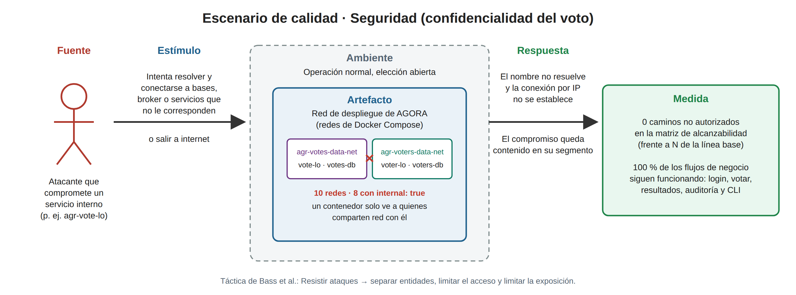

*Figura 2. Escenario de calidad. Las seis partes y la táctica que lo responde.*

**Táctica.** En el catálogo de Bass, Clements y Kazman el escenario se responde con la categoría *resistir ataques*, mediante tres tácticas que la segmentación aplica a la vez: **separar entidades** (cada base en su propia red, con solo su servicio), **limitar el acceso** (un contenedor solo alcanza a quienes comparten red con él, de acuerdo con la matriz F1–F20) y **limitar la exposición** (solo tres puertos publicados, y la consola del broker únicamente en `127.0.0.1`).

**Por qué la medida es verificable.** Cada parte del escenario se traduce en una prueba concreta. Los casos B1–B9 de `design/flujos-permitidos.md` §4 son estímulos puntuales (B1 y B2 son exactamente el cruce que desanonimiza el voto), y `scripts/verify-segmentation.sh` mide la respuesta para todas las parejas origen × destino, antes y después del cambio. El riesgo que el patrón acepta sin cerrar (B8, servicio a servicio dentro de `agr-back-net`) se cuenta aparte en la matriz para que no se confunda con un camino no autorizado (§3.5 y §3.6).

### 3.3 Pasos de implementación

La segmentación se aplicó sobre el `docker-compose.yml` del Prototipo 2 **sin cambiar el código de ningún servicio**: solo cambian las redes a las que se conecta cada contenedor y la dirección en la que se publica la consola de RabbitMQ. Estos son los pasos, en el orden en que se hicieron, para que otro equipo pueda repetirlos en su proyecto. Resumen:

| Paso | Qué se hace | Resultado |
|:-:|---|---|
| 1 | Inventariar los flujos reales a partir de las variables `*_URL`, `*_URI` y `*_HOST` del compose, y guardar una línea base | Matriz de flujos permitidos (F1–F20) |
| 2 | Agrupar los contenedores en zonas: un contenedor entra a una red solo si tiene un flujo con alguien de ella | Tabla de zonas y redes (§2.1) |
| 3 | Declarar las redes con `name:` y `internal: true` | Bloque `networks:` (§3.4.1) |
| 4 | Migrar servicio por servicio, de las bases hacia el borde | `networks:` de cada servicio (§3.4.2) |
| 5 | Quitar las redes viejas y recrear todo | Solo quedan las redes nuevas |
| 6 | Verificar redes, flujos bloqueados y permitidos, y el flujo de negocio | Matriz con 0 caminos no autorizados (§3.5) |

#### Paso 1. Hacer el inventario de flujos reales

Antes de crear redes hay que saber **quién llama a quién**. Las conexiones de un sistema en Docker Compose están casi siempre en las variables de entorno que contienen una URL o un host:

```bash
grep -nE "_URL|_URI|_HOST|DATABASE" docker-compose.yml
```

En AGORA salen las URLs del gateway hacia los seis servicios (`AUTH_SERVICE_URL`, `ELECTION_SERVICE_URL`, …), la URL interna que usa la web (`GATEWAY_INTERNAL_URL`), la de la CLI (`AGORA_GATEWAY_URL`), la conexión de cada servicio a su base (`DATABASE_URL`, `DB_URL`, `SPRING_DATASOURCE_URL`, `MONGO_URI`, `REDIS_URL`) y la de los servicios que usan el broker (`AMQP_URL`). Con eso se armó la matriz de **20 flujos permitidos (F1–F20)** de `design/flujos-permitidos.md` §3. Todo flujo que no esté en la matriz debe quedar bloqueado.

Antes de tocar nada, se guarda la **línea base** con el compose original, para poder comparar después:

```bash
git switch main
docker compose up --build -d --wait
docker network ls --filter name=agr
docker inspect agr-vote-lo --format '{{range $k,$v := .NetworkSettings.Networks}}{{$k}} {{end}}'
# arquisoft_agr-back arquisoft_agr-data   (vote-lo ve todas las bases y el broker)
```

#### Paso 2. Definir las zonas

Con la matriz, los contenedores se agrupan por exposición y por dueño de los datos. La regla es una sola: **un contenedor entra a una red solo si tiene un flujo de la matriz con alguien de esa red**. El resultado son las cinco zonas y diez redes de la tabla de §2.1; el cambio principal es que la red plana `agr-data` se parte en ocho: una de datos por servicio, una para la mensajería y una para la consola del broker.

#### Paso 3. Declarar las redes nuevas

Las diez redes se declaran en la sección `networks:` de `docker-compose.yml`, todas con `name:` explícito y, salvo las dos que publican puertos, con `internal: true`. El bloque completo y el efecto de cada opción están en §3.4.1.

#### Paso 4. Migrar servicio por servicio

Se cambia el bloque `networks:` de cada servicio, de abajo hacia arriba, para que cada servicio encuentre sus dependencias ya conectadas:

1. **Bases de datos:** cada una solo en su red de datos.
2. **Broker:** en `agr-bus-net` y `agr-mgmt-net`, con la consola publicada solo en `127.0.0.1`.
3. **Servicios de lógica:** `agr-back-net` + su red de datos (+ `agr-bus-net` solo vote, results y audit).
4. **Gateway:** `agr-edge-net` + `agr-back-net`. No entra a ninguna red de datos ni a la del bus.
5. **Web y CLI:** solo `agr-edge-net`.

La tabla de antes y después de cada contenedor está en §3.4.2. Para no romper nada a mitad de camino, durante la migración cada servicio puede quedar en **la red vieja y la nueva a la vez** (por ejemplo `[agr-data, agr-elections-data-net]`). Después de cada cambio se valida el archivo y se reinicia solo ese servicio:

```bash
docker compose config --quiet                       # sintaxis y referencias a redes
docker compose up -d --wait agr-election-lo         # se recrea con sus redes nuevas
docker compose logs agr-election-lo --tail 20       # si queda unhealthy, casi siempre le falta una red
```

El contenedor de pruebas de punta a punta de `agr-vote-lo` (`docker-compose.test.yml`) también se ajusta: se une a las mismas redes que `agr-vote-lo` y a `default`, porque necesita internet para que `go test` descargue los módulos y las redes nuevas no lo tienen.

#### Paso 5. Quitar las redes viejas

Cuando todos los servicios funcionan con las redes nuevas, se eliminan `agr-front`, `agr-back` y `agr-data` de cada servicio y de la sección `networks:`. Como Compose ya no las conoce, no las borra al apagar; hay que limpiarlas y recrear todo desde cero:

```bash
docker compose down -v --remove-orphans
docker network prune -f            # borra las redes que ya no usa ningún contenedor
docker compose up --build -d --wait
docker network ls --filter name=agr
```

Al final deben quedar solo las **10 redes nuevas** (`agr-edge-net`, `agr-back-net`, las seis `agr-*-data-net`, `agr-bus-net` y `agr-mgmt-net`).

#### Paso 6. Verificar

La verificación tiene tres partes. Las pruebas de red usan un contenedor `busybox` que **comparte la red del contenedor de origen** (`--network container:<origen>`), así que ve exactamente lo que vería ese servicio si alguien lo compromete.

**a) Cada contenedor está en las redes del diseño.**

```bash
for c in $(docker ps --format '{{.Names}}' | grep '^agr-' | sort); do
  printf '%-18s ' "$c"
  docker inspect "$c" --format '{{range $k,$v := .NetworkSettings.Networks}}{{$k}} {{end}}'
done
```

**b) Los flujos prohibidos no funcionan y los permitidos sí.** Ejemplo con el gateway (caso B6): debe alcanzar a los servicios, pero no a las bases ni al broker.

```bash
# Control positivo: flujo permitido F7 (gateway -> election-lo)
docker run --rm --network container:agr-gateway-or busybox nc -zv -w 2 agr-election-lo 8000
# esperado: agr-election-lo (172.x.x.x:8000) open

# Flujo prohibido B6 (gateway -> base de elecciones)
docker run --rm --network container:agr-gateway-or busybox nslookup agr-elections-db
# esperado: ** server can't find agr-elections-db: NXDOMAIN
docker run --rm --network container:agr-gateway-or busybox nc -zv -w 2 agr-elections-db 5432
# esperado: nc: bad address 'agr-elections-db'
```

El nombre del destino **ni siquiera se resuelve**, porque el DNS interno de Docker solo responde por los contenedores que comparten red con el origen. La misma prueba se repite para cada caso B1–B9 de `design/flujos-permitidos.md` §4, y `scripts/verify-segmentation.sh` la automatiza para todas las parejas origen × destino (resultados en §3.5).

**c) El negocio sigue funcionando (prueba de punta a punta).** Con el sistema segmentado se recorre el flujo completo:

1. Iniciar sesión en `http://localhost:3000` (documento `1001`, clave `123456`) → F1, F3, F5.
2. Votar en la elección abierta → saga F2, F5–F8; evento por `agr-bus-net` (F17–F19).
3. Ver los resultados actualizarse en vivo en otra pestaña → SSE F2, F9.
4. Consultar la auditoría a través del gateway → F10:
   ```bash
   curl -s -H "X-API-Key: dev-admin-key" "http://localhost:8080/admin/audit?limit=5"
   ```
5. Listar las elecciones desde la CLI → F4:
   ```bash
   docker compose run --rm agr-admin-fr elections list
   ```

Si los cinco pasos funcionan y las pruebas de la parte b) fallan donde deben fallar, la segmentación está completa: se cerraron los caminos no autorizados sin perder ninguna funcionalidad.

### 3.4 Configuración y fragmentos de código

Toda la segmentación vive en un solo archivo, `docker-compose.yml`, en la raíz del repositorio. No hubo que cambiar el código de ningún servicio: los nombres de host que ya usaban (`agr-voters-db`, `agr-broker-as`, …) siguen siendo los mismos, y lo único que cambia es en qué redes los resuelve el DNS de Docker. Esta sección muestra los cuatro fragmentos que materializan el patrón.

#### 3.4.1 Declaración de las redes

En el Prototipo 2 el compose declaraba tres redes sin ninguna opción:

```yaml
# Antes (rama main, Prototipo 2)
networks:
  agr-front:
  agr-back:
  agr-data:     # 6 servicios + 6 bases + broker en el mismo segmento
```

Con el patrón aplicado son diez redes. Cada una lleva `name:` explícito y, salvo las dos que publican puertos, `internal: true`:

```yaml
# Después (rama lab5-security)
networks:

  # --- Zona de borde: lo único alcanzable desde fuera de Docker ---------------
  agr-edge-net:
    name: agr-edge-net

  # --- Zona de lógica: el gateway y los servicios -----------------------------
  agr-back-net:
    name: agr-back-net
    internal: true

  # --- Zona de datos: una red privada por servicio (servicio + su base) -------
  agr-auth-data-net:        # agr-auth-lo      + agr-auth-db
    name: agr-auth-data-net
    internal: true
  agr-elections-data-net:   # agr-election-lo  + agr-elections-db
    name: agr-elections-data-net
    internal: true
  agr-voters-data-net:      # agr-voter-lo     + agr-voters-db
    name: agr-voters-data-net
    internal: true
  agr-votes-data-net:       # agr-vote-lo      + agr-votes-db
    name: agr-votes-data-net
    internal: true
  agr-results-data-net:     # agr-results-lo   + agr-results-db
    name: agr-results-data-net
    internal: true
  agr-audit-data-net:       # agr-audit-lo     + agr-audit-db
    name: agr-audit-data-net
    internal: true

  # --- Zona de mensajería: el broker y solo sus clientes reales ---------------
  agr-bus-net:
    name: agr-bus-net
    internal: true

  # --- Zona de administración: consola de RabbitMQ ----------------------------
  agr-mgmt-net:
    name: agr-mgmt-net
```

| Opción | Efecto | Por qué se usa |
|---|---|---|
| `name:` | La red se crea con ese nombre exacto, sin el prefijo del proyecto | `docker network ls`, los scripts y las evidencias muestran el mismo nombre en cualquier máquina |
| `internal: true` | Docker crea el bridge sin puerta de enlace: no hay salida a internet ni se pueden publicar puertos desde esa red | Las ocho redes que no necesitan exponerse quedan cerradas por completo; esto también cumple B4 para los `*-lo` |
| (sin `internal`) | Red con puerta de enlace | Solo `agr-edge-net` (publica 3000 y 8080) y `agr-mgmt-net` (publica 15672), porque Docker exige una red con puerta de enlace para publicar puertos |

#### 3.4.2 Bloque `networks:` de un servicio (antes / después)

La pertenencia a una red se declara en cada servicio. Esta es la migración completa:

| Contenedor | Antes (Prototipo 2) | Después (Lab 5) | Flujos que conserva |
|---|---|---|---|
| `agr-web-fr`, `agr-admin-fr` | `[agr-front]` | `[agr-edge-net]` | F3, F4 |
| `agr-gateway-or` | `[agr-front, agr-back]` | `[agr-edge-net, agr-back-net]` | F2–F10 |
| `agr-auth-lo` | `[agr-back, agr-data]` | `[agr-back-net, agr-auth-data-net]` | F5, F11 |
| `agr-election-lo` | `[agr-back, agr-data]` | `[agr-back-net, agr-elections-data-net]` | F7, F12 |
| `agr-voter-lo` | `[agr-back, agr-data]` | `[agr-back-net, agr-voters-data-net]` | F6, F13 |
| `agr-vote-lo` | `[agr-back, agr-data]` | `[agr-back-net, agr-votes-data-net, agr-bus-net]` | F8, F14, F17 |
| `agr-results-lo` | `[agr-back, agr-data]` | `[agr-back-net, agr-results-data-net, agr-bus-net]` | F9, F15, F18 |
| `agr-audit-lo` | `[agr-back, agr-data]` | `[agr-back-net, agr-audit-data-net, agr-bus-net]` | F10, F16, F19 |
| Cada `*-db` | `[agr-data]` | solo su `agr-*-data-net` | F11–F16 |
| `agr-broker-as` | `[agr-data]` · `15672:15672` | `[agr-bus-net, agr-mgmt-net]` · `127.0.0.1:15672:15672` | F17–F20 |

Los dos casos típicos son un servicio que solo necesita su base (`agr-voter-lo`) y uno que además usa el broker (`agr-audit-lo`):

```yaml
# Antes: agr-voter-lo compartía agr-data con las otras cinco bases y el broker
  agr-voter-lo:
    environment:
      DB_URL: jdbc:postgresql://agr-voters-db:5432/${VOTERS_DB_NAME:-voters}
    networks: [agr-back, agr-data]

  agr-voters-db:
    networks: [agr-data]
```

```yaml
# Después: agr-voter-lo solo comparte red con el gateway y con su propia base
  agr-voters-db:
    container_name: agr-voters-db
    image: postgres:16-alpine
    networks: [agr-voters-data-net]
    restart: unless-stopped

  agr-voter-lo:
    container_name: agr-voter-lo
    build: ./agr-voter-lo
    environment:
      DB_URL: jdbc:postgresql://agr-voters-db:5432/${VOTERS_DB_NAME:-voters}   # sin cambios
      SERVICE_API_KEY: ${SERVICE_API_KEY:-dev-service-key}
    networks: [agr-back-net, agr-voters-data-net]

  agr-audit-db:
    container_name: agr-audit-db
    image: mongo:7
    networks: [agr-audit-data-net]

  agr-audit-lo:
    container_name: agr-audit-lo
    build: ./agr-audit-lo
    environment:
      MONGO_URI: mongodb://${AUDIT_DB_USER:-audit}:${AUDIT_DB_PASSWORD:-audit}@agr-audit-db:27017/?authSource=admin
      AMQP_URL: amqp://${BROKER_USER:-agora}:${BROKER_PASSWORD:-agora}@agr-broker-as:5672/
    networks: [agr-back-net, agr-audit-data-net, agr-bus-net]
```

La diferencia más importante: `agr-voters-db` (quién votó) ahora solo comparte red con `agr-voter-lo`, y `agr-votes-db` (los votos) solo con `agr-vote-lo`, así que ningún servicio alcanza las dos (casos B1 y B2, §3.5). Ninguna variable de entorno cambió: `DB_URL`, `MONGO_URI` y `AMQP_URL` apuntan a los mismos nombres, por lo que la migración fue transparente para el código Java (voter) y C# (audit).

#### 3.4.3 Consola de RabbitMQ publicada solo en `127.0.0.1`

El broker es el único contenedor de la zona interna que publica un puerto. En el Prototipo 2 lo hacía en todas las interfaces del host, así que cualquier máquina de la red local podía abrir la consola de administración:

```yaml
# Antes
  agr-broker-as:
    ports:
      - "15672:15672"          # equivale a 0.0.0.0:15672
    networks: [agr-data]       # AMQP y consola en la misma red que todo lo demás
```

```yaml
# Después
  agr-broker-as:
    container_name: agr-broker-as
    hostname: agr-broker-as
    build: ./agr-broker-as
    ports:
      - "127.0.0.1:15672:15672"   # consola solo desde esta máquina; AMQP (5672) solo dentro de Docker
    networks: [agr-bus-net, agr-mgmt-net]
```

Tres decisiones se combinan aquí:

1. **Dirección de enlace `127.0.0.1`.** Docker solo abre el puerto en la interfaz de loopback del host. Desde otra máquina, `http://<ip-lan>:15672` no responde (caso B9).
2. **El puerto AMQP 5672 no se publica.** Solo lo alcanzan los miembros de `agr-bus-net`: `agr-vote-lo`, `agr-results-lo` y `agr-audit-lo` (F17–F19).
3. **Dos redes separadas para el broker.** `agr-bus-net` (internal) lleva el tráfico de mensajería y `agr-mgmt-net` existe solo para que Docker pueda publicar la consola, ya que una red `internal` no admite `ports:`. Así el tráfico de administración y el de AMQP no comparten segmento.

Comprobación rápida en el host:

```bash
docker ps --format '{{.Names}}\t{{.Ports}}' | grep agr-
# agr-broker-as    127.0.0.1:15672->15672/tcp
# agr-gateway-or   0.0.0.0:8080->8080/tcp
# agr-web-fr       0.0.0.0:3000->3000/tcp
```

Ninguna base de datos ni ningún `*-lo` aparece con la flecha `->`: no publican nada.

#### 3.4.4 Comandos de verificación

Con la técnica de `busybox` del Paso 6, este es el núcleo de las pruebas B1 y B2 (anonimato del voto):

```bash
# B1: desde agr-vote-lo, ¿se alcanza la base de quién votó?
docker run --rm --network container:agr-vote-lo busybox nslookup agr-voters-db
docker run --rm --network container:agr-vote-lo busybox nc -zv -w 2 agr-voters-db 5432

# B2: desde agr-voter-lo, ¿se alcanza la base de los votos?
docker run --rm --network container:agr-voter-lo busybox nslookup agr-votes-db
docker run --rm --network container:agr-voter-lo busybox nc -zv -w 2 agr-votes-db 27017

# Control: los flujos permitidos F13 y F14 deben seguir abiertos
docker run --rm --network container:agr-voter-lo busybox nc -zv -w 2 agr-voters-db 5432
docker run --rm --network container:agr-vote-lo  busybox nc -zv -w 2 agr-votes-db 27017
```

En `main` las cuatro primeras líneas resuelven el nombre y abren el puerto. En `lab5-security`, `nslookup` no encuentra el nombre y `nc` termina con `bad address`, mientras que las dos de control siguen abiertas. Como un nombre que no resuelve no prueba por sí solo el aislamiento, también se intenta la conexión por IP:

```bash
# IP real de la base (en su propia red); desde agr-vote-lo no debe haber ruta
ip=$(docker inspect agr-voters-db --format '{{range .NetworkSettings.Networks}}{{.IPAddress}}{{end}}')
docker run --rm --network container:agr-vote-lo busybox nc -zv -w 2 "$ip" 5432
# Esperado: sin conexión. Docker descarta en el host el tráfico entre bridges distintos
```

Estas pruebas están automatizadas en `scripts/verify-b1-b2.sh`, que hace cada caso por nombre y por IP y deja la salida en `evidence/before/B1_B2.txt` y `evidence/after/B1_B2.txt`. Las capturas y la matriz completa de origen × destino, antes y después, están en §3.5.

### 3.5 Resultados y mejoras observadas

Las mismas pruebas se corrieron sobre el Prototipo 2 (rama `main`, **antes**) y sobre el sistema segmentado (rama `lab5-security`, **después**), con los 15 contenedores en ejecución y `healthy`. La salida completa de cada prueba está en `evidence/before/` y `evidence/after/`.

#### 3.5.1 Medida del escenario

`scripts/verify-segmentation.sh` intenta conectarse desde cada contenedor al puerto de servicio de todos los demás (210 parejas), primero por nombre y, si el nombre no abre, por cada IP real del destino. También prueba si cada contenedor sale a internet. Cada camino abierto se compara con la matriz F1–F20.

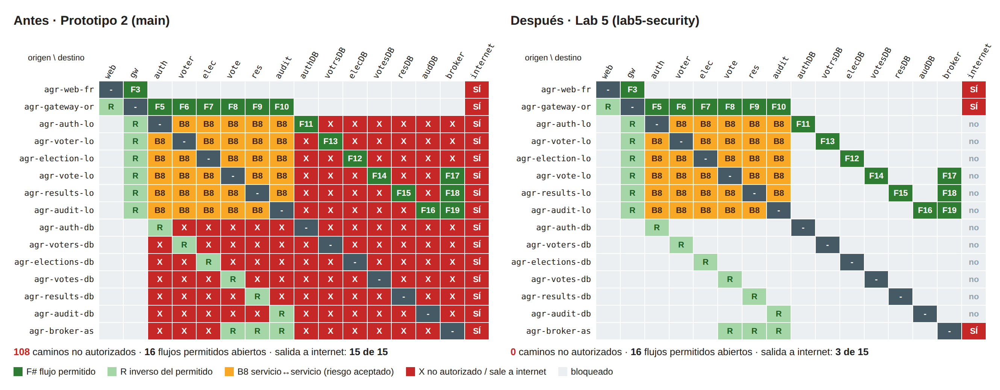

*Figura 3. Matriz de alcanzabilidad origen × destino. Cada fila es un contenedor comprometido y cada columna, a dónde puede llegar.*

| Medida (§3.2) | Antes | Después | Objetivo |
|---|:-:|:-:|:-:|
| Caminos no autorizados (X) | **108** | **0** | 0 ✅ |
| Flujos permitidos abiertos (F3, F5–F19) | 16 de 16 | 16 de 16 | todos ✅ |
| Servicios de lógica (`*-lo`) con salida a internet | 6 de 6 | **0 de 6** | 0 ✅ |
| Bases de datos con salida a internet | 6 de 6 | **0 de 6** | 0 ✅ |
| Consola de RabbitMQ accesible desde la LAN | sí | **no** | no ✅ |
| Flujo de negocio de punta a punta | funciona | funciona | funciona ✅ |

Los 108 caminos del Prototipo 2 eran de tres tipos: cada servicio llegaba a las cinco bases ajenas y al broker; cada base llegaba a todos los servicios y a las demás bases; y el broker llegaba a todas las bases y a los servicios que no lo usan. Después de segmentar, cada base solo comparte red con su servicio, y el broker solo con sus tres clientes.

La matriz también muestra lo que el patrón **no** cierra, y que se contó aparte para no confundirlo con un camino no autorizado. Son los 30 caminos **B8** entre servicios de `agr-back-net`, los 16 inversos **R** de flujos permitidos (por ejemplo, un servicio hacia el gateway o una base hacia su servicio, porque un bridge no es direccional) y la salida a internet de `agr-web-fr`, `agr-gateway-or` y `agr-broker-as`, cuyas redes publican puertos. Los tres riesgos quedan documentados con su mitigación en §3.6.

#### 3.5.2 Casos de prueba

| Caso | Prueba | Antes | Después | Evidencia |
|:-:|---|---|---|---|
| B1 | `agr-vote-lo` → `agr-voters-db` | resuelve y conecta | no resuelve; por IP, *Network is unreachable* | Fig. 4, `B1_B2.txt` |
| B2 | `agr-voter-lo` → `agr-votes-db` | resuelve y conecta | no resuelve; por IP, sin conexión | Fig. 5, `B1_B2.txt` |
| B3 | Todos salvo auth → `agr-auth-db` | conectan | `bad address` (control F11 abierto) | Fig. 5 |
| B4 | Cualquier `*-lo` → internet | salen | `bad address` | Fig. 6 |
| B5 | `agr-web-fr` → `*-lo`, `*-db`, broker | (no aplica) | 35 de 35 comprobaciones, por nombre y por IP | Fig. 8, `B5_web-fr.txt` |
| B6 | `agr-gateway-or` → `*-db`, broker | no resolvían* | `bad address` (control F7 abierto) | Fig. 8 |
| B7 | election, voter, auth → broker | conectan | `bad address` (F17–F19 abiertos) | Fig. 6 |
| B8 | Servicio → servicio | abierto | abierto ⚠ (riesgo aceptado) | Fig. 3 |
| B9 | Consola en `127.0.0.1` y en la IP de la LAN | ambas HTTP 200 | solo `127.0.0.1` | Fig. 7 |
| E2E | Login → votar → resultados → auditoría → CLI | funciona | funciona | Fig. 9, `E2E_api.txt`, `vote-lo_e2e.txt` |

\* En el Prototipo 2 el gateway ya estaba fuera de `agr-data`, así que B6 se cumplía; la segmentación lo mantiene.

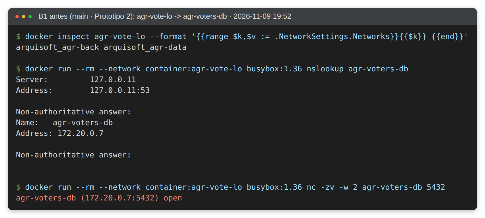 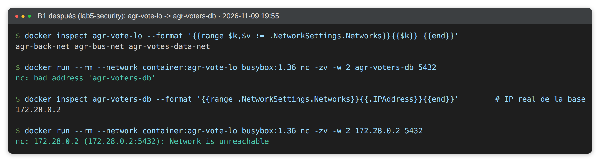

*Figura 4. B1 (anonimato). Izquierda, antes: desde `agr-vote-lo` el nombre `agr-voters-db` resuelve y el puerto 5432 abre. Derecha, después: el nombre no resuelve y, aun con la IP real de la base, no hay ruta.*

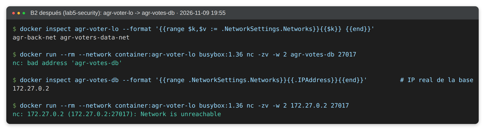 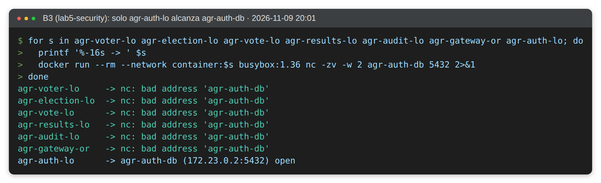

*Figura 5. Izquierda, B2 después: `agr-voter-lo` ya no llega a la base de los votos (antes conectaba, `B2_antes.png`). Derecha, B3: la base de credenciales solo es alcanzable desde `agr-auth-lo`.*

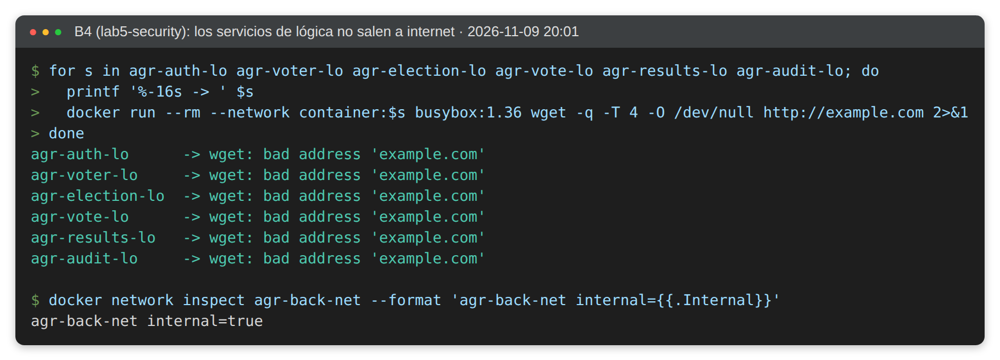 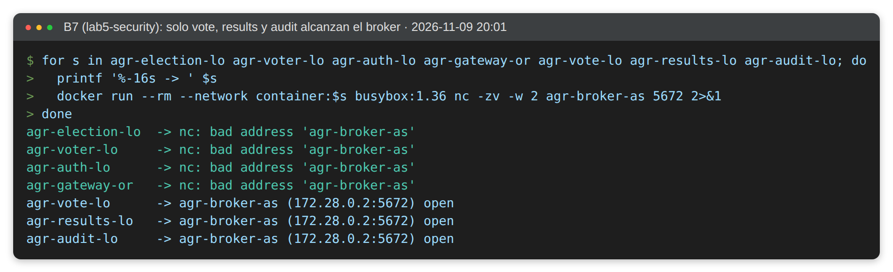

*Figura 6. Izquierda, B4: ningún servicio de lógica sale a internet (`agr-back-net` es `internal`). Derecha, B7: solo los tres clientes reales del broker llegan al puerto AMQP.*

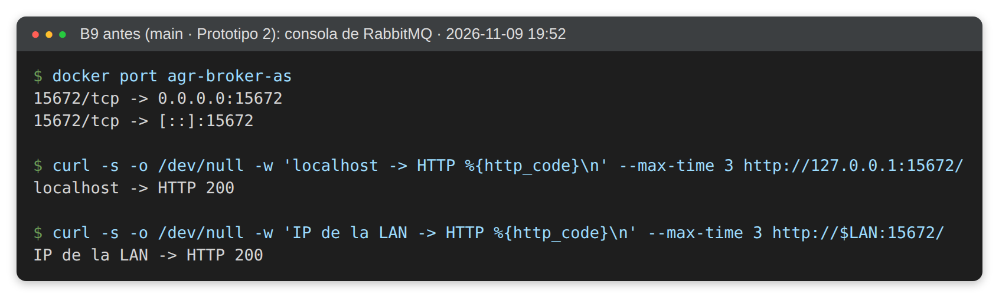 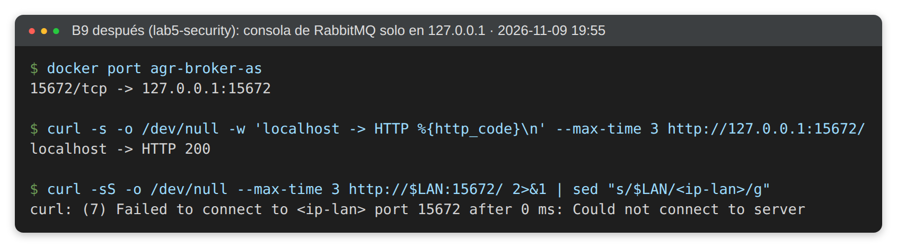

*Figura 7. B9. Izquierda, antes: la consola de RabbitMQ respondía en todas las interfaces del host. Derecha, después: responde en `127.0.0.1` y rechaza la conexión desde la IP de la LAN.*

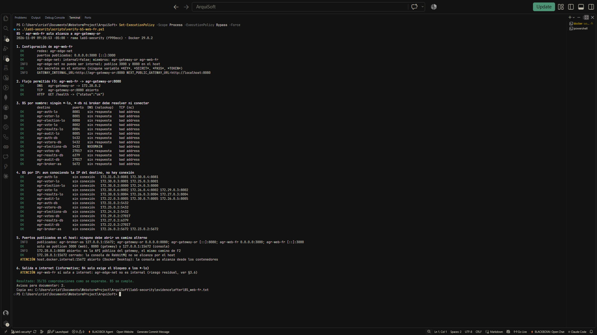 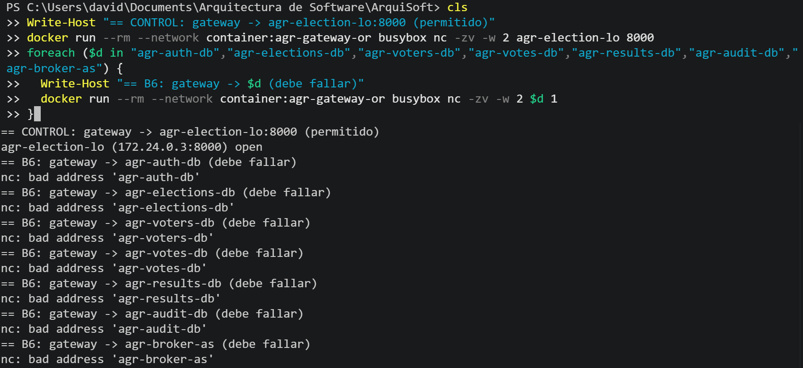

*Figura 8. Izquierda, B5 (`scripts/verify-b5-web-fr.ps1`, detalle en `B5_web-fr.txt`): desde `agr-web-fr` solo se alcanza el gateway. Derecha, B6: el gateway alcanza los servicios pero ninguna base ni el broker.*

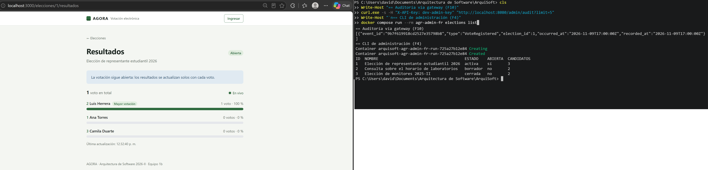

*Figura 9. E2E con el sistema segmentado: resultados en vivo tras votar, auditoría por el gateway (F10) y CLI (F4). Las 6 pruebas de `agr-vote-lo/e2e/run.sh` también pasan.*

#### 3.5.3 Mejoras observadas

- **Anonimato del voto protegido por la red y no solo por credenciales.** Ningún contenedor alcanza a la vez `agr-voters-db` y `agr-votes-db`. Para desanonimizar un voto ahora hay que comprometer dos servicios distintos, no uno.
- **Radio de impacto mínimo.** Un servicio comprometido solo ve su base, el broker si lo usa, y la red del gateway; de 108 caminos no autorizados se pasó a 0.
- **Sin exfiltración directa desde los datos.** Ni las bases ni los servicios de lógica tienen salida a internet (de 15 contenedores con salida se pasó a 3, todos en el borde o la administración).
- **Consola de administración fuera de la LAN.**
- **Costo cero en código.** No se cambió ninguna línea de los servicios ni ninguna variable de entorno: solo los bloques `networks:` y un puerto en `docker-compose.yml`. La única mejora adicional fue un `healthcheck` en `agr-auth-lo` para que el gateway espere a que esté listo (`service_healthy`), lo que hace el arranque más predecible.

> Nota sobre el entorno de prueba: en la máquina donde se tomaron las evidencias de antes y después el puerto 8080 estaba ocupado, así que el gateway se publicó en 18080 con un archivo override. Esto no afecta las pruebas de red, que son entre contenedores; el `docker-compose.yml` del repositorio publica 8080.

### 3.6 Recomendaciones para otros equipos

Estas recomendaciones salen de aplicar el patrón en AGORA. Las primeras son de método; las últimas tratan los errores más comunes y los riesgos que la segmentación, por sí sola, no cierra.

**1. Empezar por el inventario de flujos, no por las redes.** Antes de tocar el compose hay que saber quién habla con quién. La fuente más confiable es la propia configuración: cada variable que contiene un nombre de host (`*_URL`, `DATABASE_URL`, `MONGO_URI`, `AMQP_URL`) es un flujo. Con esa lista se arma una matriz con origen, destino, puerto, protocolo y propósito, y la regla es sencilla: lo que no esté en la matriz debe quedar bloqueado. En AGORA salieron 20 flujos, y esa tabla sirvió a la vez como contrato de la implementación y como lista de casos de prueba.

```bash
docker compose config | grep -E '(_URL|_URI):'
```

**2. Separar por relación de confianza, no solo por capa.** Una red por capa no alcanza. En el Prototipo 2 la red de datos ya estaba separada del borde, pero dentro de ella cualquier servicio llegaba a cualquier base. Lo que de verdad aisló los datos fue una red por servicio, que lleva *database-per-service* también al nivel de la red.

**3. Declarar cada red con `name:` y, si no publica puertos, con `internal: true`** (§3.4.1). Sin `name:`, el prefijo del proyecto depende de la carpeta donde se clonó el repositorio, y los scripts y las evidencias dejan de coincidir entre máquinas. Ojo: la salida a internet se decide por contenedor; si está en al menos una red sin `internal`, sale por ella (en AGORA, `agr-web-fr`, `agr-gateway-or`, `agr-admin-fr` y `agr-broker-as`).

**4. Revisar los puertos publicados, porque son la otra puerta.** Un `ports:` abre el servicio en las interfaces del host, y por ahí entran otras máquinas de la red local y también contenedores de otras redes usando la dirección del host; por eso la consola de RabbitMQ quedó en `127.0.0.1` (§3.4.3). Un detalle útil: Docker no publica los puertos de un contenedor que solo está en redes `internal`. El `ports:` se acepta sin error, pero `docker ps` no muestra la flecha `->`. Eso protege a las bases de un puerto de depuración olvidado, por ejemplo en un `docker-compose.override.yml` local, y también explica por qué esos puertos dejan de responder después de segmentar. Para entrar a una base, lo indicado es `docker compose exec`.

**5. En un front-end con SSR, separar las dos URL del gateway.** El servidor de Next.js llama al gateway por el nombre interno (`http://agr-gateway-or:8080`) y el navegador por la URL pública (`http://localhost:8080`). Hay dos errores frecuentes. El primero es poner el nombre interno en una variable `NEXT_PUBLIC_*`: el navegador no puede resolverlo, y además Next.js fija esas variables en el código al compilar, de modo que se pasan como argumentos de construcción y no en tiempo de ejecución. El segundo es "arreglar" un nombre que no resuelve conectando el front-end a la red de lógica, lo que deshace la segmentación. Cuando un nombre no resuelve, primero se revisa la matriz: o falta un flujo, o esa llamada no debería existir.

**6. Migrar de forma gradual y no olvidar retirar las redes viejas** (Pasos 4 y 5). Un contenedor que siga conectado a la red plana anterior conserva todos sus caminos, aunque las redes nuevas se vean bien.

**7. Probar desde el contenedor de origen, por nombre y también por IP, y automatizarlo.** Que un nombre no resuelva es buena señal, pero el control real lo hacen las reglas que Docker instala en el firewall del host; por eso hay que intentar también con la IP del destino. Las pruebas conviene correrlas antes y después del cambio: en AGORA, `scripts/verify-segmentation.sh` recorre la matriz completa, `verify-b1-b2.sh` los casos del anonimato y `verify-b5-web-fr.sh` (también en PowerShell) la zona de borde.

**8. Documentar lo que la segmentación no cierra.**

| Riesgo residual | Por qué existe | Cómo cerrarlo |
|---|---|---|
| B8: un servicio de lógica puede conectarse a otro dentro de `agr-back-net` | Todos comparten la red del gateway. Las llaves lo mitigan solo en parte: `agr-voter-lo` y `agr-vote-lo` exigen `SERVICE_API_KEY` y las escrituras de `agr-election-lo` la llave de administración, pero `agr-auth-lo`, `agr-results-lo` y `agr-audit-lo` responden sin llave (por ejemplo, `GET /audit/events`) | Exigir `SERVICE_API_KEY` también en esos tres servicios y, en la red, usar una red `internal` por cada par gateway–servicio (seis redes) o autenticación mutua con TLS (patrón Secure Channel) |
| Salida a internet desde las redes sin `internal` | `agr-edge-net` y `agr-mgmt-net` publican puertos, así que tienen puerta de enlace; `agr-web-fr`, `agr-gateway-or`, `agr-admin-fr` y `agr-broker-as` pueden salir | Reglas propias en el firewall del host (en iptables, la cadena `DOCKER-USER`) que bloqueen la salida de esas subredes, o un proxy de salida |
| `agr-admin-fr` comparte `agr-edge-net` con `agr-web-fr` | La CLI llega al gateway por la red de borde | La CLI no escucha en ningún puerto y solo existe mientras corre un comando; aun así, una red propia entre la CLI y el gateway la separaría del front-end |
