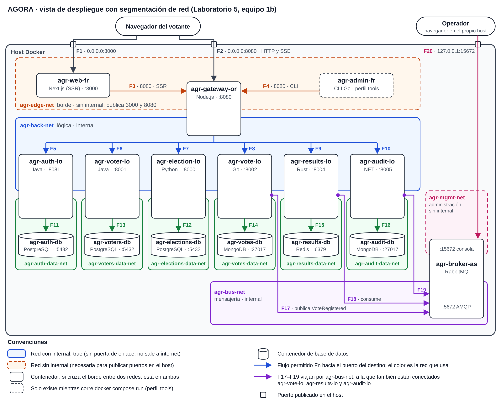

# Laboratorio 5 — Seguridad: Network Segmentation Pattern

Arquitectura de Software, Universidad Nacional de Colombia, 2026-II.
**Equipo:** 1b
**Sistema:** AGORA, sistema de votación electrónica

<!--
  PLANTILLA DEL ENTREGABLE (se exporta a l5_1b.pdf)
  - Cada sección indica su responsable. Reemplacen los bloques "TODO" por el contenido final.
  - Imágenes: images/diagrams/ (vistas) e images/screenshots/ (capturas). Rutas relativas, p. ej. 
  - Salidas de texto (matrices, logs): evidence/before/ y evidence/after/
  - Diseño de referencia: design/flujos-permitidos.md
  - Borren estos comentarios antes de exportar.
-->

## 1. Equipo

<!-- Responsable: Sebastián -->

- Maicol Sebastián Olarte Ramírez (arquitecto líder)
- David Fernando Benjumea Mora
- Esteban Prieto Lugo
- Camilo Borja Rojas
- Cristian Felipe Moreno Gomez
- Miguel Angel Zamudio Villa

## 2. Vista arquitectónica

<!-- Responsable: Cristian -->

La Figura 1 es la vista de despliegue de AGORA con el patrón aplicado. Cada recuadro de color es una red bridge de Docker Compose y funciona como un segmento: un contenedor solo puede abrir conexiones hacia los contenedores con los que comparte al menos una red. Por eso la vista no dibuja todas las conexiones posibles entre los 16 contenedores, sino únicamente los 20 flujos que el sistema necesita (F1 a F20). Cualquier otro camino lo cierra la red, sin depender de la configuración de cada servicio.


*Figura 1. Vista de despliegue segmentada. La versión editable está en `images/diagrams/l5_despliegue.svg`.*

| Elemento gráfico | Significado |
|---|---|
| Recuadro de borde continuo | Red con `internal: true`. Docker no le asigna puerta de enlace: por ella no se sale a internet ni se publican puertos en el host |
| Recuadro de borde discontinuo | Red sin `internal`. Solo hay dos, `agr-edge-net` y `agr-mgmt-net`, porque son las únicas que publican puertos |
| Contenedor sobre el borde de dos recuadros | Está conectado a las dos redes; por ejemplo, el gateway queda entre el borde y la lógica |
| Flecha | Flujo permitido, con su identificador (F1 a F20). Su color es el de la red por la que viaja; en gris, las que llegan desde fuera del host |
| Flecha violeta con punto de origen | Flujo hacia el broker por `agr-bus-net`. El punto indica que el origen también está conectado a esa red |
| Contenedor de borde discontinuo | `agr-admin-fr`, que solo existe mientras se ejecuta un comando de la CLI |
| Cuadro pequeño sobre el marco del host | Puerto publicado en el host |

### 2.1 Descripción de los elementos y sus relaciones

**Elementos de software.** Son los 16 contenedores del Prototipo 2: dos de presentación (`agr-web-fr` y `agr-admin-fr`), el gateway (`agr-gateway-or`), seis servicios de lógica (`*-lo`), seis bases de datos (`*-db`) y el broker (`agr-broker-as`). No se agregó ni se quitó ninguno; lo que cambia es la red a la que pertenece cada uno.

**Elementos del entorno.** El host Docker y las diez redes bridge declaradas en `docker-compose.yml`.

**Relaciones.**

- *Conectado a* (contenedor → red). Define qué nombres le resuelve a ese contenedor el DNS interno de Docker y hacia qué direcciones puede abrir conexiones.
- *Se comunica con* (contenedor → contenedor). Son los flujos F1 a F20, y cada uno ocurre dentro de una red que comparten el origen y el destino.
- *Publica en* (contenedor → host). Solo tres contenedores publican puertos: `agr-web-fr` (3000), `agr-gateway-or` (8080) y `agr-broker-as` (15672, únicamente en `127.0.0.1`).

| Zona | Red | `internal` | Miembros | Flujos | Qué aísla |
|---|---|:-:|---|:-:|---|
| Borde | `agr-edge-net` | no | `agr-web-fr`, `agr-gateway-or`, `agr-admin-fr`¹ | F1–F4 | La presentación solo llega al gateway |
| Lógica | `agr-back-net` | sí | `agr-gateway-or` y los seis `*-lo` | F5–F10 | El gateway llega a cada servicio; ni las bases ni el broker están en esta red (riesgo B8 en §3.6) |
| Datos | `agr-auth-data-net` | sí | `agr-auth-lo`, `agr-auth-db` | F11 | Credenciales de los votantes |
| Datos | `agr-elections-data-net` | sí | `agr-election-lo`, `agr-elections-db` | F12 | Elecciones y candidatos |
| Datos | `agr-voters-data-net` | sí | `agr-voter-lo`, `agr-voters-db` | F13 | Quién votó (`ballots_cast`) |
| Datos | `agr-votes-data-net` | sí | `agr-vote-lo`, `agr-votes-db` | F14 | Votos anónimos y outbox |
| Datos | `agr-results-data-net` | sí | `agr-results-lo`, `agr-results-db` | F15 | Conteos |
| Datos | `agr-audit-data-net` | sí | `agr-audit-lo`, `agr-audit-db` | F16 | Eventos de auditoría |
| Mensajería | `agr-bus-net` | sí | `agr-broker-as`, `agr-vote-lo`, `agr-results-lo`, `agr-audit-lo` | F17–F19 | Solo los clientes reales llegan al broker |
| Administración | `agr-mgmt-net` | no | `agr-broker-as` | F20 | La consola de RabbitMQ, separada del tráfico AMQP |

¹ `agr-admin-fr` está en el perfil `tools`: solo existe mientras se ejecuta `docker compose run --rm agr-admin-fr <comando>`.

En el Prototipo 2 había tres redes: `agr-front`, `agr-back` y `agr-data`. La última reunía las seis bases, los seis servicios y el broker, de modo que un servicio comprometido podía conectarse a cualquier base y la única barrera eran las credenciales. Desde un mismo servicio se alcanzaban `agr-voters-db` (quién votó) y `agr-votes-db` (los votos), que es justamente la combinación que permitiría desanonimizar el voto. La vista muestra cómo se resolvió: `agr-data` se dividió en seis redes de datos, una por servicio, más `agr-bus-net` para la mensajería y `agr-mgmt-net` para la consola del broker. `agr-front` y `agr-back` conservaron sus miembros y pasaron a llamarse `agr-edge-net` y `agr-back-net`; la red de lógica, además, quedó `internal`.

### 2.2 La zona de borde y `agr-web-fr`

`agr-web-fr` y el gateway son los únicos contenedores que reciben tráfico desde otras máquinas. El front-end, además, ejecuta un servidor Next.js con una cadena larga de dependencias de npm, así que es un punto de entrada probable para un atacante. La zona de borde se diseñó para que comprometerlo no sirva para llegar más lejos.

En el compose, `agr-web-fr` declara una sola red (`agr-edge-net`) y publica un solo puerto (3000). Habla con el gateway por dos caminos distintos:

| Quién hace la petición | Variable | Valor | Camino | Flujo |
|---|---|---|---|---|
| Servidor de Next.js, al generar las páginas (SSR) | `GATEWAY_INTERNAL_URL` | `http://agr-gateway-or:8080` | DNS de Docker, dentro de `agr-edge-net` | F3 |
| Navegador, al iniciar sesión, votar y abrir el stream de resultados | `NEXT_PUBLIC_GATEWAY_URL` | `http://localhost:8080` | Puerto 8080 publicado en el host | F2 |

Desde `agr-web-fr`, el DNS de Docker solo responde por los contenedores de `agr-edge-net`: `agr-gateway-or` y, mientras corre un comando de la CLI, `agr-admin-fr`. Ningún `*-lo`, ningún `*-db` ni el broker resuelven. Tampoco sirve conocer sus direcciones: `agr-edge-net` es un bridge distinto de las redes internas, y Docker descarta en el host el tráfico entre bridges diferentes.

La justificación de seguridad tiene tres partes:

- **Superficie de ataque reducida.** Si alguien logra ejecutar código en `agr-web-fr`, por ejemplo a través de una dependencia vulnerable, desde ahí solo ve el puerto 8080 del gateway, que es la misma API pública que tiene cualquier navegador. Para votar sigue necesitando un JWT válido, que el gateway hace validar con `agr-auth-lo`, y para las rutas `/admin`, la llave de administración. No puede abrir una conexión a `agr-voters-db` ni a `agr-votes-db`, ni a `agr-auth-db`, ni publicar eventos falsos en el broker.
- **Menor privilegio en la red y en los secretos.** En la red, el contenedor está en un solo segmento y alcanza un solo destino en un solo puerto. En los secretos, no guarda ninguna credencial: ni claves de bases, ni `SERVICE_API_KEY`, ni la llave de administración, ni el secreto con que se firman los JWT. El token del votante vive en el `sessionStorage` del navegador, y las páginas que se generan en el servidor no lo necesitan porque elecciones y resultados son públicos. Comprometer el front-end no entrega nada con qué avanzar hacia adentro.
- **Radio de impacto acotado.** El daño posible queda dentro de la zona de borde, que es justamente la que ya está expuesta.

Quedan dos puntos abiertos. Primero, `agr-edge-net` no puede ser `internal`, porque Docker solo publica puertos de un contenedor que tenga al menos una red con puerta de enlace; por eso `agr-web-fr` y el gateway conservan salida a internet. El caso B4 exige ese bloqueo solo a los `*-lo`, y para el borde queda documentado como riesgo residual (§3.6). Segundo, `agr-admin-fr` comparte la red de borde. La CLI no escucha en ningún puerto y solo existe mientras corre un comando, así que no ofrece nada a qué conectarse, pero una red propia entre la CLI y el gateway la separaría del front-end.

El caso B5 (§3.5) verifica este aislamiento desde el propio espacio de red de `agr-web-fr`: por nombre, por IP y a través de los puertos publicados en el host.

### 2.1 Descripción de los elementos y sus relaciones

> **TODO (Cristian):** una tabla por zona de red con sus miembros y lo que cada una puede alcanzar.

## 3. Guía técnica

### 3.1 Descripción del patrón y su propósito

<!-- Responsable: Esteban
  - Qué es Network Segmentation (dividir la red en zonas con mínimo privilegio de comunicación).
  - Problema que resuelve: movimiento lateral y radio de impacto de un compromiso.
  - Cómo se materializa en Docker Compose: redes bridge definidas por usuario, DNS por red, internal: true.
  - Relación con otros patrones (database-per-service, API Gateway, defensa en profundidad). -->

> ### 3.1 Descripción del patrón y su propósito

#### Qué es

El **patrón de segmentación de red** (*Network Segmentation*) divide la infraestructura en zonas de red aisladas, agrupando los componentes según su nivel de exposición y sensibilidad. La comunicación entre zonas no es libre: solo se permite el tráfico estrictamente necesario entre cada par de zonas, aplicando el principio de **mínimo privilegio**. Todo lo que no está explícitamente permitido queda bloqueado por defecto.

Una segmentación típica separa una zona pública (puntos de entrada expuestos), una zona de aplicación (lógica de negocio) y una zona de datos (bases de datos y almacenamiento), de modo que cada capa solo pueda hablar con la inmediatamente adyacente.

#### Problema que resuelve

En una red plana, donde todos los servicios comparten el mismo espacio de red, el compromiso de un solo componente expuesto le da al atacante visibilidad y acceso a todos los demás. Este fenómeno se conoce como **movimiento lateral**. El patrón ataca dos problemas:

- **Movimiento lateral:** un atacante que vulnera un servicio de la zona pública no puede alcanzar la base de datos ni los servicios internos, porque no existe una ruta de red hacia ellos.
- **Radio de impacto (*blast radius*):** el daño de un incidente queda contenido en la zona afectada, lo que facilita la detección, el análisis y la recuperación.

En AGORA, la base de datos de votantes y votos es el activo más crítico. Su confidencialidad e integridad no deben depender de que cada servicio expuesto sea invulnerable, sino de que simplemente no sean alcanzables desde fuera.

#### Cómo se materializa en Docker Compose

En nuestro despliegue, cada zona se implementa como una **red *bridge* definida por el usuario** en `docker-compose.yml`. Estas son las características de Docker que hacen posible el patrón:

- **Aislamiento por red:** los contenedores solo pueden comunicarse con los que comparten al menos una red con ellos. Un contenedor en la red `data` no es alcanzable desde otro que solo está en la red `public`.
- **DNS por red:** en las redes definidas por el usuario, Docker resuelve automáticamente los nombres de los servicios (por ejemplo, `db`), pero solo dentro de la misma red. Un servicio fuera de ella ni siquiera puede resolver el nombre del destino.
- **Servicios puente:** un servicio conectado a dos redes (por ejemplo, el backend en `app` y `data`) es el único camino autorizado entre ambas zonas, y actúa como punto de control.
- **`internal: true`:** al declarar una red como interna, Docker no le asigna salida hacia el exterior ni permite publicar puertos hacia el host. Se usa en la zona de datos para que la base de datos no tenga conectividad externa.
- **Publicación selectiva de puertos:** solo los servicios de la zona pública declaran `ports:`. Los demás no son accesibles desde el host.

#### Relación con otros patrones

La segmentación no funciona sola, sino que complementa a otros patrones del sistema:

- **Defensa en profundidad:** es una de sus capas. Aunque falle la autenticación o se explote una vulnerabilidad en la aplicación, la red sigue limitando el alcance del atacante.
- **API Gateway / Reverse Proxy:** el gateway es el único componente en la zona pública, y es el punto de entrada que reenvía tráfico hacia la zona de aplicación. La segmentación garantiza que no existan otros caminos de entrada.
- **Database-per-service:** cada servicio tiene su propia base de datos, y la segmentación refuerza ese aislamiento a nivel de red, de modo que un servicio solo alcanza la base de datos que le corresponde.
- **Secure Channel:** la segmentación controla *quién* puede comunicarse con quién; el canal seguro protege *cómo* viajan los datos entre zonas. Son complementarios.

**Atributos de calidad que apoya:** seguridad (**confidencialidad** e **integridad** de los datos) y, de forma secundaria, **disponibilidad**, al contener el impacto de un incidente.

### 3.2 Escenario de calidad

<!-- Responsable: Sebastián (base: design/flujos-permitidos.md §1) -->

> **TODO (Sebastián):** tabla de seis partes y diagrama del escenario.

### 3.3 Pasos de implementación

<!-- Responsable: David
  Paso a paso replicable: 1) inventario de flujos, 2) definir zonas, 3) declarar redes,
  4) migrar servicio por servicio, 5) quitar las redes viejas, 6) verificar. Incluir los comandos. -->

La segmentación se aplicó sobre el `docker-compose.yml` del Prototipo 2 **sin cambiar el código de ningún servicio**: solo cambian las redes a las que se conecta cada contenedor y la dirección en la que se publica la consola de RabbitMQ. Estos son los pasos, en el orden en que se hicieron, para que otro equipo pueda repetirlos en su proyecto.

#### Paso 1. Hacer el inventario de flujos reales

Antes de crear redes hay que saber **quién llama a quién**. Las conexiones de un sistema en Docker Compose están casi siempre en las variables de entorno que contienen una URL o un host:

```bash
grep -nE "_URL|_URI|_HOST|DATABASE" docker-compose.yml
```

En AGORA salen las URLs del gateway hacia los seis servicios (`AUTH_SERVICE_URL`, `ELECTION_SERVICE_URL`, …), la URL interna que usa la web (`GATEWAY_INTERNAL_URL`), la de la CLI (`AGORA_GATEWAY_URL`), la conexión de cada servicio a su base (`DATABASE_URL`, `DB_URL`, `SPRING_DATASOURCE_URL`, `MONGO_URI`, `REDIS_URL`) y la de los servicios que usan el broker (`AMQP_URL`). Con eso se armó la matriz de **20 flujos permitidos (F1–F20)** de `design/flujos-permitidos.md` §3. Todo flujo que no esté en la matriz debe quedar bloqueado.

Antes de tocar nada, se guarda la **línea base** con el compose original, para poder comparar después:

```bash
git switch main
docker compose up --build -d --wait
docker network ls --filter name=agr
docker inspect agr-vote-lo --format '{{range $k,$v := .NetworkSettings.Networks}}{{$k}} {{end}}'
# arquisoft_agr-back arquisoft_agr-data   (vote-lo ve todas las bases y el broker)
```

#### Paso 2. Definir las zonas

Con la matriz, los contenedores se agrupan por exposición y por dueño de los datos. La regla es una sola: **un contenedor entra a una red solo si tiene un flujo de la matriz con alguien de esa red**.

| Zona | Red | `internal` | Quién está |
|---|---|:-:|---|
| Borde | `agr-edge-net` | no | web, CLI y gateway |
| Lógica | `agr-back-net` | sí | gateway y los 6 servicios |
| Datos | `agr-<servicio>-data-net` (6 redes) | sí | cada servicio con **su** base |
| Mensajería | `agr-bus-net` | sí | broker, vote, results y audit |
| Administración | `agr-mgmt-net` | no | broker (consola) |

La diferencia principal con el Prototipo 2 es que la red plana `agr-data` (todos los servicios, todas las bases y el broker juntos) se parte en **ocho redes**: una de datos por servicio y una solo para la mensajería.

#### Paso 3. Declarar las redes nuevas

Las redes se declaran en la sección `networks:` de `docker-compose.yml`. Dos decisiones se aplican a todas (el bloque completo está en §3.4):

- **`name:` explícito**, para que Docker no les anteponga el nombre del proyecto (`agr-edge-net` en vez de `arquisoft_agr-edge-net`) y las evidencias sean legibles.
- **`internal: true`** en todas las redes que no publican puertos. Una red interna no tiene salida a internet ni deja publicar puertos hacia el equipo anfitrión.

```yaml
networks:
  agr-edge-net:
    name: agr-edge-net          # publica 3000 y 8080: no puede ser internal
  agr-elections-data-net:
    name: agr-elections-data-net
    internal: true              # solo agr-election-lo y agr-elections-db
```

#### Paso 4. Migrar servicio por servicio

Se cambia el bloque `networks:` de cada servicio, de abajo hacia arriba, para que cada servicio encuentre sus dependencias ya conectadas:

1. **Bases de datos:** cada una solo en su red de datos.
2. **Broker:** en `agr-bus-net` y `agr-mgmt-net`, con la consola publicada solo en `127.0.0.1`.
3. **Servicios de lógica:** `agr-back-net` + su red de datos (+ `agr-bus-net` solo vote, results y audit).
4. **Gateway:** `agr-edge-net` + `agr-back-net`. No entra a ninguna red de datos ni a la del bus.
5. **Web y CLI:** solo `agr-edge-net`.

| Contenedor | Antes (Prototipo 2) | Después (Lab 5) |
|---|---|---|
| `agr-elections-db` | `agr-data` | `agr-elections-data-net` |
| `agr-election-lo` | `agr-back`, `agr-data` | `agr-back-net`, `agr-elections-data-net` |
| `agr-vote-lo` | `agr-back`, `agr-data` | `agr-back-net`, `agr-votes-data-net`, `agr-bus-net` |
| `agr-broker-as` | `agr-data` · puerto `15672:15672` | `agr-bus-net`, `agr-mgmt-net` · puerto `127.0.0.1:15672:15672` |
| `agr-gateway-or` | `agr-front`, `agr-back` | `agr-edge-net`, `agr-back-net` |
| `agr-web-fr`, `agr-admin-fr` | `agr-front` | `agr-edge-net` |

Para no romper nada a mitad de camino, durante la migración cada servicio puede quedar en **la red vieja y la nueva a la vez** (por ejemplo `[agr-data, agr-elections-data-net]`). Después de cada cambio se valida el archivo y se reinicia solo ese servicio:

```bash
docker compose config --quiet                       # sintaxis y referencias a redes
docker compose up -d --wait agr-election-lo         # se recrea con sus redes nuevas
docker compose logs agr-election-lo --tail 20       # si queda unhealthy, casi siempre le falta una red
```

El contenedor de pruebas de punta a punta de `agr-vote-lo` (`docker-compose.test.yml`) también se ajusta: se une a las mismas redes que `agr-vote-lo` y a `default`, porque necesita internet para que `go test` descargue los módulos y las redes nuevas no lo tienen.

#### Paso 5. Quitar las redes viejas

Cuando todos los servicios funcionan con las redes nuevas, se eliminan `agr-front`, `agr-back` y `agr-data` de cada servicio y de la sección `networks:`. Como Compose ya no las conoce, no las borra al apagar; hay que limpiarlas y recrear todo desde cero:

```bash
docker compose down -v --remove-orphans
docker network prune -f            # borra las redes que ya no usa ningún contenedor
docker compose up --build -d --wait
docker network ls --filter name=agr
```

Al final deben quedar solo las **10 redes nuevas** (`agr-edge-net`, `agr-back-net`, las seis `agr-*-data-net`, `agr-bus-net` y `agr-mgmt-net`).

#### Paso 6. Verificar

La verificación tiene tres partes. Las pruebas de red usan un contenedor `busybox` que **comparte la red del contenedor de origen** (`--network container:<origen>`), así que ve exactamente lo que vería ese servicio si alguien lo compromete.

**a) Cada contenedor está en las redes del diseño.**

```bash
for c in $(docker ps --format '{{.Names}}' | grep '^agr-' | sort); do
  printf '%-18s ' "$c"
  docker inspect "$c" --format '{{range $k,$v := .NetworkSettings.Networks}}{{$k}} {{end}}'
done
```

**b) Los flujos prohibidos no funcionan y los permitidos sí.** Ejemplo con el gateway (caso B6): debe alcanzar a los servicios, pero no a las bases ni al broker.

```bash
# Control positivo: flujo permitido F7 (gateway -> election-lo)
docker run --rm --network container:agr-gateway-or busybox nc -zv -w 2 agr-election-lo 8000
# esperado: agr-election-lo (172.x.x.x:8000) open

# Flujo prohibido B6 (gateway -> base de elecciones)
docker run --rm --network container:agr-gateway-or busybox nslookup agr-elections-db
# esperado: ** server can't find agr-elections-db: NXDOMAIN
docker run --rm --network container:agr-gateway-or busybox nc -zv -w 2 agr-elections-db 5432
# esperado: nc: bad address 'agr-elections-db'
```

El nombre del destino **ni siquiera se resuelve**, porque el DNS interno de Docker solo responde por los contenedores que comparten red con el origen. La misma prueba se repite para cada caso B1–B9 de `design/flujos-permitidos.md` §4, y `scripts/verify-segmentation.sh` la automatiza para todas las parejas origen × destino (resultados en §3.5).

**c) El negocio sigue funcionando (prueba de punta a punta).** Con el sistema segmentado se recorre el flujo completo:

1. Iniciar sesión en `http://localhost:3000` (documento `1001`, clave `123456`) → F1, F3, F5.
2. Votar en la elección abierta → saga F2, F5–F8; evento por `agr-bus-net` (F17–F19).
3. Ver los resultados actualizarse en vivo en otra pestaña → SSE F2, F9.
4. Consultar la auditoría a través del gateway → F10:
   ```bash
   curl -s -H "X-API-Key: dev-admin-key" "http://localhost:8080/admin/audit?limit=5"
   ```
5. Listar las elecciones desde la CLI → F4:
   ```bash
   docker compose run --rm agr-admin-fr elections list
   ```

Si los cinco pasos funcionan y las pruebas de la parte b) fallan donde deben fallar, la segmentación está completa: se cerraron los caminos no autorizados sin perder ninguna funcionalidad.

### 3.4 Configuración y fragmentos de código

<!-- Responsable: Camilo
  - Sección networks: de docker-compose.yml.
  - Ejemplo del bloque networks: de un servicio (antes / después).
  - Publicación de 15672 solo en 127.0.0.1.
  - Fragmento relevante de scripts/verify-segmentation.sh. -->

> **TODO (Camilo)**

### 3.5 Resultados y mejoras observadas

<!-- Responsable: Miguel (pruebas B1, B2 de Camilo; B3, B4 de Esteban; prueba E2E de David)
  - Matriz de alcanzabilidad antes vs. después (evidence/before, evidence/after).
  - Capturas de los casos B1–B9 (design/flujos-permitidos.md §4).
  - Evidencia de que el flujo de negocio sigue funcionando.
  - Medida del escenario: N flujos no autorizados -> 0. -->

> **TODO (Miguel)**

### 3.6 Recomendaciones para otros equipos

<!-- Responsable: Cristian -->

Estas recomendaciones salen de aplicar el patrón en AGORA. Las primeras son de método; las últimas tratan los errores más comunes y los riesgos que la segmentación, por sí sola, no cierra.

**1. Empezar por el inventario de flujos, no por las redes.** Antes de tocar el compose hay que saber quién habla con quién. La fuente más confiable es la propia configuración: cada variable que contiene un nombre de host (`*_URL`, `DATABASE_URL`, `MONGO_URI`, `AMQP_URL`) es un flujo. Con esa lista se arma una matriz con origen, destino, puerto, protocolo y propósito, y la regla es sencilla: lo que no esté en la matriz debe quedar bloqueado. En AGORA salieron 20 flujos, y esa tabla sirvió a la vez como contrato de la implementación y como lista de casos de prueba.

```bash
docker compose config | grep -E '(_URL|_URI):'
```

**2. Separar por relación de confianza, no solo por capa.** Una red por capa no alcanza. En el Prototipo 2 la red de datos ya estaba separada del borde, pero dentro de ella cualquier servicio llegaba a cualquier base. Lo que de verdad aisló los datos fue una red por servicio, que lleva *database-per-service* también al nivel de la red.

**3. Declarar cada red con `name:` y, si no publica puertos, con `internal: true`.** Sin `name:`, Compose antepone el nombre del proyecto (`<proyecto>_agr-back-net`), que por defecto es el de la carpeta donde se clonó el repositorio; los nombres cambian de una máquina a otra y los scripts y las evidencias dejan de coincidir. `internal: true` deja la red sin puerta de enlace. Hay que tener en cuenta que la salida a internet se decide por contenedor: si un contenedor está en al menos una red sin `internal`, sale por ella. En AGORA es el caso de `agr-web-fr`, `agr-gateway-or`, `agr-admin-fr` y `agr-broker-as`.

**4. Revisar los puertos publicados, porque son la otra puerta.** La segmentación gobierna el tráfico entre contenedores, pero un `ports:` abre el servicio en las interfaces del host, y por ahí entran otras máquinas de la red local y también contenedores de otras redes, que llegan usando la dirección del host. Por eso la consola de RabbitMQ, que en el Prototipo 2 se publicaba en todas las interfaces, quedó solo en `127.0.0.1`. La revisión cabe en un comando:

```bash
docker ps --format '{{.Names}}\t{{.Ports}}'
```

Un detalle útil: Docker no publica los puertos de un contenedor que solo está en redes `internal`. El `ports:` se acepta sin error, pero `docker ps` no muestra la flecha `->`. Eso protege a las bases de un puerto de depuración olvidado, por ejemplo en un `docker-compose.override.yml` local, y también explica por qué esos puertos dejan de responder después de segmentar. Para entrar a una base, lo indicado es `docker compose exec`.

**5. En un front-end con SSR, separar las dos URL del gateway.** El servidor de Next.js llama al gateway por el nombre interno (`http://agr-gateway-or:8080`) y el navegador por la URL pública (`http://localhost:8080`). Hay dos errores frecuentes. El primero es poner el nombre interno en una variable `NEXT_PUBLIC_*`: el navegador no puede resolverlo, y además Next.js fija esas variables en el código al compilar, de modo que se pasan como argumentos de construcción y no en tiempo de ejecución. El segundo es "arreglar" un nombre que no resuelve conectando el front-end a la red de lógica, lo que deshace la segmentación. Cuando un nombre no resuelve, primero se revisa la matriz: o falta un flujo, o esa llamada no debería existir.

**6. Migrar de forma gradual y retirar las redes viejas.** Conviene crear las redes nuevas junto a las anteriores, mover un servicio a la vez y comprobar el flujo de negocio en cada paso. Al terminar hay que quitar las redes viejas de todos los servicios: un contenedor que siga conectado a la red plana anterior conserva todos sus caminos, aunque las redes nuevas se vean bien. Después del cambio, `docker network ls` no debería mostrar redes del diseño anterior; si queda alguna sin uso, `docker network prune` la elimina.

**7. Probar desde el contenedor de origen, por nombre y también por IP.** Que un nombre no resuelva es una buena señal, pero el control real lo hacen las reglas que Docker instala en el firewall del host para descartar el tráfico entre redes bridge distintas. Para comprobarlo hay que intentar la conexión con la IP del destino, que se obtiene con `docker inspect`, y no solo con su nombre. Para no instalar herramientas en las imágenes, se usa un contenedor auxiliar que comparte la red del origen:

```bash
docker run --rm --network container:agr-web-fr busybox nc -zv -w 2 <ip-destino> <puerto>
```

Lo ideal es automatizar las pruebas y correrlas antes y después del cambio. En AGORA, `scripts/verify-segmentation.sh` recorre la matriz completa (origen × destino) y `scripts/verify-b5-web-fr.sh` revisa en detalle la zona de borde; este último tiene una versión equivalente para PowerShell (`verify-b5-web-fr.ps1`).

**8. Documentar lo que la segmentación no cierra.**

| Riesgo residual | Por qué existe | Cómo cerrarlo |
|---|---|---|
| B8: un servicio de lógica puede conectarse a otro dentro de `agr-back-net` | Todos comparten la red del gateway. Las llaves lo mitigan solo en parte: `agr-voter-lo` y `agr-vote-lo` exigen `SERVICE_API_KEY` y las escrituras de `agr-election-lo` la llave de administración, pero `agr-auth-lo`, `agr-results-lo` y `agr-audit-lo` responden sin llave (por ejemplo, `GET /audit/events`) | Exigir `SERVICE_API_KEY` también en esos tres servicios y, en la red, usar una red `internal` por cada par gateway–servicio (seis redes) o autenticación mutua con TLS (patrón Secure Channel) |
| Salida a internet desde las redes sin `internal` | `agr-edge-net` y `agr-mgmt-net` publican puertos, así que tienen puerta de enlace; `agr-web-fr`, `agr-gateway-or`, `agr-admin-fr` y `agr-broker-as` pueden salir | Reglas propias en el firewall del host (en iptables, la cadena `DOCKER-USER`) que bloqueen la salida de esas subredes, o un proxy de salida |
| `agr-admin-fr` comparte `agr-edge-net` con `agr-web-fr` | La CLI llega al gateway por la red de borde | La CLI no escucha en ningún puerto y solo existe mientras corre un comando; aun así, una red propia entre la CLI y el gateway la separaría del front-end |
