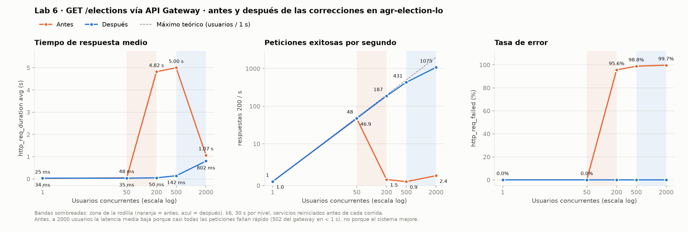

# Lab 6: Rendimiento (k6)

Funcionalidad probada: **listar elecciones** (`GET /elections`), con los cuatro componentes que pide el enunciado.

```
k6 (otro PC) ──► agr-gateway-or :8080 ──► agr-election-lo ──► agr-elections-db
                 agr-web-fr :3000 ──────┘
```

| Archivo | Dónde se usa | Qué es |
|---|---|---|
| `docker-compose.lab6.yml` | PC servidor | Levanta solo los cuatro componentes |
| `performance_test.js` | PC con k6 | Script base del profesor (`vus: 1`, `30s`) |
| `performance_test_stages.js` | PC con k6 | Script con `stages` del profesor (1 → 2000 usuarios) |
| `make_chart.py` | Cualquiera | Genera la gráfica comparativa antes / después |
| `performance_comparison.png` / `.svg` | Informe | Gráfica comparativa |

## Contenido

1. [Resultados](#1-resultados)
2. [Por qué fallaba al inicio](#2-por-qué-fallaba-al-inicio)
3. [Cambios aplicados en agr-election-lo](#3-cambios-aplicados-en-agr-election-lo)
4. [Cómo ejecutar las pruebas](#4-cómo-ejecutar-las-pruebas)
5. [Reiniciar y diagnosticar](#5-reiniciar-y-diagnosticar)
6. [Gráficas](#6-gráficas)
7. [Al terminar el laboratorio](#7-al-terminar-el-laboratorio)

---

## 1. Resultados



k6 desde un PC distinto al servidor, 30 s por nivel y `sleep(1)` por iteración. Antes de cada corrida se reiniciaron los cuatro contenedores.

| Usuarios | **Antes**: latencia media | p95 | error | respuestas 200/s | **Después**: latencia media | p95 | error | respuestas 200/s |
|---:|---:|---:|---:|---:|---:|---:|---:|---:|
| 1 | 25 ms | 43 ms | 0 % | 1.0 | 34 ms | 74 ms | 0 % | 1.0 |
| 50 | 48 ms | 117 ms | 0 % | 46.9 | 35 ms | 82 ms | 0 % | 47.5 |
| 200 | 4.82 s | 5.16 s | **95.6 %** | 1.5 | 50 ms | 127 ms | **0 %** | 187.5 |
| 500 | 5.00 s | 5.38 s | **98.8 %** | 0.9 | 142 ms | 260 ms | **0 %** | 430.7 |
| 2000 | 1.07 s | 5.04 s | **99.7 %** | 2.4 | 802 ms | 1.49 s | **0 %** | 1075.4 |

**Antes**, la rodilla está **entre 50 y 200 usuarios**. Pasado ese punto el sistema no se degrada poco a poco: **colapsa**. Atiende la primera ola de peticiones y después casi nada.

**Después**, no hay errores en ningún nivel. El sistema sigue el máximo teórico (1 petición por usuario por segundo) hasta 500 usuarios. La nueva rodilla está **entre 500 y 2000 usuarios**: a 2000 atiende 1075 peticiones por segundo, el 54 % del máximo teórico, y la latencia media sube a 802 ms. La capacidad sostenida pasó de unas **47** a más de **1000** peticiones exitosas por segundo, unas 23 veces más.

> Antes, a 2000 usuarios la latencia media *baja* a 1.07 s. No es una mejora: casi todas las peticiones fallan rápido, con un 502 del gateway en menos de 1 s.

---

## 2. Por qué fallaba al inicio

### Síntomas

- Con 200 usuarios o más, casi todas las peticiones tardaban **exactamente unos 5 s** y fallaban.
- Las pocas respuestas correctas llegaban **solo en los primeros segundos** de cada prueba. Después, el servicio no atendía nada.
- `agr-election-lo` quedaba `unhealthy`, y su log mostraba **629 errores** de este tipo:
  ```
  sqlalchemy.exc.TimeoutError: QueuePool limit of size 5 overflow 10 reached, connection timed out, timeout 30.00
  ```
- Los logs del gateway (`agr-gateway-or`), sumando todas las pruebas, registraron:

  | Respuesta | Cantidad | Significado |
  |---|---:|---|
  | 200 | 1,565 | Correcta |
  | 502 en unos 5 s | 9,477 | El gateway se cansó de esperar al Election Service |
  | 502 en menos de 1 s | 23,981 | El Election Service rechazó o cortó la conexión (prueba de 2000 usuarios) |
  | 500 / 504 | 0 | — |

### De dónde salen los 5 s

Del **API Gateway**, no de k6. `agr-gateway-or/src/config.ts` define `UPSTREAM_TIMEOUT_MS = 5000`. Si el servicio no responde en 5 s, el gateway corta la petición y devuelve `502 {"detail":"El Election Service no responde"}`.

### La causa raíz: un bloqueo mutuo (deadlock) en el Election Service

El Election Service original tenía tres límites que chocaban entre sí:

| Recurso | Límite original | Dónde |
|---|---|---|
| Procesos de uvicorn | **1** | `Dockerfile` (sin `--workers`) |
| Hilos para endpoints `def` (síncronos) | **40** por proceso | valor por defecto de FastAPI / anyio |
| Conexiones a PostgreSQL | **15** (pool 5 + overflow 10) | `create_engine(...)` sin parámetros |
| Espera por una conexión libre | **30 s** | valor por defecto de SQLAlchemy |

Cada petición a `GET /elections` pasa por estos pasos:

1. Toma un **hilo** del grupo de 40 y ejecuta el endpoint.
2. Toma una **conexión** del pool de 15 y hace la consulta.
3. El endpoint devuelve los objetos y el hilo se libera, **pero la conexión sigue tomada**: la sesión de la base de datos solo se cierra al final de la petición.
4. FastAPI convierte la respuesta a JSON, y para eso **necesita otra vez un hilo del mismo grupo de 40**. Lo verificamos en el contenedor: FastAPI 0.115 usa `run_in_threadpool` para serializar.
5. Solo después se cierra la sesión y **la conexión vuelve al pool**.

k6 arranca todos los usuarios a la vez. Con **200 usuarios** llegan 200 peticiones juntas:

```
 40 hilos  ──ocupados por──►  peticiones nuevas que esperan una CONEXIÓN libre (paso 2)
 15 conexiones ──tomadas por──►  peticiones que esperan un HILO para serializar (paso 4)
```

- Cada vez que se libera un hilo, se lo lleva una de las ~160 peticiones nuevas que están en cola **antes** que las serializaciones, y se queda bloqueada esperando una conexión.
- Las 15 peticiones que tienen conexión nunca consiguen un hilo para terminar.
- **Nadie avanza** hasta que se cumplen los 30 s de `pool_timeout`, que es cuando aparecen los 629 errores `QueuePool limit`.
- Mientras tanto, el gateway abandona cada petición a los 5 s y k6 envía otra de inmediato. El servicio acumula trabajo que ya nadie espera.

Con **50 usuarios** no pasa: la cola de peticiones nuevas es corta, así que algunas serializaciones alcanzan a tomar un hilo, liberan su conexión y el sistema sigue avanzando.

Por eso el patrón era "atiende la primera ola y se congela", y no una degradación gradual. La consulta SQL no era el problema: `list_elections` hace solo 2 consultas, con `selectinload`.

---

## 3. Cambios aplicados en `agr-election-lo`

Son 5 archivos y 47 líneas, sin cambios en la funcionalidad. Los 12 tests del servicio siguen pasando.

| # | Cambio | Archivo | Qué resuelve |
|---|---|---|---|
| 1 | Liberar la conexión **antes** de serializar la respuesta | `app/routers/elections.py` | **Elimina el deadlock** (la causa raíz) |
| 2 | Pool configurable: 10 + 10 conexiones y espera de **3 s** | `app/config.py`, `app/database.py` | Falla rápido en vez de procesar peticiones ya abandonadas |
| 3 | **4 procesos** de uvicorn | `Dockerfile` | Usa varios núcleos de CPU |
| 4 | Candado de PostgreSQL al arrancar | `app/main.py` | Arranque seguro con varios procesos |

### 3.1 Liberar la conexión antes de serializar (`app/routers/elections.py`)

```diff
 def list_elections(..., db: Session = Depends(get_db)):
-    return services.list_elections(db, status_filter)
+    result = [ElectionSummary.model_validate(e) for e in services.list_elections(db, status_filter)]
+    db.close()   # la conexión vuelve al pool antes de que FastAPI serialice
+    return result
```

Lo mismo en `GET /elections/{id}` con `ElectionOut`. El endpoint arma la respuesta mientras todavía tiene la sesión y luego cierra la sesión. Cuando FastAPI pide un hilo para serializar, la petición ya no tiene ninguna conexión tomada. Así no puede haber un ciclo en el que los hilos esperan conexiones y las conexiones esperan hilos.

### 3.2 Pool de conexiones configurable (`app/config.py`, `app/database.py`)

```diff
-engine = create_engine(settings.database_url, pool_pre_ping=True)
+engine = create_engine(settings.database_url, pool_pre_ping=True,
+                       pool_size=settings.db_pool_size,         # 10
+                       max_overflow=settings.db_max_overflow,   # 10
+                       pool_timeout=settings.db_pool_timeout)   # 3 s
```

| Variable de entorno | Antes | Ahora | Por qué |
|---|---|---|---|
| `DB_POOL_SIZE` | 5 | 10 | Más conexiones fijas por proceso |
| `DB_MAX_OVERFLOW` | 10 | 10 | Conexiones extra en picos |
| `DB_POOL_TIMEOUT` | 30 s | **3 s** | Menor que los 5 s del gateway: si no hay conexión, el servicio responde con error **antes** de que el gateway abandone la petición |

Las pruebas usan SQLite en memoria, que no acepta estos parámetros, así que solo se aplican con PostgreSQL.

### 3.3 Cuatro procesos (`Dockerfile`)

```diff
-CMD ["uvicorn", "app.main:app", "--host", "0.0.0.0", "--port", "8000"]
+ENV UVICORN_WORKERS=4
+CMD ["sh", "-c", "exec uvicorn app.main:app --host 0.0.0.0 --port 8000 --workers ${UVICORN_WORKERS}"]
```

Python ejecuta un solo hilo de código a la vez por proceso (GIL), así que un único proceso usa en la práctica un solo núcleo. Con 4 procesos, el servicio usa 4 núcleos. Total de conexiones: 4 procesos × (10 + 10) = **80**, por debajo del `max_connections = 100` de PostgreSQL.

### 3.4 Arranque seguro con varios procesos (`app/main.py`)

Cada proceso ejecuta al arrancar `init_db()` (crear las tablas) y `seed()` (datos de ejemplo). Con 4 procesos y una base vacía, podrían hacerlo los cuatro a la vez y duplicar los datos. Ahora el arranque toma un candado de PostgreSQL (`pg_advisory_lock`), así que lo hacen de uno en uno. Comprobado: después del cambio siguen siendo 3 elecciones.

### Cómo aplicar los cambios

```bash
lab6 up -d --build --wait agr-elections-db agr-election-lo agr-gateway-or agr-web-fr
docker logs agr-election-lo 2>&1 | grep "Started server process"   # deben salir 4 líneas
```

Para volver al comportamiento original del pool sin tocar el código, define en el servicio `DB_POOL_SIZE=5`, `DB_POOL_TIMEOUT=30` y `UVICORN_WORKERS=1`. El cambio 3.1 (el deadlock) no se puede desactivar así: es una corrección del código.

---

## 4. Cómo ejecutar las pruebas

Todos los comandos de `docker compose` se ejecutan desde la **raíz del repo** en el **PC servidor**. Para abreviarlos:

```bash
alias lab6='docker compose -f docker-compose.yml -f lab6-performance/docker-compose.lab6.yml'
```

### 4.1 PC servidor: levantar los cuatro componentes

```bash
# Los puertos 8080 y 3000 deben estar libres (detén cualquier otro proyecto que los use)
ss -ltn | grep -E ':(8080|3000) '

# Si está corriendo el sistema AGORA completo, bájalo primero (los volúmenes se conservan)
lab6 down

# Levanta solo los cuatro componentes y espera a que estén sanos
lab6 up -d --build --wait agr-elections-db agr-election-lo agr-gateway-or agr-web-fr

# Los cuatro deben decir "(healthy)"
docker ps --filter name=agr- --format '{{.Names}}\t{{.Status}}\t{{.Ports}}'
```

`docker-compose.lab6.yml` hace que el gateway espere solo a `agr-election-lo`. Sin ese archivo, el gateway espera a los seis servicios y se levanta todo el sistema.

### 4.2 PC servidor: dirección del gateway para k6

La IP depende de la red. **Revísala cada vez que cambies de red o te reconectes.**

```bash
hostname -I          # el primer valor es la IP de la red local, p. ej. 192.168.100.69
```

La URL para k6 es `http://<IP>:8080/elections`. Para probarla desde el servidor:

```bash
curl -s -w '\nHTTP %{http_code} en %{time_total}s\n' http://<IP>:8080/elections
```

Si el PC con k6 no logra conectarse, revisa el firewall:

```bash
sudo ufw status                 # si dice "active":
sudo ufw allow 8080/tcp
sudo ufw allow 3000/tcp
```

### 4.3 PC con k6: conectar y ejecutar

1. Conéctalo a la **misma red** que el servidor. En el Wi-Fi de la universidad, si los dos PCs no se ven, usa el hotspot de un celular.
2. Comprueba la conexión:
   ```bash
   curl http://<IP>:8080/elections        # debe devolver JSON
   ```
3. Pon la IP actual en **los dos** scripts:
   ```js
   const res = http.get('http://<IP>:8080/elections');
   ```
4. Ejecuta:
   ```bash
   k6 version                                  # k6 está instalado
   ulimit -n 65535                             # Linux/Mac, antes de 1000+ usuarios
   k6 run performance_test.js                  # cambia vus: 1, 50, 200, 500, 2000 y repite
   k6 run performance_test_stages.js           # barrido completo de 1 a 2000
   ```
5. En cada nivel anota `http_req_duration` **avg** y p95, `http_reqs` (peticiones/s), `checks_succeeded` y `http_req_failed`.

Mientras corren las pruebas, deja el PC servidor sin usar: nada de navegador ni compilaciones.

---

## 5. Reiniciar y diagnosticar

### Reiniciar los cuatro contenedores

Reinícialos **antes de cada prueba**, para que cada nivel arranque desde cero.

```bash
lab6 restart agr-elections-db agr-election-lo agr-gateway-or agr-web-fr

# Espera a que los cuatro vuelvan a estar sanos
lab6 up -d --wait agr-elections-db agr-election-lo agr-gateway-or agr-web-fr
docker ps --filter name=agr- --format '{{.Names}}\t{{.Status}}'

# Comprueba que la funcionalidad responde
curl -s -o /dev/null -w 'HTTP %{http_code} en %{time_total}s\n' http://localhost:8080/elections
```

Para reiniciar un solo servicio (normalmente el que quedó `unhealthy`):

```bash
lab6 restart agr-election-lo
```

### Observar durante una prueba

```bash
# CPU y memoria de los cuatro contenedores, en vivo
docker stats agr-gateway-or agr-election-lo agr-elections-db agr-web-fr

# Logs recientes
docker logs --tail 50 -f agr-election-lo
docker logs --tail 50 -f agr-gateway-or

# Códigos de respuesta del gateway en los últimos 2 minutos (justo después de una prueba)
docker logs --since 2m agr-gateway-or 2>&1 | grep -oE '"status":[0-9]+' | sort | uniq -c

# Errores de pool agotado en el Election Service
docker logs --since 2m agr-election-lo 2>&1 | grep -c "QueuePool limit"

# Guarda los logs como evidencia ANTES de un `down` (un restart los conserva, un down los borra)
docker logs agr-election-lo > lab6-performance/election-lo-<N>vu.log 2>&1
```

---

## 6. Gráficas

`make_chart.py` genera `performance_comparison.png` y `.svg` con tres paneles: tiempo de respuesta medio, peticiones exitosas por segundo (con el máximo teórico de usuarios / 1 s) y tasa de error. Cada panel muestra el antes y el después, con la zona de la rodilla de cada versión sombreada.

```bash
pip install matplotlib
python3 make_chart.py
```

Para cambiar los datos, edita las listas `ANTES` y `DESPUES` al inicio del archivo. Cada fila sale del resumen de k6: `(usuarios, http_reqs/s, latencia media en ms, p95 en ms, checks OK, checks totales)`. Las zonas de la rodilla están en `RODILLA_ANTES` y `RODILLA_DESPUES`. El script también imprime la tabla comparativa en la consola.

---

## 7. Al terminar el laboratorio

```bash
# Baja los cuatro componentes (los volúmenes se conservan)
lab6 down

# Vuelve a levantar el sistema AGORA completo
docker compose up -d --build --wait
```
