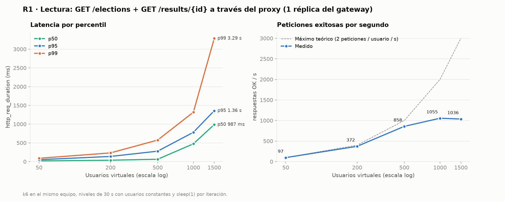
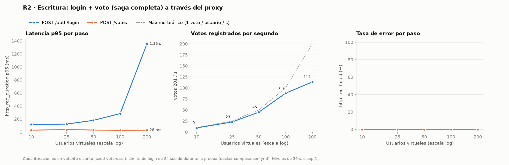
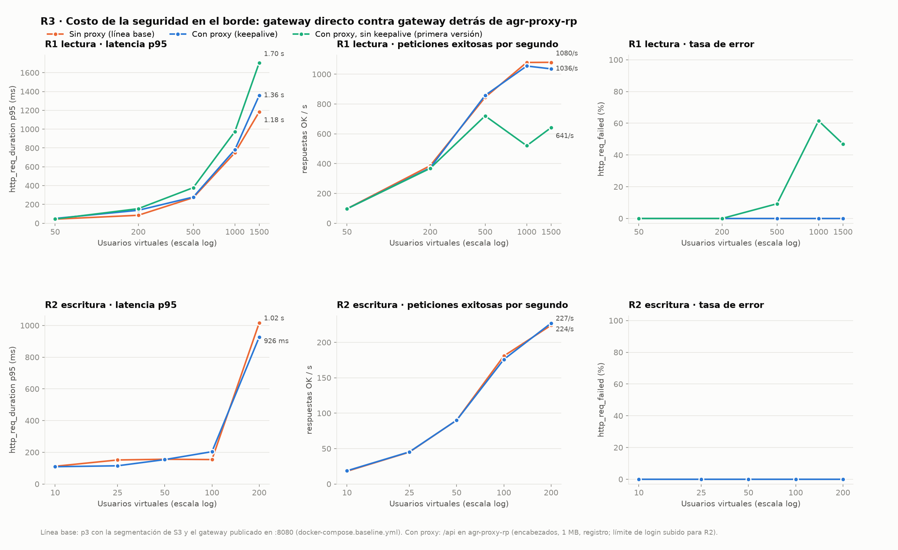
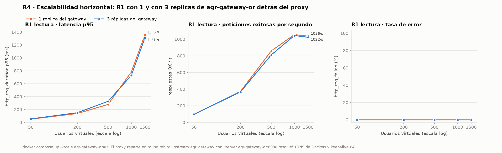
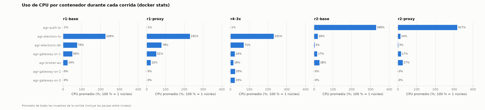

# Rendimiento y escalabilidad (R1 a R4)

Responsable: Maicol. Pruebas de carga con **k6** sobre AGORA en la rama `p3`. Parte del Lab 6
(rama `feat/agr-performance`, ahora en [`lab6/`](lab6/)), que solo medía `GET /elections` con una URL fija. Aquí se
mide todo el sistema: lectura, la saga del voto, el costo de la seguridad en el borde y el escalado del gateway.

| Prueba | Qué mide | Script | Resultado principal |
|---|---|---|---|
| R1 · Lectura | `GET /elections` + `GET /results/{id}` por niveles de 50 a 1500 usuarios | [`r1-read.js`](r1-read.js) | Hasta ~**1050 peticiones/s** sin errores. La rodilla está entre 500 y 1000 usuarios |
| R2 · Escritura | Login + voto (saga completa), de 10 a 200 usuarios | [`r2-write.js`](r2-write.js) | ~**110 votos/s** sin errores. Quiebre de latencia entre 100 y 200 usuarios por el BCrypt del login |
| R3 · Costo de la seguridad | R1 y R2 sin proxy (línea base) contra R1 y R2 con proxy | los mismos | Con keepalive el proxy cuesta **~2 %** de capacidad y unos ms de latencia. La primera versión **fallaba con 61 % de errores** |
| R4 · Escalabilidad | R1 con 1 y con 3 réplicas del gateway | `r1-read.js` | El reparto es parejo (33 393 / 33 392 / 33 392), pero la capacidad **no sube**: el cuello de botella es `agr-election-lo` |

## Contenido

1. [Cómo ejecutar](#1-cómo-ejecutar)
2. [Archivos](#2-archivos)
3. [Condiciones de la prueba](#3-condiciones-de-la-prueba)
4. [Resultados y análisis](#4-resultados-y-análisis)
5. [Cambios en el sistema que salieron de las pruebas](#5-cambios-en-el-sistema-que-salieron-de-las-pruebas)
6. [Limitaciones y trabajo pendiente](#6-limitaciones-y-trabajo-pendiente)

---

## 1. Cómo ejecutar

Solo se necesitan Docker y Python con `matplotlib` (para las gráficas). k6 corre en un contenedor
(`grafana/k6:0.54.0`), así que no se instala. Desde la **raíz del repo**:

```bash
p3/perf/run-all.sh                      # R1 a R4 de punta a punta, ~25 min; deja AGORA como estaba
```

O por partes:

```bash
# Línea base (R3): sin proxy, el gateway publica el 8080
docker compose -f docker-compose.yml -f p3/perf/docker-compose.baseline.yml up -d --build --wait --scale agr-proxy-rp=0
docker exec -i agr-auth-db psql -U postgres -d agr_auth_db -v n=40000 < p3/perf/seed-voters.sql
p3/perf/run.sh r1-base r1-read.js  http://localhost:8080
p3/perf/run.sh r2-base r2-write.js http://localhost:8080

# Con proxy (límite de login de S4 subido solo para la prueba)
docker compose -f docker-compose.yml -f p3/perf/docker-compose.perf.yml up -d --wait --scale agr-proxy-rp=1
p3/perf/run.sh r1-proxy r1-read.js  http://localhost/api
p3/perf/run.sh r2-proxy r2-write.js http://localhost/api

# R4: 3 réplicas del gateway
docker compose -f docker-compose.yml -f p3/perf/docker-compose.perf.yml up -d --wait --scale agr-gateway-or=3
p3/perf/run.sh r4-3x r1-read.js http://localhost/api

# Volver al despliegue normal y generar gráficas
docker compose up -d --wait --scale agr-gateway-or=1
python3 p3/perf/make_charts.py
```

> **Antes de repetir R2** hay que borrar la participación de los votantes de carga, porque cada uno vota una sola vez
> (`run-all.sh` lo hace solo):
> `docker exec agr-voters-db psql -U voters -d voters -c "DELETE FROM ballots_cast WHERE voter_id >= 6"`

Parámetros de los scripts (con `run.sh` se pasan como `NOMBRE=valor` al final):

| Variable | Por defecto | Uso |
|---|---|---|
| `BASE_URL` | `http://localhost/api` | Proxy: `http://localhost/api` (con S1, `https://localhost/api`). Línea base: `http://localhost:8080` |
| `LEVELS` | R1 `50,200,500,1000,1500`; R2 `10,25,50,100,200` | Usuarios virtuales de cada nivel |
| `LEVEL_DURATION` | `30s` | Duración de cada nivel |
| `SLEEP` | `1` | Pausa de cada usuario entre iteraciones, en segundos |
| `VOTERS`, `ITER_CAP` | `40000`, `200` | Votantes sembrados y tope de iteraciones por usuario en R2 |
| `PROXY_URL` (solo `run-all.sh`) | `http://localhost/api` | URL de las corridas con proxy; con S1, `https://localhost/api` |

Para correr k6 **desde otro PC**, como en el Lab 6, se usa la IP del servidor en `BASE_URL`. En el servidor solo
queda publicado el proxy (80/443).

## 2. Archivos

| Archivo | Qué es |
|---|---|
| `r1-read.js`, `r2-write.js` | Pruebas de k6. Cada nivel es un escenario `constant-vus` y van uno tras otro, así que el resumen trae las métricas de cada nivel y de cada endpoint por separado |
| `lib/common.js` | Niveles, umbrales que obligan a k6 a calcular las submétricas, y el resumen (`summary.json` / `summary.txt`) |
| `seed-voters.sql` | Inserta N votantes (`9000001`… con la clave `123456`) usando el hash BCrypt del votante `1001`. Es idempotente y agrega las columnas de S4 si a la base le faltan |
| `docker-compose.baseline.yml` | Línea base de R3: sin proxy, el gateway publica el 8080 |
| `docker-compose.perf.yml` | Sube el límite de login de S4 (`LOGIN_RATE=100000r/s`) para que R2 mida el sistema y no el límite |
| `run.sh` | Ejecuta una prueba: k6 en Docker más `docker stats` cada ~2 s en segundo plano |
| `run-all.sh` | R1 a R4 completos, en orden, y las gráficas |
| `make_charts.py` | Gráficas de `charts/` y tablas de `results/RESUMEN.md` |
| `results/<corrida>/` | `summary.txt`, `summary.json`, `k6.log`, `docker-stats.csv`, `docker-stats-summary.txt` (y para R4 `replicas.txt` y `reparto-replicas.txt`) |
| `results/*-sin-keepalive/` | Corridas con la primera versión del proxy, como evidencia del problema de la sección 5.1 |
| `estructura-capas.md` | Borrador de la sección 3.3 del documento (estructura por capas de P3) |
| `lab6/` | El Lab 6 original (antecedente): Election Service antes y después de las correcciones |

## 3. Condiciones de la prueba

- **Equipo:** un solo PC con 12 núcleos y 15 GB de RAM. k6 y los 16 contenedores corren en la misma máquina, así que
  compiten por la CPU. Las cifras sirven para **comparar** configuraciones, no como capacidad absoluta del sistema.
- **Carga:** usuarios virtuales constantes en cada nivel, 30 s por nivel, 5 s de pausa entre niveles y `sleep(1)` en
  cada iteración. Una iteración de R1 hace 2 peticiones y una de R2 hace un login y un voto.
- **Datos:** las elecciones de ejemplo (la 1 está abierta y tiene 3 candidatos) y 40 000 votantes de carga.
- **Línea base:** `p3` con la segmentación de S3, pero sin proxy (como estaba `p3` antes de S2).
- **Con proxy:** la configuración de S2 completa (encabezados de seguridad, 1 MB por petición, registro de cada
  petición, `/api/admin` bloqueado). Solo cambia el límite de login, que se sube para R2.
- **TLS (S1)** todavía no está en `p3`, así que R3 mide el proxy sin cifrado. Ver la [sección 6](#6-limitaciones-y-trabajo-pendiente).
- Las métricas salen del resumen de k6 (p50, p95 y p99 de `http_req_duration`, `http_reqs` y `http_req_failed`) y de
  `docker stats` (CPU y memoria por contenedor). Las tablas completas están en [`results/RESUMEN.md`](results/RESUMEN.md).

## 4. Resultados y análisis

### R1 · Lectura



| Usuarios | req/s | p50 | p95 | p99 | Error |
|---:|---:|---:|---:|---:|---:|
| 50 | 96.9 | 19 ms | 51 ms | 89 ms | 0 % |
| 200 | 371.8 | 37 ms | 138 ms | 232 ms | 0 % |
| 500 | 857.8 | 63 ms | 278 ms | 574 ms | 0 % |
| 1000 | 1054.9 | 474 ms | 781 ms | 1.32 s | 0 % |
| 1500 | 1035.9 | 987 ms | 1.36 s | 3.29 s | 0 % |

*(con proxy y 1 réplica del gateway)*

- Hasta 500 usuarios el sistema sigue casi al máximo teórico (2 peticiones por usuario por segundo) y el p95 se queda
  bajo 300 ms.
- **La rodilla está entre 500 y 1000 usuarios.** Desde ahí la capacidad se estanca en unas **1050 peticiones/s**. Lo
  que sobra de carga se convierte en cola, no en errores: el p50 pasa de 63 ms a casi 1 s, pero ninguna petición
  falla.
- **Cuello de botella: `agr-election-lo`.** Es el contenedor con más CPU (231 % de promedio y 548 % de pico, cerca
  de sus 4 workers de uvicorn), seguido de su base (79 %). Las dos rutas de R1 pasan por él: `/results/{id}` también
  le pide la elección para componer la respuesta. El gateway usa 51 %.
- Comparado con el Lab 6, donde el Election Service original **colapsaba con 200 usuarios** (95 % de errores), las
  correcciones que se trajeron a `p3` (sección 5.2) son las que permiten pasar de 1000 peticiones/s sin errores.

### R2 · Escritura (saga del voto)



| Usuarios | votos/s | Login p95 | Voto p95 | Error |
|---:|---:|---:|---:|---:|
| 10 | 9 | 117 ms | 28 ms | 0 % |
| 25 | 23 | 122 ms | 37 ms | 0 % |
| 50 | 45 | 179 ms | 30 ms | 0 % |
| 100 | 88 | 283 ms | 26 ms | 0 % |
| 200 | 114 | 1.35 s | 28 ms | 0 % |

*(con proxy; votos/s = votos registrados con 201 por segundo)*

- **El voto es barato y el login es caro.** La saga completa (`POST /votes`: auth, election, voter, vote y el evento
  al broker) se mantiene entre 26 y 37 ms de p95 en todos los niveles. El login pasa de 117 ms a 1.35 s.
- **El quiebre está entre 100 y 200 usuarios**, y lo marca `agr-auth-lo`: con 200 usuarios usa 317 % de promedio y
  927 % de pico, casi 9 de los 12 núcleos del equipo. Verificar una clave con BCrypt es costoso a propósito (frena la
  fuerza bruta), así que la capacidad de escritura la pone el login y no la saga. A 200 usuarios el sistema registra
  ~114 votos/s, frente a 200 posibles.
- No hubo votos perdidos ni duplicados: el 100 % de los votos respondió 201 y cada votante votó una sola vez.

### R3 · Costo de la seguridad en el borde



| | Línea base (sin proxy) | Con proxy | Diferencia |
|---|---:|---:|---:|
| R1 · capacidad máxima | 1079 req/s | 1055 req/s | **−2 %** |
| R1 · p95 con 200 usuarios | 85 ms | 138 ms | +53 ms |
| R1 · p95 con 500 usuarios | 272 ms | 278 ms | +6 ms |
| R1 · errores (todos los niveles) | 0 % | 0 % | — |
| R2 · peticiones/s con 200 usuarios | 224 | 227 | igual |
| R2 · p95 con 100 usuarios | 154 ms | 204 ms | +50 ms |
| R2 · errores | 0 % | 0 % | — |

- **El proxy cuesta poco**: un salto de red más, un proceso más que procesa cada petición y el registro de cada
  petición. Son unas decenas de ms en el p95 cuando hay poca carga, ~2 % de capacidad en saturación, y casi nada en
  R2, donde manda el BCrypt. La seguridad de borde de S2 (un solo punto de entrada, encabezados, límite de tamaño,
  `/api/admin` cerrado, límite de login) se obtiene sin pérdida de capacidad que importe.
- **La primera versión del proxy sí tenía un costo grande** (curva verde): con 500 usuarios daba 9 % de errores y con
  1000, 61 %, todos 502. La causa y la corrección están en la [sección 5.1](#51-keepalive-entre-el-proxy-y-el-gateway).
  Esta es la diferencia que más importa de R3: el patrón *reverse proxy* no es caro, pero configurado sin
  reutilizar conexiones se vuelve el cuello de botella de todo el sistema.

### R4 · Escalabilidad horizontal del gateway



| Usuarios | 1 réplica: req/s | p95 | 3 réplicas: req/s | p95 |
|---:|---:|---:|---:|---:|
| 200 | 371.8 | 138 ms | 365.7 | 150 ms |
| 500 | 857.8 | 278 ms | 810.5 | 327 ms |
| 1000 | 1054.9 | 781 ms | 1044.0 | 728 ms |
| 1500 | 1035.9 | 1.36 s | 1022.1 | 1.31 s |

- **El escalado horizontal funciona:** con `--scale agr-gateway-or=3` el proxy encuentra las tres réplicas por el DNS
  de Docker y reparte en round robin. Según la columna `up=` del registro del proxy, cada réplica atendió exactamente
  un tercio de las peticiones (33 393, 33 392 y 33 392). La CPU de cada réplica bajó de 51 % a ~24 %.
- **Pero la capacidad no sube** (1044 contra 1055 peticiones/s, dentro del ruido), porque **el gateway no era el
  cuello de botella**. `agr-election-lo` sigue igual de cargado (231 % de promedio y 504 % de pico). Replicar un
  componente solo aumenta la capacidad si es el que limita. R4 confirma que el gateway es *stateless* y se puede
  replicar sin cambios, y deja medido dónde está el próximo límite.
- Con la primera versión del proxy, las 3 réplicas **sí eliminaban los errores** (0 % frente a 61 %,
  `results/r4-3x-sin-keepalive/`). Cada réplica tiene su propia IP, así que el proxy tenía tres veces más puertos
  disponibles. Es otra prueba de que el problema de la primera versión eran las conexiones y no la CPU.
- **Siguiente paso para escalar las lecturas:** replicar `agr-election-lo` (hoy tiene `container_name` y 4 workers
  con hasta 80 conexiones a PostgreSQL, así que con 2 réplicas habría que bajar el pool o subir `max_connections`), o
  poner una caché de lectura en el gateway para `GET /elections`, que cambia muy poco.

### Uso de recursos



La memoria no limitó en ninguna corrida: el máximo fue `agr-election-lo` con ~430 MiB (4 procesos de Python) y
`agr-audit-db` con ~420 MiB. El proxy no pasó de 53 MiB.

## 5. Cambios en el sistema que salieron de las pruebas

### 5.1 Keepalive entre el proxy y el gateway

**Síntoma.** R1 con la primera versión del proxy: 9 % de errores con 500 usuarios y 61 % con 1000, todos 502
(`{"detail":"Un servicio de AGORA no responde..."}`). Sin proxy, la misma carga daba 0 % de errores. El registro del
proxy tenía **44 218** líneas iguales:

```
connect() to 172.25.0.2:8080 failed (99: Address not available) while connecting to upstream
```

**Causa.** `nginx.conf` usaba `proxy_pass http://$gateway_upstream`, con una variable, para que Nginx resolviera el
nombre en cada petición. Pero con una variable Nginx no puede usar un grupo `upstream` con `keepalive`, así que
**abría una conexión TCP nueva hacia el gateway en cada petición** y la cerraba. Cada conexión cerrada deja su puerto
local en `TIME_WAIT` unos 60 s. Con más de ~500 peticiones/s se agotaban los ~28 000 puertos del rango
(`32768–60999`) y las conexiones nuevas fallaban. En ese estado el proxy también gastaba mucha CPU (hasta 1114 %).

**Corrección** (`agr-proxy-rp/nginx.conf`). Grupos `upstream` con `keepalive`, y el parámetro `resolve` (Nginx ≥ 1.27.3;
la imagen trae 1.28.3) para que el nombre se siga resolviendo con el DNS de Docker, réplicas incluidas:

```nginx
upstream agr_gateway {
    zone agr_gateway 64k;
    server agr-gateway-or:8080 resolve;   # cada réplica (R4) es un destino; se reparte en round robin
    keepalive 64;                          # conexiones reutilizables por proceso de Nginx
}
...
location /api/ { rewrite ^/api/(.*)$ /$1 break; proxy_pass http://agr_gateway; }
```

El mismo arreglo se aplicó a la web (`agr_web`). **Resultado:** 0 % de errores en todos los niveles, la capacidad
pasó de 520–640 a ~1050 peticiones/s, y la CPU del proxy en R1 bajó de 171 % de promedio (1114 % de pico) a 8 % (17 % de pico). Las rutas, los
encabezados, el límite de 1 MB, el SSE sin buffer y el límite de login no cambian.

### 5.2 Correcciones del Election Service (Lab 6, traídas a `p3`)

La rama `feat/agr-performance` se unió a `p3` con *merge*. Trae las cuatro correcciones de `agr-election-lo` que salieron
del Lab 6 (detalle en [`lab6/README.md`](lab6/README.md)):

| Cambio | Archivo | Por qué |
|---|---|---|
| Liberar la conexión antes de serializar la respuesta | `app/routers/elections.py` | Eliminaba un bloqueo mutuo entre los hilos y el pool de conexiones que tumbaba el servicio con 200 usuarios |
| Pool configurable (10 + 10, espera de 3 s) | `app/config.py`, `app/database.py` | Fallar rápido, antes del timeout de 5 s del gateway |
| 4 procesos de uvicorn | `Dockerfile` | Usar varios núcleos (GIL) |
| Candado de PostgreSQL al arrancar | `app/main.py` | Arranque seguro con varios procesos |

### 5.3 Gateway sin `container_name` (R4)

`docker-compose.yml` ya no fija el nombre del contenedor del gateway, así que `--scale agr-gateway-or=N` funciona. Los
contenedores se llaman `arquisoft-agr-gateway-or-N`. Nada se refería a él por nombre de contenedor: la web, la CLI y
el proxy usan el nombre del servicio. Solo `p3/s3/verify-segmentation.sh` buscaba los contenedores por nombre; ahora
los busca por la etiqueta de servicio de Compose y sigue funcionando con una o varias réplicas.

## 6. Limitaciones y trabajo pendiente

- **TLS (S1).** Cuando entre a `p3`, hay que repetir `r1-proxy`, `r2-proxy` y `r4-3x` con
  `PROXY_URL=https://localhost/api p3/perf/run-all.sh` y agregar la comparación con y sin TLS a R3. Lo esperable es
  que el costo sea sobre todo el *handshake*: con keepalive se paga una vez por conexión y no por petición. Los scripts
  ya aceptan el certificado autofirmado (`insecureSkipTLSVerify`).
- **Un solo equipo.** k6 compite por la CPU con el sistema. En R2, `agr-auth-lo` llegó a usar 9 de los 12 núcleos, y
  con k6 en otro PC (como en el Lab 6) es probable que la rodilla de R2 se corra hacia arriba.
- **Votos y conteos acumulados.** Cada corrida de R2 agrega votos reales a la elección 1 (anónimos, con su evento en
  el broker y en la auditoría). Solo se reinicia `ballots_cast` para poder reusar a los votantes. Para presentar con
  datos limpios: `docker compose down -v` y volver a levantar.
- **R4 sobre el gateway.** Se pidió escalar el gateway, y se escaló; el próximo cuello de botella (`agr-election-lo`)
  queda medido pero no se escaló en esta entrega.
